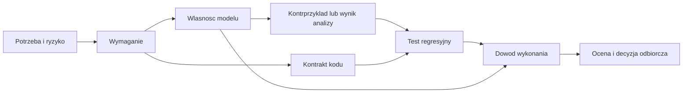

# Od wymagania do modelu, kodu i dowodu

Data: 2026-10-22. Status: **primer i propozycja ćwiczenia**, bez wdrożenia do bieżącego szablonu. Przykłady dotyczą fikcyjnego Release Ledger z [planów](planning-examples/README.md). Kod modeli jest materiałem do przyszłego uruchomienia: **nie wykonano Alloy ani TLC, nie ma raportów potwierdzających ich wyniki**.

## 1. Kontekst i zakres wnioskowania

[Zapis poprzedniej odpowiedzi](FORMAL-FEASIBILITY-CONVERSATION.md) rozdziela wykonalność planu, strukturę relacji, przebieg procesu i ograniczenia czasu. Tutaj rozwijamy dwa środkowe obszary oraz przejście do kodu. Nie projektujemy pełnego narzędzia zarządzania cyklem życia.

| Pytanie | Model | Co wynik rzeczywiście oznacza |
|---|---|---|
| Czy plan ma rozwiązanie przy zadanych czasach, zasobach i zależnościach? | Ograniczenia, np. MiniZinc / CP-SAT | Wykonalność przy tych założeniach; trafność estymacji wymaga pomiarów |
| Czy relacje wymagań, zadań i testów spełniają reguły? | Relacje i kwantyfikatory, np. Alloy | Brak wskazanego kontrprzykładu w zadanej przestrzeni lub znaleziony kontrprzykład |
| Czy dozwolona kolejność zdarzeń chroni aktualność dowodu? | Stany, przejścia, własności temporalne, np. TLA+ | Własność konkretnego badanego modelu; nie automatycznie kodu |
| Czy kod realizuje reguły i działa dla odbiorcy? | Testy, przeglądy, demonstracje; ewentualnie formalne refinement | Dowody dla implementacji i użycia, o osobno zadeklarowanym zakresie |

Norma opisująca cele procesu nie ustanawia automatycznie obowiązku użycia Alloy, TLA+ ani solvera harmonogramu. Wybór tych narzędzi jest naszą propozycją eksperymentu.

## 2. Jak projektować wymagania przed formalizacją

1. **Potrzeba i skutek błędu.** Opiekun chce uniknąć wydania na podstawie nieaktualnych dowodów. Skutek błędu: fałszywe przekonanie o sprawdzonym produkcie.
2. **Granica systemu.** CLI czyta manifest i dowody. Nie rozstrzyga, czy tekst wymagania wyraża właściwą potrzebę, i nie potwierdza tożsamości podpisującego.
3. **Pojęcia.** Wymaganie w zakresie wydania; zadanie realizacyjne; przypadek testowy; wykonanie testu; dowód; snapshot wejść; zgoda; wydanie. Przypadek testowy i jego wykonanie to różne obiekty.
4. **Założenia.** Znany format, kompletność odczytu, jawny zakres, stabilny snapshot. Założenie musi mieć właściciela i sposób sprawdzenia; nie jest odpowiedzią użytkownika.
5. **Obserwowalna reguła.** Opisać wyzwalacz, warunek, odpowiedź i istotny błąd. Wymaganie nie powinno nakazywać Alloy, jeśli potrzebą jest wykrycie luki w planie.
6. **Przykład i kontrprzykład.** Poprawne dane, brakująca relacja, pusty zakres, zmiana wersji, awaria odczytu i wyścig między kontrolą a publikacją.
7. **Przegląd z odbiorcą.** Czy blokada jest potrzebna w tym momencie? Zadanie bez wykonania może wystarczać w planie, ale nie przy wydaniu. Nie mylić etapów dojrzałości.

Przykładowe wymagania procesu, oprócz S1–S4 z [planu I1](planning-examples/increment-plan.md):

| ID lokalne | Wymaganie demonstracyjne | Obserwacja |
|---|---|---|
| DEMO/REQ/P1 | Przy próbie wydania system odmawia, jeśli brakuje pozytywnego dowodu dla dokładnie wskazanego zestawu wejść. | Kod odmowy i identyfikacja brakującego/nieaktualnego dowodu |
| DEMO/REQ/P2 | System odmawia wydania, jeśli zgoda nie dotyczy tego samego snapshotu. | Stara zgoda po zmianie nie wystarcza |
| DEMO/REQ/P3 | Manifest opublikowanego wydania wskazuje dokładnie snapshot poddany kontroli i zgodzie. | Wyścig nie może podmienić sprawdzonego wejścia |
| DEMO/REQ/P4 | Historia wydania zachowuje identyfikację użytych wtedy dowodów i zgody. | Nowa rewizja nie przepisuje historii |

Warunek „przy stabilnych wejściach i dostarczonej zgodzie proces może się zakończyć” wymaga osobnego zdefiniowania oczekiwań czasowych. Model nie może obiecywać, że użytkownik zawsze udzieli zgody.

## 3. Spójność struktury — Alloy

### 3.1 Co modelujemy

Obiekty: `Requirement`, `Task`, `TestCase`, `Release`. Relacje: zadanie realizuje wymagania, test wskazuje wymagania, wydanie wybiera zakres i planowane zadania/testy. Przykład bada **pokrycie planu**, nie zakończenie zadań ani wynik testów.

Reguła: dla każdego wymagania w niepustym zakresie wydania istnieją wybrane zadanie i przypadek sprawdzenia. Test gdzieś w repozytorium nie wystarcza, jeśli nie należy do wybranego zakresu.

```alloy
module ReleaseStructure

sig Requirement {}
sig Task { implements: set Requirement }
sig TestCase { verifies: set Requirement }
sig Release {
  scope: set Requirement,
  planned: set Task,
  selected: set TestCase
}

pred Ready[x: Release] {
  some x.scope
  all r: x.scope | some t: x.planned | r in t.implements
  all r: x.scope | some c: x.selected | r in c.verifies
}

assert ReadyHasTests {
  all x: Release | Ready[x] implies
    (all r: x.scope | some c: x.selected | r in c.verifies)
}

// Poprawny niepusty przyklad musi istniec.
run { some x: Release | Ready[x] }
  for 3 but exactly 1 Release, exactly 2 Requirement

// Przyklad z luka tez musi byc reprezentowalny.
run {
  some x: Release | some x.scope and no x.selected and not Ready[x]
} for 3 but exactly 1 Release

check ReadyHasTests for 3
```

W Alloy `run` szuka instancji spełniającej predykat, a `check` kontrprzykładu dla asercji. Analiza odbywa się w określonym zakresie; brak kontrprzykładu w tym przykładzie nie jest dowodem dla dowolnej liczby obiektów. Źródło semantyki: [specyfikacja Alloy](https://alloytools.org/spec.html).

### 3.2 Jak sprawdzać model i uniknąć pozornego dowodu

Powyższa asercja jest celowo prosta: sprawdza fragment bezpośrednio zapisany w `Ready`. To użyteczna demonstracja mechanizmu, ale słaby niezależny dowód. Nie wolno przedstawiać jej jako walidacji poprawności wymagań.

Przyszłe ćwiczenie RED/GREEN:

1. Zachować asercję oczekiwanego pokrycia, ale w wadliwej kopii `Ready` usunąć warunek testów.
2. Uruchomić `check`: oczekujemy kontrprzykładu z wymaganiem bez wybranego testu. To oczekiwanie, nie zapis wykonanego wyniku.
3. Przywrócić warunek i powtórzyć `check` w tym samym zakresie.
4. Osobno uruchomić pozytywny `run`. Gdy nic nie istnieje, trzeba zbadać sprzeczność modelu; „wszystkie gotowe wydania są poprawne” może być prawdą tylko dlatego, że żadne nie jest gotowe.
5. Dodać przypadki ręczne: test poza wydaniem, puste `scope`, dwa wymagania i pokryte tylko jedno, jedno zadanie dla kilku wymagań, kilka testów dla jednego wymagania.

Brak `some x.scope` pozwalałby pustemu zakresowi spełnić kwantyfikowane reguły. Test samej asercji `ReadyHasTests` tego nie wykryje — dlatego osobno sprawdzamy niepustość i scenariusze.

### 3.3 Jak podłączyć rzeczywiste dane

Model reguły i kontrola rzeczywistego repozytorium to różne zadania. Eksporter danych musi zachować wszystkie obiekty i relacje z określonego zakresu. Niedopuszczalne jest pominięcie trudnych rekordów, a następnie zgłoszenie sukcesu analizy uproszczonej reszty.

Proponowany przepływ: parser → typowany graf → kontrola referencji → deterministyczna reprezentacja dla modelu → analiza → mapowanie kontrprzykładu na ID użytkownika. Przy sprawdzaniu konkretnego grafu trzeba ustalić dokładne obiekty i relacje, nie pozwolić solverowi swobodnie wymyślić brakujących połączeń.

Niezależnie sprawdzić liczbę i ID obiektów na wejściu/wyjściu oraz znane wadliwe fixture. Dla samej reguły „brak testu” zwykła funkcja Python będzie prostsza. Alloy jest szczególnie użyteczny do odkrywania interakcji kilku reguł i kontrprzykładów; nie ma potrzeby wywoływać go przy każdej prostej kontroli grafu.

## 4. Poprawność procesu — TLA+ i TLC

### 4.1 Stan, zdarzenia i oczekiwania

Uproszczenie: `rev` reprezentuje wersję całego zestawu istotnych wejść. W implementacji potrzebny będzie stabilny identyfikator snapshotu lub skrót manifestu zawierającego wymagania, kod, testy, konfigurację, fixture i wersje narzędzi. Zmiana któregokolwiek istotnego wejścia zmienia tożsamość zestawu.

| Zdarzenie | Warunek | Skutek |
|---|---|---|
| Change | Możliwa kolejna rewizja | Nowa wersja; bieżący dowód, zgoda i uprawnienie wydania tracą aktualność |
| Verify | Sprawdzamy bieżący snapshot | Pozytywny dowód wskazuje jego rewizję |
| Approve | Dowód odpowiada bieżącej rewizji | Zgoda wskazuje tę rewizję |
| Release | Dowód i zgoda odpowiadają bieżącej rewizji | Bieżący kandydat może zostać wydany |

Ten model rozpatruje **bieżące dopuszczenie**, nie pełny rejestr historycznych wydań. Historyczny manifest powinien pozostać niezmienny, również po `Change`.

```tla
---------------------------- MODULE ReleaseGate ----------------------------
EXTENDS Naturals
CONSTANT MaxRev
ASSUME MaxRev \in Nat /\ MaxRev >= 1

VARIABLES rev, verified, approved, released
vars == <<rev, verified, approved, released>>

Init == /\ rev = 1
        /\ verified = 0
        /\ approved = 0
        /\ released = FALSE

Change == /\ rev < MaxRev
          /\ rev' = rev + 1
          /\ verified' = 0
          /\ approved' = 0
          /\ released' = FALSE

Verify == /\ verified # rev
          /\ verified' = rev
          /\ UNCHANGED <<rev, approved, released>>

Approve == /\ verified = rev
           /\ approved # rev
           /\ approved' = rev
           /\ UNCHANGED <<rev, verified, released>>

Release == /\ verified = rev
           /\ approved = rev
           /\ ~released
           /\ released' = TRUE
           /\ UNCHANGED <<rev, verified, approved>>

Next == Change \/ Verify \/ Approve \/ Release
Spec == Init /\ [][Next]_vars

TypeOK == /\ rev \in 1..MaxRev
          /\ verified \in 0..MaxRev
          /\ approved \in 0..MaxRev
          /\ released \in BOOLEAN

Safe == released => (verified = rev /\ approved = rev)

NoRelease == ~released

(* Tylko osobny scenariusz: brak zmian, sprawdzenie i zgoda nastapia. *)
StableSpec == Init /\ [][Verify \/ Approve \/ Release]_vars
              /\ WF_vars(Verify)
              /\ WF_vars(Approve)
              /\ WF_vars(Release)
EventuallyReleased == <>released
=============================================================================
```

Przykładowa konfiguracja `ReleaseGate.cfg` do badania safety:

```text
CONSTANT MaxRev = 2
SPECIFICATION Spec
INVARIANT TypeOK
INVARIANT Safe
CHECK_DEADLOCK FALSE
```

Polecenie po zapisaniu i sprawdzeniu narzędzia: `java -jar /path/to/tla2tools.jar -config ReleaseGate.cfg ReleaseGate.tla`. Ścieżka jest przykładowa; narzędzie nie zostało dołączone ani uruchomione. Sposób użycia TLC: [dokumentacja](https://docs.tlapl.us/using%3Atlc%3Astart).

`CHECK_DEADLOCK FALSE` jest tu świadome: zakończony przebieg może pozostać bezczynny, a model dopuszcza stuttering. Nie wolno na podstawie tego uruchomienia deklarować sprawdzenia braku zakleszczeń.

### 4.2 Safety, osiągalność i liveness

**Safety:** nic zabronionego nie zachodzi — bieżące wydanie wymaga aktualnego dowodu i zgody. TLC ma zbadać osiągalne stany skonfigurowanego skończonego modelu. Model nie obejmuje wszystkich rozmiarów systemu ani kodu Python.

**Osiągalność:** dobry przebieg jest możliwy. W oddzielnej konfiguracji dodaj `INVARIANT NoRelease`. Oczekiwane naruszenie tej celowo fałszywej własności powinno wskazać `Init → Verify → Approve → Release`. Jest to pozytywny świadek osiągalności, a nie błąd produktu. Nie mieszać tego uruchomienia z bramką wymagającą braku naruszeń.

**Liveness:** coś pożądanego ostatecznie następuje. Dla osobnego eksperymentu użyj `SPECIFICATION StableSpec` i `PROPERTY EventuallyReleased`. Założenia: wejścia się nie zmieniają, a stale możliwe Verify, Approve i Release ostatecznie się wykonają (`WF`, weak fairness). To założenie środowiska, szczególnie dotyczące ludzkiej zgody. Nie przenosić go jako bezwarunkowej gwarancji procesu rzeczywistego. W `Spec` bez fairness nie twierdzimy, że wydanie zawsze nastąpi.

### 4.3 Kontrolowany błąd i kontrprzykład

W wadliwej kopii modelu pozostaw w `Change` stare `verified` i `approved` zamiast zerować, a w `Release` zastąp równości `= rev` warunkami `> 0`. Asercja `Safe` pozostaje bez zmian. Oczekiwany przebieg:

```text
rev=1 → Verify(1) → Approve(1) → Change(2)
      → Release z dowodem=1 i zgodą=1 → naruszenie Safe
```

To zaplanowana mutacja dwóch zabezpieczeń, nie twierdzenie o wykonanym teście. W tym projekcie modelu samo usunięcie jednej ochrony może zostać zamaskowane przez drugą. Takie mutacje trzeba jawnie opisywać; nie deklarować, że każdy pojedynczy mutant musi zostać wykryty.

Model agreguje sprawdzenie i publikację w atomowym `Release`. To nie dowodzi, że wielokrokowa implementacja jest atomowa. Dalszy model powinien rozdzielić `Prepare` i `Commit`, dopuścić `Change` pomiędzy nimi i sprawdzić ponownie politykę albo użycie niezmiennego snapshotu. Ten sam wyścig musi mieć test integracyjny w kodzie.

## 5. Jak implementować wymagania zgodnie z clean code

Proponowane odpowiedzialności, bez narzucania frameworka:

| Element | Odpowiedzialność | Czego nie powinien robić |
|---|---|---|
| `ManifestReader` | Odczyt i walidacja formatu, pełne zgłoszenie błędów | Oceniać biznesowej zgody |
| `ProjectGraph` | Wymagania, relacje, jawny zakres | Czytać Git i filesystem podczas pytania o regułę |
| `check_structure(graph, scope)` | Czysta kontrola reguł S1–S4 | Uruchamiać solvera lub zapisywać raport |
| `release_policy(snapshot, evidence, approval)` | Decyzja i przyczyny odmowy dla P1–P2 | Uznawać samo `pass=True` za aktualny dowód |
| `ReleaseService` | Zamrozić wejścia, skoordynować kontrolę i publikację | Dublować reguły polityki |
| `ReleaseRepository` | Zapisać niezmienny manifest albo zgłosić awarię | Podmieniać snapshot po kontroli |
| Adaptery CLI/raportowania | Zamienić wynik na komunikat i kod wyjścia | Dopisywać ukryte wyjątki polityki |

Nazwy klas są propozycją. Mały program może używać funkcji i prostych rekordów. Interfejsy wprowadzać na rzeczywistych granicach zależności, nie tworzyć klasy dla każdego zdania wymagania.

Przepływ implementacji P1–P3:

1. Zapisać test zachowania: po `verify(A)` i `approve(A)` próba wydania B jest odrzucona.
2. Zobaczyć RED z właściwej przyczyny, potem dodać porównanie identyfikatorów wejść i powtórzyć test.
3. Dodać poprawny przypadek A/A/A oraz brak dowodu, fail, brak zgody i błąd odczytu.
4. Dodać test z kontrolowaną zmianą między przygotowaniem a publikacją; wybrać świadomie niezmienny snapshot albo synchronizację z ponowną kontrolą.
5. Dodać awarię zapisu: brak częściowo opublikowanego manifestu, poprzednie wydanie zachowane.
6. Refaktoryzować przy zielonych testach; nie zmieniać wymagania, aby ukryć defekt.

Warstwa zapisu wymaga własnych testów kontraktu. Model bezpieczeństwa może zakładać trwały atomowy zapis, ale system plików i awaria procesu muszą zostać sprawdzone empirycznie dla wybranej implementacji.

## 6. Odwzorowanie modelu na implementację

| Pojęcie modelu | Reprezentacja w kodzie | Dowód odwzorowania |
|---|---|---|
| `Release.scope` | Jawny zbiór ID manifestu | Test parsera i kompletności eksportu |
| `Ready` | `check_structure` nie znajduje blokujących luk | Fixture poprawne/wadliwe; różnicowe porównanie wyników na małych grafach |
| `rev` | Identyfikator niezmiennego zestawu wejść | Każde istotne wejście zmienia tożsamość; test kanonizacji |
| `verified = rev` | Dowód pass wskazuje identyczny zestaw i zakres | Test starych wyników i niepełnego zestawu |
| `approved = rev` | Zgoda wskazuje ten sam snapshot | Zgoda na A nie akceptuje B |
| Atomowe `Release` | Transakcja lub publikacja zamrożonego snapshotu | Wyścig, awaria zapisu, kontrola manifestu |

To **argument odwzorowania wsparty testami**, nie formalnie udowodniona relacja refinement. Pełny dowód wymagałby określonej semantyki implementacji, mapowania stanów i wykazania zachowania własności. TLA+ nie generuje tu automatycznie poprawnego kodu Python.

Model można wykorzystać jako wyrocznię testów sekwencji: generator wybiera polecenia, wykonuje je na modelu i implementacji, porównuje obserwowalne wyniki. Trzeba sprawdzać również sam generator i adaptery oraz zachować ręczne przypadki z niezależnym oczekiwaniem. Ten sam błąd skopiowany do modelu i kodu może dać zgodność wyników.

## 7. Dwukierunkowy ślad i aktualność

Proponowany graf, bez aktywowania nowego schematu ID:



Strzałki pokazują zależności. Relacje zapisujemy raz w artefakcie zależnym; zapytania odwrotne generujemy. Kluczowe pytania: które wymaganie uzasadnia tę własność; które własności i testy zmienić po zmianie wymagania; jaki kod rzeczywiście realizuje regułę; czy wynik dotyczy aktualnych wejść?

Przykładowa mapa: S2 → `ReadyHasTests` → `check_structure` → test „test poza zakresem”; P1/P2 → `Safe` → `release_policy` → test starej rewizji; P3 → przyszły model Prepare/Commit → `ReleaseService` → test wyścigu. P4 nie jest dowiedzione przez uproszczony model bez historii; wymaga osobnego modelu lub testu rejestru. Mapa ma ujawniać tę lukę, a nie udawać pełne pokrycie.

Raport analizy powinien zawierać: wersję i skrót modelu, konfigurację, narzędzie/backend, zakres obiektów lub stałe, sprawdzane własności, założenia, status ukończenia, wyniki i kontrprzykłady, czas oraz mapowanie na wymagania. Raport testów kodu ma odrębne wejścia. Zmiana zależności oznacza potrzebę ponownej oceny aktualności.

## 8. Kryteria dla przyszłej automatyzacji

Rozróżniać co najmniej: analiza ukończona bez naruszenia w zakresie; znaleziony kontrprzykład; brak instancji; timeout; błąd narzędzia; błąd danych; wynik nieaktualny. Dla `run`, `check` i celowo fałszywego `NoRelease` inne są oczekiwania sukcesu. Nie interpretować każdego kodu wyjścia 0 jako dowodu spełnienia wymagania.

Brama CI musi znać obowiązkowy zestaw własności i konfiguracji. Pusta lista albo nieodczytany plik nie przechodzi. Limity czasu i rozmiaru zapisujemy jawnie; kosztowne modele mogą mieć osobną częstotliwość. W obecnym boilerplate nie ma tych poleceń ani bramki.

TDD narzędzia integrującego: najpierw testy odczytu wyników pozytywnych i negatywnych, błędu składni, timeoutu, brakującego logu i starego dowodu. Dopiero potem adapter i podłączenie CI. Nie mylić testów parsera raportu z poprawnością solvera.

## 9. Kolejność nauki i koszt

1. Zwykłe testy grafu i tablica decyzyjna: najtańszy punkt odniesienia.
2. Mały Alloy: reguły strukturalne i kontrolowany kontrprzykład.
3. Mały TLA+: aktualność dowodu, poprawny przebieg i stara zgoda.
4. Testy implementacji z kontrprzykładów, potem wyścigi i awarie.
5. Dopiero po pomiarze decyzja o utrzymaniu modeli i automatyzacji.

Dla samego harmonogramu osobny mały eksperyment z MiniZinc; nie jest zależnością Alloy ani TLA+. Plan pilota, koszt i kryteria: [practice-pilot-plan.md](planning-examples/practice-pilot-plan.md). Nie deklarujemy zgodności z DO-178C ani kwalifikacji narzędzi; to ćwiczenie wybranych technik.

## 10. Źródła i stan wykonania

- [Alloy — język i zakres analizy](https://alloytools.org/spec.html).
- [TLC — uruchamianie i rodzaj analizy](https://docs.tlapl.us/using%3Atlc%3Astart).
- [Leslie Lamport — PlusCal Tutorial](https://lamport.azurewebsites.net/tla/tutorial/home.html): alternatywa zapisu algorytmów analizowanych narzędziami TLA+.
- [MiniZinc Handbook](https://docs.minizinc.dev/en/stable/).
- [OR-Tools — harmonogramowanie](https://developers.google.com/optimization/scheduling/job_shop).

Materiały powyżej potwierdzają możliwości narzędzi. Modele, wymagania, plany, progi i proponowana organizacja kodu w tym primerze są autorskimi przykładami dla tej rozmowy. Nie są fragmentami normy ani gotowym wdrożeniem. Przejrzano dokumentację; modele nie zostały uruchomione, przykład nie ma implementacji. Kontrola redakcyjna plików nie zastępuje wykonania opisanych eksperymentów.
