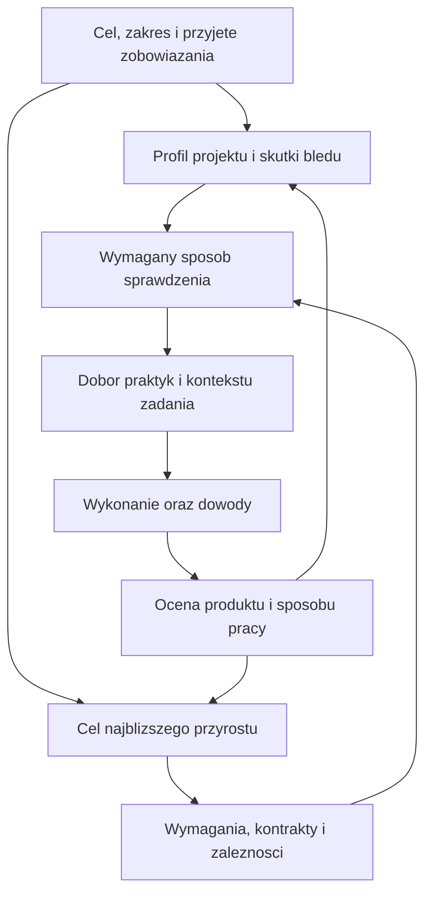

# Konspekt operacyjny: kontekst, kolejność prac i dobór praktyk

Data: 2026-10-23. Status: **propozycja do wdrożenia, nieaktywny plan procesu**.

Cel zlecenia: wyjaśnić, co wyznacza kontekst i kolejność dla czego, oraz opisać wdrożenie punktów decyzyjnych operatora. Zapis tego dokumentu nie aktywuje praktyk, nie zatwierdza budżetu, nie zmienia kontraktu ani planu wydania szablonu.

Kontekst: [PROPOSAL](PROPOSAL-CONTEXT-AND-PRACTICE-PACKAGES.md), [przykłady planów](planning-examples/README.md), [modele formalne](FORMAL-MODELS-REQUIREMENTS-AND-PROCESS.md). Bieżące zasady: [AGENTS](../AGENTS.md), [kontrakt](../template/process/kontrakt-decyzji.md), [decyzje](../project/decisions.md), [plan](../project/plan.md).

## 1. Co wyznacza co

Nie istnieje jedna kolejność pełniąca wszystkie funkcje. Trzeba rozdzielić obowiązywanie zasad, zależności prac, dobór informacji i ocenę dowodów.

| Rodzaj porządku | Co go wyznacza | Do czego służy | Czego nie oznacza |
|---|---|---|---|
| Obowiązywanie zasad | Uprawnienia środowiska, instrukcje użytkownika, obowiązujący kontrakt i decyzje w ich zakresie, przyjęte zobowiązania | Ustalenie, co wolno i co trzeba wykonać | Nowy przykład lub pakiet nie zmienia samodzielnie uzgodnień |
| Cel i priorytet produktu | Potrzeby odbiorcy, uzgodniony zakres, wartość, ryzyko, terminy | Wybór następnego wyniku do dostarczenia | Kolejność rozdziałów normy nie jest kolejką funkcji produktu |
| Zależności wykonania | Potrzebne wejścia, kontrakty, dostępność zasobów i warunki rozpoczęcia | Ustalenie, co musi istnieć przed danym zadaniem | Cała specyfikacja nie musi być ukończona przed pierwszym przyrostem |
| Dobór kontekstu dla agenta | Cel zadania, dotknięte komponenty, relacje, ryzyka i aktywne praktyki | Wskazanie, co przeczytać i sprawdzić | K0–K6 nie jest sześcioma etapami projektu ani rankingiem prawdy |
| Moment przeglądu procesu | Nowy przyrost, zmiana profilu, incydent, wydanie i zakończenie pilota | Wykrycie potrzeby decyzji o praktyce | Każdy przegląd nie wymaga nowej zgody ani nowego narzędzia |
| Siła i aktualność dowodu | Rodzaj sprawdzenia, granica, wersje wejść, wynik, założenia | Ustalenie, co rzeczywiście wiemy o gotowości | Zielone CI nie dowodzi kompletności projektu i akceptacji odbiorcy |

Wymaganie jest źródłem oczekiwanego zachowania, kod i wyniki pokazują zachowanie zaobserwowane. Sprzeczność wymaga analizy; nie rozstrzyga jej sam fakt, że jeden plik jest nowszy. Nowa wersja planu nie kasuje historycznego odchylenia ani wyniku testu.

## 2. Łańcuch od celu do działania

Przykład: potrzeba zachowania danych → ryzyko ich utraty → przyrost migracji → wymaganie zachowania oryginału → kontrakt przełączenia danych → test przerwania i próba odtworzenia → decyzja o dopuszczeniu migracji. Jeśli pojawiają się trudne przeploty operacji, rozważamy model procesu; sama obecność TLA+ w katalogu praktyk nie nadaje mu priorytetu.

Są dwa cykle: rozwój produktu i rozwój sposobu pracy. Łączą się w przeglądzie przyrostu, lecz mają oddzielne wyniki. Nowa funkcja może być gotowa bez nowej praktyki; udany eksperyment z praktyką nie oznacza gotowości funkcji.

## 3. Dobór kontekstu — konkretna procedura

### 3.1 Warstwy i ich zależności

| Warstwa z PROPOSAL | Informacja | Kiedy poszerzamy kontekst |
|---|---|---|
| K0 — zasady | Granice działania i sposób uzgadniania decyzji | Zawsze według obowiązującej instrukcji startowej; ponownie po zmianie kontraktu |
| K1 — projekt | Cel, zakres, profil, plan, decyzje i rzeczywisty postęp | Początek pracy oraz zmiana zobowiązań lub profilu |
| K2 — przyrost | Wymagany wynik, kryteria, zależności, otwarte decyzje | Każde nowe zadanie lub zmiana jego zakresu |
| K3 — obszar | Pojęcia, kontrakty, architektura, dane, sąsiedni konsumenci | Zgodnie z wpływem zmiany, także poza bezpośrednio edytowanym plikiem |
| K4 — praktyka/rola | Aktywne reguły, instrukcja testów, przegląd i wymagany dowód | Gdy praktyka obejmuje dane zadanie |
| K5 — wykonanie | Kod, testy, konfiguracja, dane próbne, wyniki i wersje | Do diagnozy, implementacji i oceny dowodów |
| K6 — odniesienia | Norma, przykłady, starsze decyzje i raporty | Gdy trzeba uzasadnić lub wyjaśnić regułę; przykłady nie są poleceniami |

K3–K5 czytamy zależnie od problemu, często wracając między nimi. Nie wymagamy sztywnego jednorazowego przejścia przez wszystkie warstwy. Skrót kontekstu nie zastępuje właściwych źródeł.

### 3.2 Przed zadaniem

1. Odczytać obowiązujące instrukcje startowe, stan Git i bieżące zlecenie. Zachować cudze zmiany.
2. Wskazać wynik zadania, jego granice i kryterium zakończenia. Sprawdzić decyzje już podjęte, aby nie pytać ponownie.
3. Ustalić zależne wymagania, interfejsy, dane i odbiorców zmiany. Graf jest pomocą, nie dowodem kompletności tej analizy.
4. Porównać profil projektu z planowaną zmianą: czy dochodzi nowe ryzyko, skala, integracja, rodzaj danych lub zobowiązanie?
5. Dobrać aktywne praktyki oraz odpowiednie instrukcje i dowody. Wykazać brakujące wejścia oraz rozstrzygnięcia.
6. Gdy wszystko mieści się w zatwierdzonym zakresie, wykonać zadanie. Gdy wymaga nowej decyzji, przygotować kartę z §6, pozostawiając niezależną pracę możliwą do wykonania.

Proponowany skrót w zadaniu: cel; zakres; źródła i ich wersje; aktywne praktyki; ryzyka; brakujące decyzje; kryteria zakończenia; dowody wyjściowe. Utrzymujemy odnośniki, nie drugie kopie wymagań.

### 3.3 Kolejność zadań i niewiadome

Najpierw spełnić wymagane warunki wejścia i ochrony danych. Wśród możliwych zadań priorytet wynika z celu przyrostu, ryzyka i uzgodnionego terminu. Jeśli zależność jest nieznana, mały eksperyment może poprzedzać estymację lub zobowiązanie implementacyjne. Nie narzucamy pełnego workflow do pojedynczej odwracalnej korekty tekstu.

Blokada dotyczy zależnego zakresu: brak zgody na migrację blokuje migrację, ale nie musi blokować testów na syntetycznej kopii. Natomiast nieznane wymaganie nie może być samodzielnie zastąpione domysłem w kodzie produkcyjnym.

## 4. Pięć punktów przeglądu i decyzji operatora

| Punkt | Wyzwalacz | Agent dostarcza | Operator rozstrzyga | Zapis wyniku |
|---|---|---|---|---|
| Start | Nowy projekt lub nowe istotne zobowiązanie | Cel, wykonalność, zasoby, profil ryzyka, bazowy sposób pracy | Czy i na jakich warunkach rozpoczynamy | Umowa/plan i decyzja we właściwym rejestrze |
| Przed przyrostem | Kolejny wynik produktu | Kryteria, zależności, różnicę profilu, proponowane zabezpieczenia | Zakres oraz zmiany zobowiązań lub praktyk | Plan przyrostu; decyzja tylko gdy potrzebna |
| Zmiana/problem | Nowa integracja, dane, incydent, istotne odchylenie | Dowód, skutki, warianty i koszt | Zmiana rozwiązania, zakresu, terminu albo kontroli | Korekta/zmiana i decyzja, jeśli wymagana |
| Wydanie/migracja | Użycie poza dotychczasową granicą | Aktualne dowody, luki, odtworzenie, ryzyko pozostałe | Dopuszczenie wskazanej wersji w określonym zakresie | Zgoda/akceptacja związana z wersją |
| Ocena praktyki | Koniec przyrostu/pilota lub ustalony termin przeglądu | Skuteczność, koszt, fałszywe alarmy, ograniczenia | Utrzymać, uprościć, rozszerzyć lub odłożyć eksperyment | Decyzja i następny warunek przeglądu |

Przegląd bez istotnej zmiany kończy się krótką informacją „bez potrzeby nowej decyzji” z uzasadnieniem. Decyzji nie tworzymy tylko po to, aby wypełnić tabelę. W pilocie określimy częstotliwość przypomnień; przekroczony termin nie jest zgodą.

## 5. Kiedy włączać praktykę

### 5.1 Trzy różne podstawy

| Podstawa | Postępowanie |
|---|---|
| Przyjęte zobowiązanie | Zapewnić wymagany cel kontroli przed objętym nim działaniem. Wyłączenie narzędzia nie usuwa obowiązku. |
| Ryzyko projektu | Dobrać adekwatną ochronę przed ekspozycją na ryzyko; uzgodnić pozostałe ryzyko z upoważnioną rolą. |
| Eksperyment edukacyjny | Ograniczyć zakres i koszt, zaplanować ocenę; brak automatycznej aktywacji w całym projekcie. |

Nie czekamy na incydent, żeby dodać testy pierwszej integracji lub kopię przed migracją. Dodatkowym wyborem bywa stopień rygoru i technika, a nie samo wykonanie potrzebnej kontroli.

### 5.2 Katalog sygnałów do przeglądu

| Sygnał | Rozważana praktyka | Najmniejszy rezultat |
|---|---|---|
| Niejasne zachowanie, różne interpretacje | Pogłębienie analizy wymagań | Przykłady, słownik i mierzalne kryteria |
| Nowa granica komponentów lub dostawca | Kontrola kontraktów i integracji | Test współpracy oraz istotnych awarii |
| Wartościowe dane lub nowy format | Migracja i odtworzenie | Kopia, próba, kontrola kompletności i przerwania |
| Nieznany wpływ zmiany | Dokładniejszy ślad i inwentarz | Wykaz zależności oraz nieobjętego zakresu |
| Błędy mimo zielonych testów | Przegląd asercji, pokrycie, mutacje | Znaleziona luka i test, który wykrywa naruszenie |
| Złożone zależności reguł | Model struktury, np. Alloy | Poprawna instancja i kontrprzykład kontrolny |
| Wznowienie, współbieżność, stare zgody/dowody | Model procesu, np. TLA+ | Własność, sekwencja naruszenia i test implementacji |
| Termin i ograniczone zasoby | Analiza wykonalności | Zależności, kalendarz, estymacje; solver, gdy uzasadniony |
| Nowy odbiorca lub przekazanie utrzymania | Dokumentacja i próba przejęcia | Odtworzenie i wykonanie procedury przez odbiorcę |

Sygnał uruchamia ocenę. Nie jest automatycznym poleceniem instalacji narzędzia ani dowodem, że jego użycie się opłaci. Ustalone progi powinny mieć źródło i zakres; sam rozmiar repozytorium lub liczba wymagań nie są uniwersalnym kryterium.

### 5.3 Logika decyzji do przyszłej automatyzacji

| Sytuacja | Oczekiwane zachowanie |
|---|---|
| Praktyka aktywna, wersja i zakres aktualne | Zastosować; nie pytać ponownie o tę samą aktywację |
| Sygnał nie dotyczy zmiany, brak nowego obowiązku | Kontynuować bazowy proces |
| Sygnał dotyczy zmiany, dodatkowa praktyka nie jest aktywna | Przygotować rekomendację i kartę decyzji |
| Nieznana stosowalność lub sprzeczne reguły | Zgłosić niepewność; nie zamieniać unknown w false |
| Wymagane zabezpieczenie nie działa lub brak aktualnego dowodu | Wstrzymać zależną operację; wskazać naprawę lub dopuszczalną alternatywę |
| Brak odpowiedzi na decyzję | Pozostawić otwartą; przypominać zgodnie z kontraktem, bez domniemanej zgody |
| Przekroczony limit pilota | Zakończyć próbę z wynikiem częściowym i przedstawić ocenę; nie rozszerzać kosztu samodzielnie |

## 6. Karta decyzji i odpowiedzialność

Minimalna karta: problem i dowód; skutek zaniechania; źródło potrzeby; rekomendacja; alternatywy; zakres; koszt wdrożenia i utrzymania z niepewnością; kryterium skuteczności; właściciel; termin lub zdarzenie ponownej oceny. Format odpowiedzi A/B/C pozostaje zgodny z kontraktem, a nie nowym protokołem.

Przykład demonstracyjny: „Zmiana konfiguracji nie unieważnia pass. Proponuję kontrolę identyfikatora wejść tylko dla wydania. Alternatywa: udokumentowana ręczna kontrola manifestu przed wydaniem. Kryterium: zmiana każdego wejścia z uzgodnionej listy powoduje odmowę użycia starego dowodu. Koszt: do oszacowania po rozpoznaniu punktów publikacji. Ocena: po jednym wydaniu i zmianie konfiguracji”. To przykład, nie otwarta decyzja użytkownika.

Agent analizuje problem, przygotowuje warianty, wykonuje uzgodnioną pracę i przedstawia dowody. Operator decyduje o celu, zobowiązaniach, istotnych zmianach kosztu i ryzyku w granicach swoich uprawnień. Weryfikator ocenia adekwatność dowodów według przyjętego rozdziału ról. Nazwanie sesji „weryfikatorem” nie ustanawia samo w sobie niezależności.

Proponowane stany zastosowania praktyki pochodzą z PROPOSAL: `available`, `proposed`, `pilot`, `active`, `deferred`, `not_applicable`, `retired`. Są odrębne od wyniku testu i statusu wymagania. `pilot` wymaga zgody na próbę; `active` wymaga decyzji o stosowaniu. Ponowna ocena może zmienić zakres lub metodę, lecz nie przepisuje historii.

## 7. Gdzie utrzymywać informacje

Poniższa mapa jest projektem rozszerzenia. Nie dodajemy teraz pól do parserów ani plików pakietu.

| Informacja | Proponowane źródło prawdy | Inne miejsca |
|---|---|---|
| Cel, zobowiązania, profil projektu | Umowa i sekcja planu w `project/` | Karta zadania wskazuje źródło |
| Aktywne praktyki, zakres, właściciel, przegląd | Początkowo sekcja planu | Widok operatora generowany dopiero później |
| Definicja praktyki, sygnały, instrukcja i ograniczenia | Pakiet `process/practices/`; w repo szablonu `template/process/practices/` | Projekt zapisuje wersję i zastosowanie |
| Decyzja i nierozstrzygnięte pytanie | `project/decisions.md` | Raport wskazuje ID, bez kopiowania odpowiedzi |
| Wymagania produktu | `spec/` konkretnego projektu | Nie przenosić domeny klienta do pakietu procesu |
| Wykonanie, usterka, ocena i akceptacja | Właściwe rekordy w `records/` | Plan odsyła do rzeczywistych wyników |
| Dowód maszynowy | Uzgodnione `evidence/` i identyfikacja wejść | `reports/` prezentuje stan, nie staje się drugim rejestrem |
| Przykłady i uzasadnienie metod | `reference/` | Agent ładuje je według zadania |

Rejestr zastosowania powinien wskazywać co najmniej: praktykę i jej wersję, podstawę, zakres, status, decyzję, właściciela, dowód i warunek następnego przeglądu. Zmiana projektu unieważnia tylko zależny wynik, gdy zależność jest ustalona; przy niepewności raportujemy zakres wymagający przeglądu. Bezrefleksyjne uznanie wszystkich starych dowodów za aktualne i unieważnienie wszystkiego po każdej zmianie są niepożądanymi skrajnościami.

## 8. Konspekt wdrożenia przyrostami

Nie przypisujemy fikcyjnych dat, kosztów ani zatwierdzeń. Po zleceniu wdrożenia trzeba oszacować najbliższy przyrost; dalsze uszczegóławiać na podstawie jego wyników.

| Przyrost | Wynik | Zależność | Jak wykazać ukończenie |
|---|---|---|---|
| O0 — ustalenie punktu startu | Mapa obecnych reguł, decyzji i braków; wybrany zakres pilota | Aktualne AGENTS, rejestr i plan | Rozróżnione działające mechanizmy, propozycje i potrzebne decyzje; bez cofania istniejących ustaleń |
| O1 — ręczny przegląd kontekstu | Mała checklista przed zadaniem, profil i karta decyzji | O0 i uzgodniony zakres zmiany procesu | Autor przeprowadza przypadek bez zmiany profilu oraz przypadek wymagający decyzji; operator rozumie wynik |
| O2 — jedna praktyka w pilocie | Wpis zastosowania z zakresem, wersją, kosztem i przeglądem | O1 i zgoda na wybrany pilot | Praktyka użyta przy realnym przyroście; znany przypadek naruszenia wykrywany; koszt zapisany |
| O3 — mała kontrola mechaniczna | Walidacja rejestru i kompletności kart, diagnostyka unknown/stale | Ustabilizowany format z O2 | Testy RED/GREEN przypadków z §9; kontrola niczego sama nie aktywuje |
| O4 — integracja z poleceniami i dystrybucją | Raport operatora, uzgodnione bramki, wzorce, instrukcja i migracja | O3 oraz decyzja o obowiązujących kontrolach | Nowy projekt i aktualizacja istniejącego zachowują lokalne decyzje, ID i zakres; dotychczasowe testy przechodzą |
| O5 — ocena i rozszerzenie | Decyzja o dalszym stosowaniu na podstawie danych | Wykonany pilot i pomiary | Wykazana korzyść/ograniczenia i koszt; pozostałe praktyki nadal opcjonalne zgodnie z podstawą |

Dlaczego tak: ręczny pilot pozwala ustalić potrzebną informację przed budową parsera. Automatyzacja powstaje dla powtarzalnego obowiązku. Alloy i TLA+ są możliwymi praktykami pilota, ale nie są konieczne do wdrożenia tego mechanizmu. Nie budujemy najpierw silnika wtyczek ani systemu automatycznych rekomendacji.

W repozytorium szablonu aktualny plan obejmuje przeniesienie, weryfikację, migracje i pilot gtd2. Tematy PROPOSAL są odłożone w Q-12, a D-74/D-75 pozostają otwarte. Ten konspekt nie zmienia tej kolejności. O0 powinno ustalić, czy proponowany przyrost wspiera obecny etap, czy wymaga osobnej zmiany planu. Nie ma potrzeby kończyć całej mapy szablonu przed czytaniem koncepcji, ale zmiany dotykające migrowanych mechanizmów muszą uwzględnić ich rzeczywisty stan.

## 9. Testowanie wdrożenia i TDD

Poniższe przypadki są planem akceptacji, nie uruchomionymi testami. W O1–O2 sprawdzamy ręcznie przepływ i przydatność. W O3–O4 automatyzujemy reguły, których kontrakt już uzgodniono.

| Przypadek | Oczekiwany wynik |
|---|---|
| Zmiana mieści się w przyjętym zakresie | Brak nowej prośby o tę samą zgodę; właściwe kontrole nadal wykonane |
| Nowa migracja wartościowych danych | Sygnał ochrony i odtworzenia przed operacją |
| Reguła odnosi się do innego komponentu | Brak nieuzasadnionej blokady całego projektu |
| Profil nieznany lub niekompletny | Widoczna niepewność i wskazanie brakującej informacji |
| Brak odpowiedzi operatora | Brak przejścia do aktywacji; pytanie zachowane z tym samym ID |
| Praktyka active bez decyzji albo wskazanej podstawy | Błąd rejestru według uzgodnionego schematu |
| Pakiet aktywny w innej wersji lub zmienione zależne wejścia | Wynik wymaga ponownej oceny, bez fałszywego pass |
| Próba wyłączenia obowiązkowego celu kontroli | Brak cichego zwolnienia; wskazanie zobowiązania i potrzeby rozwiązania |
| Sprzeczne reguły albo cykl zależności praktyk | Jawny błąd, bez arbitralnego wyboru i zapętlenia |
| Timeout, nieodczytany plik lub pusta lista kontroli | Brak raportu sukcesu udającego pełne sprawdzenie |
| Powtórzony sygnał z rozstrzygniętą decyzją | Odwołanie do decyzji; nowe pytanie tylko po zmianie jej warunków |
| Aktualizacja pakietu procesu | Zachowane lokalne ustalenia, pytania i wersje dowodów |

TDD: test oczekiwanego zachowania → rzeczywisty RED → najmniejsza implementacja → GREEN → refaktoryzacja. Test od razu zielony to sprawdzenie istniejącego zachowania. Mutacje służą badaniu czułości, nie fabrykowaniu historycznego RED.

Kontrole nie zastępują walidacji: operator na przygotowanych przykładach ma umieć powiedzieć, co jest blokowane, dlaczego, jakie ma opcje i co dzieje się bez odpowiedzi. Mechaniczna poprawność pól nie dowodzi trafności rekomendacji.

## 10. Koszt i warunki oceny

Przed pilotem zapisać koszt obecnego sposobu obsługi podobnej zmiany. Mierzyć osobno: aktywny czas operatora, czas agenta i narzędzi, czas oczekiwania, czas utrzymania rejestru oraz dodatkowy czas CI.

Ocena korzyści: potwierdzone istotne luki wykryte wcześniej, pominięte potrzebne decyzje, zbędne pytania, fałszywe blokady, czas odtworzenia kontekstu i koszt aktualizacji praktyki po zmianie wymagania. Przypadki celowo wadliwe liczyć oddzielnie od rzeczywistych usterek.

Progi i wielkość próby uzgadnia operator przed pilotem. Brak naturalnej usterki w małej próbie nie dowodzi braku wartości. Wynik może być nierozstrzygający. Praktykę można uprościć, jeśli zachowuje potrzebny cel; nie obniżać kryteriów po fakcie tylko dla pozytywnego wyniku.

## 11. Podstawa i granice adaptacji

| Źródło | Uzasadnia | Nie narzuca |
|---|---|---|
| [Rozdział 5, §5.1–5.3](../../iso-29110-5-1/chapters/05-overview.md) | Różne cykle rozwoju, warunki wejścia, współpracę PM i SI | Naszych nazw K0–K6 i przyrostów O0–O5 |
| [PM.O1–PM.O7, PM.02 i PM.03](../../iso-29110-5-1/chapters/06-project-management-pm-process.md) | Planowanie, ocenę postępu, zmian i ryzyka oraz uzgodnienia | Konkretnych kart A/B/C i automatycznego doboru narzędzi |
| [WP.10 i organizacja produktów pracy](../../iso-29110-5-1/chapters/09-description-of-work-products.md) | Treść planu i możliwość organizacji informacji odpowiedniej do projektu | Osobnego pliku dla każdego punktu przeglądu |
| [Załącznik E, informacyjny](../../iso-29110-5-1/chapters/annex-e-deployment-packages.md) | Stopniowe wdrażanie pakietów z instrukcją, przykładami i oceną | Dowolnego pomijania obowiązków przy deklarowaniu pełnego spełnienia profilu |

Przyjęte zobowiązania wyznaczają minimum. Profil ryzyka określa potrzebne wzmocnienia. Pilot pozwala dobrać ekonomiczny sposób realizacji i ćwiczyć dodatkowe techniki. Ten konspekt nie jest deklaracją zgodności z normą.

## 12. Przekazanie przyszłemu agentowi i stan wykonania

Po zleceniu wdrożenia zacznij od O0. Nie kopiuj przykładowych danych jako odpowiedzi użytkownika, nie aktywuj wszystkich praktyk i nie zmieniaj samodzielnie kontraktu. Zachowaj ID decyzji i rozstrzygnięcia, pokaż potrzebny zakres zmiany oraz najmniejszy sprawdzalny przyrost. Przy zmianach pakietu wykonaj wymagane testy dystrybucji i migracji zgodnie z aktualnym AGENTS.

Stan na 2026-10-23: zapisano konspekt. O0–O5 nie zostały wykonane; przypadki z §9 nie są zautomatyzowane ani uruchomione. Jedyną obecną zmianą zadania jest dokument referencyjny. Rejestr tej propozycji:

| Data | Zmiana | Stan |
|---|---|---|
| 2026-10-23 | Rozdzielenie porządków kontekstu, pięć przeglądów, sygnały praktyk, karty decyzji, wdrożenie i plan testów | Propozycja zapisana; aktywny proces bez zmian |
