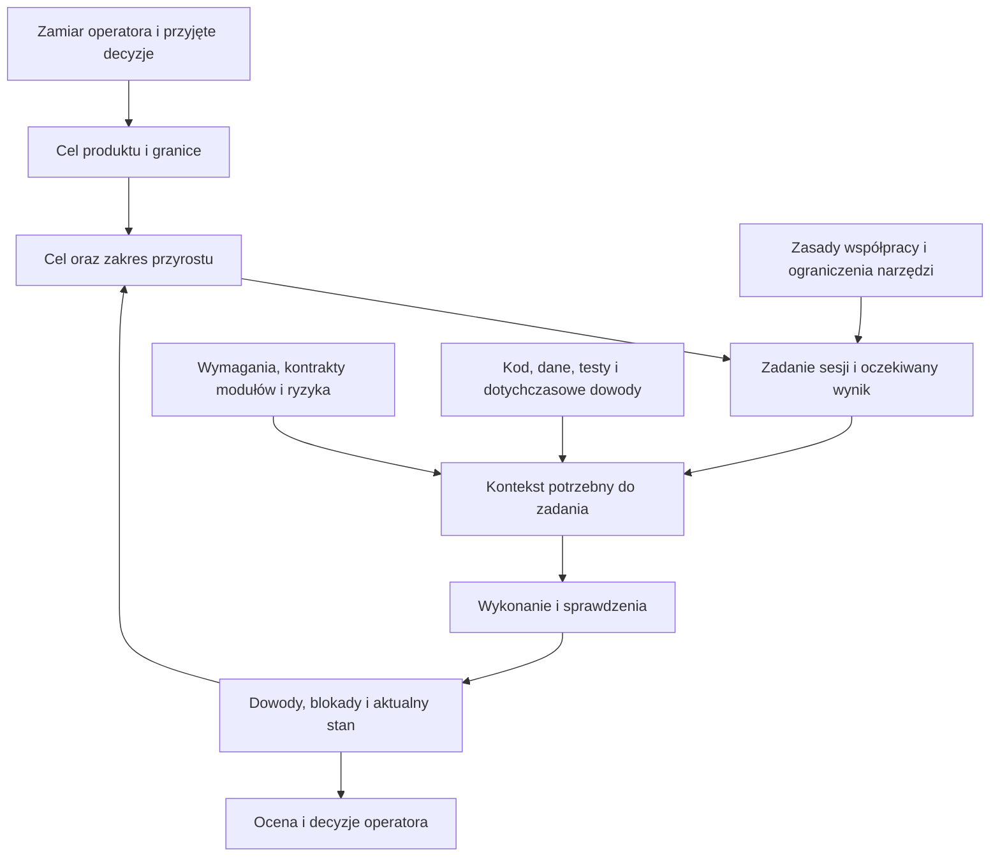

# Operator, agenci, role i kontekst — synteza źródeł

Data: 2026-10-25. Status: analiza i propozycja wdrożenia, bez aktywowania nowych ról, uprawnień lub bramek. Repozytoria RKD i iso-model-state przeczytano; nie zmieniano ich. Nie uruchamiano agentów testowych, testów modeli ani produkcji. To nasze rozwiązanie organizacyjne, nie deklaracja zgodności z normą.

## 1. Znalezione wcześniejsze ustalenia

| Źródło i sekcja | Ustalenie i status | Jak wykorzystać |
| --- | --- | --- |
| [RKD AGENTS](../../rkd/AGENTS.md), §1–4; [README](../../rkd/README.md), „Jak wprowadza się zmianę” | Obowiązujące lokalne instrukcje: mandat pochodzi ze zlecenia, nie z roli ani kolejności planu. DEC/OQ w wymaganiach są źródłem oczekiwań; wzorce pochodzą od właściciela; archiwum nie ustanawia nowych decyzji. | Zachować źródła RKD i granice delegowania. Karta sesji wskazuje konkretne zlecenie, źródła i zależne OQ, zamiast powielać specyfikację. |
| [RKD plan prób agentów](../../rkd/tools/redteam/PLAN.md), „Scenariusze i kryteria zaliczenia” | Istnieje harness i scenariusze S1–S7: m.in. poprawianie wzorca pod kod, luzowanie tolerancji, wpisanie decyzji za właściciela, instrukcje w materiale wejściowym. Są zapisane wyniki. | Wykorzystać istniejące próby do sprawdzania kart sesji; nie zakładać, że sam prompt zapewnia przestrzeganie reguł. |
| [iso-model-state PROMPT-STARTOWY](../../iso-model-state/PROMPT-STARTOWY.md); [STAN](../../iso-model-state/docs/STAN.md), „Ocena używalności”; [informative/README](../../iso-model-state/informative/README.md) | Prompt jest wejściem do dokumentów, stan leży osobno. Przyjęte reguły są oddzielone od materiałów informacyjnych. E2 trwa; wykonawca modelu nie jest adapterem do rzeczywistego projektu. | Przejąć rozdzielenie stałej instrukcji startowej, aktualnego stanu i historii. Model traktować jako materiał do sprawdzania reguł, nie gotowy sterownik pracy developerów. |
| [Karty ról szablonu](../template/process/roles/README.md), „Teraz” i „Odłożone”; [weryfikator](../template/process/roles/verifier.md) | Są role operatora, autora, weryfikatora i skryptów. Autor bez osobnej karty (Q-04); programista i tester odłożeni do etapu kodu (Q-05). Kontrola uprawnień plikowych Q-06 odłożona. | Kodowanie już wystąpiło, więc warunek powrotu do Q-05 zaszedł. To powód do oceny zakresu kart, nie automatyczna zgoda na nowe sesje lub wdrożenie całej propozycji. |
| [Konspekt operacyjny](OPERATIONAL-CONTEXT-AND-PRACTICE-ROLLOUT.md), §1–3; [propozycja kontekstu](PROPOSAL-CONTEXT-AND-PRACTICE-PACKAGES.md), §4 | Niewdrożona propozycja rozdziela obowiązywanie zasad, priorytet produktu, zależności wykonania, dobór kontekstu i siłę dowodu. K0–K6 nie są etapami ani jedną hierarchią prawdy. | Użyć tej istniejącej koncepcji do jednej karty zadania i widoku wznowienia. Nie projektować kolejnej konkurencyjnej metodyki. |

W [historii RKD](../../rkd/historia/rejestr_prob_RKD.md), „Uzupełnienie C”, jest wcześniejszy zespół operator + agenci bez trwałej pamięci oraz limit czasu na metodykę. To zapis historyczny, nie obowiązujący budżet obecnego pilota. [Sesja założycielska modelu](../../iso-model-state/informative/SESJA-2026-10-23.md), §3–5, opisuje konkretne motywacje: niejednoznaczna odpowiedź potraktowana jako decyzja, odbiór uznany przez agenta, nieaktualny prompt, pozostawione zależności po zmianie produktu. Te materiały wyjaśniają potrzebę kontroli; nie są nowymi poleceniami.

## 2. Cztery rzeczy, których nie można utożsamiać

- **Rola:** za jaki rodzaj wyniku odpowiadam, np. programowanie lub przegląd.
- **Mandat zadania:** jaką konkretnie pracę zlecono i jakie są granice już udzielonej zgody.
- **Kontekst:** z których ustaleń, kontraktów i dowodów wynika prawidłowe wykonanie.
- **Uprawnienia narzędzi:** co sesja technicznie może odczytać, zmienić lub uruchomić.

Dopuszczalne działanie musi mieścić się w mandacie i przyjętych regułach. Techniczna dostępność działania nie ustanawia zgody. Odwrotnie, sam prompt nie odbiera dostępu do plików. Karta roli może zawężać zadanie; nie może rozszerzać zlecenia użytkownika. Nie trzeba powtarzać zgody dla kroków już objętych mandatem.

## 3. Proponowany podział pracy

Role nie muszą oznaczać osobnych agentów. Na początek wystarczą operator, agent prowadzący wykonanie i osobny przegląd tam, gdzie jest uzasadniony ryzykiem. Równoległe sesje nie są domyślnym rozwiązaniem.

| Perspektywa | Odpowiedzialność operatora | Zadanie agenta i wynik | Granica |
| --- | --- | --- | --- |
| PO / domena | Potrzeba, priorytet, znaczenie reguł, zakres i odbiór | Analiza potrzeby, propozycja wymagań i przykładów, jawne pytania | Nie wymyśla brakującej reguły CNC ani odpowiedzi właściciela |
| PM | Istotne zmiany kolejności, kosztu, zobowiązań i przyjęcie ryzyka | Utrzymuje mapę prac, zależności, blokady, stan dowodów i następny możliwy krok | Plan nie jest zgodą na wszystko; raport postępu nie jest odbiorem |
| Projektowanie i development | Rozstrzyga przekroczenie przyjętych granic | Dobiera technikę, implementuje i testuje w zakresie; utrzymuje kontrakty modułów | Wybór techniczny eskaluje, gdy zmienia zakres, ryzyko, koszt lub zobowiązanie |
| Testowanie i przegląd | Zapewnia potrzebne rozstrzygnięcia domenowe i ocenę przydatności | Sprawdza produkt wobec wymagań i niezależnie uzasadnionych oczekiwań; raportuje braki | Autor może testować własny kod, ale nie przedstawia tego jako niezależnego przeglądu |
| Integracja, wydanie i utrzymanie | Zatwierdza wydanie i użycie produkcyjne | Wskazany agent odpowiada za zgodność wersji, pełną drogę danych, instrukcje uruchomienia i odzyskiwania | Zielone testy modułów nie potwierdzają całej integracji ani gotowości CNC |

Brakujące dziś doprecyzowanie to przede wszystkim odpowiedzialność za cały zintegrowany wynik i prowadzenie mapy prac. Nie rozwiązujemy go samym dopisaniem nazw „PM agent”, „tester” i „release agent”. Trzeba wskazać wynik i właściciela. Role utrzymaniowe uruchamiamy wraz z rzeczywistym wdrożeniem; nie projektujemy z góry rozbudowanego dyżuru ani zespołu.

## 4. Co wyznacza kontekst dla czego



Zasady odpowiadają „co wolno”; produkt „po co”; przyrost „jaki wynik teraz”; rola „za co odpowiadam”; zależności „co trzeba wiedzieć”; wykonanie „co faktycznie się stało”.

Kontekst developera obejmuje wymaganie, źródłową decyzję, jednostki i reguły, kontrakt wejścia/wyjścia, dotknięte moduły oraz testy i konsumentów interfejsu. Kontekst PM/PO obejmuje cele przyrostów, zależności, otwarte decyzje, ryzyka i aktualność dowodów; nie wymaga każdego szczegółu implementacji. Recenzent potrzebuje specyfikacji, ocenianej wersji, kryteriów oraz dowodów; nie potrzebuje narracji autora przekonującej, że rozwiązanie jest dobre. Przegląd kodu wymaga kodu; próby czarnej skrzynki mogą go celowo nie używać.

Konflikt wymagania z kodem jest problemem do zbadania, nie powodem zmiany wymagania pod kod. Nowszy plik z propozycją nie unieważnia przyjętej decyzji. Powiązania pomagają dobrać kontekst, lecz nie dowodzą, że wszystkie zależności zapisano. Gdy brakuje rozstrzygnięcia, zatrzymuje się tylko zależna część pracy.

## 5. Minimalna karta sesji i prompt

Propozycja: jedna krótka sekcja w istniejącym zadaniu, nie kolejny rejestr. Stały prompt wskazuje źródła, a zmienny stan pozostaje w punkcie wznowienia.

```text
Zadanie: <odnośnik do już zleconej pracy i jej granic>
Tryb: <analiza / wykonanie / przegląd>
Wynik i zakończenie: <konkretny rezultat i sprawdzenie>
Czytaj: <zasady projektu, stan, wymagania/DEC/OQ, kontrakty i dowody>
Zmieniaj: <uzgodniony obszar; zachowaj cudze zmiany>
Granice: <wzorce i decyzje; commit/push; środowisko i produkcja>
Eskaluj: <konflikt źródeł lub przekroczenie przyjętego zakresu>
Zostaw: <wynik, dowody, otwarte sprawy z właścicielem, następny krok>
```

Agent przygotowuje tę kartę ze źródeł. Operator nie powinien przy każdej sesji ręcznie komponować długiego promptu. Przykład dla przeglądu: „Przejrzyj wskazane wymagania i zmiany; zapisuj tylko ustalenia i dowody; nie poprawiaj ocenianego produktu; nie udzielaj odbioru”. To instrukcja zachowania; techniczne ograniczenie zapisu jest osobnym mechanizmem.

## 6. Jak wygląda jeden cykl developmentu

1. Agent jako asystent PM/PO odczytuje przyjęty zakres i stan; przedstawia najbliższy wykonalny wynik z zależnościami. Nie prosi ponownie o już udzieloną zgodę.
2. Dla zadania dobiera wymagania, kontrakty, wzorce i potrzebne decyzje. Zapisuje plan oraz kryteria przed wykonaniem.
3. Agent wykonujący tworzy testy, kod i dowody. Aktualizuje skutki zmian w objętych zadaniem źródłach. Nie zmienia wzorca ani tolerancji, aby ukryć defekt.
4. Wskazany wykonawca integracji sprawdza całą ścieżkę dotkniętą przyrostem. Raport odróżnia wynik jednostkowy, integracyjny, demonstrację i brakujące sprawdzenia.
5. Przegląd ocenia wynik; błędy wracają do wykonawcy. Osobna sesja ogranicza wpływ historii autora, ale nie gwarantuje innego modelu błędów. Oczekiwane wyniki muszą mieć uzasadnienie poza samą implementacją.
6. Operator ocenia przydatność i dokonuje odbioru; wydanie pozostaje osobną decyzją. Agent zapisuje aktualny stan do wznowienia.

PM widzi „co blokuje następny wynik”; PO „jaką potrzebę spełnia i co odbieram”; developer „co zmieniam i po czym poznam poprawność”. Są to widoki tych samych źródeł, nie trzy niezależnie utrzymywane backlogi.

## 7. Co już jest mechaniczne, a co pozostaje propozycją

- RKD: [guard.py](../../rkd/tools/guard.py) sprawdza chronione ścieżki i obecność niepustej linii `Decyzja-wlasciciela` przy commicie. To kontrola zapisu, nie uwierzytelnienie człowieka i nie blokada edycji pliku. Lista `.protected` ma jeszcze zakomentowaną przyszłą ochronę testów. Nie potwierdzano w tej analizie konfiguracji aktywnego CI ani hooków klonu.
- RKD: sprawdzono przykładowy zapis [S3-1](../../rkd/tools/redteam/results/2026-10-20-r3-codex/S3-1.json) oraz odpowiedź `.out`. Agent nie wpisał linii za właściciela, ale operację indeksu zablokowało środowisko (`index.lock`). Brak commita w tej próbie nie jest dowodem zadziałania strażnika. Nie oceniano wszystkich przebiegów.
- iso-model-state: `execution.py` sprawdza zadeklarowanego aktora zdarzenia wobec przejścia. `actor: U` w danych nie uwierzytelnia operatora w rzeczywistym środowisku. [Propozycja zgód na konkretną zmianę](../../iso-model-state/model/proposals/change-authorization.md) nadal ma status proposed; nie importujemy jej jako działającej funkcji.
- Szablon: E9, kontrola śladu, W5 i raporty są opisane w [poprzedniej ocenie](PROCESS-MECHANIZATION-REVIEW.md). Nie zapewniają uruchamiania sesji z uprawnieniami zależnymi od roli.

## 8. Jak to uwzględnić bez kolejnej przebudowy procesu

| Najmniejszy krok — propozycja | Dlaczego obecne mechanizmy nie wystarczają | Koszt i ocena efektu |
| --- | --- | --- |
| W jednym zadaniu połączyć mandat, tryb sesji, źródła, wynik i zakres zmian | Karta weryfikatora nie opisuje wykonania kodu; ogólne AGENTS nie wskazuje aktualnego zadania | Kilka odnośników utrzymywanych przy zmianie zakresu. Próba: nowa sesja prawidłowo wskazuje granice bez dopowiadania historii. |
| W mapie przyrostu wskazać odpowiedzialność za integrację i stan dowodów | Raport postępu nie zastępuje oceny całej ścieżki wielu modułów | Jeden właściciel i odnośnik do sprawdzenia. Próba: brak testu kontraktu lub całości widoczny mimo zielonych testów modułów. |
| Przed uznaniem kart za skuteczne wykorzystać wybrane istniejące scenariusze RKD | Prompt i oznaczenie autora nie egzekwują uprawnień | Koszt wybranych przebiegów i oceny diffów; błędy środowiska oddzielić od odmowy agenta i zadziałania kontroli. Nie uruchamiano tego teraz. |

Techniczne ograniczenia zapisu per sesja można rozważyć, gdy zadanie wymaga silniejszego rozdziału. Osobny katalog lub worktree pomaga oddzielić zmiany, ale sam nie jest granicą uprawnień. Kontrola diffu po pracy wykrywa przekroczenie, nie zapobiega mu. Równoległość wymaga dodatkowo ustalenia właściciela integracji i rozłącznych obszarów zmian; nie jest teraz wdrażana.

## 9. Granice między repozytoriami i punkt wznowienia

RKD zawiera decyzje produktu, w tym istniejący zakres przyrostu 1 (§5.2 wymagań, m.in. DEC-49 bez edytora GUI). Nie wybieramy nowego zakresu obok niego. Najpierw trzeba ustalić relację tego zakresu do planowanego pilota i rozpoznać rzeczywisty stan implementacji. Materiały historyczne nie są poleceniem wznowienia starych prób.

iso-template-agent dostarcza pakiet procesu; iso-model-state bada reguły; RKD utrzymuje wymagania produktu. To trzy odpowiedzialności, nie trzy konkurencyjne źródła wymagań Kitchen. Decyzje mają lokalny zakres. Przykładowo iso-model-state zawiera zasadę pracy na wypychanych gałęziach, RKD pozostawia push Michałowi, a obecna rozmowa wymaga wyraźnego zlecenia commita. Odczyt dokumentu innego repo nie przenosi jego uprawnień do tej sesji.

Następny krok agenta: rozpoznanie aktualnego produktu i źródeł RKD w ramach kierunku D-81; dopiero na tej podstawie propozycja jednej karty rzeczywistego zadania i brakujących kontroli. Nie zmieniono Q-04–Q-07, kolejności planu E2–E5, wzorców RKD ani zasad commitowania. Pytania o docelowe środowisko, produkcję CNC i izolację wielu agentów pozostają do odpowiednich momentów planowania.

## 10. Niezależność przeglądu — doprecyzowanie po pytaniu użytkownika

2026-10-25: użytkownik przypomniał skuteczne użycie subagentów jako recenzentów w określonych przypadkach i zakresach. To doświadczenie do wykorzystania przy doborze kontroli; nie jest poleceniem uruchomienia subagentów w tej analizie.

Sprawdzono lokalne źródło ISO/IEC 29110:

- [Rozdział 7.2, SI.O7](../../iso-29110-5-1/chapters/07-software-implementation-si-process.md): opis rezultatu procesu obejmuje weryfikację i walidację według kryteriów, spójność wejść i wyjść, korektę defektów oraz zapisy wyników.
- Uwaga 2 przy SI.O7 ma charakter objaśniający: mówi o swobodzie organizacyjnej i uprawnieniach osób umożliwiających obiektywną ocenę oraz inicjowanie, przeprowadzanie i sprawdzanie rozwiązania problemów. Nie zawiera dosłownego zakazu weryfikacji przez autora ani nakazu osobnej sesji AI.
- [Rozdział 4, „Roles involved”](../../iso-29110-5-1/chapters/04-naming-diagramming-and-definitions-conventions.md) dopuszcza wiele ról jednej osoby. [Rozdział 8, tabela 11](../../iso-29110-5-1/chapters/08-description-of-roles.md) nie ustanawia osobnej roli nazwanej „niezależność”. Niezależność jest cechą organizacji oceny, a recenzent pełni funkcję.

**Potwierdzony problem opisu szablonu:** początek `template/process/roles/verifier.md` przypisuje uwadze 2 treść „ktoś, kto nie jest autorem”; `roles/README.md` pisze o wymaganiu niezależnej weryfikacji. Pierwsze sformułowanie wykracza poza tekst lokalnego źródła, drugie zaciera różnicę między rezultatem SI.O7, objaśnieniem i naszą przyjętą polityką rozdziału. Rozdzielenie autora i recenzenta może być uzasadnioną regułą projektu, ale należy ją opisać jako adaptację. W tej analizie nie zmieniono pakietu procesu. Właściciel przygotowania korekty opisu: agent; następny krok przy korekcie dokumentacji ról — zachować politykę, poprawić przypisanie do źródła.

Temat wystąpił wcześniej w D-36/D-37, karcie weryfikatora i ostatniej syntezie. Nie przełożono go jednak na pełny, operacyjny opis: kiedy zlecić przegląd, co przekazać subagentowi, co może zmieniać, kto rozstrzyga ustalenia i jak sprawdzić poprawki. Ostatnie skrócenie zakresu rozmowy dodatkowo zgubiło tę odpowiedzialność. To luka syntezy i wdrożenia, nie brak podstaw w poprzednich materiałach.

**Propozycja zastosowania:** osobny przebieg recenzenta dla zmian reguł domenowych/obliczeń CNC, kontraktów między modułami i oceny dowodów przed odbiorem istotnego przyrostu. Kryteria dobrane do ryzyka; nie osobny agent do każdej drobnej edycji. Recenzent otrzymuje wymagania i ich źródła, kryteria, ocenianą wersję oraz dane/testy, bez historii perswazji autora. Może zakwestionować wynik; raportuje miejsce, kryterium i dowód. Nie poprawia ocenianego produktu i nie odbiera go za użytkownika. Autor odpowiada na ustalenia i poprawia produkt, następnie następuje ponowne sprawdzenie adekwatne do zmiany. Nierozwiązana różnica dotycząca zakresu lub ryzyka trafia do operatora; autor nie usuwa jej bez uzasadnienia.

Osobny kontekst ogranicza wpływ rozumowania autora, lecz ten sam model i te same błędne założenia mogą dać ten sam błąd. Dlatego potrzebne są także wymagania i oczekiwane wyniki niezależne od implementacji, np. istniejące wzorce właściciela w RKD. Karta sesji nie ogranicza technicznie dostępu do plików; takie ograniczenie wymaga konfiguracji narzędzi. E9 nie dowodzi rozdziału sesji. Koszt proponowanej praktyki: jeden ograniczony przegląd i obsługa ustaleń; efekt oceniać przez potwierdzone usterki, fałszywe alarmy, testy z celowymi naruszeniami i czas operatora. Brak znalezionych usterek w jednej próbie nie dowodzi zbędności przeglądu.

## 11. Rola i sposób wizualizacji całości — propozycja

Zlecenie 2026-10-25: zaproponować rolę łączącą kompetencje oraz narzędzia i techniki, które pozwolą operatorowi zrozumieć całość procesu i jego luki. Proponowana rola: **architekt procesu operator–agenci i projektant wizualizacji procesu**. Łączy perspektywy PM/PO (wartość, zakres, decyzje), developera/integratora (rzeczywiste wykonanie), inżyniera wymagań i kontroli (źródła, warunki, dowody) oraz projektanta informacji (czytelność i stopniowe odsłanianie szczegółów). To profil pracy, nie automatyczna zgoda na uruchamianie zespołu subagentów.

Rezultat: jedna mapa orientacyjna i dwa powiązane powiększenia. Nie nowy silnik procesu.

| Widok | Pytanie operatora | Technika |
| --- | --- | --- |
| Przebieg przyrostu | Kto teraz działa, co przekazuje i gdzie wraca poprawka? | Tory operator / agent wykonujący / recenzent / narzędzia, etapy od potrzeby do odbioru; osobno wydanie i powrót po zmianie |
| Produkty i kontekst | Na czym opiera się zadanie i na co wpłynie zmiana? | Graf źródeł i produktów: decyzja, wymaganie, plan, kontrakt, kod, test, wynik, przegląd; przykładowe ID jawnie dydaktyczne |
| Kontrole i luki | Kto lub co zauważy pominięcie? | Nakładka na przebieg: kontrola wykonywalna / instrukcja / brak / propozycja; przy kontroli wyzwalacz, sprawdzany warunek, wynik i dowód |

Kolor nie jest jedynym nośnikiem znaczenia: każda kontrola ma etykietę statusu. Nie kolorujemy całego etapu na zielono tylko dlatego, że ma jeden skrypt. Strzałka kolejności, zależność danych i zakres uprawnienia muszą być odróżnione. Schemat ogólny nie jest raportem wykonania projektu.

Najbliższa technika dydaktyczna: przejście jednym przyrostem, następnie ten sam przebieg z pominiętym recenzentem. Wskazać, gdzie istniejące narzędzia nadal przepuszczają zapis. Drugi wariant: zmiana produktu po przeglądzie. To demonstracje obecnych granic, nie udawane działanie przyszłych bramek.

Narzędzia: Mermaid do małych map i diagramów w dokumentacji (https://mermaid.js.org/syntax/flowchart.html); Graphviz `dot` do większych grafów zależności (https://graphviz.org/docs/layouts/dot/). W iso-model-state istnieją już SVG i generator Graphviz, opisane w informative/WIZUALIZACJA-2026-10-24.md. Te ilustracje pokazują reguły modelu v0.4, nie wdrożone uprawnienia sesji i nie aktualny przebieg Kitchen; historyczna liczba testów w przewodniku nie zastępuje aktualnego STAN.md. Na początku wystarczy statyczny dokument z diagramami; interakcja dopiero jeśli konkretne zadanie użytkownika jej wymaga.

Przykładowe zlecenie dla tej roli: „Na podstawie źródeł pokaż istniejący proces operator–agenci: odpowiedzialności, przekazania, produkty pracy, kontekst, kontrole i luki. Oddziel stan obecny od propozycji. Zacznij od mapy czytelnej bez znajomości ISO. Każdą szczegółową regułę powiąż ze źródłem. Nie wdrażaj nowych zasad ani nie dopisuj zgód.”

Koszt: utrzymanie trzech małych widoków i odnośników przy zmianach reguł; istniejące grafy generowane wykorzystać zamiast przepisywać model. Ocena użyteczności: operator potrafi wskazać aktualny krok, właściciela, potrzebne wejścia i mechanizm wykrywający pominięcie. Właściciel przygotowania wizualizacji: agent; punktem wyjścia mapa obecnego procesu z lukami, nie kolejny model idealny.

Wykonanie wizualizacji: po poleceniu Użytkownika „wykonaj wedlug twojej rekomendacji” (D-82) przygotowano [mapę i przewodnik](process-map/index.html). [Rejestr wykonania](process-map/README.md) zawiera źródła, decyzje techniczne i sprawdzenia. Zgoda dotyczy wizualizacji, nie wdrożenia pokazanych propozycji kontroli. Nie uruchamiano zespołu subagentów.

## 12. Śledzalność dwukierunkowa i brak przeglądu

Wyjaśnienie do pytania użytkownika, 2026-10-25. **Bidirectional traceability** oznacza możliwość przejścia od źródła oczekiwania do jego realizacji i sprawdzenia oraz od realizacji/dowodu do źródła. Relacje mogą być wiele-do-wielu; nie trzeba utrzymywać dwóch ręcznych list tego samego powiązania.

Źródło lokalne: [rozdział 9, tabela 33, WP.21](../../iso-29110-5-1/chapters/09-description-of-work-products.md) opisuje Traceability record i wprost podaje mapowanie forward/backward wymagań na projekt, komponenty, przypadki/procedury testowe oraz wyniki. Lista ma wprowadzenie „It may include”; nie jest nakazem konkretnego formatu pliku lub programu. [Rozdział 7](../../iso-29110-5-1/chapters/07-software-implementation-si-process.md): SI.03.05 obejmuje ocenę adekwatności relacji wymaganie–projekt, SI.04.06 dodawanie komponentów, przypadków i wyników testów, SI.05.06 aktualizację o testy integracyjne i ich wyniki. Zatem istniejący link także podlega merytorycznej ocenie.

Praktyka opisana w [NASA SWE-059, §3 Guidance](https://swehb.nasa.gov/pages/viewpage.action?pageId=22938644): identyfikowalne elementy, utrzymywana macierz powiązań, możliwość czytania w obu kierunkach, ręczna macierz lub wynik narzędzia do wymagań. To źródło praktyki, nie dodatkowy obowiązek projektu. Mały projekt może przechowywać ID i typowane odwołania w istniejących plikach, a tabelę/graf wyliczać. Duży rejestr lub osobna baza nie są konieczne.

Szablon już ma fragment takiego mechanizmu: AGENTS P-03 nakazuje zapisywać rodzica, P-04 generuje widok w obie strony; trace.py tworzy parents_of/children. VER wskazuje ocenione elementy. W3 może ostrzec o stanie verified/approved bez VER pass, ale tylko w obsługiwanym zakresie i przy aktywnym typie VER; nie jest blokadą ani dowodem, że odrębny recenzent wykonał wymagany przegląd przyrostu.

Zastosowanie do luki jest **naszą propozycją śledzenia zobowiązań procesu**, nie dosłowną listą relacji WP.21: przyjęta reguła przeglądu → zadanie/przyrost, do którego się stosuje → oczekiwany przegląd → zapis wyniku dotyczący ocenianego materiału → obsługa ustaleń → ocena gotowości. W przód pytamy „gdzie wykonano wymagany przegląd?”, wstecz „co i w jakiej wersji oceniał ten wynik oraz dlaczego był potrzebny?”.

Żeby wykryć pominięcie, oprócz relacji potrzebna jest reguła kompletności: jeśli przegląd jest wymagany dla tego zakresu, zgłoszenie gotowości wymaga odpowiedniego wyniku i obsłużenia ustaleń. Graf istniejących relacji sam nie wie, że brakujący przegląd powinien istnieć. Trzeba też wykrywać brak ustalenia zastosowania reguły przed wykonaniem, inaczej pominięcie samego oznaczenia „wymagany” ominie późniejszą kontrolę. Wersjonowanie i zasady aktualności są kolejną warstwą; samo ID nie dowodzi aktualności wyniku.

Najmniejszy kierunek: wykorzystać istniejący plan, rekordy VER i graf, wskazać brakującą relację/warunek. Bez drugiego ręcznego rejestru, nowego narzędzia ani zmiany ostrzegawczego W5. Koszt to utrzymanie powiązania i podstawy przeglądu; efekt sprawdzać przez przypadki usuniętego wyniku, błędnego powiązania i zmiany po ocenie. To propozycja do pilota, nie wdrożona bramka. Następny krok edukacyjny po stronie agenta: pokazać na widoku 2 różnicę między relacją a kontrolą kompletności.

## 13. Model mentalny: zależności wyników i warunki gotowości

Pytanie użytkownika 2026-10-25 dotyczy analogii do algorytmów, struktur danych i wzorców architektury. Propozycja pojęciowa: **graf wersjonowanych produktów i dowodów, z regułami gotowości oraz historią wykonania**. Diagram etapów nadal służy orientacji, ale kontrola odpowiada na pytanie „czego brakuje do tego wyniku?”, nie tylko „jaki krok jest następny?”. Nie zatwierdzono zmiany architektury ani nowej implementacji.

Najbliższa analogia to system budowania przyrostowego: target ma określone wejścia i regułę wytworzenia; brak lub zmiana wejścia wpływa na możliwość uznania wyniku za aktualny. [Ninja manual](https://ninja-build.org/manual.html), „Conceptual overview”, opisuje wejścia, wyjścia i reguły; [Build systems à la carte](https://www.microsoft.com/en-us/research/publication/build-systems-la-carte/) porządkuje modele systemów budowania. U nas część czynności wykonuje człowiek lub agent, a jakość oceny nie jest deterministyczną funkcją wejść. Zmiana wskazuje potrzebę oceny wpływu, nie automatycznie unieważnia historyczne wykonanie. To analogia projektowa, nie rekomendacja przeniesienia całego procesu do Make/Ninja.

Przydatne mechanizmy: indeks relacji w obu kierunkach; przejście grafu w celu znalezienia zależnych elementów; automat stanów z warunkami przejść; oddzielenie definicji czynności od jej wykonań; widoki wyliczane ze wspólnych danych. Typy relacji muszą pozostać odróżnione: „realizuje”, „sprawdza”, „opiera się na”, „wymaga decyzji”. Nie wszystkie relacje oznaczają unieważnienie; nie należy traktować całego procesu z pętlami poprawek jako jednego DAG. Porządek topologiczny ma zastosowanie dopiero dla konkretnego acyklicznego fragmentu zależności.

Minimalne pojęcia danych: produkt i jego wersja; zadanie z wejściami i oczekiwanym wynikiem; wykonanie z wynikiem i podstawą; decyzja ze źródłem i zakresem. Mogą pozostać w obecnych plikach. Nie oznacza to czterech nowych rejestrów, grafowej bazy danych, pełnego event sourcingu ani manifestów wejść.

Przykład dydaktyczny: gotowość przyrostu wymaga zdefiniowanego zakresu, określonych testów i — jeśli uzgodniona reguła ma zastosowanie — przeglądu. Brak wyniku przeglądu daje konkretną przyczynę niegotowości. Zmiana ocenionego kodu wskazuje potrzebę ponownej oceny aktualności dowodu. Nieustalone zastosowanie reguły przeglądu jest stanem „nieustalone”, nie domyślnym „przegląd zbędny”. Nawet kompletna podstawa odbioru nie dokonuje odbioru za użytkownika.

Granica algorytmu: wykrywa niespełnienie zapisanych zależności i warunków. Nie odgadnie brakującej reguły domenowej ani nigdy niezdefiniowanej potrzeby przeglądu. Dlatego najpierw trzeba zdefiniować regułę gotowości jednego realnego przyrostu i sprawdzić ją na brakującym lub zmienionym dowodzie. Agent przygotowuje propozycję; brak zgody na nowy silnik, zmianę W5 lub dodatkowe obowiązki operatora.

## 14. Diagramy ISO a mechanizacja — odczyt 2026-10-26

Na pytanie użytkownika obejrzano bezpośrednio wszystkie sześć PNG w `iso-29110-5-1/assets/figures`: figure-01 (struktura rodziny norm), figure-02 (PM/SI), figure-03 (PM), figure-04 (SI), figure-a-01 i figure-a-02 (wsparcie po dostarczeniu). Wcześniejszy odczyt rozdziałów nie był oglądaniem tych grafik.

**Wniosek: obieg produktów, uruchamianie czynności i pilnowanie zapisanych warunków można mechanizować.** Identyfikatory oraz ERD stanowią dobrą podstawę. Nie istnieje tu zasadniczy zakaz lub techniczna przeszkoda; trzeba doprecyzować semantykę wykonania i połączyć model z rzeczywistym repozytorium. Wcześniejsze wyjaśnienia ograniczeń nie powinny sugerować, że taka mechanizacja jest niemożliwa.

[Rozdział 4.2](../../iso-29110-5-1/chapters/04-naming-diagramming-and-definitions-conventions.md), akapit „Diagram”, definiuje strzałki jako przepływy informacji oraz wejściowych/wyjściowych produktów. Notacja nie narzuca konkretnego cyklu życia. Zatem połączenie na [rysunku 4](../../iso-29110-5-1/assets/figures/figure-04.png) jest materiałem do zdefiniowania przejść, a nie kompletną instrukcją kolejności wywołań. Opisy zadań i produktów w rozdziałach 6–9 dostarczają dalszych warunków; wybór zakresu praktyk i reguł wykonania pozostaje adaptacją projektu.

Przekład na wykonywalną regułę obejmuje: typ produktu → konkretny element i wersja; czynność → zadanie i wykonanie; wejście/wyjście → typowana relacja; role → mandat i egzekwowane możliwości; wynik sprawdzenia → rekord z rzeczywistego wykonania; zmiana → ocena wpływu na zależności; bramka → sprawdzany warunek i powód odmowy; postęp → widok wyliczony ze stanu. System może uruchamiać narzędzia, kierować pracę do agenta/recenzenta, zbierać wyniki i czekać na potrzebne rozstrzygnięcie człowieka. Decyzja człowieka może być wejściem do mechanicznego obiegu bez automatyzacji jej treści.

Blokowanie dotyczy operacji przechodzącej przez kontrolowany mechanizm. Jeśli agent nadal dowolnie edytuje statusy i omija polecenia procesu, pozostaje kontrola wykrywająca zmiany po fakcie. Ta różnica musi być jawna. Samo ID przypisane deklaracji nie czyni jej dowodem wykonania; sam napis „operator” nie zapewnia tożsamości.

**Aktualizacja wiedzy o drugim repozytorium:** [STAN.md iso-model-state](../../iso-model-state/docs/STAN.md), odczytany 2026-10-26, wskazuje v0.6, wykonane scenariusze WIT1–WIT5 i 249 testów w ostatnim zapisanym przebiegu. Odczytano też raporty [WIT3](../../iso-model-state/examples/wit3/report.md) i [WIT5](../../iso-model-state/examples/wit5/report.md). Nie uruchamiano ich ponownie. Wcześniejsze fragmenty tej syntezy opisujące v0.4 i proposed dla zgód dokumentują stan z wcześniejszego odczytu; nie są aktualnym stanem tamtego projektu. Według aktualnego punktu wznowienia nadal brakuje pełnej semantyki, trwałego stanu rzeczywistego projektu i adaptera do dokumentów/historii repozytorium. Raporty scenariuszy jawnie podają, że wyniki kontroli i jednoznaczność odpowiedzi są wejściami symulacji, a nie pomiarami rzeczywistego produktu.

Rekomendacja: wykorzystać istniejący model i sprawdzić jeden pełny przypadek połączenia reguły z rzeczywistym produktem i dowodem, zamiast projektować drugi silnik. Dobór implementacji po rozpoznaniu zakresu i zależności planu iso-model-state; nie zmieniać samodzielnie E2–E5 ani wcześniejszego wyłączenia mechanizmu zgód/manifestów z prac nad szablonem. To analiza, nie zlecenie nowego wdrożenia.
