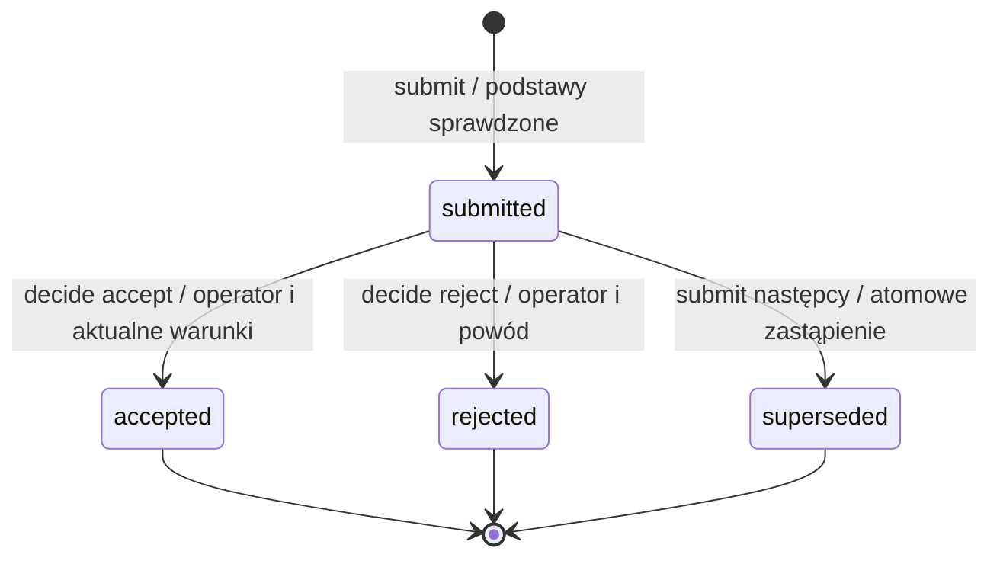

# Kontrakt odbioru przyrostu przez API procesu

2026-10-26 · rewizja 2 po osobnej recenzji · **propozycja do oceny, bez implementacji**. [Uwagi i ich rozliczenie](acceptance-contract-review.md).

Cel: wykonawca zgłasza określony wynik pracy, system sprawdza podstawy zgłoszenia, operator podejmuje decyzję o tym wyniku. Agent nie może nadać sobie odbioru. Dokument określa znaczenie operacji, a nie endpointy HTTP lub wybór frameworka. Właściciel opracowania: agent w roli architekta protokołów i systemów workflow.

## 1. Mandat i granica

Użytkownik zlecił wykonanie rekomendowanej metody: zakres → informacje i odpowiedzialność → niezmienniki → przykłady → kontrakt → osobna recenzja kontrprzykładów. Obejmuje to opis i recenzję. Nie obejmuje implementacji API, aktywacji nowych bramek, manifestów wejść, zmian w Kitchen lub iso-model-state, commita ani pushu.

**Przedmiotem jest odbiór jednego przyrostu, nie zgoda na wydanie, wdrożenie ani produkcję CNC.** Zakładamy, że zakres pracy został wcześniej uzgodniony. Brak takiego uzgodnienia oznacza brak podstaw do zgłoszenia, a nie automatyczną zgodę. Mechanizm ustalania zakresu pozostaje poza tym kontraktem.

| Status podstawy | Ustalenie | Źródło |
| --- | --- | --- |
| U1 — ustalone przez użytkownika | Agent realizuje pracę w zatwierdzonym zakresie; odbiór przyrostu, zmiana zakresu, ryzyko i wydanie należą do człowieka. Milczenie nie jest zgodą. | [Minimalny proces, kroki 2–6](../KITCHEN-MINIMAL-PROCESS.md), [kontrakt współpracy](../process-simulator/collaboration.md) i bieżące zlecenie |
| U2 — ustalone przez użytkownika | Oddzielamy wykonawcę od procesu przez API; wykonawca może zgłaszać wyniki i recenzje, ale nie akceptować. | Pomysł użytkownika i zlecenie „wejdz w role i wykonaj zgodnie ze sztuka i powyzszymi zalozeniami” |
| N1 — zadanie lokalnej normy | PM.04.01 dotyczy odbioru dostawy przez klienta i zapisu odbioru. | [Rozdział 6, PM.04.01](../../../iso-29110-5-1/chapters/06-project-management-pm-process.md) |
| N2 — opis produktu pracy | WP.01 dokumentuje odbiór dostarczonych elementów; przykładowe cechy obejmują kryteria i otwarte kwestie. Lista ma „may have”. | [Rozdział 9, tabela 13](../../../iso-29110-5-1/chapters/09-description-of-work-products.md) |
| P — własna propozycja architektoniczna | Stany, operacje, reguły wersji, odmowy i ponowienia w §2–9. | Ten kontrakt; nie są narzuconym przez ISO schematem API |

Odbiór przyrostu jest naszą adaptacją na potrzeby pracy iteracyjnej. Nie utożsamiamy go z pełnym PM.04.01, podpisem prawnym ani zamknięciem projektu. W02 z wcześniejszej analizy dotyczy przeglądu wydania; ten kontrakt nie zmienia jego semantyki i nie przejmuje identyfikatorów W01–W04.

## 2. Najkrótszy przebieg

1. Agent wskazuje przyrost, uzgodniony zakres, konkretny materiał i wyniki sprawdzeń. System odczytuje wskazane źródła; nie uznaje samego oświadczenia agenta za wykonanie testu.
2. System zapisuje zgłoszenie i wyświetla operatorowi wynik, kryteria, ograniczenia i sposób demonstracji. Formalna gotowość nie jest oceną przydatności produktu.
3. Operator ocenia wynik. Może go odebrać, odrzucić z powodem lub pozostawić bez decyzji. Odrzucenie jest decyzją biznesową; odmowa API z powodu braku danych nią nie jest.
4. Przy odbiorze system ponownie sprawdza podstawę i zapisuje decyzję wraz ze stanem w jednej trwałej operacji. Zmiana materiału lub nowych wyników w międzyczasie uniemożliwia użycie starego widoku.
5. Nowa sesja odczytuje zachowany stan, przyczynę blokady i następne działanie. Wydanie nadal wymaga odrębnej decyzji poza tym kontraktem.

## 3. Informacje i wiążące źródła

Poniżej są pojęcia i wymagane informacje, nie obowiązek tworzenia osobnego pliku lub tabeli bazy dla każdego wiersza. Wszystkie ID w przykładach z prefiksem DEMO są fikcyjne.

| Informacja | Minimalna treść i właściciel | Źródło i kontrola |
| --- | --- | --- |
| Zlecenie | ID przyrostu, cel, uzgodniony zakres i kryteria w określonej wersji; ustala operator, agent przygotowuje | Istniejący zapis decyzji i planu. Agent nie może zastąpić go własnym `approved: true`. |
| Materiał | Jednoznaczny odnośnik do zachowanej wersji wyniku, instrukcja uruchomienia/demonstracji; przygotowuje agent | Repozytorium lub zachowany artefakt. Sam HEAD przy brudnym drzewie nie wystarcza. Wybór identyfikacji przed implementacją: Q1. |
| Kryteria | Zestaw i wersja; dla każdej pozycji: warunek, sposób oceny, wymagany rodzaj wyniku, etap oceny (`before_submission` lub `operator_decision`) | Kryteria pochodzą z uzgodnionego zlecenia. Dobór dla rzeczywistego przyrostu: Q2. Zmiana treści bez zmiany ID nadal jest zmianą wersji. |
| Dowód | ID, podstawa, rodzaj (`tool_observation`, `human_assessment`, `agent_claim`), wykonanie/autor i wynik; dane dostarcza wykonawca lub narzędzie | Pochodzenie ustala adapter systemu, nie pole zadeklarowane przez agenta. `agent_claim` nie zaspokaja kryterium wymagającego obserwacji narzędzia lub człowieka. |
| Blokady | Powiązane pytania/ustalenia, ich stan i zastosowanie do przyrostu; zgłasza człowiek lub agent | Istniejący rejestr; kwalifikacja według uzgodnionej reguły. Agent nie może zmienić blokady w zaakceptowane ryzyko. Nieznana kwalifikacja daje `unknown`. |
| Zgłoszenie | ID, przyrost, niezmienna podstawa, stan, autor zgłoszenia i poprzednik | Tworzy system. Podstawa wskazuje wersje zakresu, materiału, kryteriów i zestawu dowodów; nie jest nowym wdrożonym manifestem. |
| Decyzja | ID zgłoszenia i jego podstawa, `accept` albo `reject`, operator, czas zapisu, oceny kryteriów operatora lub powód odrzucenia | Zaufany kanał operatora. Agent może przygotować propozycję tekstu; nie może wysłać decyzji własnym uprawnieniem. |
| Rewizja kontroli | Nieprzezroczysty token odczytu obejmujący zgłoszenie oraz aktualne, istotne dla niego źródła i reguły | Nadaje system. Zmiana blokady lub wyniku zmienia token nawet bez zmiany kodu. Nie służy do identyfikowania człowieka. |

Adapter oznacza źródło jako nieustalone, jeśli nie potrafi sprawdzić jego wersji, dostępności lub zastosowania. Odczyt pliku raportu agenta nie czyni go automatycznie `tool_observation`. Dla wyniku testów potrzebny jest zapis wykonania pochodzący z ustalonego runnera, powiązany z materiałem, poleceniem i kodem zakończenia. Zielony log nadal nie dowodzi trafności testu ani wiarygodności runnera przeciw celowym modyfikacjom (Q3).

Powiązania nie zastępują treści. Kryterium „wszystko dobrze” jest formalnie możliwe do zapisania, lecz wymaga korekty w przeglądzie. System nie potwierdzi pełności merytorycznej kryteriów.

## 4. Stany i warunki gotowości

Stan dotyczy **zgłoszenia**, nie całego projektu lub przyrostu. Proponujemy najwyżej jedno aktywne zgłoszenie odbioru na przyrost; inne przyrosty mogą postępować równolegle. To ograniczenie pierwszego kontraktu, nie ogólna reguła ISO.

| Stan | Znaczenie |
| --- | --- |
| `submitted` | Trwale zgłoszono określoną podstawę; brak decyzji operatora. |
| `accepted` | Operator odebrał tę podstawę. Stan historyczny, nie gwarancja braku przyszłych błędów. |
| `rejected` | Operator odrzucił tę podstawę z powodem. |
| `superseded` | Wykonawca lub operator zastąpił oczekujące zgłoszenie nowym, wskazanym zgłoszeniem. Brak decyzji odbiorczej. |

Brak zgłoszenia nie jest przechowywanym stanem. `accepted`, `rejected` i `superseded` są końcowe dla danego ID. Korekta prowadzi do nowego ID; nie wymazuje historii. W pierwszym kontrakcie nie ma anulowania ani cofania decyzji; jeśli okażą się potrzebne, wymagają osobnej specyfikacji. Odrzucenie nie jest zamiennikiem anulowania.



Nowy ID następcy zaczyna własny przebieg `submitted`. Diagram pokazuje życie jednego ID, nie mutację starego materiału w nowy.

Gotowość jest osobną oceną odczytu: `eligible`, `blocked` albo `unknown`. Po zgłoszeniu nowe ustalenie może zablokować odbiór bez fałszowania historii zgłoszenia. Odczyt zwraca też listę kryteriów wymagających osobistej oceny operatora; `eligible` oznacza możliwość rozpatrzenia odbioru, nie ich spełnienie.

Warunek G dla `submit` i `decide accept`:

- istnieje uzgodnione zlecenie i zgodna z nim, odtwarzalna podstawa;
- wersje materiału, zakresu, kryteriów i dowodów pozostają właściwe dla zgłoszenia;
- każda pozycja `before_submission` ma wymagany, zgodny wynik z właściwego źródła;
- brak otwartych ustaleń blokujących; brak wyniku, nieznane pochodzenie lub niedostępne źródło dają odmowę, nigdy domyślne `pass`;
- nowe negatywne wyniki mające zastosowanie wykluczają użycie starszego `pass`; sprzeczne wyniki pozostają nierozstrzygnięte, dopóki właściwa kontrola nie wyjaśni sprzeczności. Wykonawca nie może wybrać wyłącznie korzystnych wyników;
- reguły klasyfikacji i kryteria są wskazane w znanej wersji. Zmiana polityki w trakcie oczekiwania wymaga jawnego rozstrzygnięcia zastosowania, nie cichego podmienienia warunku.

Odbiór dodatkowo wymaga jawnych pozytywnych ocen wszystkich kryteriów `operator_decision`, udzielonych przez operatora dla tej podstawy. Istniejącą ocenę można wskazać zamiast przepisywać; musi być zgodna z wersją i pochodzeniem. Brak oceny daje `ASSESSMENT_REQUIRED`. Negatywna ocena nie jest automatycznym odrzuceniem: operator może wysłać `reject` albo pozostawić sprawę otwartą.

Pytanie jawnie nieblokujące według obowiązujących kryteriów nie zabrania odbioru. Nie ma w tym kontrakcie przycisku „zaakceptuj mimo blokady”; przyjęcie ryzyka lub zmiana kryteriów należą do odrębnej decyzji, po której potrzebna jest ponowna ocena podstawy.

## 5. Uprawnienia i zaufanie

Operator i agent są klientami procesu; system jest mechanizmem, nie trzecim decydentem. Agent ma przydział do konkretnego projektu/przyrostu. Recenzent jest wykonawcą osobnego zadania i może dostarczyć ocenę, lecz nie uzyskuje przez to prawa odbioru. Nie ustanawiamy obowiązkowego subagenta przy każdym przyroście.

Każda operacja sprawdza uprawnienie do konkretnego obiektu. Tożsamość i uprawnienie pochodzą z kontekstu wywołania, nigdy z przesłanego `role: operator`. Reguła dotyczy również odczytu i pobierania wyników ponowień. Agent nie otrzymuje poświadczenia operatora. Swobodna rozmowa może służyć przygotowaniu decyzji; interpretacja „tak” przez agenta nie jest uwierzytelnioną operacją API. Sposób powiązania świadomej czynności operatora z żądaniem pozostaje Q3.

To wymaganie granicy architektury, nie opis wdrożonej ochrony. Jeżeli agent ma zapis do bazy procesu, reguł, poświadczeń operatora lub wiarygodnego kanału wyników, nie możemy obiecać ochrony przed jego celowym obejściem. Ochronę przed pomyłkami można sprawdzać wcześniej; odporność na celowe działania wymaga uzgodnienia modelu zagrożeń. Podstawa techniczna: [OWASP Authorization Cheat Sheet, Validate the Permissions on Every Request i Verify that Authorization Checks Are Performed in the Right Location](https://cheatsheetseries.owasp.org/cheatsheets/Authorization_Cheat_Sheet.html).

## 6. Kontrakt operacji

To nazwy operacji dziedzinowych, bez wyboru HTTP, MCP lub biblioteki. Operacje zapisu przyjmują `request_id` oraz oczekiwaną rewizję kontroli. System nadaje ID zapisów i czas; klient nie wpisuje dowolnego stanu.

| Operacja i wykonawca | Wejścia oraz warunki | Skutek i odpowiedź | Odmowy |
| --- | --- | --- | --- |
| `inspect`, operator lub przypisany agent | ID przyrostu albo zgłoszenia; uprawnienie odczytu | Stan, podstawa, bieżąca rewizja kontroli, gotowość, braki, decyzja jeśli istnieje, następne działanie i właściciel. Bez zmiany stanu. | `FORBIDDEN`, `NOT_FOUND`; niedostępność źródeł jest jawna, bez pozytywnej gotowości |
| `submit`, przypisany agent lub operator | ID przyrostu, odnośniki podstawy, opcjonalny poprzednik, `request_id`, rewizja z `inspect`; G | Nowe ID `submitted`. Jeśli poprzednik jest aktywny: stary ID → `superseded` i powiązanie z następcą w tej samej operacji. Jeśli końcowy: pozostaje bez zmian. Zwraca zapis i nową rewizję. | `FORBIDDEN`, `CONFLICT`, `BASIS_UNRESOLVED`, `EVIDENCE_REQUIRED`, `BLOCKED`, `SOURCE_UNAVAILABLE`, `POLICY_UNRESOLVED` |
| `decide accept`, wyłącznie operator | ID `submitted`, dokładna podstawa, `request_id`, rewizja z odczytanego widoku; G oraz wymagane oceny operatora | Jedna decyzja oraz `accepted`, utrwalone atomowo. Bez wydania, pushu lub uruchomienia produktu. | Jak wyżej oraz `ASSESSMENT_REQUIRED`, `ALREADY_CLOSED` |
| `decide reject`, wyłącznie operator | ID `submitted`, dokładna podstawa, niepusty powód, `request_id`, aktualna rewizja kontroli | Jedna decyzja oraz `rejected`, utrwalone atomowo. Nie wymaga G: można odrzucić także zablokowane zgłoszenie. | `FORBIDDEN`, `CONFLICT`, `REASON_REQUIRED`, `ALREADY_CLOSED`; awaria własnego zapisu nie daje sukcesu |

Jeśli istnieje aktywne zgłoszenie przyrostu, `submit` musi wskazywać właśnie je jako poprzednika. Brak poprzednika lub dowolny inny ID, także końcowy, daje `CONFLICT`. Jeśli nie ma aktywnego zgłoszenia, można wskazać końcowego poprzednika tego samego przyrostu albo rozpocząć pierwszy przebieg bez niego. Sprawdzenie braku/innego aktywnego zgłoszenia oraz utworzenie następcy są jedną operacją na poziomie przyrostu, także przy dwóch równoczesnych pierwszych zgłoszeniach. Zastąpienie wymaga aktualnego tokenu i uprawnienia do poprzednika. Poprawa wyniku lub zestawu dowodów zmienia podstawę, więc wymaga nowego zgłoszenia. Dodatkowe ustalenie rejestru zmienia ocenę gotowości istniejącego zgłoszenia, nie przepisuje jego podstawy.

Niedostępność zewnętrznego źródła nie uniemożliwia odczytu zachowanego zgłoszenia i jego rewizji: `inspect` zwraca lokalny stan, token, `unknown` oraz wskazuje niedostępne źródło. Operator może wtedy wykonać `reject`; nie musi odbudowywać dowodów tylko po to, by odrzucić wynik. Awaria samego magazynu procesu uniemożliwia wiarygodny odczyt/zapis i nie daje udanej decyzji. Kryteria oceniane w `decide` są częścią decyzji operatora lub wskazują zachowaną ocenę; nie zmieniają wstecz podstawy zgłoszenia.

Wynik odmowy zawiera kod, wskazany brak/konflikt, ID obiektu, następne działanie i właściciela; nie zapisuje decyzji `reject`. Kod `SOURCE_UNAVAILABLE` nie oznacza błędu produktu. System nie podpowiada „zaakceptuj” jako sposobu usunięcia blokady.

## 7. Trwałość i zmiany równoległe

Każdy zapis ma punkt, w którym sprawdzone przesłanki i jego skutek stają się jedną spójną operacją. Zapisuje się łącznie: zmianę stanu, decyzję lub zgłoszenie, odniesienie do podstawy, historię działania i wynik rozpoznawania ponowień. Sukces wolno zwrócić po trwałym zapisie. Przerwanie przed nim nie pozostawia częściowego odbioru. Nie zakładamy transakcji obejmującej dowolne zewnętrzne repozytoria: adapter musi dostarczać zachowane wersje i wiarygodnie ustalić istotne aktualizacje; wybór techniczny jest Q1.

Po uwierzytelnieniu i autoryzacji system sprawdza ponowienie, a dopiero dla nowego żądania oczekiwaną rewizję. Klucz ponowienia obejmuje projekt, tożsamość klienta i `request_id`; zapis wiąże go z operacją, obiektem i pełną treścią wejścia. To samo żądanie po utracie odpowiedzi zwraca poprzedni wynik bez nowego skutku, nawet gdy rewizja już się zmieniła. Ten sam klucz z inną treścią daje `REQUEST_ID_REUSED`, również podczas wykonywania pierwszego żądania. Wskazany jest wynik historyczny operacji i odnośnik do aktualnego `inspect`, nie obietnica niezmienionej gotowości.

Równoczesne żądania z tym samym kluczem i tą samą treścią współdzielą jedno logiczne wykonanie i jeden wynik końcowy. Rozpoznanie/rezerwacja klucza obejmuje wywołania równoczesne, nie tylko zakończone. Podczas trwającego wykonania ponowienie może otrzymać `IN_PROGRESS` z instrukcją ponowienia tego samego żądania. To wynik przejściowy, nie stan zgłoszenia, odmowa dziedzinowa ani drugi wynik końcowy. Odzyskiwanie po awarii musi rozstrzygnąć stan takiej rezerwacji na podstawie trwałego zapisu, bez powielenia decyzji; wybór mechanizmu należy do Q4.

Także odmowa dziedzinowa zużywa klucz: po poprawie danych klient wysyła nowy `request_id`. Błąd transportu lub nieustalony wynik zapisu wymaga ponowienia tego samego żądania. Okres przechowywania kluczy musi pokrywać życie zgłoszenia i uzgodnione okno ponowień; dobór retencji należy do Q4. Wygaśnięcie nie może pozwolić na drugą decyzję dla zamkniętego ID.

Dwa konkurencyjne **różne** żądania dotyczące tego samego zgłoszenia lub utworzenia aktywnego zgłoszenia w tym samym przyroście: najwyżej jedno wygrywa; drugie dostaje konflikt bez skutku. Identyczne ponowienia obsługuje wcześniejsza reguła wspólnego wykonania. Dwie sprzeczne decyzje nie mogą powstać. Tak samo traktujemy wyścig odbioru z zastąpieniem zgłoszenia lub aktualizacją znanej blokady. Sam token przesłany przez klienta nie zapewnia tej własności; wymaga porównania i zapisu po stronie systemu.

Nie każda zmiana repozytorium ma wpływ na przyrost: dopisanie raportu lub niezwiązana dokumentacja nie unieważnia automatycznie oceny niezmienionego materiału. Adapter musi wskazać oceniany zakres. Jeśli nie umie określić wpływu, wynik jest `unknown`. Aktualność względem niewykrytych zmian lub niezgłoszonych faktów nie jest gwarantowana.

Nowy błąd po odbiorze: zapis `accepted` pozostaje historią decyzji o wskazanej podstawie. Aktualny widok pokazuje nowe ustalenie i nie przedstawia dawnego odbioru jako aktualnego dowodu braku błędów. Obsługa korekty lub następnego przyrostu jest poza tym przejściem; nowa wersja nie dziedziczy odbioru.

## 8. Niezmienniki i scenariusze do przyszłych testów

| ID | Niezmiennik | Scenariusze |
| --- | --- | --- |
| INV1 | Tylko uprawniony operator tworzy decyzję, wyłącznie w zakresie swojego dostępu. | S02, S16 |
| INV2 | Decyzja dotyczy dokładnie jednej zachowanej podstawy; nie przenosi się na następny materiał. | S03, S04, S12, S18 |
| INV3 | Odbiór wymaga aktualnego G i ocen operatora; brak lub nieustalone źródło nie stają się `pass`. | S01, S05–S08, S15, S19 |
| INV4 | Na zgłoszenie przypada najwyżej jedna decyzja; stan i decyzja są zapisywane razem. | S09–S11 |
| INV5 | Ponowienie nie powiela skutku; zmieniona treść nie korzysta z tego samego klucza. | S09, S13, S20, S23 |
| INV6 | Historia pozostaje zachowana; odmowa API nie udaje decyzji człowieka ani odbioru/wydania. | S05, S08, S12, S14, S18 |
| INV7 | Przyrost ma najwyżej jedno aktywne zgłoszenie, także przy równoczesnych operacjach. | S12, S21, S22 |

Wspólna fikcyjna baza: DEMO-I1, uzgodnione zlecenie Z1@1, materiał M1@1, kryteria K1@1 (T — test przed zgłoszeniem, U — użyteczność oceniana przez operatora), dowód T1 z ustalonego runnera dotyczący M1@1, brak blokad. Agent A ma przydział, operator O ma prawo odbioru. Token v10 opisuje tę podstawę. Każdy scenariusz jest odrębny; liczby wersji są dydaktyczne.

| ID | Stan i polecenie | Oczekiwany wynik |
| --- | --- | --- |
| S01 | A wykonuje `submit` dla bazy; O odczytuje nowy widok, potwierdza U i wykonuje `accept` | Zgłoszenie, następnie jedna decyzja i `accepted`; podstawa zachowana; brak wydania. |
| S02 | A wywołuje `accept`, także z `role: operator` w treści | `FORBIDDEN`, brak decyzji i zmiany stanu. |
| S03 | Po odczycie O materiał właściwy dla przyrostu zmieniono na M1@2 | Stare żądanie: `CONFLICT`; świeży odczyt pokazuje rozbieżność. Potrzebne nowe zgłoszenie po sprawdzeniach. |
| S04 | Tekst kryterium zmieniony przy zachowaniu jego ID | Zmiana wersji i konflikt/nieustalona podstawa; stara ocena nie spełnia zmienionego kryterium. |
| S05 | Brak T1 albo agent podaje jedynie `tests_ok: true` | `EVIDENCE_REQUIRED`; nie powstaje zgłoszenie ani decyzja odrzucająca. |
| S06 | Runner kończy kodem 1 mimo tekstu `pass` | `BLOCKED`; wynik nie spełnia T. |
| S07 | Nowa blokada lub mający zastosowanie negatywny wynik po zgłoszeniu, przed odbiorem | Stary token → `CONFLICT`; świeży token → `BLOCKED`; zgłoszenie nadal `submitted`. |
| S08 | Jest jawnie nieblokujące pytanie; O nie ocenił U | Samo pytanie nie blokuje; `accept` daje `ASSESSMENT_REQUIRED`. Po ocenie U z nowym request_id odbiór możliwy. Milczenie nie zmienia stanu. |
| S09 | O ponawia identyczny `accept` po zapisaniu decyzji i utracie odpowiedzi | Ta sama decyzja i wynik historyczny, bez drugiego zapisu; stary token nie przeszkadza rozpoznaniu ponowienia. |
| S10 | Awaria przed zatwierdzeniem zapisu stanu/decyzji | Po wznowieniu brak częściowego odbioru. Ponowienie kończy operację raz albo jawnie zwraca niedostępność. |
| S11 | Równocześnie `accept` i `reject` dla tego samego tokenu | Najwyżej jedna decyzja; druga operacja bez skutku. Własność obu kolejności. |
| S12 | A zgłasza M1@2 jako następcę oczekującego zgłoszenia | Po sprawdzeniu G: stary ID `superseded`, nowy `submitted`; obie zmiany razem. O nie odbierze starego ID. |
| S13 | Ponowiono request_id, zmieniając accept na reject lub podmieniając obiekt | `REQUEST_ID_REUSED`, bez nowego skutku. |
| S14 | O odrzuca zgłoszenie z `blocked` albo `unknown` z powodu niedostępnego źródła zewnętrznego; podaje powód i aktualny token z lokalnego odczytu | `rejected` i decyzja; G nie jest wymagane. Bez powodu: `REASON_REQUIRED`. Niedostępny magazyn procesu nie pozwala zapisać decyzji. |
| S15 | Adapter nie odczytuje źródła albo nie zna pochodzenia logu | `unknown`; odbiór niedopuszczalny. UI podaje niedostępność, a nie porażkę testu produktu. |
| S16 | Klient bez dostępu odczytuje cudzy obiekt lub wynik ponowienia | `FORBIDDEN` lub odpowiedź ukrywająca istnienie obiektu; bez ujawnienia treści. |
| S17 | Zmienia się wyłącznie niezwiązana dokumentacja | Przy potwierdzonym braku wpływu nie ma fałszywej blokady. Nieznany wpływ jest jawny. |
| S18 | Po `accepted` wykryto błąd lub utworzono M1@2 | Dawna decyzja pozostaje przy M1@1; widok pokazuje nowe ustalenie. M1@2 nie jest odebrane. |
| S19 | Agent wybiera stary pozytywny log, pomijając znany aktualny negatywny | System sprawdza wiążące źródło, odmawia; jeśli nie potrafi ustalić kompletności odczytu, `unknown`. |
| S20 | Po odmowie braku dowodu dodano dowód i ponowiono stary klucz | Stary wynik odmowy; nowe żądanie z nowym kluczem podlega nowej ocenie. |
| S21 | DEMO-S1 jest `rejected`, jego następca DEMO-S2 jest `submitted`; A próbuje utworzyć DEMO-S3 z poprzednikiem DEMO-S1 i aktualnym tokenem | `CONFLICT`: poprzednik musi wskazywać aktywne DEMO-S2. Nie powstaje drugie aktywne zgłoszenie. |
| S22 | Dwa różne żądania `submit` dla przyrostu bez aktywnego zgłoszenia korzystają z tej samej rewizji; wariant: dwa zastąpienia tego samego aktywnego zgłoszenia | Najwyżej jedno nowe aktywne zgłoszenie. Drugie żądanie dostaje konflikt. Sprawdzenie i zapis obejmują cały przyrost. |
| S23 | Identyczne `accept` z tym samym kluczem dociera przed zakończeniem pierwszego; odpowiedź pierwszego ginie | Drugie wywołanie czeka na ten sam wynik albo zwraca przejściowe `IN_PROGRESS`. Kolejne ponowienie zwraca jedną utrwaloną decyzję; nie zapisuje konfliktu jako drugiego wyniku tego klucza. |

To przykłady specyfikacyjne, **nie wykonane testy API**. Nie ma implementacji, więc nie deklarujemy RED/GREEN ani pełnego sprawdzenia kombinacji. Przed kodowaniem należy doprecyzować wiążące źródła i przekształcić te przykłady w testy kontraktu. Przypadki konkurencji i awarii wymagają testów wybranego magazynu, nie tylko czystej funkcji przejścia.

## 9. Widok dla operatora i wznowienie

Przykład oczekiwanego widoku, nie wynik rzeczywistej kontroli:

```text
Przyrost: DEMO-I1 — umówiony wynik do oceny
Zgłoszenie: DEMO-S1 / materiał M1@1
Stan: oczekuje na decyzję
Sprawdzenia przed odbiorem: dostępne, bez znanych blokad
Do Twojej oceny: U — czy wynik pozwala wykonać wskazane zadanie?
Demonstracja i kryteria: odnośniki do zachowanej podstawy
Możesz: odebrać po ocenie U, odrzucić z powodem, wrócić później
Odbiór nie uruchamia wydania ani produkcji.
```

Po wznowieniu agent dostaje ten sam stan oraz następne działanie z właścicielem. Nie rekonstruuje decyzji z rozmowy. W razie konfliktu: „Podstawa zmieniła się; odczytaj nowy widok i oceń różnicę”. System nie wymaga powtarzania zgody na techniczne czynności już objęte mandatem.

## 10. Koszt i otwarte kwestie

| Mechanizm proponowany | Wykazana potrzeba i brak obecnej ochrony | Koszt oraz sposób sprawdzenia efektu |
| --- | --- | --- |
| Rozdział zgłoszenia, obserwacji i decyzji | W02 bez raportu; sprzeczne podsumowanie vcs-lite | Adapter istniejących źródeł. S05/S06/S19 wykrywają fałszywy sukces; mierzyć koszt i fałszywe blokady. |
| Podstawa i kontrola aktualności przy zapisie | Znana nowa blokada nie zatrzymywała W02; sam ID nie określa treści | Wersjonowanie i odczyt zależności. S03/S04/S07/S17: prawdziwe konflikty kontra zbędne odmowy. |
| Trwały stan, atomowość i ponowienia | Lekcja utraciła stan po końcu procesu; ręczny eksport nie wystarczył | Magazyn i testy awarii. S09–S13: brak utraty decyzji i duplikatów; czas wznowienia. |
| Uprawnienia po stronie systemu | E9 rozdziela commity, a nie osoby i uprawnienia odbioru | Oddzielny kanał operatora i zakresy dostępu. S02/S16; osobno ustalić koszt ochrony przed celowym obejściem. |
| Czytelny następny krok | Operator zgłaszał rozmycie celu mimo dokumentów i ID | Widok generowany z tych samych danych. Zmierzyć czas poprawnego wznowienia i pytania o kontekst, bez nowego ręcznego rejestru. |

| Pytanie | Właściciel i moment potrzebnej odpowiedzi | Propozycja przygotowania |
| --- | --- | --- |
| Q1. Jak wskazać i zachować rzeczywistą podstawę oraz wykrywać istotne aktualizacje? | Agent; przed testami adaptera i implementacją | Rozpoznać istniejące źródła projektu, wersjonowanie, wyniki runnerów i kontrakty modułów. Nie wybierać funkcji Kitchen wcześniej. |
| Q2. Które kryteria i ustalenia blokują dany odbiór, które ocenia operator? | Agent przygotowuje, operator rozstrzyga przy uzgadnianiu rzeczywistego przyrostu | Użyć obecnych kryteriów, pokazać braki i koszt. Nie ustanawiać uniwersalnej listy z normy. |
| Q3. Jak wygląda kanał operatora i jaki model zagrożeń przyjmujemy? | Agent przygotowuje wariant, operator rozstrzyga przed wdrożeniem decyzji | Oddzielić zapobieganie pomyłkom od celowego obejścia; określić dostęp do reguł, bazy, runnera i poświadczeń. |
| Q4. Jaki magazyn, retencja i odtwarzanie? | Agent; przed implementacją trwałości, eskalacja gdy zmienia koszt lub zobowiązania | Najprostszy lokalny wariant zgodny z Q1/Q3; bez wyboru infrastruktury w tym opracowaniu. |

Te pytania nie blokują oceny kontraktu. Blokują deklarację gotowości do produkcyjnej implementacji. Nie tworzymy teraz nowego silnika obok iso-model-state; ewentualna adaptacja wymaga porównania z jego aktualnym modelem i planem.

## 11. Źródła doświadczeń i status

- [Przegląd mechanizacji](../PROCESS-MECHANIZATION-REVIEW.md), szczególnie zakres W5/E9, aktualność wyników i utrata stanu.
- [Diagnostyka i osobna recenzja W02](transition-review.md), siedem prób istniejącego modelu; nie są testami tego kontraktu.
- [Wywiad vcs-lite](../vcs-lite-interview/findings.md), sprawdzone przykłady brakującego testu, błędnej asercji i niespójnego raportu.

Plan etapu: opracowanie kompletnej propozycji → recenzent szuka kontrprzykładów → korekty i rozliczenie uwag → kontrola dokumentacji i punkt wznowienia. Warunek zakończenia: operacje mają wejścia, skutki i odmowy; niezmienniki mają scenariusze; uwagi mają rozstrzygnięcia; granice i otwarte decyzje są jawne.

Decyzje agenta, 2026-10-26: (A1) zapis obok przykładu W02, aby utrzymać jedno miejsce analizy przejść; (A2) stany dotyczą zgłoszeń, a gotowość jest oddzielną oceną, aby nie przepisywać historii; (A3) tabela operacji zamiast OpenAPI, ponieważ transport nie rozstrzyga reguł; (A4) brak implementacji i testów udających wykonanie API, ponieważ zlecono specyfikację i recenzję. A2–A3 są wyborami autora propozycji, nie nową polityką przyjętą przez operatora.
