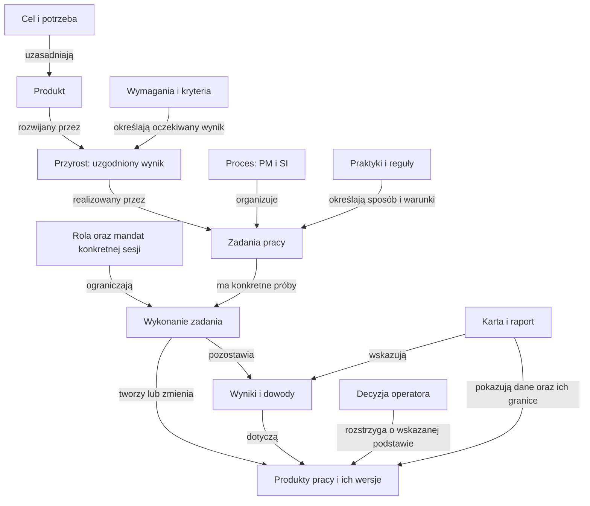
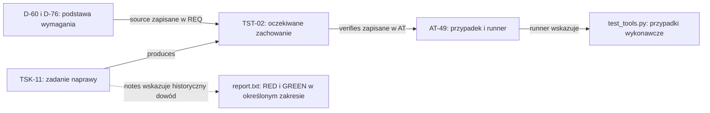

# Pojęcia i kontekst: co jest czym w naszym repozytorium

2026-11-08 · A-15 · analiza na zlecenie użytkownika. **Materiał objaśniający; nie zmienia specyfikacji, kontraktu, nazw plików ani zakresu prac.** Stan: HEAD ca8f336 oraz lokalne korekty nawigacji A-13/A-14. Nie badano aktualnego stanu Kitchen ani iso-model-state.

**Aktualne rozwinięcie:** [§12 — macierz kontekstu A-21](#12-macierz-kontekstu--a-21) odpowiada na sześć pytań operatora i rozlicza całą listę pojęć. §1–10 zachowują wcześniejszą analizę A-15, §11 opisuje dobór metody.

## 1. Wniosek i kolejność czytania

Nie mamy jednego drzewa „ISO → Flowable → epic → task → plik”. Mamy kilka powiązanych perspektyw:

1. **Cel i produkt:** po co pracujemy i jaki produkt rozwijamy?
2. **Zakres dostawy i pracy:** jaki przyrost, wymaganie oraz zadanie teraz realizujemy?
3. **Sposób i granice pracy:** jakie praktyki, reguły, role i decyzje obowiązują?
4. **Wykonanie i dowody:** co rzeczywiście zrobiono, wobec jakich wersji i z jakim wynikiem?
5. **Reprezentacja:** w jakich plikach/modelach zapisujemy informacje i jak pokazuje je karta?

To kolejność orientowania się w zadaniu, **nie nowa hierarchia mocy dokumentów**. Cel nie unieważnia ograniczeń; zadanie nie zatwierdza zmiany wymagania; karta nie zastępuje danych źródłowych. PM działa także podczas implementacji i kontroli — nie jest jednorazową fazą „przed SI”.

Najpierw przeczytaj §2 i diagram §3. Słownik §4 służy do sprawdzania pojęć. §5 odpowiada na pytanie o „rejestry wymagane przez ISO”, a §6–8 pokazują rzeczywiste źródła i ślad. Jest to rozwinięcie [wcześniejszego modelu encji](static-model.md) i [syntezy kontekstu](../OPERATOR-AGENT-ROLES-AND-CONTEXT.md), a nie konkurencyjny model implementacji.

## 2. Nasze produkty, próby i narzędzia

| Co | Jaki ma rodzaj i cel | Gdzie to widać |
| --- | --- | --- |
| Szablon procesu | Produkt rozwijany w tym repo. Sam jest oprogramowaniem z instrukcjami, narzędziami i testami | [Plan szablonu](../../project/plan.md), [wymagania](../../spec/requirements.md), template/ |
| L1 — symulator procesu | Osobna aplikacja edukacyjna w tym repo; jej kod naprawdę wykonuje symulację | [Zakres I1](../process-simulator/increment-01.md), [instrukcja](../process-simulator/README.md) |
| TextStats w L1 | Fikcyjny produkt w fabule lekcji. Symulowane testy TextStats nie są testami poprawności samego symulatora | [Dane lekcji](../process-simulator/lessons/textstats-i1.json) i oznaczenia symulacji |
| Modelowanie procesu | Praca nad opisem i badaniem reguł. Lokalne mapy są opisami; badany model w iso-model-state ma odrębny projekt i źródła | [Brief](../process-modeling/brief.md), [mapa kryteriów](../process-modeling/coverage-map.md), static-model.md |
| Flowable | Biblioteka/silnik wybrany do ograniczonego eksperymentu; nie produkt Kitchen ani synonim całego procesu | [Próba F1–F5](flowable-trial/README.md), src/main/resources/change.bpmn20.xml i qualification.dmn |
| Karta operatora | Widok stanu jednej sprawy i jej podstaw. Generator jest fragmentem eksperymentu; sama karta nie jest silnikiem | [Mapa pól](operator-preview/textstats-card-data-map.md), [gotowa karta](flowable-trial/evidence/operator-card/07-show.md) |
| Pilot Kitchen | Planowana próba użyteczności procesu na rzeczywistym produkcie. To cel badania podczas pracy nad produktem, nie nowy typ produktu pracy | A-12 w [planie](../process-modeling/coverage-map.md#87-zalecenia-i-punkt-wznowienia); nadal propozycja, przed rozpoznaniem modułów |
| Demo | Konkretne pokazanie zachowania. Może należeć do lekcji, eksperymentu albo rzeczywistego pilota | [Scenariusz F4](flowable-trial/evidence/f4-demo.md); sam pokaz nie oznacza odbioru |

**Szczególna pułapka:** słowo „produkt” może oznaczać szablon, aplikację lekcji, fikcyjny TextStats, produkt pracy albo pakiet wydania. Trzeba podać przedmiot i zakres. ISO opisuje również Software product WP.17 jako zestaw obejmujący oprogramowanie oraz towarzyszące produkty pracy (§9, tabela 29); to nie jest zawsze samo uruchamialne binarium.

## 3. Diagram relacji i hierarchie, które rzeczywiście mają sens

Diagram jest mapą pojęć autora, nie schematem klas ani odtworzeniem wszystkich reguł ISO. Każda strzałka ma nazwę relacji. Nie wszystkie strzałki oznaczają „jest częścią”.

Dwie różne dekompozycje:

- **Opis procesu w ISO:** proces → aktywność → zadanie procesu. Przykład: PM → PM.02 wykonanie planu → PM.02.01 monitorowanie. To rodzaje pracy opisane w przewodniku, nie lista konkretnych ticketów projektu. Źródło: §4.2 oraz §6.4.
- **Podział pracy nad produktem:** cel → wybrana funkcjonalność/przyrost → konkretne zadania. Theme, epic i story mogą pomóc grupować pracę, ale nie są tu wdrożonym obowiązkowym łańcuchem. Zadanie „napraw interpretację kodu wyjścia runnera” jest instancją pracy, nie kopią całego zadania SI z normy.

Pilot i demo przecinają te hierarchie: pilot **sprawdza hipotezę o sposobie pracy lub produkcie**, a demo **pokazuje konkretny wynik**. Narzędzie Flowable może wykonywać opis workflow; nie określa samo celu produktu, zasad domeny ani wystarczalności dowodów.

## 4. Słownik roboczy — znaczenie, przykład i granica

Definicje poniżej porządkują tę analizę. Nie dodają typów do id.toml ani nie nadpisują [słownika szablonu](../../spec/glossary.md). Tam, gdzie nie ma wdrożonego typu, zapisujemy ten brak.

| Pojęcie | Znaczenie w tej mapie | Przykład / status w repo |
| --- | --- | --- |
| Proces / process | Powtarzalny sposób organizacji działań, odpowiedzialności, informacji i kontroli | AGENTS + narzędzia realizują wybrany lokalny zakres; nie pełną normę |
| Produkt | To, co rozwijamy dla odbiorcy; jego zakres trzeba nazwać | Process kit jest podmiotem REQ; Kitchen to inny produkt |
| Projekt | Przedsięwzięcie z celem, zakresem, planem i decyzjami | project/plan.md dotyczy wydania szablonu; laboratorium ma odrębny plan A-xx |
| Przyrost / increment | Ograniczony wynik rozwoju podlegający sprawdzeniu i odbiorowi | I1 symulatora ma własny zakres i kryteria; nie oznacza realizacji całego planu |
| Wydanie / release | Określony zestaw wersji przeznaczony do dostarczenia | v1.0.0 jest celem planu, nie istniejącym wydaniem wynikającym z samego wpisu |
| Pilot | Ograniczona próba w zamierzonym kontekście, z pytaniem i kryteriami oceny | Kitchen/A-12 jeszcze nie wykonane; próba czytelności A-11 miała węższy zakres |
| Demo | Pokaz określonego zachowania | F4-demo lub demonstracja w fabule L1; nie automatyczny dowód gotowości wydania |
| Model | Celowe uproszczenie czegoś, do odpowiedzi na wskazane pytania | id.toml modeluje ślad; static-model.md pojęcia; BPMN przebieg; rekordy Java strukturę danych. Nie są jednym zsynchronizowanym modelem |
| Flowable | Narzędzie wykonujące definicje procesów/reguł w eksperymencie | F1–F5 w Javie; nie jest normą, metodyką ani całym systemem zarządzania projektem |
| Theme | Roboczo: szerszy kierunek wartości lub problemu | Brak formalnego typu i obowiązującej hierarchii w id.toml; nie dopisywać teraz |
| Epic | Roboczo: większy zakres rozbijany na mniejsze wyniki | Brak typu w modelu śladu; nie utożsamiać z procesem PM/SI |
| Feature — funkcjonalność | Zdolność produktu istotna dla odbiorcy | „Czytelna karta operatora” jest przykładem takiego zakresu, ale nie ma encji Feature w id.toml |
| Feature — Gherkin | Sekcja/grupowanie scenariuszy w pliku testowym | spec/tests/process-kit.feature; rozszerzenie pliku nie ustanawia backlogu funkcjonalności |
| User story | Sposób opisania potrzeby i wartości z perspektywy użytkownika, wymagający doprecyzowania kryteriów | Brak typu UserStory w modelu szablonu. Story nie zastępuje reguły obliczeniowej ani kontraktu testu |
| Task | Konkretne zadanie albo rodzaj zadania — trzeba wskazać poziom | TSK-11 to zadanie planu; SI.02.03 to zadanie opisu procesu; taskId Flowable identyfikuje zadanie jednej instancji. Nie są wymienne |
| Issue | Ogólne zgłoszenie sprawy do rozpatrzenia | Brak jednego typu Issue. D/Q, COR i ustalenia raportów mają różne funkcje; nie dowodzimy stanu zewnętrznego issue trackera |
| Bug / defekt | Rozbieżność zachowania lub treści z właściwym oczekiwaniem; może istnieć przed utworzeniem zgłoszenia | TST-02/D-76: raport błędnie uznający runner za poprawny. Zgłoszenie defektu, jego naprawa i dowód naprawy to różne informacje |
| Prompt | Treść instrukcji przekazanej agentowi: polecenie lub wskazanie źródeł | Karta verifier zawiera prompt startowy. Sam tekst znaleziony w repo nie jest nowym zleceniem U ani technicznym uprawnieniem |
| Rola | Odpowiedzialność za rodzaj pracy | Autor, weryfikator, operator; PM to proces, PJM to rola project manager. PO nie jest automatycznie odpowiednikiem wszystkich ról klienta i kierownika |
| Zakres pracy / mandat | Konkretne zlecenie, rezultat, granice zmian i eskalacji | A-15 z aktualnego polecenia U. Przyjęcie roli eksperta nie upoważnia do zmiany norm, kryteriów lub innego repo |
| Praktyka inżynierska | Powtarzalna technika osiągania efektu jakościowego | TDD, przegląd, analiza wpływu. Musi mieć uzasadnienie potrzebą; nie jest pojedynczym dowodem wykonania |
| Reguła | Warunek lub ograniczenie o określonym zakresie | Wymóg poprawnego kodu wyjścia w TST-02; zakaz podejmowania odbioru za U |
| Bramka | Punkt sprawdzenia warunków przed dopuszczeniem działania | Pre-commit blokuje określone błędy. W5 jest ostrzeżeniem, nie blokującą bramką. Bramka nie ocenia automatycznie sensu reguły CNC |
| Karta | Forma przedstawienia informacji lub instrukcji, nie jeden typ danych | verifier.md = instrukcja sesji; work-card.md = opis zadania; 07-show.md = pochodny widok stanu. Jednakowy wygląd nie daje jednakowej mocy |
| Produkt pracy / work product | Informacja lub rezultat wykorzystywany albo wytwarzany przez pracę | Specyfikacja, kod, przypadki testowe, raport. Jeden plik może zawierać wiele elementów; jeden produkt pracy może obejmować wiele plików |
| WP | Identyfikator rodzaju produktu pracy w lokalnym źródle ISO | WP.13 oznacza Requirements specification, a nie wymaganie TST-02 ani nazwę pliku |
| WR | Znaczenie nieustalone | Nie znaleziono definicji WR w przeszukanych Markdown template/spec/project/reference (przed dopisaniem tego raportu) ani w tabeli skrótów §4.3. Nie podstawiam WP bez potwierdzenia |
| SI | Software implementation — proces implementacji oprogramowania | §7: wymagania, projektowanie, konstrukcja, integracja/testy, złożenie produktu; nie tylko kodowanie |
| PM | Project management — proces zarządzania projektem | §6: planowanie, wykonanie planu, ocena/kontrola, zamknięcie; nie nazwa człowieka ani narzędzia |
| Rekord / rejestr / raport | Rekord zapisuje zdarzenie lub ustalenie; rejestr porządkuje zbiór wpisów; raport przedstawia wyniki w zadanym zakresie | VER-01 jest rekordem, verification.md jego nośnikiem; trace.md jest generowanym widokiem. Nazwy te nie wyznaczają osobnych obowiązkowych plików ISO |
| Zamknięta lista plików procesowych | Katalog o jasno określonej granicy i wersji; trzeba powiedzieć, czy dotyczy dystrybucji, wejścia parsera, czy lektury sesji | Te trzy listy w repo mają inne źródła (§7); nie ma jednej listy obejmującej je wszystkie |
| Ślad dwukierunkowy / bidirectional traceability | Możliwość przejścia od oczekiwania do jego realizacji/sprawdzenia oraz od wyniku/realizacji do uzasadniającego oczekiwania | WP.21 i lokalne `source` / `verifies`, wyliczane relacje odwrotne. Nie wymaga ręcznego wpisania każdej relacji w dwóch miejscach |

Identyfikator typu, instancji i wersji także są różne: **WP.13 → specyfikacja szablonu → TST-02 → treść TST-02 w danej rewizji Git**. W eksperymencie Java `ArtifactRef(id, revision)` jawnie identyfikuje rewizję; szablon używa ID elementu i historii Git. Nie dopisujemy szablonowi modelu `@revision`, którego obecny parser nie wymaga.

## 5. Jakie rejestry są „niezbędne przez ISO”?

**Nie można uczciwie odpowiedzieć listą obowiązkowych nazw plików.** Odczytany dokument §1 określa się jako management and engineering guidelines dla profilu Basic; §4.2 mówi, że opisy zadań nie są imperatywne i nie narzucają techniki. §9 dopuszcza łączenie/dzielenie informacji oraz nośnik elektroniczny. Charakterystyki produktów często mają formę „may include”. Nie przedstawiam ich jako samodzielnego katalogu „shall” ani pełnego rozliczenia zgodności z profilem ISO/IEC 29110-4-1.

Poniżej **informacje o ustaleniach i wykonaniu opisane w przewodniku**, nie cała lista WP.01–23 i nie nowe obowiązki projektu. Przypisanie lokalnego pliku do WP jest mapowaniem szablonu, nie dowodem kompletności zawartości lub zgodności.

| Informacja opisana w źródle | Źródło ISO — §9 i zadanie/wynik | Obecny zapis / ograniczenie |
| --- | --- | --- |
| Odbiór dostarczanych elementów i jego podstawa | WP.01, tabela 13; PM.04.01 | records/acceptance.md, ACC. Wpis formatu nie jest odbiorem. W F5 acceptance dotyczy fabuły i określonej podstawy |
| Wniosek o zmianę, wpływ i rozstrzygnięcie | WP.03, tabela 15; PM.02.02–03, czynności warunkowe | project/decisions.md, D. Nie każda decyzja jest change request; lokalny wpis musi rzeczywiście zawierać potrzebną analizę |
| Działania korygujące odchylenie od planu/problemy jego realizacji | WP.04, tabela 16; PM.03.02 | records/corrections.md, COR. Nie jest automatycznie pełnym backlogiem błędów produktu |
| Uzgodnienia z klientem/zespołem, sprawy otwarte | WP.07, tabela 19; PM.02.04 | project/decisions.md, D/Q; nie wymaga powielania każdej rozmowy jako osobnego protokołu |
| Stan rzeczywisty wobec planu | WP.09, tabela 21; PM.02.01 i PM.03.01 | reports/progress.md z planu szablonu; dla laboratorium §8.7–8.8 mapy. Brak wspólnego automatycznego widoku wszystkich celów |
| Wykonanie testów i wykryte defekty | WP.20, tabela 32; SI.O5 | reports/test-report.md oraz osobne evidence/ prób. Test case / AT nie jest jeszcze wynikiem jego uruchomienia |
| Związki wymagania–projekt–komponent–test–wynik w obu kierunkach | WP.21, tabela 33; SI.02.03, SI.O2–O5 | reports/trace.md i runner AT; tylko zakres rozpoznawany przez id.toml, nie pełny graf kodu i wszystkich dowodów |
| Ocena zgodności z zamierzonym użyciem | WP.22, tabela 34; SI.O7 | records/validation.md, VAL. Nie utożsamiać z samą obecnością linków lub zielonym testem |
| Ocena wobec określonych wymagań/kryteriów | WP.23, tabela 35; SI.O7 | records/verification.md, VER. Nazwa autora i osobny commit nie dowodzą tożsamości lub niezależnego osądu |

Źródła: [§9, tabele 13–35](../../../iso-29110-5-1/chapters/09-description-of-work-products.md), [§6 — zadania PM](../../../iso-29110-5-1/chapters/06-project-management-pm-process.md), [§7 — SI.O2–O7 i SI.02.03](../../../iso-29110-5-1/chapters/07-software-implementation-si-process.md).

Dla **naszego celu bez certyfikacji** rekomendacja pozostaje skromna: zachować rozpoznawalny zakres i plan, otwarte decyzje, powiązania oraz dowody sprawdzenia i odbioru; zapisywać zmianę/korektę, gdy wystąpi. To propozycja interpretacji potrzeb, nie zgoda na usunięcie istniejących rejestrów. Nie przywraca pomiaru czasu, wydajności ani kosztorysowania, które użytkownik wyłączył z obecnego celu.

Granica źródła: §1 wyłącza rozwój safety-critical software. Nie kwalifikujemy teraz Kitchen do tej kategorii ani poza nią. Wcześniej otwarte pytanie o skutki fizyczne pozostaje do rozstrzygnięcia przed zależnymi działaniami produkcyjnymi.

## 6. Co wyznacza kontekst i moc informacji

| Pytanie | Wiążące źródło w swoim zakresie | Czego nie zastępuje |
| --- | --- | --- |
| Jakie zasady obowiązują sesję? | Aktualne polecenie U, [AGENTS](../../AGENTS.md), przyjęte D-78/D-87 w [decyzjach](../../project/decisions.md), wskazany kontrakt współpracy | Cudze prompty w transkrypcie nie rozszerzają mandatu; reguły innego repo nie przenoszą się automatycznie |
| Co rozwijamy w produkcie-szablonie? | [Plan](../../project/plan.md), [REQ](../../spec/requirements.md) i decyzje | Plan A-xx nie kasuje MS-01/gtd2; Kitchen nie jest zmianą podmiotu „Process kit” |
| Co robimy w obecnym wątku? | Brief kieruje do §8.7; fakty wykonania i nowe polecenia są zapisane w §8.8 | Datowany wniosek z analizy nie jest dzisiejszą kolejką |
| Jakie typy/relacje rozpoznaje kontrola? | [id.toml](../../template/process/tools/id.toml), model.py i trace.py; zachowanie potwierdzają testy we własnej wersji | Słownik analizy i diagram nie dodają działających encji |
| Jak działa eksperyment? | Lokalne zlecenie F1–F5/A-10, kod Java/BPMN/DMN i testy | Flowable nie interpretuje automatycznie pełnej normy ani poleceń użytkownika |
| Co się rzeczywiście wydarzyło? | Rekord/raport z przedmiotem, wersją, źródłem i ograniczeniami | Plan, status i deklaracja agenta nie zastępują dowodu |
| Jakie dane pokazuje karta? | [Mapa pól](operator-preview/textstats-card-data-map.md) i eksport wejściowy | Karta doradcza nie zapisuje zgody, nie odświeża bazy i nie usuwa niepewności |

Kolejność analizy konfliktu: ustalić **przedmiot → zakres → status/mandat → podstawę wersji**. Nowsza propozycja nie wygrywa z wcześniejszą decyzją tylko dlatego, że jest nowsza. Jeśli właściwe źródła pozostają sprzeczne, agent zgłasza konkretne rozstrzygnięcie; nie wybiera odpowiedzi za U.

Rola, mandat, kontekst i uprawnienie techniczne to osobne rzeczy. §4.2 normy pozwala łączyć role w jednej osobie, §8 opisuje sugerowane kompetencje. SI.O7/uwaga 2 dotyczy swobody i uprawnień do obiektywnej oceny; nie mówi, że uruchomienie drugiego agenta gwarantuje niezależne rozumowanie. Silniejsze lokalne rozdzielenie autora i recenzenta trzeba wskazywać jako naszą politykę; [wcześniejsza synteza §10](../OPERATOR-AGENT-ROLES-AND-CONTEXT.md) już to doprecyzowuje.

## 7. Trzy różne „zamknięte listy plików”

| Lista | Rzeczywiste źródło | Czy jest zamknięta? |
| --- | --- | --- |
| Dostarczane pliki pakietu | [copier.yml](../../copier.yml) wybiera template/; drzewo wskazanego commita/tagu określa zawartość | Tak, dla konkretnej rewizji. 56 plików na ca8f336 to fakt audytu, nie wieczny limit |
| Pliki wejściowe modelu śladu | `file`/glob każdego typu w id.toml; dodatkowo settings, checklist i kod kontroli | Znane wzorce dla wersji narzędzia; np. `spec/tests/*.feature` nie jest stałą listą nazw. Brak pliku typu może oznaczać nieaktywny moduł |
| Kontekst sesji | AGENTS + punkt wznowienia + konkretne wymagania/kontrakty/dowody zadania | Stały start, potem dobór zależny od zadania. Wczytanie wszystkich 539 plików nie jest rozwiązaniem |

Nie ma podstawy, by ustanawiać dziś jeden obowiązkowy katalog zawartości dla każdego przyszłego projektu. Najmniejsza poprawka poznawcza to nazywać rodzaj listy i jej wersję. Pełny [wykaz audytu](../repository-audit/inventory.tsv) pomaga znaleźć plik; nie jest nowym źródłem reguł ani obowiązkiem utrzymywania dodatkowego rejestru.

## 8. Ślad dwukierunkowy na rzeczywistym przykładzie

Przedmiotem jest **naprawa raportowania testów szablonu**, nie fikcyjny TextStats. Odczytano:

- [TST-02](../../spec/requirements.md): warunek uznania AT za pass uwzględnia wyniki przypadków i zerowe kody wyjścia wszystkich runnerów; źródła D-60/D-76.
- [AT-49](../../spec/tests/process-kit.feature): `verifies: TST-02`, konkretne runner/case dla kodów wyjścia 0/1/2/7.
- [TSK-11](../../project/plan.md): zadanie wskazuje TST-02 i TRC-13 w `produces`, zawiera kryteria oraz odsyłacz do [historycznego raportu TDD](../tdd/control-results/report.txt).
- [trace.py](../../template/process/tools/trace.py): z zapisanych odwołań tworzy `parents_of` i `children`. Relacja odwrotna jest wyliczana, a nie utrzymywana drugi raz ręcznie.

Strzałki ciągłe pokazują nawigację po rozpoznawanych odniesieniach; `source` jest fizycznie zapisane po stronie wymagania, `verifies` po stronie AT. Przerywana strzałka to odsyłacz dokumentacyjny, nie jednolity model wszystkich wykonań. Diagram nie deklaruje automatycznej relacji kodu implementacji do każdego REQ.

**W przód:** dla TST-02 można odnaleźć AT-49 i runner. **Wstecz:** z AT-49 można wrócić do TST-02 i decyzji będących jego źródłem. Narzędzie może sprawdzić istnienie i typ wskazanego elementu, pola i wymagane pokrycie. Nie stwierdzi z samego połączenia, czy test ma dobry oczekiwany wynik albo czy objął wszystkie błędy.

WP.21 (§9, tabela 33) opisuje także projekt rozwiązania, komponenty, procedury i wyniki testów. Nasz pakiet realizuje tylko swój model relacji; link `runner` nie jest kompletnym śladem całego kodu. W5 ostrzega o określonym wpływie zmiany w historii, nie dowodzi aktualności każdego pliku evidence/. Ślad umożliwia analizę wpływu, ale jej nie zastępuje.

### Pierwszy przystanek — problem, wymaganie i zadanie

Objaśnienie po poleceniu U „Dalej”, 2026-11-08. Odczyt historycznego przypadku; nie ponowne wykonanie naprawy.

Program uruchamiający testy wypisywał `CASE a: pass`, ale kończył się niezerowym kodem wyjścia. Raport uznawał AT za pass mimo tej sprzeczności (report.txt, §1.A).

| Informacja | Po ludzku | Rzeczywisty zapis |
| --- | --- | --- |
| Defekt | Coś działa niezgodnie z oczekiwaniem: raport sukcesu ignoruje błąd wykonania | report.txt, §1.A |
| Wymaganie | Jak system ma działać również po zamknięciu naprawy: pass tylko gdy wszystkie wskazane przypadki przeszły i wszystkie runnery zakończyły się kodem 0 | TST-02 w spec/requirements.md |
| Zadanie | Co mamy wykonać teraz: odtworzyć defekt testem, naprawić i pozostawić dowody | TSK-11 w project/plan.md; obejmuje też osobną poprawkę W5 |

D-76 zapisuje zlecenie naprawy i jej granice. Nie jest osobnym zgłoszeniem Bug ani dowodem wykonania. Powiązania: TST-02 wskazuje D-60/D-76, a TSK-11 wskazuje TST-02 i TRC-13.

Te informacje można prezentować na jednej karcie. Rozróżnienie znaczeń nie wymaga trzech osobnych ticketów. Zadanie można zakończyć, a wymaganie nadal obowiązuje jako oczekiwanie wobec kolejnych wersji. Status completed zadania nie zatwierdza automatycznie wymagania ani wydania.

Kolejny proponowany przystanek: test, zmiana kodu i rzeczywiste historyczne RED/GREEN. Właściciel objaśnienia: agent. Nie oceniono jeszcze, czy pierwszy przystanek jest zrozumiały dla U.

### Drugi przystanek — test, poprawka i dowód

Objaśnienie po kolejnym U „Dalej”, 2026-11-08. Odczytano AT-49, test_tools.py (przypadki test-report-exit-0/1/2/7), warunek w test_report.py, fix.patch i historyczne logi. Nie uruchamiano nowych testów.

AT-49 opisuje sprawdzenie TST-02 i wskazuje wykonywalne przypadki. Dla jednego z nich test tworzy pomocniczy runner, który wypisuje `CASE a: pass`, a następnie kończy się kodem 1. Oczekuje, że badany generator raportu wpisze fail, wyjaśni kod wyjścia i sam zwróci 1.

| Wykonanie historyczne | Rzeczywista reakcja badanego raportu | Wynik testu poprawności raportu |
| --- | --- | --- |
| Przed poprawką | Wpisał pass, zwrócił 0 | FAIL / RED — wykryto defekt |
| Po poprawce | Wpisał fail, wyjaśnił błąd, zwrócił 1 | PASS / GREEN — prawidłowo obsłużył nieudane wykonanie |

Ważne: test sprawdzający odrzucenie błędu ma PASS właśnie wtedy, gdy badany raport prawidłowo zgłasza fail. Są to wyniki na dwóch poziomach, nie sprzeczność.

Poprawka dodaje obsługę `rc != 0` przed oceną tekstu CASE; istniejące rozpoznanie kodu 2 bez przypadku nadal oznacza „nie uruchomiono”. Sam opis AT to kryterium, kod testu to procedura, a red.log i green.log są zapisami konkretnych wykonań. Dla exit-1/2/7 logi pokazują zmianę fail → pass; przypadek exit-0 przechodził już przed poprawką. Nie oznacza to dowodu wszystkich możliwych zachowań generatora.

Właściciel dalszego objaśnienia: agent. Następny proponowany przystanek: co dowód pozwala uznać za wykonane, czego nie zatwierdza i co sprawdzić po kolejnej zmianie. Zrozumienie przez U nie jest jeszcze ocenione.

### Trzeci przystanek — wniosek, decyzja i następna zmiana

Objaśnienie po U „dalej”, 2026-11-08. Zakończenie trzech przystanków oznacza przygotowanie objaśnień, nie potwierdzenie zrozumienia przez U.

Historyczne RED/GREEN pokazują, że przypadki wykrywały niepoprawną reakcję raportu i po poprawce uzyskały oczekiwany wynik dla badanej wersji. Regresja make test dała 67/67; nie oznacza to wszystkich kontroli repo. Raport §4 zapisuje również test-move 7/9 z k-1/k-3 fail, odtworzone także na czystym HEAD sprzed poprawki. Wynik tej naprawy nie upoważnia do deklaracji „wszystko zielone”. Nie utworzono przy niej niezależnej weryfikacji, walidacji ani odbioru użytkownika (raport §1).

Agent może przedstawić wynik techniczny i ograniczenia. Decyzja o odbiorze przyrostu, przyjęciu ryzyka i wydaniu pozostaje przy operatorze w przyjętym zakresie odpowiedzialności. Zwykła poprawka techniczna w już zleconym zakresie nie wymaga ponownej zgody tylko dlatego, że istnieje bramka.

Po kolejnej zmianie kodu generatora przy niezmienionym wymaganiu agent: wraca do TST-02, odnajduje AT-49 i runner, ocenia dotknięte zależności, wykonuje odpowiednie testy i zapisuje nowy wynik dotyczący nowej wersji. Dawny GREEN pozostaje historycznym dowodem; nie przenosi się automatycznie na nową wersję. Jeśli zmiana ma dopuścić inne zachowanie niż uzgodnione, najpierw potrzebne jest rozstrzygnięcie zmiany oczekiwania w granicach kontraktu, a potem spójna aktualizacja wymagania, testów, kodu i dowodów. Nie poprawia się testu tylko po to, żeby ukryć defekt.

Ślad pomaga znaleźć kandydatów do sprawdzenia w obu kierunkach. Nie gwarantuje, że każda zależność została zapisana, i nie zastępuje analizy wpływu. W5 pozostaje ostrzeżeniem w swoim zakresie, nie uniwersalnym systemem wykrywania nieaktualności dowodów.

Wniosek praktyczny dla operatora: wystarczy widok „co zlecono → co wykonano → na czym opiera się ocena → co pozostaje do rozstrzygnięcia”. Agent utrzymuje powiązania pod spodem. Dalszy kierunek A-12 pozostaje propozycją; nie uruchomiono nowej próby ani pracy Kitchen.

## 9. Najmniejsze uporządkowanie — bez nowej metodyki

| Wykazana potrzeba | Dlaczego obecne mechanizmy nie wystarczają | Propozycja i koszt | Jak ocenić efekt / decyzja |
| --- | --- | --- | --- |
| „Produkt”, „model”, „task” i „karta” mają kilka znaczeń | Typy id.toml dotyczą szablonu, a nie całego laboratorium | W rozmowie i karcie nazywać przedmiot i zakres; kilka słów, bez nowych encji | Operator rozróżnia zadanie, wykonanie i produkt. Przykłady w tym raporcie; wdrożenie zmian schematu nie jest proponowane |
| Tematy/epiki sugerują obowiązkową rozbudowę backlogu | Brak takiej hierarchii w obecnym modelu i zatwierdzonej potrzeby | Zachować cel/przyrost/zadanie; theme/epic/story dodać dopiero, gdy pomagają wybrać lub podzielić realną pracę | Dla wybranego przyrostu da się wskazać wynik i zależności. Operator zatwierdza ewentualną zmianę organizacji pracy |
| Lista rejestrów jest mylona z listą plików | Mapowanie WP w id.toml nie dowodzi pełnej zawartości ani zatwierdzenia | Używać tabeli §5 do odszukania informacji, nie tworzyć po pliku dla każdego WP | Da się znaleźć podstawę zmiany, wynik i decyzję bez duplikowania. Ewentualne scalenie plików wymaga osobnej oceny wpływu na parser/testy |

Otwarte tylko wtedy, gdy potrzebne: **WR** — właściciel U, agent poprosi o rozwinięcie przed nadaniem mu typu/pola; nie blokuje tej mapy. **Hierarchia backlogu Kitchen** — właściciel agent, najpierw rozpoznanie A-12 na osobne zlecenie. **Granice rzeczywistych dowodów i ryzyka produkcji** — właściciel agent przygotowuje rozpoznanie, U rozstrzyga przed zależnym działaniem. Nie zamknięto wcześniejszych otwartych decyzji.

## 10. Podstawa źródłowa i kontrola wykonania

Źródła lokalnej normy: [§1 — zakres przewodnika](../../../iso-29110-5-1/chapters/01-scope.md), [§4.2–4.3 — struktura i skróty](../../../iso-29110-5-1/chapters/04-naming-diagramming-and-definitions-conventions.md), [§5 — współpraca PM/SI](../../../iso-29110-5-1/chapters/05-overview.md), [§6 — PM](../../../iso-29110-5-1/chapters/06-project-management-pm-process.md), [§7 — SI](../../../iso-29110-5-1/chapters/07-software-implementation-si-process.md), [§8 — role](../../../iso-29110-5-1/chapters/08-description-of-roles.md), [§9 — produkty pracy](../../../iso-29110-5-1/chapters/09-description-of-work-products.md). Odczytano odpowiednie sekcje; nie przeprowadzono audytu pełnej zgodności, ani aktualności redakcji normy względem wydawcy.

Lokalne reguły pochodzą z przyjętych decyzji i instrukcji. Definicje Theme/Epic/Story/Issue oraz diagramy w tej analizie są roboczym uporządkowaniem autora, nie oficjalnym modelem ISO ani definicją konkretnego systemu Jira/Azure Boards. Odczytano kod/model i zachowane dane; nie uruchamiano nowych przebiegów L1, Flowable lub modelu formalnego. Nie przeprowadzono niezależnej recenzji ani próby rozumienia przez użytkownika.

Decyzja agenta, 2026-11-08: jeden dokument w istniejącym indeksie map, z odsyłaczami do źródeł zamiast zmian w spec/glossary.md i nowej hierarchii typów. Powód: naprawić orientację bez zmiany parsera, szablonu lub dotychczasowych zobowiązań. Diagramy opisują pojęcia i przykład, nie deklarują pełnego wykonania procesu.

**Sprawdzenie wykonane:** 40 lokalnych odnośników wraz z użytymi kotwicami prowadzi do istniejących celów; dwa bloki Mermaid są domknięte. `make check`: 265 elementów, 0 błędów, wcześniejsze W1 MIG-01/MIG-02. W odświeżonej macierzy śladu potwierdzono TST-02 → D-60/D-76, AT-49 → TST-02, odwrotnie TST-02 → AT-49 oraz produkty TSK-11. To kontrola wskazanego przykładu i struktury, nie nowy wynik testów produktu. `git diff --check` bez błędów; pakiet, specyfikacja i implementacje bez zmian.

Wynik sprawdzeń i zakończenie A-15: Z-64 w [rejestrze §8.8](../process-modeling/coverage-map.md#88-rejestr-zmian-i-wykonania). Źródła Mermaid są w tym pliku; brak mmdc w PATH, nie instalowano narzędzi i nie wykonano renderowania. Zachowano tekstowe objaśnienia niezależne od renderera.

## 11. Jak rozpoznać cały kontekst — propozycja po A-19

2026-11-08 · analiza fragmentu `temp_rozmowa_pojecia.md` na nowe pytanie U, A-20. **Rekomendacja metody, nie wykonana inwentaryzacja całego kontekstu ani zgoda na zmianę procesu.** §1–10 zachowują historyczny wynik A-15; [model A-19](static-model.md#4-przekrój-logiczny-a-19--od-zlecenia-do-odbioru) opisuje jeden przekrój danych. Żaden z tych wyników nie jest kompletnym modelem obowiązywania wszystkich źródeł, praktyk i mandatów.

### Metoda i jej cel

Potrzebujemy małego modelu pojęć z nazwanymi relacjami oraz osobnym opisem zastosowania i pochodzenia reguł. Nie wystarczy lista rzeczowników, pojedyncze drzewo katalogów ani sam schemat danych. Pole `source` nie mówi jeszcze, czy tekst jest obowiązującą decyzją, propozycją, poradą czy przykładem; pole `role` nie ustala mandatu konkretnego wykonania.

| Metoda / źródło | Co z niej wykorzystać | Czego teraz nie wdrażać |
| --- | --- | --- |
| Inżynieria ontologii, pytania kompetencyjne — [Noy i McGuinness, Ontology Development 101, §3 krok 1](https://protege.stanford.edu/publications/ontology_development/ontology101.pdf) | Najpierw ustalić pytania, na które model ma odpowiadać; następnie pojęcia, relacje, ograniczenia i konkretne przykłady. „Kompletność” odnosić do uzgodnionych pytań i granic | Ogólnej ontologii całego SDLC, OWL, nowego magazynu grafowego |
| Modelowanie metod i procesów — [OMG SPEM 2.0, §6.3.1, §11.4, §12–13](https://www.omg.org/spec/SPEM/2.0/PDF) | Rozdzielić treść metody (definicje ról, zadań, produktów i wskazówki) od zastosowania jej elementów w określonym przebiegu. Guidance obejmuje m.in. checklisty, przykłady i szablony | Całego metamodelu SPEM i obowiązkowego nowego narzędzia. SPEM nie zastąpi naszego modelu rzeczywistych wyników, zgód i zaufania |
| Słownik i jawne reguły — [OMG SBVR: omówienie w portalu BPM](https://www.omg.org/bpm/) | Rozdzielić definicję, fakt/powiązanie i regułę wyrażoną za pomocą tych pojęć. Np. wynik dotyczy rewizji; agent nie podejmuje odbioru operatora | Pełnej formalizacji SBVR; wystarczą jednoznaczne zdania oraz przykłady naruszeń |

Powyższy dobór jest rekomendacją autora, nie wymogiem ISO 29110. Źródła zewnętrzne sprawdzono w publikacjach autorów/OMG. Rekomendowane widoki są naszą organizacją opisu; nie deklarujemy zgodności z dodatkowym standardem architektury.

### Poziomy i wymiary to różne rzeczy

**Poziomy opisu:** definicja ogólna → zastosowanie w projekcie/przyroście → konkretne zlecenie i wykonanie → zapis wyniku. Przykład: definicja przeglądu → przegląd wymagany w tym przyroście → zlecenie sprawdzenia wskazanej rewizji przez wskazanego recenzenta → wykonanie i ustalenia. Strzałki oznaczają różne relacje, a nie uniwersalne dziedziczenie obowiązków.

**Wymiary klasyfikacji**, stosowane tylko tam, gdzie mają sens:

| Wymiar | Pytanie / przykład |
| --- | --- |
| Przedmiot | Czy opis dotyczy szablonu, aplikacji edukacyjnej, eksperymentu Flowable czy produktu Kitchen? |
| Rodzaj informacji | Potrzeba, wymaganie, zadanie, praktyka, reguła, upoważnienie, produkt, wynik, decyzja czy widok? |
| Zastosowanie | Do jakiego projektu, przyrostu, zadania, roli i warunków ryzyka odnosi się ten zapis? |
| Pochodzenie i moc | Fragment normy/przewodnika, lokalne przyjęte ustalenie, propozycja, wiedza pomocnicza czy przykład? Co i na jakiej podstawie czyni go wiążącym tutaj? |
| Czas i wersja | Opis wzorca czy zdarzenie; która rewizja, od kiedy stosowana, czym zastąpiona? Nowsza propozycja nie unieważnia przyjętej decyzji |
| Realizacja i prezentacja | Instrukcja dla człowieka/agenta, sprawdzana reguła programu, dane źródłowe czy karta pokazująca dane? |

Nie są to sześć obowiązkowych nowych pól każdego rekordu. To lista kontrolna rozpoznania. Np. wiedza o TDD może uzasadniać proponowaną praktykę; obowiązującą praktykę wyznacza jej przyjęcie w konkretnym zakresie. Prompt przekazuje instrukcję i odsyłacze do kontekstu, ale nie nadaje sam uprawnień i nie dowodzi wykonania. Historyczna kopia promptu nie jest aktualnym poleceniem.

Relacje muszą mieć nazwy i dozwolone końce: `jest rodzajem`, `jest częścią`, `stosuje się do`, `uzasadnia`, `ogranicza`, `wykonuje`, `sprawdza`, `dotyczy rewizji`, `przedstawia`, `zastępuje`. Jedna ogólna krawędź „powiązane” nie pozwoli ustalić skutków zmiany. Upoważnienie, zależność danych i kolejność wykonania nie są tą samą relacją.

### Od czego zacząć — jeden ograniczony rezultat

**Najpierw pytania operatora, potem uzupełnienie istniejącej mapy, na końcu szczegółowe operacje.** Roboczy zestaw pytań kompetencyjnych:

1. Jakiego produktu i przyrostu dotyczy praca oraz jaki wynik ma powstać?
2. Które reguły obowiązują właśnie tutaj, dlaczego i gdzie jest ich wiążące źródło?
3. Co agent może wykonać samodzielnie, co wymaga operatora i z jakiego ustalenia to wynika?
4. Jakie dokładnie materiały i kryteria otrzymuje wykonawca/recenzent?
5. Co rzeczywiście wykonano, na której podstawie i czego wynik nie potwierdza?
6. Co po zmianie trzeba ponownie rozpatrzyć, a co pozostaje historycznym zapisem?

Proponowany pierwszy rezultat: **uzupełnić istniejącą mapę o macierz „pytanie → potrzebne pojęcia i relacje → wiążące źródło → brak lub konflikt”**. Użyć wszystkich terminów wskazanych w fragmencie jako listy do rozliczenia: definicja, świadomy synonim, poza zakresem albo jawnie nieustalone (np. WR). Nie tworzyć encji tylko dlatego, że słowo pojawia się w rozmowie.

Rozpoznanie powinno objąć reprezentatywne definicje i ich rzeczywiste zastosowania: instrukcję, decyzję, zadanie, rekord wyniku, prompt i widok. Git pomaga ustalić historię i zastąpienia; sam wiek pliku nie ustala jego mocy. Przy konflikcie trzeba wskazać zakres, wersję i podstawę obowiązywania. Nierozstrzygnięty konflikt trafia do właściciela, nie do arbitralnej hierarchii „norma zawsze wygrywa”.

**Warunek zakończenia pierwszego kroku:** każde z sześciu pytań ma odpowiedź popartą wskazanym źródłem albo konkretną lukę z właścicielem; każde pojęcie z listy ma rozliczone znaczenie; jedną ścieżkę rzeczywistej pracy można prześledzić między perspektywami bez zmiany znaczenia słów. To nie dowód absolutnej kompletności domeny. Sprawdzianem będzie odczyt stanu i granic pracy przez operatora/nową sesję, nie liczba diagramów.

Koszt: utrzymywanie nazw relacji i odsyłaczy przy istotnych zmianach, bez kopiowania całych instrukcji. Powód: A-15 już zawiera słownik, a A-19 strukturę jednego przekroju; brakującym elementem jest spójne zastosowanie źródeł i reguł do pracy. Po tym rozpoznaniu można wrócić do operacji P3. Właściciel propozycji: agent; wykonanie macierzy i ewentualne zmiany obowiązujących ustaleń wymagają właściwego zlecenia/rozstrzygnięcia. Obecne pytanie zleca analizę sposobu pracy, nie wdrożenie ontologii lub nowego modelu uprawnień.

**Wykonane teraz:** odczyt całego fragmentu rozmowy, mapy A-15, punktu wznowienia i przyjętych instrukcji; sprawdzenie źródeł metod; propozycja powyżej. Nie wykonano jeszcze macierzy ani nowego przejścia procesu. Rejestr: Z-78.

Kontrola zapisu A-20: lokalny odsyłacz z §11 i jego kotwica poprawne, bloki kodu domknięte; make check: 265 elementów, 0 błędów, wcześniejsze W1 MIG-01/02; git diff --check bez błędów. Kontrole te nie dowodzą kompletności proponowanej metody.

## 12. Macierz kontekstu — A-21

2026-11-08 · wykonanie zlecenia U „przygotuj macierz rzetelnie na bazie powyzszej wiadomosci”. **Odczyt źródeł i analiza, nie zmiana obowiązujących reguł.** Podstawa: HEAD `6df1c90` i robocze A-18–A-20; fragment wejściowy `temp_rozmowa_pojecia.md`. Jego treść rozliczono poniżej; pliku U nie edytowano. Zakres: to repozytorium i wskazane lokalne źródło ISO, bez nowego badania Kitchen lub drugiego repozytorium.

Czytaj **§12.2 — sześć pytań**, następnie **§12.6 — rzeczywisty przykład**. Pozostałe tabele służą sprawdzaniu znaczeń, źródeł i luk. To widok analityczny istniejących zapisów, nie drugi plan, słownik wymagań ani nowy rejestr zgód.

### 12.1 Jak rozumieć oznaczenia i moc źródeł

Rozdzielamy dwie osie. **Moc:** U — przyjęte ustalenie lokalne; N — treść lokalnego źródła ISO, ze wskazaniem rodzaju wypowiedzi; P — propozycja; I — objaśnienie/przykład. **Realizacja:** M — istniejący mechanizm; T — instrukcja wymagająca stosowania przez wykonawcę; E — zachowany dowód określonego wykonania; B — stwierdzony brak w badanym zakresie; ? — nieustalone. Dokument może zawierać kilka kategorii: przypisujemy je do twierdzenia/sekcji, nie automatycznie do całego katalogu.

| Źródło | Co rozstrzyga w swoim zakresie | Ograniczenie |
| --- | --- | --- |
| S1 — [AGENTS repo](../../AGENTS.md), [kontrakt D-78](../process-simulator/collaboration.md), [decyzje](../../project/decisions.md), aktualne polecenie U | U/T: granice działania, delegowanie, komunikacja, wyraźne zlecenia; D-78 zastępuje sprzeczne wcześniejsze reguły tej współpracy | Uprawnienia środowiska nadal ograniczają wykonanie. Plik nie jest technicznym uwierzytelnieniem ani nowym zleceniem |
| S2 — [plan szablonu](../../project/plan.md), [plan laboratorium §8.7](../process-modeling/coverage-map.md#87-zalecenia-i-punkt-wznowienia), [brief](../process-modeling/brief.md) | Zamiar i status w odrębnych przedmiotach: wydanie szablonu oraz bieżące analizy/eksperymenty; brief kieruje do planu | Pozycja `proposed` i historyczne „Dalej” nie upoważniają do wykonania. A-18/A-19 są opisami proponowanego systemu |
| S3 — [wymagania](../../spec/requirements.md), [AT](../../spec/tests/process-kit.feature), [id.toml](../../template/process/tools/id.toml) | Oczekiwania wobec Process kit i rozpoznawane typy/relacje; status przyjęcia trzeba odczytać dla elementu | Źródło wymagania w decyzji nie nadaje automatycznie statusu approved. Słownik w tej mapie nie dodaje typów parsera |
| S4 — [AGENTS pakietu](../../template/process/AGENTS.md), [karta weryfikatora](../../template/process/roles/verifier.md), [checklista](../../template/process/checklist.md) | U/T w zakresie przyjętych reguł: sposób pracy, wejścia, wyniki i ograniczenia roli | Stosować z lokalnymi odstępstwami S1; samo istnienie karty nie dowodzi wykonania przeglądu |
| S5 — [trace.py](../../template/process/tools/trace.py), [test_report.py](../../template/process/tools/test_report.py), [E9](../../template/process/tools/check_separation.py), [hook](../../template/process/hooks/pre-commit) | M: rzeczywiste algorytmy i ich granice; testy i zachowane logi dostarczają osobnego dowodu działania | Kod opisuje działanie, a nie prawo do zmiany oczekiwań. Brak alarmu nie oznacza, że kontrola obejmuje wszystkie informacje |
| S6 — [raport naprawy](../tdd/control-results/report.txt), [rejestr VER](../../records/verification.md), [rejestr ACC](../../records/acceptance.md) | E: konkretne historyczne wykonanie; VER/ACC wskazują właściwy przedmiot albo brak jego odbioru | Format pustego rekordu nie jest zdarzeniem. VER-01 dotyczy odtworzenia repo, nie naprawy TSK-11 |
| S7 — [ISO §4.2](../../../iso-29110-5-1/chapters/04-naming-diagramming-and-definitions-conventions.md), [SI.O7 i uwaga 2](../../../iso-29110-5-1/chapters/07-software-implementation-si-process.md), [§9](../../../iso-29110-5-1/chapters/09-description-of-work-products.md) | N: definicje struktury procesu, opis celu V&V, wskazówka o swobodzie obiektywnej oceny, opisy produktów i możliwych cech | §4.2 nie narzuca techniki wykonania zadań; §9 dopuszcza łączenie informacji. Nie przenosimy wszystkich opisów do lokalnych obowiązków „shall” |
| S8 — [propozycja K0–K6](../PROPOSAL-CONTEXT-AND-PRACTICE-PACKAGES.md), [konspekt operacyjny](../OPERATIONAL-CONTEXT-AND-PRACTICE-ROLLOUT.md) | P/I: pomoc w doborze kontekstu i praktyk. D-68/D-69 przyjęły konkretne części propozycji, nie cały dokument | Nie jest aktywnym automatycznym selektorem kontekstu lub rejestrem aktywnych praktyk |
| S9 — [kontrakt odbioru](acceptance-contract.md), [model A-19](static-model.md#4-przekrój-logiczny-a-19--od-zlecenia-do-odbioru), [porównanie prototypów](flowable-trial/python-comparison.md) | P: definicje docelowego przekroju; I/E: porównanie rzeczywistych, lecz różnych implementacji | Gotowy opis nie wdraża operacji. Przejścia i uprawnienia PY-01/Flowable nie zastępują D-78 |
| S10 — [karta 07-show](flowable-trial/evidence/operator-card/07-show.md), [mapowanie jej pól](operator-preview/textstats-card-data-map.md) | I oraz wynik generatora: archiwalny widok fikcyjnej sprawy z eksportu F5 | Nie jest stanem na żywo, dowodem wykonania TextStats ani odbiorem rzeczywistego produktu |

**Rozstrzyganie niezgodności:** najpierw ustalić przedmiot, zastosowanie, wersję i przyjęcie danego ustalenia. W tej współpracy konkretną podstawą pierwszeństwa D-78 jest S1; nie wymyślamy uniwersalnego porządku wszystkich dokumentów. Niezgodność kodu z wymaganiem jest kandydatem na defekt, nie konfliktem rozstrzyganym datą pliku. Pozostała rzeczywista sprzeczność wymaga wskazania właściciela i decyzji przed zależną pracą.

### 12.2 Macierz sześciu pytań operatora

K1–K6 poniżej to lokalne pytania tej macierzy, **nie warstwy K0–K6 z propozycji S8**.

| Pytanie | Potrzebne pojęcia i relacje | Odpowiedź dla bieżącej pracy / wiążące źródło | Realizacja i brak lub konflikt |
| --- | --- | --- | --- |
| **K1. Co rozwijamy i jaki wynik ma powstać?** | Produkt ← rozwijany przez projekt; przyrost realizuje cel; zadanie ma oczekiwany rezultat. Pilot ocenia zastosowanie, demo pokazuje zachowanie | Tu: A-21 opracowuje macierz dla projektowanego wsparcia procesu. Produkt-szablon ma osobny plan MS-01; Kitchen ma przyszły pilot, bez rozpoznania modułów. S1/S2; granice A-18 | U/T: obecne zlecenie i zapis planu. B: brak jednego automatycznego widoku wszystkich przedmiotów; nie łączymy ich statusów. L1 |
| **K2. Jakie reguły obowiązują i dlaczego?** | Źródło uzasadnia regułę; przyjęcie ustala jej zastosowanie; praktyka realizuje cel kontroli; bramka sprawdza warunek | D-78/D-87 i S4 z lokalnymi odstępstwami obowiązują tę sesję. ISO S7 wspiera interpretację, S8 pozostaje propozycją poza jawnie przyjętymi fragmentami. TDD przy TSK-11 wynikało z D-76 | U/T i M mają różne zakresy. B: brak kompletnego maszynowego rozstrzygania zastosowania reguł. Nie przypisywać karcie weryfikatora dosłownego wymogu ISO „inna osoba niż autor” na podstawie samej uwagi 2. L2/L3 |
| **K3. Co agent może zrobić sam, a co należy do U?** | Uczestnik pełni rolę; zlecenie określa mandat; uprawnienie techniczne pozwala wykonać operację; decyzja dotyczy konkretnego zakresu | Agent dobiera środki w zleconym zakresie, eskaluje zastrzeżone sprawy. Zakres/ryzyko/odbiór/wydanie: U. Commit na wyraźne żądanie. S1; karta roli S4 uszczegóławia zadanie, nie zmienia tego podziału | U/T. M: E9 kontroluje treść commita, nie tożsamość lub pełny mandat. Polecenie commita w S4 nie jest tu stałą zgodą — konflikt rozstrzygnięty D-78. L3/L4 |
| **K4. Jakie materiały i kryteria otrzymuje wykonawca/recenzent?** | Zlecenie wskazuje cel i materiały; rola wybiera sposób kontroli; kryterium dotyczy określonego przedmiotu; rewizja ustala podstawę | Start według S1, potem wymagania/AT/checklisty i dowody zadania S3/S4/S6. Dla weryfikatora: wskazane elementy oraz ich relacje. W A-21 podstawą jest lista pojęć i sześć pytań, a nie kryteria wydania MS-01 | T oraz częściowo M (istnienie/typ relacji). P: K0–K6 pomagają doborowi, ale nie są wdrożonym loaderem. B: nie ma jednolitego wiązania każdej sesji z kompletnym zestawem rewizji. L2/L4 |
| **K5. Co wykonano, na jakiej podstawie, czego to nie dowodzi?** | Zadanie ma wykonania; wykonanie daje wyniki; wynik dotyczy materiału i kryterium; decyzja nie jest wynikiem testu; karta przedstawia dane | S6 dokumentuje historyczne RED/GREEN naprawy. S10 dokumentuje wygenerowany widok symulacji. Nie wolno zamienić go w dowód TextStats. A-19 jest propozycją modelu danych, nie wykonaniem tego modelu | E istnieje dla określonych prób; M generuje część raportów. B: brak jednego automatycznego śladu wszystkich wykonań i dowodów laboratorium. Odbiór naprawy nie wynika z completed lub GREEN. L4 |
| **K6. Co po zmianie sprawdzić ponownie, co zachować?** | Rewizja zależy od podstawy; zmiana uruchamia analizę wpływu; relacja odwrotna jest wyliczana; historyczny wynik pozostaje przy swojej podstawie | S5/trace.py analizuje zweryfikowany element i jego bezpośrednich rodziców, wskazując W5; S3 wyznacza ślad. S9 opisuje bogatsze reguły aktualności/odbioru jako propozycję. S1 określa potrzebną zgodę na zmianę zakresu | M: ograniczony ślad i ostrzeżenie W5. B: nie obejmuje dowolnych plików evidence ani pełnego grafu kodu. Brak W5 przy braku odpowiedniego VER/Git nie oznacza aktualności. L4 |

### 12.3 Rozliczenie całej listy pojęć

To indeks do definicji z §4 i do macierzy, nie ich drugi słownik. **„Typ” oznacza tu pojęcie w modelowaniu; nie obietnicę osobnej tabeli/klasy.** Warstwy: definicja → zastosowanie → konkretna praca → wykonanie/wynik; reprezentacja może pokazywać każdą z nich.

| Pojęcie z fragmentu | Miejsce i właściwe powiązanie | Źródło / status / pytania |
| --- | --- | --- |
| process / proces | Definicja sposobu pracy; zastosowanie organizuje konkretne zadania | S4/S7, U/T i N; K2/K3 |
| produkt | Przedmiot rozwoju; trzeba wskazać szablon, symulator, Kitchen lub produkt pracy | S2, §2; K1 |
| pilot | Próba hipotezy w określonym kontekście; ocenia produkt/praktykę, nie jest etapem każdej funkcji | D-81, A-12; planowana praca z własnymi granicami; K1/K5 |
| demo | Wykonanie pokazu konkretnego zachowania; może dać materiał do oceny | S10 i §2; I/E zależnie od pokazywanego przedmiotu; K5 |
| model | Reprezentacja wybranych właściwości przedmiotu; wskazuje granice uproszczenia | S3/id.toml, S9/A-19, BPMN to różne modele; K1/K4/K5 |
| flowlable / Flowable | Narzędzie realizujące część przebiegu ograniczonego eksperymentu | S9, implementacja próby M; nie hierarchia pojęć i nie norma; K1/K5 |
| theme | Opcjonalne grupowanie kierunku wartości | §4; brak przyjętego typu/parsera. K1; L5 |
| epic | Opcjonalne grupowanie większego zakresu | §4; brak przyjętego typu/parsera. K1; L5 |
| feature | Zdolność produktu; odróżnić od słowa `Feature` w Gherkin | S3 i §4; brak obowiązkowego szczebla backlogu. K1/K4; L5 |
| user story | Forma opisu potrzeby; wymaga odpowiednich kryteriów i powiązań | §4; nie przyjęto osobnego typu. K1/K4; L5 |
| task | Definicja zadania ISO, konkretne TSK planu lub zadanie instancji Flowable — trzy konteksty | S2/S7/S9; nie zamieniać ich ID. K1/K3/K5 |
| issue | Sprawa do rozpatrzenia; może być opisana przez D/Q/COR lub raport, zależnie od znaczenia | S1/S6; brak jednolitego typu Issue. K2/K6; L5 |
| bug | Defekt produktu; zapis defektu, zlecenie naprawy i wynik naprawy to osobne informacje | S6/TSK-11; defekt rzeczywisty, bez osobnej encji Bug. K1/K5/K6 |
| Prompt | Instrukcja konkretnego wywołania albo wzorzec instrukcji; wskazuje kontekst/rezultat | S4/verifier; T dla użytej instrukcji, I dla cytatu. Nie nadaje sam dostępu. K3/K4 |
| role | Definicja odpowiedzialności; przypisana uczestnikowi w danej pracy | S1/S4/S7; rola ≠ tożsamość. K3; L3 |
| zakresy pracy | Granica mandatu konkretnego zlecenia; nie to samo co kompetencje roli lub zakres całego produktu | S1/S2; U/T. K1/K3 |
| praktyki inżynierskie | Powtarzalne sposoby pracy stosowane w wybranym zakresie | D-76: TDD w naprawie; S8: propozycje pakietów. K2/K4; L2 |
| rejestry | Nośniki grupujące wpisy; wymagane informacje oddzielić od nazw/liczby plików | §5, S6/S7; mapowanie dziewięciu rodzajów informacji już istnieje. K4/K5 |
| reguły | Ograniczenia lub warunki o wskazanym źródle i zastosowaniu | S1/S3/S4; nie każda reguła ma M. K2/K6 |
| bramki | Kontrole przed dopuszczeniem operacji; W5 jest ostrzeżeniem, nie blokadą | S5; M w konkretnym zakresie. K2/K6 |
| karty | Instrukcja roli, karta zlecenia lub pochodny widok — rozdzielić znaczenia | S4/S10; T, I lub widok M. K3/K4/K5 |
| WR | Nierozpoznany termin; bez przypisania typu i bez zamiany na WP | §4; ?; L6 |
| SI | Proces implementacji oprogramowania, szerszy od kodowania | S7/§7; N; K2/K4 |
| PM | Proces zarządzania; nie rola PJM i nie osobna faza wyłącznie przed SI | S7/§4.2 i §6 mapy; N; K1/K2 |
| zamknięta lista plików procesowych | Osobno: dystrybucja, wejścia parsera, kontekst sesji | §7, S3/S4; lista zawsze względem celu i wersji. K2/K4 |
| bidirectional traceability | Nawigacja po relacji i jej odwrotności; nie nakaz dwóch ręcznych wpisów | S3/S5; M dla zakresu parsera, szersze relacje P w A-19. K4/K6 |

Uzupełnienia niezbędne do odpowiedzi, choć nie były osobnymi słowami w liście: **projekt/przyrost/wydanie** (S2), **produkt pracy/rewizja/wykonanie/wynik/decyzja** (S6/S9), **wymaganie/kryterium/upoważnienie** (S1/S3), **wiedza pomocnicza i źródło normatywne** (S7/S8). Odsyłają do istniejących definicji; nie tworzą dodatkowej hierarchii.

### 12.4 Relacje — co dokładnie oznacza strzałka

To słownik interpretacji tej macierzy, nie nowy schemat id.toml.

| Relacja i dozwolone znaczenie końców | Przykład / realizacja | Czego nie wywnioskujemy |
| --- | --- | --- |
| `jest rodzajem`: pojęcie → pojęcie | Przypadek testowy jest rodzajem produktu pracy; definicja w §4 | Że AT-49 jest tym samym co typ WP.19 |
| `jest częścią`: element → całość tego samego podziału | TSK-11 wskazuje MS-01 przez milestone (S2/S3) | Że SI jest częścią epika albo silnik częścią normy |
| `uzasadnia`: źródło/ustalenie → oczekiwanie lub wybór | D-76 uzasadnia TST-02; zapis `source` w S3 | Że każde zdanie w materiale źródłowym zostało przyjęte |
| `stosuje się do`: reguła/praktyka → określony zakres i warunki | TDD wymagane w naprawie D-76; D-78 dotyczy tej współpracy | Że praktyka z przykładu obowiązuje wszystkie projekty |
| `ogranicza/upoważnia`: przyjęte ustalenie → rodzaj działania w zakresie | D-76 pozwala naprawić dwa defekty, D-80 później zleca commit | Że nazwa roli lub plan upoważnia do pushu/odbioru |
| `ma wykonanie`: zlecenie → konkretna próba | TSK-11 ma historyczne przebiegi RED/GREEN (odsyłacz dokumentacyjny S6) | Że każdy completed ma jednolity maszynowy rekord wykonania |
| `sprawdza`: kryterium/test → wskazane oczekiwanie | AT-49 verifies TST-02; M w S3/S5 | Że samo powiązanie dowodzi trafności oczekiwanego wyniku |
| `dotyczy podstawy`: wynik/decyzja → materiał w wersji i kryteria | S6 opisuje bazę naprawy; S9 proponuje jawne rewizje i zgłoszenie | Że log obejmuje bieżący HEAD albo decyzja starą i nową wersję |
| `przedstawia`: widok → źródłowe informacje | 07-show przedstawia archiwalny eksport F5 | Że karta zapisuje decyzję lub pokazuje dzisiejszy stan |
| `zastępuje`: nowe ustalenie → wskazane poprzednie, w określonym zakresie | D-78 zastępuje sprzeczne reguły komunikacji; nie edytuje dystrybuowanego pakietu | Że nowszy plik ma automatyczne pierwszeństwo |

Odwrotności relacji służą pytaniom „co wynika z tego wymagania?” lub „które prace podlegają tej regule?”. Obecny generator liczy tylko relacje swojego modelu (S3), nie wszystkie powyższe strzałki. Kolejność czynności jest osobną relacją; nie należy jej wyprowadzać ze wszystkich zależności informacji.

### 12.5 Luki, konflikty i moment rozstrzygnięcia

Numery L są lokalne dla macierzy; nie tworzą kolejnego rejestru zadań. Praca nad nimi wraca do jedynego planu dopiero po właściwym zleceniu. Brak w wybranym przekroju nie jest automatycznie wadą całego szablonu.

| Sprawa i kwalifikacja | Źródło / skutek | Właściciel i następny krok / kiedy |
| --- | --- | --- |
| **L1 — brak wspólnego widoku przedmiotów** | S2 rozdziela szablon, laboratorium i przyszły Kitchen; reports/progress obejmuje plan szablonu, nie wszystkie te prace | Agent: zachować rozdział w projektowanych widokach; przed projektowaniem wspólnej karty. Nie scalać planów ani statusów |
| **L2 — brak jednolitego zapisu zastosowania każdej praktyki/reguły** | S8 proponuje pakiety i dobór kontekstu; obecnie trzeba rozpoznać zastosowanie z decyzji i instrukcji. Sama lista praktyk nie wystarcza do automatycznej selekcji | Agent: w następnym pojedynczym kontrakcie wskazać konkretne źródła przesłanek. U rozstrzyga jedynie rzeczywistą nową politykę; przed jej egzekwowaniem. Bez katalogowania wszystkich praktyk z góry |
| **L3 — granica niezależności i nieprecyzyjne przypisanie normie** | S4/verifier przypisuje uwadze SI.O7 dosłownie „nie jest autorem”; S7/uwaga 2 mówi o swobodzie i uprawnieniach do obiektywnej oceny. Lokalny rozdział wynika z D-36/D-37; E9 nie potwierdza tożsamości/sesji | Agent: przy następnym przeglądzie karty zaproponować precyzyjne źródło bez osłabienia lokalnej zasady. U: zakres zaufania przed operacyjną kontrolą ról. Obecny model nie deklaruje niezależności poznawczej |
| **L4 — brak jednolitej podstawy każdego wykonania i odbioru** | S6 ma dowody z różną szczegółowością; S9 proponuje ujednolicenie. W5 pomija m.in. brak wersji w Git/nieskommitowany VER i nie bada dowolnych dowodów | Agent: określić wymagane odniesienia i wynik „nieustalona podstawa” przy opisie P3. Wybór przechowywania/zaufania przed integracją runnera. Nie rozszerzać ostrzeżenia W5 w tej pracy |
| **L5 — nieprzyjęta hierarchia backlogu i wspólny typ zgłoszenia** | Theme/epic/story/Issue nie są typami obecnego parsera. Nie ma dowodu, że pełna hierarchia jest potrzebna | Agent: dobór po rozpoznaniu rzeczywistego projektu; U rozstrzyga zmianę organizacji pracy wtedy, gdy zostanie zaproponowana. Nie blokuje obecnej macierzy lub P3 |
| **L6 — WR nieustalone** | Fragment używa skrótu bez definicji; §4 wcześniejszej analizy nie znalazł jego znaczenia | U dostarczy rozwinięcie, agent poprosi dopiero przed użyciem skrótu jako pola/reguły. Do tego czasu jawnie nieustalone |

**Konflikt z rozstrzygnięciem już dostępnym:** karta weryfikatora S4 poleca commit po przeglądzie, lecz S1/D-78 wymaga wyraźnego zlecenia. Dla tej współpracy agent nie commitowałby samodzielnie. Nie potrzebujemy kolejnej decyzji ani uznania całej karty za nieobowiązującą. To przykład, dlaczego macierz musi opisywać zakres pierwszeństwa.

### 12.6 Sprawdzian na rzeczywistej naprawie TSK-11

Odtworzono **znaczenie zachowanych zapisów**, nie uruchomiono ponownie naprawy. Przypadek dotyczy Process kit, nie TextStats, Kitchen lub F5. TSK-11 obejmuje dwie poprawki; dla szczegółowego śladu wybrano interpretację kodu wyjścia runnera.

| Pytanie | Przejście przez konkretne źródła | Uczciwy wniosek |
| --- | --- | --- |
| K1 — cel i wynik | D-76 → TSK-11 → TST-02: runner z kodem niezerowym nie może dać pozytywnego raportu AT | Zakres naprawy znany, oczekiwane zachowanie określone; nie potrzeba epika i story, żeby to ustalić |
| K2 — obowiązująca praktyka | D-76 zleca TDD i trwałe odtworzenie; S6 opisuje RED przed poprawką, GREEN po niej | TDD ma konkretne źródło zastosowania. Obecność opisu TDD w poradniku sama nie byłaby takim źródłem |
| K3 — mandat | D-76: naprawa bez commita, manifestów i mechanizmu zgód; D-80 później zezwala na commit. Git wskazuje e63c8da zawierający raport | Upoważnienie ma zakres i chronologię. Późniejsza zgoda na commit nie daje odbioru produktu ani prawa do innych zmian |
| K4 — wejścia i oczekiwania | TST-02 → AT-49 → runner/case `test-report-exit-0/1/2/7`; kod `test_report.py`, odtwarzalna poprawka i baza opisana w S6 | Dla wybranych danych wiadomo, jaki wynik ma mieć sprawdzany generator. `source` i `verifies` pozwalają wrócić do oczekiwania |
| K5 — fakty i granice | Odczyt red.log: 63 pass/4 fail; green.log: 67 pass/0 fail. move.log: 7 pass/2 fail. S6 rozdziela naprawę od niezależnego przeglądu i odbioru | Dowód określonych testów istnieje. Nie ma podstaw do „całe test-all zielone” ani „U odebrał”. VER-01 dotyczy kopii repo; records/acceptance.md mówi „Brak akceptacji” |
| K6 — następna zmiana | Od TST-02 odnajdujemy AT-49; od AT-49 wracamy do TST-02/D-76. Nowa zmiana kodu wymaga oceny wpływu i właściwych testów. TST-02 ma nadal initiated; brak VER tej naprawy | Historyczny GREEN nie potwierdza nowego kodu. W5 nie zastąpi analizy i testów; brak W5 przy braku stosownego VER nie jest „wszystko aktualne” |

Sprawdzenie odwróconej interpretacji: negatywny wynik generatora przy błędnym runnerze daje **pozytywny wynik testu generatora**. Macierz rozróżnia badany produkt, jego zachowanie i ocenę tego zachowania. Tak samo completed zadania nie równa się approved wymagania, a brak akceptacji kamienia nie unieważnia faktu wykonania testów.

### 12.7 Wynik i granice kontroli

Każde z sześciu pytań ma odpowiedź źródłową lub jawną granicę. Wszystkie pojęcia z fragmentu rozliczono w §12.3; WR pozostało nieustalone, opcjonalnych poziomów backlogu nie nadano obowiązującej mocy. Jedną rzeczywistą pracę prześledzono przez wszystkie pytania, bez utożsamiania instrukcji, modelu, wykonania i odbioru.

Przegląd autora objął: źródła S1–S10 w zakresie przywołanych sekcji, treść mechanizmów W5/E9/raportowania, kartę sesji i archiwalną kartę F5, historię raportu naprawy oraz zliczenie CASE w trzech zachowanych logach. Nie ponawiano testów produktu, nie wykonywano niezależnej recenzji ani próby orientacji nowego operatora/agenta. Zakończenie dokumentacyjne nie oznacza wykazania użyteczności lub kompletności całego SDLC.

**Rekomendowany następny krok:** wrócić do pojedynczego P3 — spóźnionego wyniku, używając macierzy jako kontroli źródeł i zakresu. L2/L4 należy uwzględnić jako jawne wejścia lub braki; nie rozwiązywać wszystkich luk i całej architektury przed jednym kontraktem. Kolejne wykonanie wymaga właściwego zlecenia; bieżąca praca dostarcza macierz, nie uruchamia P3.

**Kontrole A-21 wykonane:** 29 lokalnych odsyłaczy w §12 (w tym 2 kotwice), kompletność obecności 26 pozycji listy, domknięcie bloków Markdown — bez braków; znaczenia i relacje oceniono przeglądem autora. make check: 265 elementów, 0 błędów, wcześniejsze W1 MIG-01/02; git diff --check bez błędów. Zliczenie historycznych logów dało RED 63/4, GREEN 67/0, test-move 7/2 (pass/fail); to odczyt dowodów, nie nowe uruchomienie. Wynik i granice: Z-80 w jedynym rejestrze.
