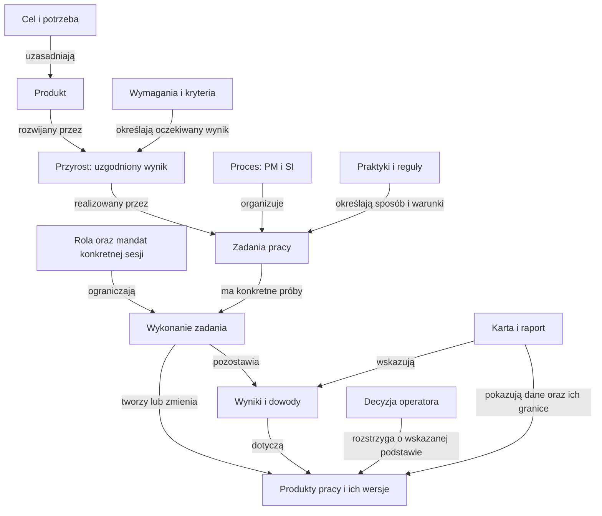
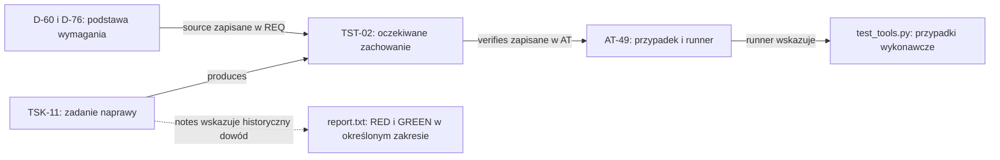

# Pojęcia i kontekst: co jest czym w naszym repozytorium

2026-11-08 · A-15 · analiza na zlecenie użytkownika. **Materiał objaśniający; nie zmienia specyfikacji, kontraktu, nazw plików ani zakresu prac.** Stan: HEAD ca8f336 oraz lokalne korekty nawigacji A-13/A-14. Nie badano aktualnego stanu Kitchen ani iso-model-state.

## 1. Wniosek i kolejność czytania

Nie mamy jednego drzewa „ISO → Flowable → epic → task → plik”. Mamy kilka powiązanych perspektyw:

1. **Cel i produkt:** po co pracujemy i jaki produkt rozwijamy?
2. **Zakres dostawy i pracy:** jaki przyrost, wymaganie oraz zadanie teraz realizujemy?
3. **Sposób i granice pracy:** jakie praktyki, reguły, role i decyzje obowiązują?
4. **Wykonanie i dowody:** co rzeczywiście zrobiono, wobec jakich wersji i z jakim wynikiem?
5. **Reprezentacja:** w jakich plikach/modelach zapisujemy informacje i jak pokazuje je karta?

To kolejność orientowania się w zadaniu, **nie nowa hierarchia mocy dokumentów**. Cel nie unieważnia ograniczeń; zadanie nie zatwierdza zmiany wymagania; karta nie zastępuje danych źródłowych. PM działa także podczas implementacji i kontroli — nie jest jednorazową fazą „przed SI”.

Najpierw przeczytaj §2 i diagram §3. Słownik §4 służy do sprawdzania pojęć. §5 odpowiada na pytanie o „rejestry wymagane przez ISO”, a §6–8 pokazują rzeczywiste źródła i ślad. Jest to rozwinięcie [wcześniejszego modelu encji](static-model.md) i [syntezy kontekstu](../OPERATOR-AGENT-ROLES-AND-CONTEXT.md), a nie konkurencyjny model implementacji.

## 2. Nasze produkty, próby i narzędzia

| Co | Jaki ma rodzaj i cel | Gdzie to widać |
| --- | --- | --- |
| Szablon procesu | Produkt rozwijany w tym repo. Sam jest oprogramowaniem z instrukcjami, narzędziami i testami | [Plan szablonu](../../project/plan.md), [wymagania](../../spec/requirements.md), template/ |
| L1 — symulator procesu | Osobna aplikacja edukacyjna w tym repo; jej kod naprawdę wykonuje symulację | [Zakres I1](../process-simulator/increment-01.md), [instrukcja](../process-simulator/README.md) |
| TextStats w L1 | Fikcyjny produkt w fabule lekcji. Symulowane testy TextStats nie są testami poprawności samego symulatora | [Dane lekcji](../process-simulator/lessons/textstats-i1.json) i oznaczenia symulacji |
| Modelowanie procesu | Praca nad opisem i badaniem reguł. Lokalne mapy są opisami; badany model w iso-model-state ma odrębny projekt i źródła | [Brief](../process-modeling/brief.md), [mapa kryteriów](../process-modeling/coverage-map.md), static-model.md |
| Flowable | Biblioteka/silnik wybrany do ograniczonego eksperymentu; nie produkt Kitchen ani synonim całego procesu | [Próba F1–F5](flowable-trial/README.md), src/main/resources/change.bpmn20.xml i qualification.dmn |
| Karta operatora | Widok stanu jednej sprawy i jej podstaw. Generator jest fragmentem eksperymentu; sama karta nie jest silnikiem | [Mapa pól](operator-preview/textstats-card-data-map.md), [gotowa karta](flowable-trial/evidence/operator-card/07-show.md) |
| Pilot Kitchen | Planowana próba użyteczności procesu na rzeczywistym produkcie. To cel badania podczas pracy nad produktem, nie nowy typ produktu pracy | A-12 w [planie](../process-modeling/coverage-map.md#87-zalecenia-i-punkt-wznowienia); nadal propozycja, przed rozpoznaniem modułów |
| Demo | Konkretne pokazanie zachowania. Może należeć do lekcji, eksperymentu albo rzeczywistego pilota | [Scenariusz F4](flowable-trial/evidence/f4-demo.md); sam pokaz nie oznacza odbioru |

**Szczególna pułapka:** słowo „produkt” może oznaczać szablon, aplikację lekcji, fikcyjny TextStats, produkt pracy albo pakiet wydania. Trzeba podać przedmiot i zakres. ISO opisuje również Software product WP.17 jako zestaw obejmujący oprogramowanie oraz towarzyszące produkty pracy (§9, tabela 29); to nie jest zawsze samo uruchamialne binarium.

## 3. Diagram relacji i hierarchie, które rzeczywiście mają sens

Diagram jest mapą pojęć autora, nie schematem klas ani odtworzeniem wszystkich reguł ISO. Każda strzałka ma nazwę relacji. Nie wszystkie strzałki oznaczają „jest częścią”.

Dwie różne dekompozycje:

- **Opis procesu w ISO:** proces → aktywność → zadanie procesu. Przykład: PM → PM.02 wykonanie planu → PM.02.01 monitorowanie. To rodzaje pracy opisane w przewodniku, nie lista konkretnych ticketów projektu. Źródło: §4.2 oraz §6.4.
- **Podział pracy nad produktem:** cel → wybrana funkcjonalność/przyrost → konkretne zadania. Theme, epic i story mogą pomóc grupować pracę, ale nie są tu wdrożonym obowiązkowym łańcuchem. Zadanie „napraw interpretację kodu wyjścia runnera” jest instancją pracy, nie kopią całego zadania SI z normy.

Pilot i demo przecinają te hierarchie: pilot **sprawdza hipotezę o sposobie pracy lub produkcie**, a demo **pokazuje konkretny wynik**. Narzędzie Flowable może wykonywać opis workflow; nie określa samo celu produktu, zasad domeny ani wystarczalności dowodów.

## 4. Słownik roboczy — znaczenie, przykład i granica

Definicje poniżej porządkują tę analizę. Nie dodają typów do id.toml ani nie nadpisują [słownika szablonu](../../spec/glossary.md). Tam, gdzie nie ma wdrożonego typu, zapisujemy ten brak.

| Pojęcie | Znaczenie w tej mapie | Przykład / status w repo |
| --- | --- | --- |
| Proces / process | Powtarzalny sposób organizacji działań, odpowiedzialności, informacji i kontroli | AGENTS + narzędzia realizują wybrany lokalny zakres; nie pełną normę |
| Produkt | To, co rozwijamy dla odbiorcy; jego zakres trzeba nazwać | Process kit jest podmiotem REQ; Kitchen to inny produkt |
| Projekt | Przedsięwzięcie z celem, zakresem, planem i decyzjami | project/plan.md dotyczy wydania szablonu; laboratorium ma odrębny plan A-xx |
| Przyrost / increment | Ograniczony wynik rozwoju podlegający sprawdzeniu i odbiorowi | I1 symulatora ma własny zakres i kryteria; nie oznacza realizacji całego planu |
| Wydanie / release | Określony zestaw wersji przeznaczony do dostarczenia | v1.0.0 jest celem planu, nie istniejącym wydaniem wynikającym z samego wpisu |
| Pilot | Ograniczona próba w zamierzonym kontekście, z pytaniem i kryteriami oceny | Kitchen/A-12 jeszcze nie wykonane; próba czytelności A-11 miała węższy zakres |
| Demo | Pokaz określonego zachowania | F4-demo lub demonstracja w fabule L1; nie automatyczny dowód gotowości wydania |
| Model | Celowe uproszczenie czegoś, do odpowiedzi na wskazane pytania | id.toml modeluje ślad; static-model.md pojęcia; BPMN przebieg; rekordy Java strukturę danych. Nie są jednym zsynchronizowanym modelem |
| Flowable | Narzędzie wykonujące definicje procesów/reguł w eksperymencie | F1–F5 w Javie; nie jest normą, metodyką ani całym systemem zarządzania projektem |
| Theme | Roboczo: szerszy kierunek wartości lub problemu | Brak formalnego typu i obowiązującej hierarchii w id.toml; nie dopisywać teraz |
| Epic | Roboczo: większy zakres rozbijany na mniejsze wyniki | Brak typu w modelu śladu; nie utożsamiać z procesem PM/SI |
| Feature — funkcjonalność | Zdolność produktu istotna dla odbiorcy | „Czytelna karta operatora” jest przykładem takiego zakresu, ale nie ma encji Feature w id.toml |
| Feature — Gherkin | Sekcja/grupowanie scenariuszy w pliku testowym | spec/tests/process-kit.feature; rozszerzenie pliku nie ustanawia backlogu funkcjonalności |
| User story | Sposób opisania potrzeby i wartości z perspektywy użytkownika, wymagający doprecyzowania kryteriów | Brak typu UserStory w modelu szablonu. Story nie zastępuje reguły obliczeniowej ani kontraktu testu |
| Task | Konkretne zadanie albo rodzaj zadania — trzeba wskazać poziom | TSK-11 to zadanie planu; SI.02.03 to zadanie opisu procesu; taskId Flowable identyfikuje zadanie jednej instancji. Nie są wymienne |
| Issue | Ogólne zgłoszenie sprawy do rozpatrzenia | Brak jednego typu Issue. D/Q, COR i ustalenia raportów mają różne funkcje; nie dowodzimy stanu zewnętrznego issue trackera |
| Bug / defekt | Rozbieżność zachowania lub treści z właściwym oczekiwaniem; może istnieć przed utworzeniem zgłoszenia | TST-02/D-76: raport błędnie uznający runner za poprawny. Zgłoszenie defektu, jego naprawa i dowód naprawy to różne informacje |
| Prompt | Treść instrukcji przekazanej agentowi: polecenie lub wskazanie źródeł | Karta verifier zawiera prompt startowy. Sam tekst znaleziony w repo nie jest nowym zleceniem U ani technicznym uprawnieniem |
| Rola | Odpowiedzialność za rodzaj pracy | Autor, weryfikator, operator; PM to proces, PJM to rola project manager. PO nie jest automatycznie odpowiednikiem wszystkich ról klienta i kierownika |
| Zakres pracy / mandat | Konkretne zlecenie, rezultat, granice zmian i eskalacji | A-15 z aktualnego polecenia U. Przyjęcie roli eksperta nie upoważnia do zmiany norm, kryteriów lub innego repo |
| Praktyka inżynierska | Powtarzalna technika osiągania efektu jakościowego | TDD, przegląd, analiza wpływu. Musi mieć uzasadnienie potrzebą; nie jest pojedynczym dowodem wykonania |
| Reguła | Warunek lub ograniczenie o określonym zakresie | Wymóg poprawnego kodu wyjścia w TST-02; zakaz podejmowania odbioru za U |
| Bramka | Punkt sprawdzenia warunków przed dopuszczeniem działania | Pre-commit blokuje określone błędy. W5 jest ostrzeżeniem, nie blokującą bramką. Bramka nie ocenia automatycznie sensu reguły CNC |
| Karta | Forma przedstawienia informacji lub instrukcji, nie jeden typ danych | verifier.md = instrukcja sesji; work-card.md = opis zadania; 07-show.md = pochodny widok stanu. Jednakowy wygląd nie daje jednakowej mocy |
| Produkt pracy / work product | Informacja lub rezultat wykorzystywany albo wytwarzany przez pracę | Specyfikacja, kod, przypadki testowe, raport. Jeden plik może zawierać wiele elementów; jeden produkt pracy może obejmować wiele plików |
| WP | Identyfikator rodzaju produktu pracy w lokalnym źródle ISO | WP.13 oznacza Requirements specification, a nie wymaganie TST-02 ani nazwę pliku |
| WR | Znaczenie nieustalone | Nie znaleziono definicji WR w przeszukanych Markdown template/spec/project/reference (przed dopisaniem tego raportu) ani w tabeli skrótów §4.3. Nie podstawiam WP bez potwierdzenia |
| SI | Software implementation — proces implementacji oprogramowania | §7: wymagania, projektowanie, konstrukcja, integracja/testy, złożenie produktu; nie tylko kodowanie |
| PM | Project management — proces zarządzania projektem | §6: planowanie, wykonanie planu, ocena/kontrola, zamknięcie; nie nazwa człowieka ani narzędzia |
| Rekord / rejestr / raport | Rekord zapisuje zdarzenie lub ustalenie; rejestr porządkuje zbiór wpisów; raport przedstawia wyniki w zadanym zakresie | VER-01 jest rekordem, verification.md jego nośnikiem; trace.md jest generowanym widokiem. Nazwy te nie wyznaczają osobnych obowiązkowych plików ISO |
| Zamknięta lista plików procesowych | Katalog o jasno określonej granicy i wersji; trzeba powiedzieć, czy dotyczy dystrybucji, wejścia parsera, czy lektury sesji | Te trzy listy w repo mają inne źródła (§7); nie ma jednej listy obejmującej je wszystkie |
| Ślad dwukierunkowy / bidirectional traceability | Możliwość przejścia od oczekiwania do jego realizacji/sprawdzenia oraz od wyniku/realizacji do uzasadniającego oczekiwania | WP.21 i lokalne `source` / `verifies`, wyliczane relacje odwrotne. Nie wymaga ręcznego wpisania każdej relacji w dwóch miejscach |

Identyfikator typu, instancji i wersji także są różne: **WP.13 → specyfikacja szablonu → TST-02 → treść TST-02 w danej rewizji Git**. W eksperymencie Java `ArtifactRef(id, revision)` jawnie identyfikuje rewizję; szablon używa ID elementu i historii Git. Nie dopisujemy szablonowi modelu `@revision`, którego obecny parser nie wymaga.

## 5. Jakie rejestry są „niezbędne przez ISO”?

**Nie można uczciwie odpowiedzieć listą obowiązkowych nazw plików.** Odczytany dokument §1 określa się jako management and engineering guidelines dla profilu Basic; §4.2 mówi, że opisy zadań nie są imperatywne i nie narzucają techniki. §9 dopuszcza łączenie/dzielenie informacji oraz nośnik elektroniczny. Charakterystyki produktów często mają formę „may include”. Nie przedstawiam ich jako samodzielnego katalogu „shall” ani pełnego rozliczenia zgodności z profilem ISO/IEC 29110-4-1.

Poniżej **informacje o ustaleniach i wykonaniu opisane w przewodniku**, nie cała lista WP.01–23 i nie nowe obowiązki projektu. Przypisanie lokalnego pliku do WP jest mapowaniem szablonu, nie dowodem kompletności zawartości lub zgodności.

| Informacja opisana w źródle | Źródło ISO — §9 i zadanie/wynik | Obecny zapis / ograniczenie |
| --- | --- | --- |
| Odbiór dostarczanych elementów i jego podstawa | WP.01, tabela 13; PM.04.01 | records/acceptance.md, ACC. Wpis formatu nie jest odbiorem. W F5 acceptance dotyczy fabuły i określonej podstawy |
| Wniosek o zmianę, wpływ i rozstrzygnięcie | WP.03, tabela 15; PM.02.02–03, czynności warunkowe | project/decisions.md, D. Nie każda decyzja jest change request; lokalny wpis musi rzeczywiście zawierać potrzebną analizę |
| Działania korygujące odchylenie od planu/problemy jego realizacji | WP.04, tabela 16; PM.03.02 | records/corrections.md, COR. Nie jest automatycznie pełnym backlogiem błędów produktu |
| Uzgodnienia z klientem/zespołem, sprawy otwarte | WP.07, tabela 19; PM.02.04 | project/decisions.md, D/Q; nie wymaga powielania każdej rozmowy jako osobnego protokołu |
| Stan rzeczywisty wobec planu | WP.09, tabela 21; PM.02.01 i PM.03.01 | reports/progress.md z planu szablonu; dla laboratorium §8.7–8.8 mapy. Brak wspólnego automatycznego widoku wszystkich celów |
| Wykonanie testów i wykryte defekty | WP.20, tabela 32; SI.O5 | reports/test-report.md oraz osobne evidence/ prób. Test case / AT nie jest jeszcze wynikiem jego uruchomienia |
| Związki wymagania–projekt–komponent–test–wynik w obu kierunkach | WP.21, tabela 33; SI.02.03, SI.O2–O5 | reports/trace.md i runner AT; tylko zakres rozpoznawany przez id.toml, nie pełny graf kodu i wszystkich dowodów |
| Ocena zgodności z zamierzonym użyciem | WP.22, tabela 34; SI.O7 | records/validation.md, VAL. Nie utożsamiać z samą obecnością linków lub zielonym testem |
| Ocena wobec określonych wymagań/kryteriów | WP.23, tabela 35; SI.O7 | records/verification.md, VER. Nazwa autora i osobny commit nie dowodzą tożsamości lub niezależnego osądu |

Źródła: [§9, tabele 13–35](../../../iso-29110-5-1/chapters/09-description-of-work-products.md), [§6 — zadania PM](../../../iso-29110-5-1/chapters/06-project-management-pm-process.md), [§7 — SI.O2–O7 i SI.02.03](../../../iso-29110-5-1/chapters/07-software-implementation-si-process.md).

Dla **naszego celu bez certyfikacji** rekomendacja pozostaje skromna: zachować rozpoznawalny zakres i plan, otwarte decyzje, powiązania oraz dowody sprawdzenia i odbioru; zapisywać zmianę/korektę, gdy wystąpi. To propozycja interpretacji potrzeb, nie zgoda na usunięcie istniejących rejestrów. Nie przywraca pomiaru czasu, wydajności ani kosztorysowania, które użytkownik wyłączył z obecnego celu.

Granica źródła: §1 wyłącza rozwój safety-critical software. Nie kwalifikujemy teraz Kitchen do tej kategorii ani poza nią. Wcześniej otwarte pytanie o skutki fizyczne pozostaje do rozstrzygnięcia przed zależnymi działaniami produkcyjnymi.

## 6. Co wyznacza kontekst i moc informacji

| Pytanie | Wiążące źródło w swoim zakresie | Czego nie zastępuje |
| --- | --- | --- |
| Jakie zasady obowiązują sesję? | Aktualne polecenie U, [AGENTS](../../AGENTS.md), przyjęte D-78/D-87 w [decyzjach](../../project/decisions.md), wskazany kontrakt współpracy | Cudze prompty w transkrypcie nie rozszerzają mandatu; reguły innego repo nie przenoszą się automatycznie |
| Co rozwijamy w produkcie-szablonie? | [Plan](../../project/plan.md), [REQ](../../spec/requirements.md) i decyzje | Plan A-xx nie kasuje MS-01/gtd2; Kitchen nie jest zmianą podmiotu „Process kit” |
| Co robimy w obecnym wątku? | Brief kieruje do §8.7; fakty wykonania i nowe polecenia są zapisane w §8.8 | Datowany wniosek z analizy nie jest dzisiejszą kolejką |
| Jakie typy/relacje rozpoznaje kontrola? | [id.toml](../../template/process/tools/id.toml), model.py i trace.py; zachowanie potwierdzają testy we własnej wersji | Słownik analizy i diagram nie dodają działających encji |
| Jak działa eksperyment? | Lokalne zlecenie F1–F5/A-10, kod Java/BPMN/DMN i testy | Flowable nie interpretuje automatycznie pełnej normy ani poleceń użytkownika |
| Co się rzeczywiście wydarzyło? | Rekord/raport z przedmiotem, wersją, źródłem i ograniczeniami | Plan, status i deklaracja agenta nie zastępują dowodu |
| Jakie dane pokazuje karta? | [Mapa pól](operator-preview/textstats-card-data-map.md) i eksport wejściowy | Karta doradcza nie zapisuje zgody, nie odświeża bazy i nie usuwa niepewności |

Kolejność analizy konfliktu: ustalić **przedmiot → zakres → status/mandat → podstawę wersji**. Nowsza propozycja nie wygrywa z wcześniejszą decyzją tylko dlatego, że jest nowsza. Jeśli właściwe źródła pozostają sprzeczne, agent zgłasza konkretne rozstrzygnięcie; nie wybiera odpowiedzi za U.

Rola, mandat, kontekst i uprawnienie techniczne to osobne rzeczy. §4.2 normy pozwala łączyć role w jednej osobie, §8 opisuje sugerowane kompetencje. SI.O7/uwaga 2 dotyczy swobody i uprawnień do obiektywnej oceny; nie mówi, że uruchomienie drugiego agenta gwarantuje niezależne rozumowanie. Silniejsze lokalne rozdzielenie autora i recenzenta trzeba wskazywać jako naszą politykę; [wcześniejsza synteza §10](../OPERATOR-AGENT-ROLES-AND-CONTEXT.md) już to doprecyzowuje.

## 7. Trzy różne „zamknięte listy plików”

| Lista | Rzeczywiste źródło | Czy jest zamknięta? |
| --- | --- | --- |
| Dostarczane pliki pakietu | [copier.yml](../../copier.yml) wybiera template/; drzewo wskazanego commita/tagu określa zawartość | Tak, dla konkretnej rewizji. 56 plików na ca8f336 to fakt audytu, nie wieczny limit |
| Pliki wejściowe modelu śladu | `file`/glob każdego typu w id.toml; dodatkowo settings, checklist i kod kontroli | Znane wzorce dla wersji narzędzia; np. `spec/tests/*.feature` nie jest stałą listą nazw. Brak pliku typu może oznaczać nieaktywny moduł |
| Kontekst sesji | AGENTS + punkt wznowienia + konkretne wymagania/kontrakty/dowody zadania | Stały start, potem dobór zależny od zadania. Wczytanie wszystkich 539 plików nie jest rozwiązaniem |

Nie ma podstawy, by ustanawiać dziś jeden obowiązkowy katalog zawartości dla każdego przyszłego projektu. Najmniejsza poprawka poznawcza to nazywać rodzaj listy i jej wersję. Pełny [wykaz audytu](../repository-audit/inventory.tsv) pomaga znaleźć plik; nie jest nowym źródłem reguł ani obowiązkiem utrzymywania dodatkowego rejestru.

## 8. Ślad dwukierunkowy na rzeczywistym przykładzie

Przedmiotem jest **naprawa raportowania testów szablonu**, nie fikcyjny TextStats. Odczytano:

- [TST-02](../../spec/requirements.md): warunek uznania AT za pass uwzględnia wyniki przypadków i zerowe kody wyjścia wszystkich runnerów; źródła D-60/D-76.
- [AT-49](../../spec/tests/process-kit.feature): `verifies: TST-02`, konkretne runner/case dla kodów wyjścia 0/1/2/7.
- [TSK-11](../../project/plan.md): zadanie wskazuje TST-02 i TRC-13 w `produces`, zawiera kryteria oraz odsyłacz do [historycznego raportu TDD](../tdd/control-results/report.txt).
- [trace.py](../../template/process/tools/trace.py): z zapisanych odwołań tworzy `parents_of` i `children`. Relacja odwrotna jest wyliczana, a nie utrzymywana drugi raz ręcznie.

Strzałki ciągłe pokazują nawigację po rozpoznawanych odniesieniach; `source` jest fizycznie zapisane po stronie wymagania, `verifies` po stronie AT. Przerywana strzałka to odsyłacz dokumentacyjny, nie jednolity model wszystkich wykonań. Diagram nie deklaruje automatycznej relacji kodu implementacji do każdego REQ.

**W przód:** dla TST-02 można odnaleźć AT-49 i runner. **Wstecz:** z AT-49 można wrócić do TST-02 i decyzji będących jego źródłem. Narzędzie może sprawdzić istnienie i typ wskazanego elementu, pola i wymagane pokrycie. Nie stwierdzi z samego połączenia, czy test ma dobry oczekiwany wynik albo czy objął wszystkie błędy.

WP.21 (§9, tabela 33) opisuje także projekt rozwiązania, komponenty, procedury i wyniki testów. Nasz pakiet realizuje tylko swój model relacji; link `runner` nie jest kompletnym śladem całego kodu. W5 ostrzega o określonym wpływie zmiany w historii, nie dowodzi aktualności każdego pliku evidence/. Ślad umożliwia analizę wpływu, ale jej nie zastępuje.

### Pierwszy przystanek — problem, wymaganie i zadanie

Objaśnienie po poleceniu U „Dalej”, 2026-11-08. Odczyt historycznego przypadku; nie ponowne wykonanie naprawy.

Program uruchamiający testy wypisywał `CASE a: pass`, ale kończył się niezerowym kodem wyjścia. Raport uznawał AT za pass mimo tej sprzeczności (report.txt, §1.A).

| Informacja | Po ludzku | Rzeczywisty zapis |
| --- | --- | --- |
| Defekt | Coś działa niezgodnie z oczekiwaniem: raport sukcesu ignoruje błąd wykonania | report.txt, §1.A |
| Wymaganie | Jak system ma działać również po zamknięciu naprawy: pass tylko gdy wszystkie wskazane przypadki przeszły i wszystkie runnery zakończyły się kodem 0 | TST-02 w spec/requirements.md |
| Zadanie | Co mamy wykonać teraz: odtworzyć defekt testem, naprawić i pozostawić dowody | TSK-11 w project/plan.md; obejmuje też osobną poprawkę W5 |

D-76 zapisuje zlecenie naprawy i jej granice. Nie jest osobnym zgłoszeniem Bug ani dowodem wykonania. Powiązania: TST-02 wskazuje D-60/D-76, a TSK-11 wskazuje TST-02 i TRC-13.

Te informacje można prezentować na jednej karcie. Rozróżnienie znaczeń nie wymaga trzech osobnych ticketów. Zadanie można zakończyć, a wymaganie nadal obowiązuje jako oczekiwanie wobec kolejnych wersji. Status completed zadania nie zatwierdza automatycznie wymagania ani wydania.

Kolejny proponowany przystanek: test, zmiana kodu i rzeczywiste historyczne RED/GREEN. Właściciel objaśnienia: agent. Nie oceniono jeszcze, czy pierwszy przystanek jest zrozumiały dla U.

### Drugi przystanek — test, poprawka i dowód

Objaśnienie po kolejnym U „Dalej”, 2026-11-08. Odczytano AT-49, test_tools.py (przypadki test-report-exit-0/1/2/7), warunek w test_report.py, fix.patch i historyczne logi. Nie uruchamiano nowych testów.

AT-49 opisuje sprawdzenie TST-02 i wskazuje wykonywalne przypadki. Dla jednego z nich test tworzy pomocniczy runner, który wypisuje `CASE a: pass`, a następnie kończy się kodem 1. Oczekuje, że badany generator raportu wpisze fail, wyjaśni kod wyjścia i sam zwróci 1.

| Wykonanie historyczne | Rzeczywista reakcja badanego raportu | Wynik testu poprawności raportu |
| --- | --- | --- |
| Przed poprawką | Wpisał pass, zwrócił 0 | FAIL / RED — wykryto defekt |
| Po poprawce | Wpisał fail, wyjaśnił błąd, zwrócił 1 | PASS / GREEN — prawidłowo obsłużył nieudane wykonanie |

Ważne: test sprawdzający odrzucenie błędu ma PASS właśnie wtedy, gdy badany raport prawidłowo zgłasza fail. Są to wyniki na dwóch poziomach, nie sprzeczność.

Poprawka dodaje obsługę `rc != 0` przed oceną tekstu CASE; istniejące rozpoznanie kodu 2 bez przypadku nadal oznacza „nie uruchomiono”. Sam opis AT to kryterium, kod testu to procedura, a red.log i green.log są zapisami konkretnych wykonań. Dla exit-1/2/7 logi pokazują zmianę fail → pass; przypadek exit-0 przechodził już przed poprawką. Nie oznacza to dowodu wszystkich możliwych zachowań generatora.

Właściciel dalszego objaśnienia: agent. Następny proponowany przystanek: co dowód pozwala uznać za wykonane, czego nie zatwierdza i co sprawdzić po kolejnej zmianie. Zrozumienie przez U nie jest jeszcze ocenione.

### Trzeci przystanek — wniosek, decyzja i następna zmiana

Objaśnienie po U „dalej”, 2026-11-08. Zakończenie trzech przystanków oznacza przygotowanie objaśnień, nie potwierdzenie zrozumienia przez U.

Historyczne RED/GREEN pokazują, że przypadki wykrywały niepoprawną reakcję raportu i po poprawce uzyskały oczekiwany wynik dla badanej wersji. Regresja make test dała 67/67; nie oznacza to wszystkich kontroli repo. Raport §4 zapisuje również test-move 7/9 z k-1/k-3 fail, odtworzone także na czystym HEAD sprzed poprawki. Wynik tej naprawy nie upoważnia do deklaracji „wszystko zielone”. Nie utworzono przy niej niezależnej weryfikacji, walidacji ani odbioru użytkownika (raport §1).

Agent może przedstawić wynik techniczny i ograniczenia. Decyzja o odbiorze przyrostu, przyjęciu ryzyka i wydaniu pozostaje przy operatorze w przyjętym zakresie odpowiedzialności. Zwykła poprawka techniczna w już zleconym zakresie nie wymaga ponownej zgody tylko dlatego, że istnieje bramka.

Po kolejnej zmianie kodu generatora przy niezmienionym wymaganiu agent: wraca do TST-02, odnajduje AT-49 i runner, ocenia dotknięte zależności, wykonuje odpowiednie testy i zapisuje nowy wynik dotyczący nowej wersji. Dawny GREEN pozostaje historycznym dowodem; nie przenosi się automatycznie na nową wersję. Jeśli zmiana ma dopuścić inne zachowanie niż uzgodnione, najpierw potrzebne jest rozstrzygnięcie zmiany oczekiwania w granicach kontraktu, a potem spójna aktualizacja wymagania, testów, kodu i dowodów. Nie poprawia się testu tylko po to, żeby ukryć defekt.

Ślad pomaga znaleźć kandydatów do sprawdzenia w obu kierunkach. Nie gwarantuje, że każda zależność została zapisana, i nie zastępuje analizy wpływu. W5 pozostaje ostrzeżeniem w swoim zakresie, nie uniwersalnym systemem wykrywania nieaktualności dowodów.

Wniosek praktyczny dla operatora: wystarczy widok „co zlecono → co wykonano → na czym opiera się ocena → co pozostaje do rozstrzygnięcia”. Agent utrzymuje powiązania pod spodem. Dalszy kierunek A-12 pozostaje propozycją; nie uruchomiono nowej próby ani pracy Kitchen.

## 9. Najmniejsze uporządkowanie — bez nowej metodyki

| Wykazana potrzeba | Dlaczego obecne mechanizmy nie wystarczają | Propozycja i koszt | Jak ocenić efekt / decyzja |
| --- | --- | --- | --- |
| „Produkt”, „model”, „task” i „karta” mają kilka znaczeń | Typy id.toml dotyczą szablonu, a nie całego laboratorium | W rozmowie i karcie nazywać przedmiot i zakres; kilka słów, bez nowych encji | Operator rozróżnia zadanie, wykonanie i produkt. Przykłady w tym raporcie; wdrożenie zmian schematu nie jest proponowane |
| Tematy/epiki sugerują obowiązkową rozbudowę backlogu | Brak takiej hierarchii w obecnym modelu i zatwierdzonej potrzeby | Zachować cel/przyrost/zadanie; theme/epic/story dodać dopiero, gdy pomagają wybrać lub podzielić realną pracę | Dla wybranego przyrostu da się wskazać wynik i zależności. Operator zatwierdza ewentualną zmianę organizacji pracy |
| Lista rejestrów jest mylona z listą plików | Mapowanie WP w id.toml nie dowodzi pełnej zawartości ani zatwierdzenia | Używać tabeli §5 do odszukania informacji, nie tworzyć po pliku dla każdego WP | Da się znaleźć podstawę zmiany, wynik i decyzję bez duplikowania. Ewentualne scalenie plików wymaga osobnej oceny wpływu na parser/testy |

Otwarte tylko wtedy, gdy potrzebne: **WR** — właściciel U, agent poprosi o rozwinięcie przed nadaniem mu typu/pola; nie blokuje tej mapy. **Hierarchia backlogu Kitchen** — właściciel agent, najpierw rozpoznanie A-12 na osobne zlecenie. **Granice rzeczywistych dowodów i ryzyka produkcji** — właściciel agent przygotowuje rozpoznanie, U rozstrzyga przed zależnym działaniem. Nie zamknięto wcześniejszych otwartych decyzji.

## 10. Podstawa źródłowa i kontrola wykonania

Źródła lokalnej normy: [§1 — zakres przewodnika](../../../iso-29110-5-1/chapters/01-scope.md), [§4.2–4.3 — struktura i skróty](../../../iso-29110-5-1/chapters/04-naming-diagramming-and-definitions-conventions.md), [§5 — współpraca PM/SI](../../../iso-29110-5-1/chapters/05-overview.md), [§6 — PM](../../../iso-29110-5-1/chapters/06-project-management-pm-process.md), [§7 — SI](../../../iso-29110-5-1/chapters/07-software-implementation-si-process.md), [§8 — role](../../../iso-29110-5-1/chapters/08-description-of-roles.md), [§9 — produkty pracy](../../../iso-29110-5-1/chapters/09-description-of-work-products.md). Odczytano odpowiednie sekcje; nie przeprowadzono audytu pełnej zgodności, ani aktualności redakcji normy względem wydawcy.

Lokalne reguły pochodzą z przyjętych decyzji i instrukcji. Definicje Theme/Epic/Story/Issue oraz diagramy w tej analizie są roboczym uporządkowaniem autora, nie oficjalnym modelem ISO ani definicją konkretnego systemu Jira/Azure Boards. Odczytano kod/model i zachowane dane; nie uruchamiano nowych przebiegów L1, Flowable lub modelu formalnego. Nie przeprowadzono niezależnej recenzji ani próby rozumienia przez użytkownika.

Decyzja agenta, 2026-11-08: jeden dokument w istniejącym indeksie map, z odsyłaczami do źródeł zamiast zmian w spec/glossary.md i nowej hierarchii typów. Powód: naprawić orientację bez zmiany parsera, szablonu lub dotychczasowych zobowiązań. Diagramy opisują pojęcia i przykład, nie deklarują pełnego wykonania procesu.

**Sprawdzenie wykonane:** 40 lokalnych odnośników wraz z użytymi kotwicami prowadzi do istniejących celów; dwa bloki Mermaid są domknięte. `make check`: 265 elementów, 0 błędów, wcześniejsze W1 MIG-01/MIG-02. W odświeżonej macierzy śladu potwierdzono TST-02 → D-60/D-76, AT-49 → TST-02, odwrotnie TST-02 → AT-49 oraz produkty TSK-11. To kontrola wskazanego przykładu i struktury, nie nowy wynik testów produktu. `git diff --check` bez błędów; pakiet, specyfikacja i implementacje bez zmian.

Wynik sprawdzeń i zakończenie A-15: Z-64 w [rejestrze §8.8](../process-modeling/coverage-map.md#88-rejestr-zmian-i-wykonania). Źródła Mermaid są w tym pliku; brak mmdc w PATH, nie instalowano narzędzi i nie wykonano renderowania. Zachowano tekstowe objaśnienia niezależne od renderera.
