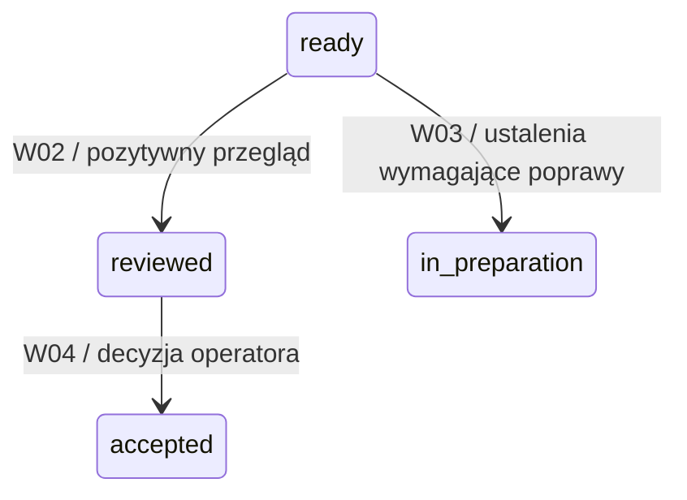

# Jeden przykład: od ISO do wykonywalnego przejścia

2026-10-26. **Opis do przeglądu, nie implementacja.** Przykład dotyczy przeglądu przygotowanego wydania. Nie wybiera funkcji Kitchen, nie wdraża mechanizmu zgód ani manifestów wejść. Identyfikatory z `DEMO` są fikcyjne.

## 1. Wybrany fragment i cel

Chcemy, aby system nie uznał wydania za przejrzane tylko dlatego, że agent wpisał taki status. Stan ma wynikać z wykonania odpowiedniego przeglądu i zapisanego wyniku.



Rozpisujemy **tylko W02: ready → reviewed**. W03 i W04 pokazują kontekst. `ready` oznacza tu przygotowanie do przeglądu w modelu, nie ukończenie wszystkich ocen. `reviewed` nie oznacza odbioru operatora.

## 2. Źródło ISO i nasza adaptacja

| Podstawa | Co z niej wynika | Czego nie należy jej przypisywać |
| --- | --- | --- |
| [Rysunek 4 — SI](../../../iso-29110-5-1/assets/figures/figure-04.png) | Czynności korzystają z produktów i tworzą/aktualizują m.in. Verification record. | To przepływ informacji; nie kompletna tabela przejść runtime. |
| [§7.2, SI.O7](../../../iso-29110-5-1/chapters/07-software-implementation-si-process.md) | Ocena według kryteriów, spójność wejść/wyjść, korekta usterek i zachowanie wyników. | Nie narzuca nazw `ready/reviewed`, JSON ani automatycznej bramki W02. |
| [§9, tabela 35, WP.23](../../../iso-29110-5-1/chapters/09-description-of-work-products.md) | Verification record dokumentuje wykonanie; przykładowa zawartość obejmuje uczestników, checklistę, wyniki i usterki. | Lista ma „may include”; wybór pól jest adaptacją projektu. |
| [PM.04.01](../../../iso-29110-5-1/chapters/06-project-management-pm-process.md) | Odbiór wymaga udziału klienta i zapisu odbioru. | Pozytywny przegląd agenta nie jest decyzją klienta. |

**Nasza adaptacja istniejąca w iso-model-state:** wydanie najpierw przygotowuje autor, następnie ocenia recenzent R, a odbiera użytkownik U. Norma dostarcza celu kontroli; model wybiera organizację i konkretne przejścia.

## 3. Co już działa w istniejącym modelu

Odczytany fragment [model/process.yaml](../../../iso-model-state/model/process.yaml), v0.6:

```yaml
- id: W02
  name: review_pass
  from: [ready]
  to: reviewed
  actor: R
  guard: "true"
  effects: []
  iso: [SI.O7]
```

[Wykonawca](../../../iso-model-state/src/isomodel/execution.py) sprawdza dozwolonego aktora, stan źródłowy, warunek i ograniczenia wykonania. Efekt zmiany stanu wynika z `to`, mimo pustej listy dodatkowych `effects`. Istniejące [testy](../../../iso-model-state/tests/test_execution.py), `test_forbidden_steps_are_atomic`, obejmują odmowę W02 dla A oraz odmowę W04 przed osiągnięciem reviewed. Odczytano kod i testy; nie uruchamiano ich ponownie w tej analizie.

**Granica:** W02 ma guard true, nie deklaruje wymaganego dowodu; funkcja `_check_evidence` pozwala na brak evidence, gdy przejście go nie wymaga. Zatem model reprezentuje oświadczenie recenzenta o pozytywnym przeglądzie, ale nie sprawdza pliku raportu, materiału ani rzeczywistego przebiegu sesji. To granica abstrakcji, nie dowód wykonania recenzji w repozytorium. W03 jest zadeklarowane w modelu, lecz według aktualnego STAN.md pełna obsługa tej ścieżki pozostaje do wykonania; nie przedstawiamy jej jako już działającej ścieżki naprawy.

## 4. Konkretna instancja dydaktyczna

| Obiekt | Wartość i znaczenie |
| --- | --- |
| Wydanie | REL-DEMO-1, stan ready |
| Przedmiot oceny | BASIS-DEMO-A: jednoznacznie wskazana, ustalona wersja materiału wydania |
| Zlecenie | TASK-DEMO-REVIEW: przejrzeć ten materiał według wskazanych kryteriów |
| Wykonawca | RUN-DEMO-R: przypisany przebieg recenzenta, odrębny od przebiegu autora |
| Wynik | VER-DEMO-1, pozytywny wynik i zapis sprawdzenia wszystkich wymaganych kryteriów |
| Ustalenia | Brak nierozwiązanych ustaleń, które według kryteriów wykluczają wynik pozytywny |

ID BASIS-DEMO-A symbolizuje podstawę oceny, nie nowy manifest. Może nią być wskazana wersja repozytorium i zakres ocenianego materiału. Sam numer HEAD nie identyfikuje niezacommitowanych zmian. Jeżeli nie umiemy wskazać ocenianej treści, wynik ma nieustaloną podstawę; nie wolno zgadywać zgodności wersji.

## 5. Proponowane połączenie z rzeczywistym repozytorium

To brakująca warstwa wejścia do modelu, **nie funkcja już dostarczona przez W02**.

1. Agent przygotowuje pakiet do oceny: zlecenie, zakres, kryteria, oceniany materiał i dowody. Nie pyta ponownie o pracę już objętą mandatem.
2. Recenzent wykonuje zlecenie i pozostawia wynik. Materiały oceniane nie są poprawiane w tej samej roli.
3. Adapter odczytuje wynik i ustala, do czego się odnosi. Nie przyjmuje samego `review_ok: true` jako raportu.
4. Przed zastosowaniem W02 kontrola sprawdza poniższe warunki.
5. Dopiero po ich spełnieniu model zmienia stan na reviewed. Wynik kontrolowany i zmiana stanu są utrwalane spójnie; błąd nie pozostawia częściowego sukcesu.

| Warunek przed W02 | Mechaniczne sprawdzenie | Wynik negatywny |
| --- | --- | --- |
| Wydanie jest nadal ready | Odczyt bieżącego stanu i oczekiwanej rewizji stanu | Odmowa: stan zmienił się; odczytaj ponownie |
| Jest wykonanie właściwego przeglądu | Powiązania zlecenie → wykonanie → rekord wyniku | Odmowa: brak wyniku lub nie to zlecenie |
| Wynik dotyczy tego wydania i materiału | Porównanie zakresu oraz wskazanych wersji | Odmowa: przegląd innego/nieaktualnego materiału |
| Zapisano ocenę wymaganych kryteriów | Porównanie zestawu kryteriów z wynikiem | Odmowa: brak oceny wskazanego kryterium |
| Wynik pozwala zakończyć przegląd | Zapis wyniku i stanu ustaleń zgodny z kryteriami | Brak W02; potrzebna obsługa ustaleń |
| Wykonanie pochodzi z przypisanej roli | Powiązanie z uruchomionym przebiegiem i dozwoloną operacją | Odmowa: niewłaściwa rola/przebieg |

Te warunki kontrolują zapis wykonania. Nie orzekają jakości rozumowania recenzenta. Etykieta `R` nie uwierzytelnia tożsamości; sposób egzekwowania uruchomień i dostępu wymaga osobnego rozwiązania przy wdrożeniu. Rozdział przebiegów nie dowodzi niezależności poznawczej.

## 6. Czytelny wynik operacji

Przy powodzeniu — przykład oczekiwanego komunikatu, nie log wykonania:

```text
REL-DEMO-1: ready → reviewed
Podstawa: BASIS-DEMO-A
Przegląd: TASK-DEMO-REVIEW / RUN-DEMO-R / VER-DEMO-1
Następne: przedstawienie do odbioru operatorowi
Odbiór: nie wykonano
```

Przy pominięciu recenzji:

```text
REL-DEMO-1 pozostaje ready
Brak wyniku przeglądu TASK-DEMO-REVIEW dla BASIS-DEMO-A
Następne: wykonać wskazany przegląd
```

Tak działający raport odciąża pamięć: wskazuje brak, obiekt i następny krok. Nie zmienia automatycznie odmowy w zgodę, nie wpisuje odbioru i nie uruchamia produkcji.

## 7. Zmiana, błąd i wznowienie

- **Materiał A zmienił się na B:** wynik A zostaje w historii. Nie stosujemy go automatycznie do B. Sprawdzamy wpływ zmiany i wymagane nowe oceny. Sama publikacja pliku raportu nie powinna unieważniać oceny niezmienionego produktu — porównujemy właściwy zakres.
- **Recenzent zgłosił usterki:** nie wykonujemy W02. Autor otrzymuje ustalenia; po poprawce ponawia wymagane sprawdzenia i przegląd. W03 wskazuje docelową ścieżkę modelu, której obsługę trzeba domknąć przed takim wdrożeniem.
- **Awaria zapisu:** nie może pozostać reviewed bez zachowanego odniesienia do wyniku. Sposób atomowego utrwalenia należy zaprojektować dla adaptera; obecna atomowość operacji w pamięci nie zapewnia trwałości.
- **Ponowienie tej samej operacji:** ma rozpoznać już zapisany rezultat albo odmówić bez nowych skutków; nie tworzyć fikcyjnego drugiego przeglądu.
- **Nowa sesja:** odczytuje stan i podstawę ostatniego przejścia, zamiast rekonstruować je z rozmowy.

## 8. Jak sprawdzić wdrożenie — przyszłe kryteria

| Próba | Oczekiwany wynik |
| --- | --- |
| Właściwy przegląd, zgodna podstawa i kryteria | reviewed; odniesienie do wyniku zachowane; brak odbioru |
| Brak raportu mimo zdarzenia z actor R | Odmowa; ready bez zmian |
| Raport innego wydania lub starszego materiału | Odmowa z identyfikatorem rozbieżności |
| Brak oceny jednego wymaganego kryterium | Odmowa ze wskazaniem brakującego kryterium |
| Nierozwiązane ustalenie wykluczające wynik pozytywny | Brak W02; jawna ścieżka poprawki |
| Próba autora bez właściwego przydziału | Odmowa; stan bez zmian |
| Materiał zmieniony pomiędzy sprawdzeniem a zapisem | Odmowa lub ponowna ocena na aktualnym stanie; brak użycia starej podstawy |
| Przerwanie utrwalenia / powtórzenie polecenia | Spójny stan po wznowieniu; bez podwójnych skutków |
| Próba W04 przed W02 | Odmowa przejścia; istniejący model już ma tę granicę stanów |

Do TDD: najpierw negatywna próba „R bez raportu” na planowanej granicy adaptera, potem minimalna implementacja i przypadek poprawny. Test istniejącego W02 nie powinien błędnie oczekiwać od niego funkcji, której model jeszcze nie deklaruje. Zmiana semantyki przyjętego modelu wymaga właściwej decyzji w iso-model-state; opracowanie przykładu nie udziela takiej zgody.

## 9. Koszt i decyzje pozostające przy wdrożeniu

Koszt minimalny: utrzymanie odnośnika zlecenia, ocenianej podstawy, kryteriów i wyniku; adapter do rzeczywistych zapisów oraz testy odrzucenia błędnych powiązań. W pierwszej próbie mierzymy pominięte/nieaktualne wyniki wykryte przez kontrolę, fałszywe blokady i czas utrzymania zapisów. Wykorzystujemy istniejący rekord przeglądu; nie tworzymy drugiej ręcznej kopii.

Otwarte do etapu wdrożenia: wybór identyfikacji ocenianego materiału, trwałego zapisu i technicznego rozdziału sesji; zakres kryteriów danego przeglądu. Przygotowanie wariantów należy do agenta. Nie blokują przeczytania tego przykładu. W5 pozostaje ostrzeżeniem i nie jest zastępowane tym opisem.

## 10. Status wykonanej pracy

Odczytano źródła ISO, model v0.6, funkcje wykonawcy i istniejące testy. Sprawdzono ścieżki dokumentacyjne. Nie uruchamiano testów modelu, recenzentów ani przedstawionego przejścia; nie zmieniono modelu, kodu, zgód, narzędzi ani zewnętrznych repozytoriów. To gotowy przykład do dyskusji o implementacji, nie deklaracja wdrożonej bramki.
