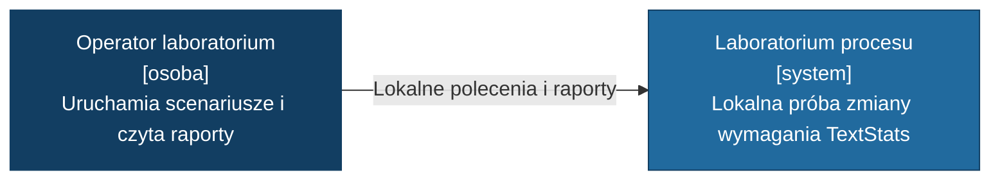
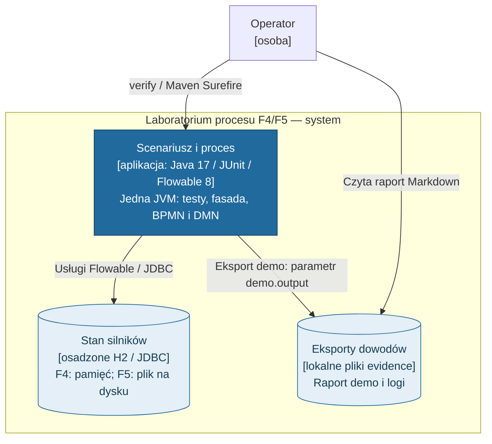
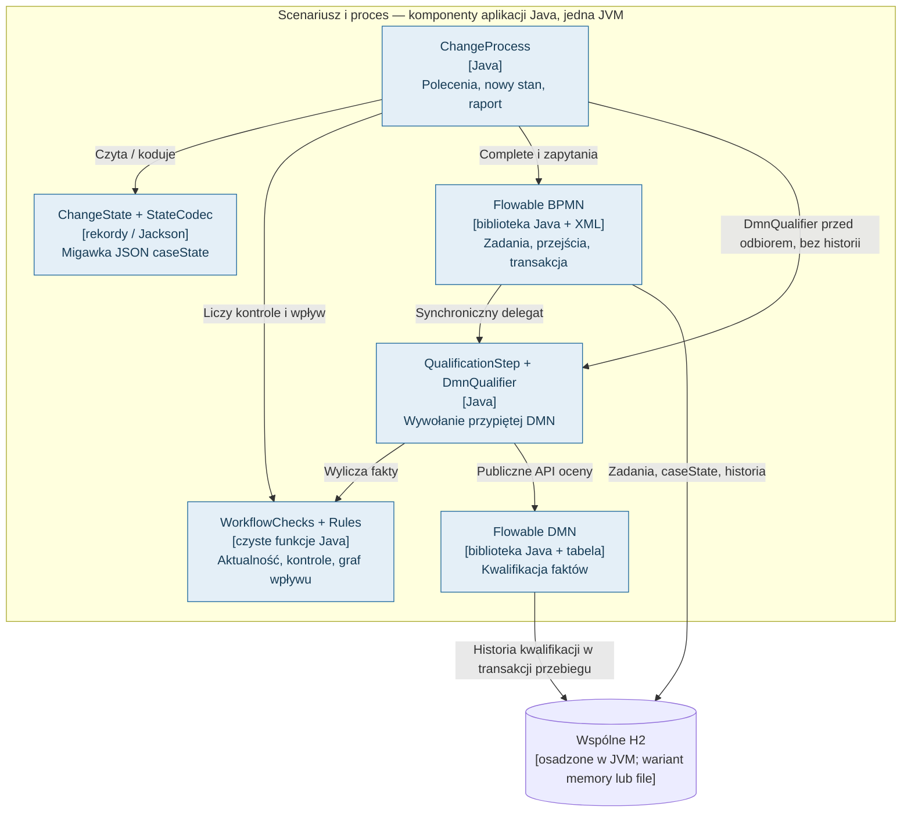
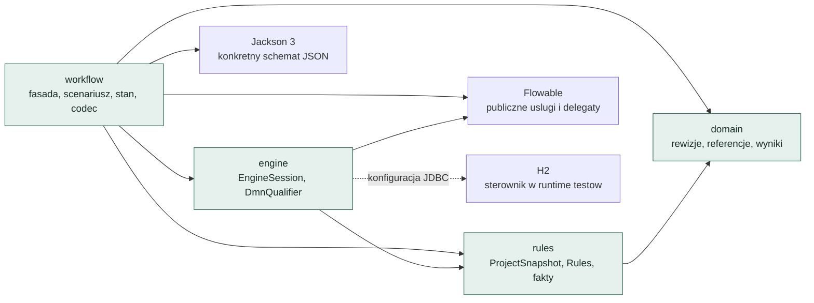
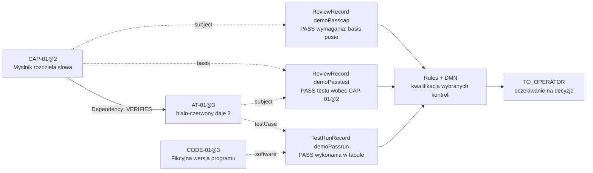
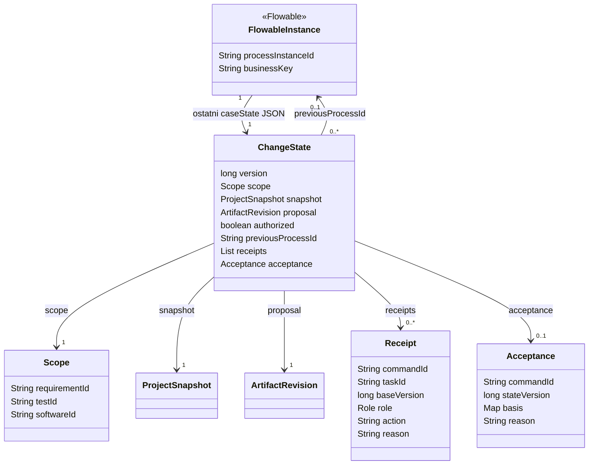
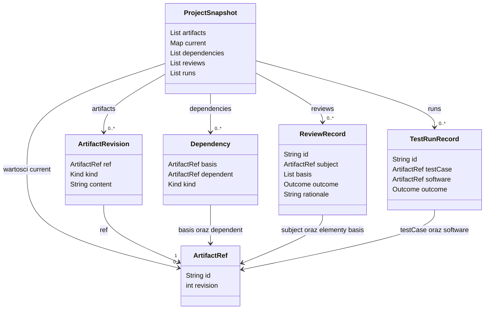
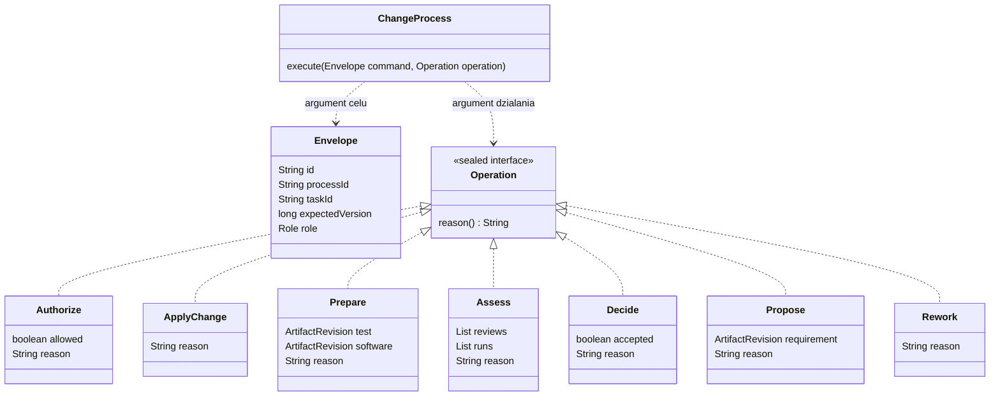

# Architektura i dane próby Flowable — F4 z wariantem wznowienia F5

2026-11-05 / aktualizacja 2026-11-06 · D-98/D-99 · dokumentacja istniejącej implementacji. **F5 dodaje wariant plikowej bazy i jawne wznowienie; odbiór użytkowy pozostaje osobny.** Kod źródłowy pozostaje źródłem prawdy; diagramy są jego ręcznie opracowanymi widokami.

Czytaj najpierw **1 → 2 → 3**: otoczenie, wykonanie, odpowiedzialności. Potem wybierz **4** dla zależności kodu, **5** dla śladu produktów albo **6 → 7 → 8** dla danych i poleceń. Strzałki nie określają kolejności pracy, chyba że ich opis mówi o wywołaniu. Przebieg w czasie pokazuje osobno [demo 1–5](evidence/f4-demo.md), a źródłem przejść jest [BPMN](src/main/resources/change.bpmn20.xml).

| Widok | Pytanie |
| --- | --- |
| 1. C4 Context | Kto korzysta z laboratorium i do czego? |
| 2. C4 Container | Co jest wykonywane i gdzie są dane? |
| 3. C4 Component | Który element odpowiada za reguły, zadania i zapis? |
| 4. Zależności kodu | Które pakiety znają inne pakiety/biblioteki? |
| 5. Zależności produktów | Co wiąże wymaganie, przegląd, test i wykonanie? |
| 6. Stan sprawy | Co pamiętamy pomiędzy poleceniami? |
| 7. Migawka produktów | Jak reprezentujemy rewizje i ich dowody? |
| 8. Polecenia | Co wolno przekazać do fasady i jak wskazujemy cel? |

## 1. C4 — kontekst systemu

**Jest jeden operator rzeczywistego laboratorium.** W uruchamianym scenariuszu kod testu podaje fikcyjne role AGENT/OPERATOR i wyniki. Nie ma integracji z sesją LLM ani interaktywnego ekranu decyzji. Testy dotyczą sterowania procesem; nie uruchamiają produktu TextStats.

Źródło: [ChangeProcessTest](src/test/java/org/example/processlab/ChangeProcessTest.java), zwłaszcza F4_09; [instrukcja uruchomienia](README.md).

## 2. C4 — kontenery i miejsca danych

„Kontener” C4 oznacza aplikację albo magazyn danych, nie kontener Docker. H2 pokazano jako osobny magazyn logiczny, **ale jest osadzone w tej samej JVM**. W F4 jest pamięciowe; F5 dodaje bazę plikową, otwieraną kolejno przez nowe JVM. Flowable BPMN i DMN to biblioteki tej aplikacji, nie osobne serwery. Maven uruchamia testową JVM przez Surefire.

H2 ma w [POM](pom.xml) zakres `test`. Pokazany wariant działa w testach; zbudowany JAR nie jest samodzielną aplikacją z dołączonym sterownikiem. Źródła: [EngineSession](src/main/java/org/example/processlab/engine/EngineSession.java), [ChangeTrial](src/main/java/org/example/processlab/workflow/ChangeTrial.java). F5 używa `createPersistent` i `reopenPersistent`: utworzenie jest jawne, wznowienie wymaga istniejącej bazy, schematu i tej samej pary modeli. Nie wdraża ich ponownie. Dziesięć osobnych JVM sprawdza odtworzenie instancji z pliku, nie z raportu. Instrukcja: [README F5](README.md#f5--jak-odtworzyć-i-obejrzeć-próbę).

## 3. C4 — komponenty aplikacji

To grupy odpowiedzialności wewnątrz jednej JVM. Na rysunku pominięto rozruch: ChangeTrial przy tworzeniu wdraża BPMN/DMN, a przy wznowieniu odczytuje zapisane definicje i kontroluje ich zgodność; łączy obiekty. EngineSession tworzy/zamyka silniki.

**Granica transakcji:** fasada przekazuje nowy JSON i `action` w jednym `TaskService.complete`. Po `Assess` ta sama synchroniczna kontynuacja BPMN uruchamia QualificationStep i zapis historii DMN. Odczyty walidujące przed `complete` nie są dowodem ochrony przed konkurującymi klientami. Próba rollbacku: F4_06 w [testach](src/test/java/org/example/processlab/ChangeProcessTest.java).

Fasada sprawdza symulowaną rolę. Bezpośrednie API silnika nie jest zabezpieczone tą kontrolą. Raport czyta stan i historię z silnika; nie utrzymuje drugiego automatu etapów.

## 4. Diagram zależności kodu

Strzałka **A → B oznacza: A używa B**. Pokazano własne pakiety i biblioteki używane bezpośrednio, nie całe drzewo przechodnich zależności Maven. Kierunek strzałek nie jest przepływem danych ani kolejnością zadań.

Wniosek: dane domenowe nie importują silnika. Rules także nie importuje Flowable; można sprawdzać te reguły bez BPMN. Pakiet `engine` zna typy faktów/kwalifikacji z `rules`, ponieważ zawiera adapter DMN. To nie jest warstwa zupełnie niezależna od domeny. Źródła: [workflow](src/main/java/org/example/processlab/workflow), [engine](src/main/java/org/example/processlab/engine), [rules](src/main/java/org/example/processlab/rules), [domain](src/main/java/org/example/processlab/domain).

## 5. Diagram zależności produktów pracy — konkretny przykład

Inna znaczeniowo strzałka: **podstawa → produkt/wynik, który się na niej opiera**. Linia ciągła między CAP i AT pokazuje krawędź `Dependency`; linie przerywane pokazują referencje w rekordach ocen/wykonania. Te ostatnie nie są dodatkowymi krawędziami wejścia algorytmu BFS.

Strzałki do kwalifikacji pokazują wykorzystanie wyników, nie zapisany ślad `Dependency`. W tym przykładzie nie ma krawędzi Requirement → Software w kolekcji dependencies. Związek z konkretną wersją programu jest w parze TestRunRecord. BFS nie obejmie automatycznie wszystkich powiązań z ocen i wykonań.

Po zmianie na CAP-01@3 stare rekordy pozostają. Nie stają się ocenami nowego wymagania. Źródło przykładu: widoki 3–5 [wykonanego demo](evidence/f4-demo.md); reguły: [Rules](src/main/java/org/example/processlab/rules/Rules.java), dobór: [WorkflowChecks](src/main/java/org/example/processlab/workflow/WorkflowChecks.java).

## 6. Struktury danych — stan sprawy i pamięć poleceń

Rysunek przedstawia rekordy Java oraz logiczne powiązanie z instancją Flowable, **nie tabele SQL**. FlowableInstance to element silnika pokazany poglądowo, nie nasza nowa klasa. Strzałki opisują pola i ich typy. Liczność przy celu oznacza zawartość pola; nie określamy wyłącznej przynależności wartości do jednej migawki. Niezmienne rekordy mogą być współdzielone przez kolejne migawki i instancje.

- `version` to wersja **stanu sprawy**, zwiększana po poleceniu; nie rewizja wymagania.
- `authorized` dotyczy propozycji zapisanej w tej migawce. Nowa propozycja zeruje upoważnienie; jego historia pozostaje w potwierdzeniach poleceń i historii silnika.
- `Acceptance.basis` to `Map<String, ArtifactRef>`: kopia mapy current w momencie przyjęcia. Zakres wykonanych kontroli określa Scope, nie sama liczba wpisów basis.
- `previousProcessId` może wskazywać poprzednią przyjętą instancję. Kod nie ogranicza jej do jednego następcy.
- Etap BPMN i aktywne taskId nie są polem ChangeState. Pochodzą z usług silnika. Historia FULL może zachować więcej niż jedną historyczną wartość JSON; rysunek wiąże instancję z ostatnią migawką odczytywaną przez fasadę.

Źródła: [ChangeState](src/main/java/org/example/processlab/workflow/ChangeState.java), metody `startNext`, `state`, `execute` w [ChangeProcess](src/main/java/org/example/processlab/workflow/ChangeProcess.java).

## 7. Struktury danych — rewizje, ślad i dowody

| Pole/typ | Znaczenie i ograniczenie |
| --- | --- |
| ArtifactRef | Para `(id, revision)`; równość po wartości, nie tożsamość obiektu Java |
| ArtifactRevision.Kind | REQUIREMENT / TEST_CASE / SOFTWARE |
| ProjectSnapshot.current | `Map<String, ArtifactRef>`; jawny wybór bieżącej rewizji. Nie wybieramy automatycznie największej |
| Dependency.Kind | DERIVED_FROM / VERIFIES; kierunek `basis → dependent` |
| ReviewRecord.basis | Lista referencji; przy porównywaniu podstawy Rules traktuje ją jak zbiór |
| ReviewRecord.Outcome | PASS / FAIL; sprzeczne wyniki tej samej podstawy nie są automatycznie rozstrzygane |
| TestRunRecord.Outcome | PASS / FAIL / ERROR; zawsze dla pary test i program |

Odnośnik ArtifactRef sam nie gwarantuje istnienia wskazanej rewizji. Migawka analityczna F3 dopuszcza braki i zwraca UNKNOWN; fasada F4 odmawia przyjęcia wyników z referencjami do nieistniejących rewizji na wejściu start/Assess. Duplikat ID dowodu jest odrzucany; dopisanie nowego tworzy nową migawkę. To zachowanie API, nie zabezpieczenie przed zmianą bazy przez kogoś z bezpośrednim dostępem.

Źródła: [ProjectSnapshot](src/main/java/org/example/processlab/rules/ProjectSnapshot.java) i [rekordy domain](src/main/java/org/example/processlab/domain).

## 8. Struktury danych — polecenie i jego cel

Envelope i Operation to dwa argumenty `execute`, nie jeden rekord zawierający drugą strukturę. Role są danymi z zaufanego lokalnego scenariusza, nie uwierzytelnioną tożsamością.

Envelope identyfikuje konkretną instancję, aktywne zadanie i oczekiwaną wersję stanu. ID polecenia jest unikalne wewnątrz instancji; ponowienie po skutecznym zapisie jest odrzucane. Authorize i Decide wymagają OPERATOR; pozostałe operacje AGENT. Dodatkowo każda operacja ma dozwolone etapy — sam prawidłowy typ nie wystarcza. Odrzucona/wycofana transakcja nie zapisuje Receipt, więc po usunięciu awarii można ponowić to samo polecenie.

Źródło: [ChangeCommands](src/main/java/org/example/processlab/workflow/ChangeCommands.java), walidacja i zapis w [ChangeProcess](src/main/java/org/example/processlab/workflow/ChangeProcess.java).

## Notacja, aktualizacja i granice

**Decyzja agenta A15, 2026-11-05:** pokazać poziomy C4 Context/Container/Component przy użyciu Mermaid flowchart z jawnymi typami i granicami, zależności również jako flowchart, a rekordy jako classDiagram. Natywny renderer C4 po próbnej generacji nakładał opisy na węzły; flowchart zachowuje treść poziomów C4 i daje czytelniejsze rozmieszczenie. Nie jest to składnia C4Context/C4Container/C4Component. Rekordy odpowiadają kodowi; nie tworzymy pozornego relacyjnego schematu bazy ani osobnych usług dla bibliotek. Diagramy ilustrują wybrany przekrój F4/F5, nie pełny model ISO. Aktualizacja A16: wariant file zmienia przechowywanie, nie rekordy domeny ani przebieg.

Podstawa notacji: [C4 — poziom kontenerów](https://c4model.com/diagrams/container) i [Mermaid — C4](https://mermaid.js.org/syntax/c4.html). O zgodności z tą implementacją rozstrzygają podane źródła lokalne. Po zmianie typów, zależności albo granic wykonania trzeba zaktualizować odpowiedni widok; nie ma automatycznej synchronizacji z kodem.

F5 obejmuje poprawne zamknięcie JVM i ponowne otwarcie na tym samym buildzie. Nie dowodzi odporności na utratę zasilania, migracji, backupu ani zgodności innego kodu Java przy takich samych XML. Dokument nie zmienia reguł procesu, nie jest nowym planem ani dowodem odbioru.
