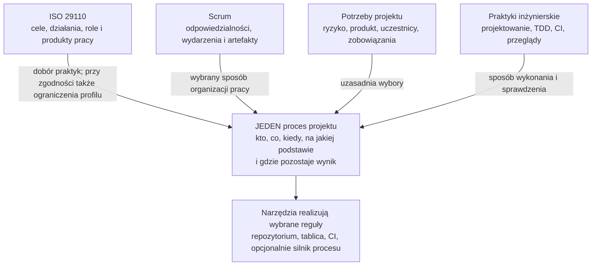
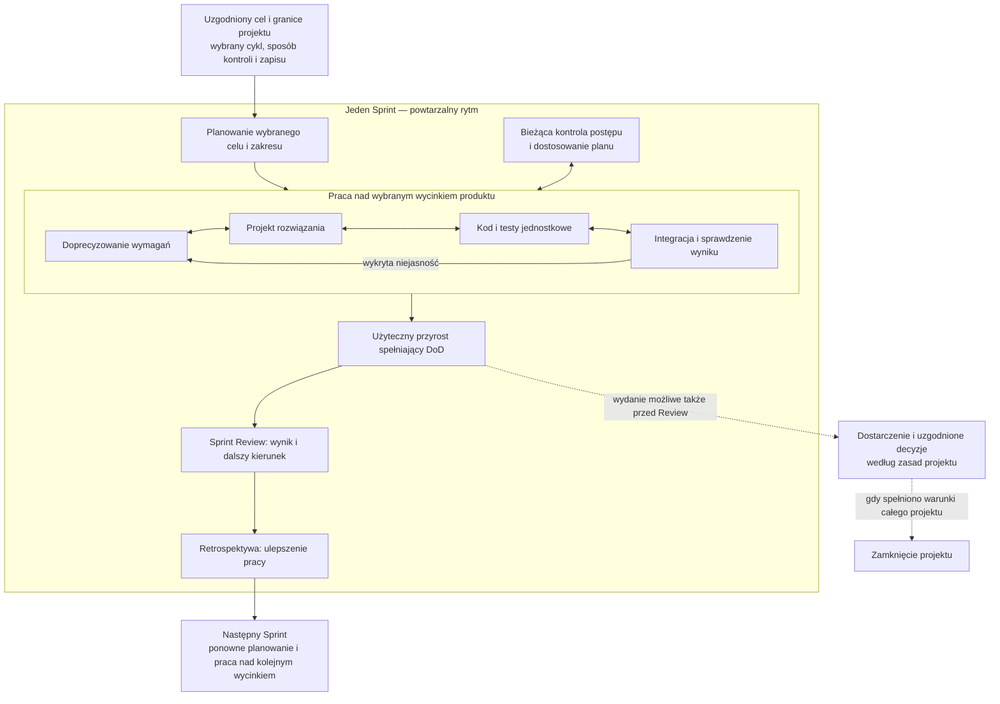
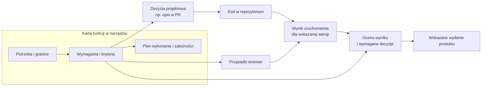

# ISO 29110 i Scrum — jak połączyć je w jednym procesie

2026-11-07 · materiał objaśniający na zlecenie użytkownika; nie nowa instrukcja procesu ani deklaracja zgodności.

**ISO dopuszcza różne metody i cykle życia. Scrum oraz ISO są odrębnymi źródłami zasad, które można połączyć w jednym rzeczywistym sposobie pracy.** Nie ma tu prostej hierarchii „Scrum jest podprocesem ISO”. Można wykonywać działania opisane w ISO w rytmie Sprintów, bez osobnego przebiegu „najpierw Scrum, potem ISO”.

Czytaj kolejno: **1 — źródła i relacja, 2 — praca przyrostowa, 3 — informacje i ich nośniki**. Analiza oryginalnych grafik jest w części 4. Wszystkie poniższe diagramy Mermaid są autorską interpretacją, nie diagramami normatywnymi.

## 1. Co faktycznie mówi źródło

Analiza dotyczy lokalnej transkrypcji w `iso-29110-5-1`, HEAD `d62e8c0`. Wyszukiwanie w `chapters/` nie znalazło słowa „Scrum”. Źródło wymienia **agile** i otwarcie dopuszcza dowolną metodę; zastosowanie tego do Scrum jest uzasadnioną interpretacją, a nie gotową instrukcją wdrożenia Scrum znalezioną w ISO.

| Miejsce w źródle | Treść i znaczenie |
| --- | --- |
| [Wprowadzenie §0.1](../../../iso-29110-5-1/chapters/00-introduction.md#01-introduction-to-the-isoiec-29110-series) | „intended to be used with any life cycle”, w tym waterfall, iterative, incremental, evolutionary i agile. Swoboda dotyczy cyklu życia. |
| [Wprowadzenie §0.2](../../../iso-29110-5-1/chapters/00-introduction.md#02-introduction-to-this-document) | Dopuszcza procesy, techniki i metody poprawiające satysfakcję klienta oraz produktywność. Wymagania zgodności odsyła do **29110-4-1**. Czytany przewodnik nie jest całym systemem wymagań zgodności. |
| [§5.1–5.2](../../../iso-29110-5-1/chapters/05-overview.md) | Procesy mają umożliwiać dowolne podejście lub metodologię dobraną do potrzeb VSE/projektu. Wybrany cykl powinien być udokumentowany. To świadomy wybór organizacji, nie z góry narzucony harmonogram. |
| [PM.01.01](../../../iso-29110-5-1/chapters/06-project-management-pm-process.md#pm0101) | Przegląd uzgodnienia obejmuje cykl rozwoju; wynikiem jest rozpoczęty plan z informacją o tym cyklu. To konkretny punkt, w którym wybór trafia do procesu. |
| [§4.2 — Diagram description](../../../iso-29110-5-1/chapters/04-naming-diagramming-and-definitions-conventions.md) | „The notation used in the diagrams does not imply the use of any specific process life cycle.” Grube strzałki oznaczają główny przepływ informacji, cienkie wejścia/wyjścia produktów pracy. |
| [§6.4.1, rys. 3](../../../iso-29110-5-1/chapters/06-project-management-pm-process.md), [§7.4.1, rys. 4](../../../iso-29110-5-1/chapters/07-software-implementation-si-process.md) | Uwagi pod diagramami ponownie dopuszczają cykle iteracyjne, przyrostowe i agile. Pionowy układ aktywności nie rozstrzyga ich rozłożenia na iteracje. |
| [§9, wprowadzenie do produktów pracy](../../../iso-29110-5-1/chapters/09-description-of-work-products.md) | Informacje można łączyć i dzielić stosownie do potrzeb. Nośnikiem może być dokument, wiadomość lub element narzędzia elektronicznego. Produkt pracy nie musi oznaczać osobnego pliku. |
| [Aneks E — informacyjny](../../../iso-29110-5-1/chapters/annex-e-deployment-packages.md) | Pakiety wdrożeniowe zawierają opisy praktyk, szablony, przykłady, listy kontrolne i narzędzia. Można wdrażać pakiet bez wdrażania całego frameworku naraz. To pomoc wdrożeniowa, nie automatyczne potwierdzenie zgodności. |

To zestawienie rozróżnia opis i zalecenia przewodnika od wymagań zgodności wskazanych w części 4-1. Nie przeprowadzono tutaj oceny zgodności z tą częścią. Swoboda metod nie oznacza, że dowolne pominięcia nadal pozwalają deklarować pełną zgodność.

### Diagram 1 — źródła zasad a konkretny proces

**Obok czy wewnątrz?** Obok jako opisy pochodzące z różnych źródeł; razem wewnątrz konkretnego procesu projektu. W przekroju czasu działania inżynierskie mogą być wewnątrz Sprintu. W przekroju oceny zgodności sprawdzamy, czy wybrany sposób pracy spełnia przyjęte wymagania. To różne relacje, nie jedna drabina nadrzędności.

Skrót „ISO mówi co, Scrum mówi jak” pomaga tylko na początku: ISO opisuje również zadania i role, a Scrum również wymagane rezultaty i reguły. Ich zakresy częściowo się przecinają.

## 2. Jak wygląda realizacja przyrostowa

Scrum to celowo niekompletny framework, dopuszczający inne procesy i techniki. Sprint obejmuje planowanie, pracę, inspekcję i adaptację. Przyrost spełnia Definition of Done; Sprint Review nie jest bramką wydania. Źródło: [Scrum Guide 2020 — Scrum Definition, The Sprint, Increment](https://scrumguides.org/scrum-guide.html).

### Diagram 2 — działania ISO powracają przy kolejnych przyrostach

Schemat pokazuje możliwą organizację, nie kompletny diagram Scrum ani nakaz powtarzania wszystkich zadań ISO w każdym Sprincie. Strzałki wewnątrz pracy pokazują wymianę informacji i poprawki.

**Interpretacja mapowania:** planowanie i kontrola z PM obejmują pracę kolejnych przyrostów; analiza, projektowanie, budowa i integracja z SI wracają dla kolejnego wycinka. Nie dzielimy automatycznie projektu na „Sprint wymagań”, „Sprint projektowania” i „Sprint testów”. Zachowujemy zależności potrzebnych informacji, ale nie zamrażamy z góry całej wiedzy o produkcie.

| Możliwe wykorzystanie istniejącej praktyki | Czego nie wolno utożsamić automatycznie |
| --- | --- |
| Backlog i plan Sprintu dostarczają część informacji do planowania PM | Sprint Backlog nie jest całym planem projektu. |
| Element backlogu z kryteriami może być nośnikiem wymagań | Sam tytuł zadania nie stanowi sprawdzalnej specyfikacji. |
| Przegląd wyniku dostarcza informacji do walidacji i dalszych prac | Sprint Review nie jest automatycznie formalnym odbiorem klienta ani zamknięciem projektu. |
| DoD może zawierać wybrane kontrole jakości | Etykieta Done nie dowodzi wykonania kontroli ani nie zastępuje wymaganej decyzji. |

Powyższe dopasowania są naszą propozycją. Nie znaleziono ich jako gotowej tabeli ISO–Scrum w badanych rozdziałach. Role ISO także trzeba przypisać świadomie; PO nie staje się automatycznie kierownikiem projektu ISO.

## 3. Skąd produkty pracy, skoro wystarczała tablica

ISO rozróżnia informacje potrzebne do wykonania i sprawdzenia pracy. Narzędzie może przechowywać je wspólnie. §9 pozwala łączyć informacje i używać elektronicznego nośnika; nie uzasadnia to braku treści, historii lub identyfikowalnej podstawy oceny.

### Diagram 3 — jeden feature, kilka powiązanych wyników

To propozycja organizacji danych, nie wymagany układ plików. Strzałki oznaczają powiązania informacyjne, nie kolejkę obowiązkowych faz.

Nie trzeba przepisywać testów ani wyników CI do kolejnego dokumentu: karta może wskazywać ich trwałe rekordy. To praktyka proponowana dla ograniczenia duplikacji; samo dodanie odnośników nie sprawdza poprawności produktu.

Ważna wskazówka źródła dla naszego problemu z `07-show`: §9 zaleca niewstawianie kodów **typów** WP.XX do opisów aktywności i zadań dla czytelności. Nie jest to zakaz identyfikatorów konkretnych wymagań lub wyników. Wniosek autora: na pierwszym planie pokazywać sens pracy, ID zostawić do jednoznacznego powiązania i szczegółów. To nie zleca jeszcze przebudowy widoku.

## 4. Co pokazują oryginalne diagramy w assets

Oględziny wszystkich sześciu PNG, zestawione z legendą §4.2 i tekstem rozdziałów:

| Grafika | Co przedstawia | Czego z niej nie wywodzić |
| --- | --- | --- |
| [Rys. 1](../../../iso-29110-5-1/assets/figures/figure-01.png) | Strukturę serii: profile, ocena, wytyczne | Nie umieszcza Scrum w hierarchii ISO. To mapa dokumentów, nie wykonania projektu. |
| [Rys. 2](../../../iso-29110-5-1/assets/figures/figure-02.png) | Powiązanie PM i SI oraz relacje z klientem i zarządem | Sześć aktywności SI nie oznacza sześciu jednorazowych etapów ani Sprintów. |
| [Rys. 3](../../../iso-29110-5-1/assets/figures/figure-03.png) | Planowanie, wykonanie, ocenę/kontrolę, zamknięcie oraz ich produkty; sprzężenia planu i postępu | Nie jest kalendarzem projektu. Nie definiuje liczby powtórzeń ani automatycznego zamknięcia po jednym cyklu. |
| [Rys. 4](../../../iso-29110-5-1/assets/figures/figure-04.png) | Działania SI, produkty i przepływy, w tym weryfikację, ślad i żądania zmian | Nie jest kompletnym automatem stanów ani nakazem waterfallu. Nie definiuje sam wszystkich warunków przejścia. |
| [Rys. A.1](../../../iso-29110-5-1/assets/figures/figure-a-01.png) | Połączenie wsparcia z PM/SI | Pochodzi z informacyjnego Aneksu A: rozszerzenie o wsparcie, nie dowód obowiązkowego trzeciego procesu w każdym projekcie. |
| [Rys. A.2](../../../iso-29110-5-1/assets/figures/figure-a-02.png) | Poziom usług, incydenty, zmiany produkcyjne i powiązane produkty | Nie jest gotowym workflow helpdesku; wymaga dobrania reguł operacyjnych. |

### Konsekwencja dla naszej próby Flowable

Wykonywalny BPMN jest **naszym konkretnym wyborem organizacji fragmentu pracy**. Rysunek ISO sam nie dostarcza kompletnego automatu, wszystkich warunków, uprawnień ani obsługi niepowodzeń. Poprawne wykonanie BPMN nie dowodzi pełnego odwzorowania ISO. Z kolei dopuszczenie agile nie usuwa potrzeby sprawdzania zależności informacji.

Nie zmieniamy tu przyjętego procesu na Scrum. Dla operatora i agentów można dobierać praktyki przyrostowe; samo używanie tablicy i iteracji nie oznacza pełnego Scrum. Najbliższy problem pozostaje użytkowy: czy człowiek rozumie, nad czym pracuje, na czym opiera ocenę i co blokuje dalszy krok.
