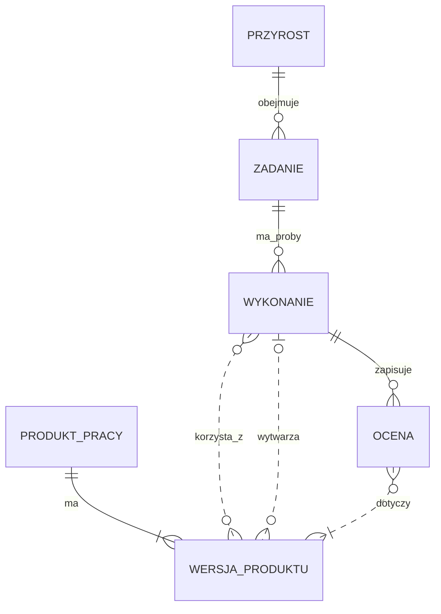
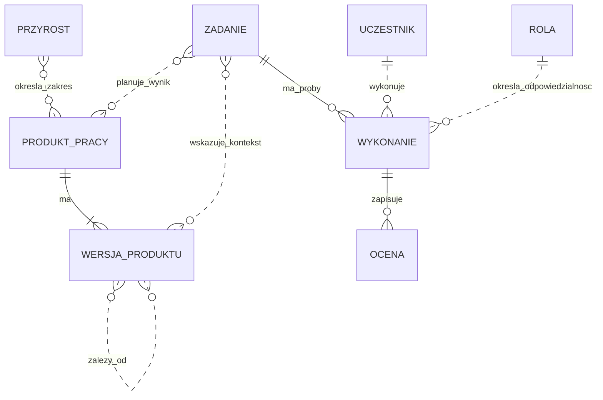
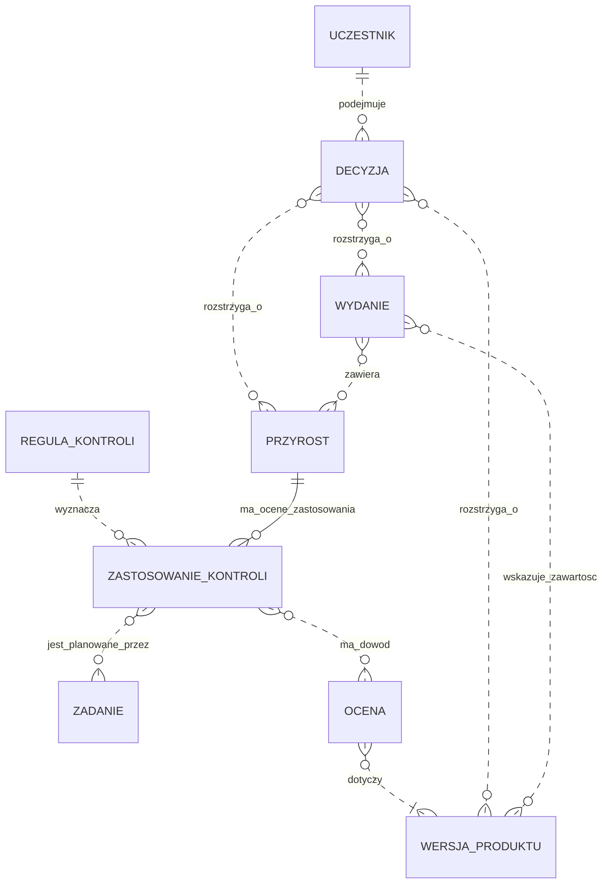

# Statyczny model procesu — diagramy encji Mermaid

2026-10-25. Model pojęciowy do nauki i dyskusji. Nie jest schematem istniejącej bazy, wymaganiem tworzenia nowych rejestrów ani wdrożeniem mechanizmu zgód. Pokazuje strukturę informacji na wybranym poziomie szczegółowości; nie wszystkie reguły zachowania procesu.

## Jak czytać

Encja to rodzaj przedmiotu, np. zadanie lub wynik oceny. Linia opisuje relację, **nie kolejność czynności**. `||` oznacza dokładnie jeden, `o{` zero lub wiele, `|{` co najmniej jeden, `o|` zero lub jeden. Relacje są czytelne w obie strony. W notacji ER linia przerywana oznacza relację nieidentyfikującą; nie ma znaczenia „propozycja” lub „luka” z poprzednich widoków.

Składnia i przeznaczenie: [Mermaid — Entity Relationship Diagrams](https://mermaid.js.org/syntax/entityRelationshipDiagram.html). Ten sam model można przechowywać w Markdown, JSON lub programie; diagram nie przesądza technologii.

## 1. Rdzeń: zamiar, wykonanie i wynik

- **Przyrost** grupuje pracę prowadzącą do jednego użytecznego wyniku. Jego zakres może obejmować istniejące produkty, nie tylko nowe pliki.
- **Zadanie** opisuje zamiar, wynik i granice. W tym uproszczeniu pokazujemy zadania jednego przyrostu; utrzymanie całego projektu wymaga osobnego zakresu.
- **Wykonanie** to konkretna próba zadania. Jedno zadanie może mieć zero, jedno lub wiele wykonań, także nieudanych.
- **Produkt pracy** ma tożsamość, np. wymaganie R1. **Wersja produktu** to określona treść, np. R1 w rewizji 2. Do wersji odnosimy dowody.
- **Ocena** to zapis sprawdzenia: wynik testu albo przeglądu, wraz z kryteriami, ustaleniami i ograniczeniami. Przypadek testowy jest produktem pracy; wynik jego wykonania jest oceną. Raport jest nośnikiem jednej lub wielu ocen, nie dodatkowym źródłem wyniku.
- Wersja importowana ze źródła może nie mieć naszego wykonania wytwarzającego; stąd `0..1` po stronie wykonania dla relacji „wytwarza”. Jedno wykonanie może wytworzyć wiele wersji różnych produktów. Pochodzenie zewnętrzne trzeba wtedy opisać.

## 2. Zależności, plan oraz ludzie i agenci

**Uczestnik** oznacza wskazanego człowieka, przebieg agenta lub wykonawcę narzędziowego. Wykonanie ma przypisaną jedną rolę roboczą; ten sam uczestnik może pełnić różne role w różnych wykonaniach. Nie oznacza to, że agent ma prawo zastępować operatora. ID uczestnika i etykieta roli nie uwierzytelniają tożsamości ani nie egzekwują dostępu.

**Mandat** to źródło zlecenia i granice zadania, a nie nazwa roli. **Sesja agenta** jest kontekstem wykonawcy; może obejmować wiele wykonań. Do rozdzielenia sesji autora i recenzenta potrzebujemy wskazania ich przebiegów, nie tylko dwóch wartości pola role. Techniczne uprawnienia narzędzi należą do środowiska wykonania; nie powstają z linii na ERD.

Relacja zależności musi mieć znaczenie, np. „realizuje”, „sprawdza”, „opiera się na”. W implementacji można ją zapisać jako rekord z początkiem, końcem i typem. Nie każda relacja ma taką samą regułę oceny wpływu. Diagram celowo nie przesądza fizycznego modelu bazy ani jednego DAG dla całego procesu.

## 3. Potrzebne kontrole, decyzje i wydanie

**Ta część zawiera propozycję jawnego zapisu zastosowania kontroli. Nie ma dziś pełnego odpowiednika w narzędziach szablonu.**

**Reguła kontroli** mówi, kiedy i czego wymaga sprawdzenie. **Zastosowanie kontroli** odpowiada, czy reguła dotyczy konkretnego przyrostu: ustalone „wymagane”, uzasadnione „nie dotyczy” albo „nieustalone”. To trzy znaczenia do rozróżnienia, nie nowe zatwierdzone statusy szablonu. Brak rekordu zastosowania też wymaga rozpoznania; nie oznacza „nie dotyczy”.

**Decyzja** przechowuje rozstrzygnięcie, autora, źródło, datę i zakres. Może dotyczyć wymagania, zakresu przyrostu lub wydania. Rysunek dopuszcza różne rodzaje decyzji; reguły poza ERD wskazują, które może podjąć agent, a które operator. Propozycja odpowiedzi nie jest decyzją. Osobna encja decyzji służy tutaj uwidocznieniu odpowiedzialności, nie nakazuje powielania jej jako osobnego produktu i rekordu.

**Wydanie** określa zestaw konkretnych wersji. `0..n` pozwala przedstawić dopiero przygotowywane wydanie; kompletność i niezmienność odebranego zestawu są dodatkowymi regułami. Nie utożsamiamy odbioru przyrostu, zatwierdzenia wydania i uruchomienia produkcji CNC.

## Minimalne atrybuty do zrozumienia modelu

To opis informacji, nie specyfikacja nowych obowiązkowych pól.

| Encja | Co musimy umieć rozpoznać |
| --- | --- |
| Przyrost | ID, oczekiwany wynik, granice, kryteria |
| Zadanie | ID, cel, mandat, oczekiwany rezultat, odpowiedzialność |
| Produkt / wersja | ID produktu, rodzaj, rewizja, lokalizacja treści |
| Wykonanie | ID próby, zadanie, wykonawca i rola, wejścia, rezultat |
| Ocena | Oceniany materiał, kryteria, wynik, ustalenia, ograniczenia |
| Reguła / zastosowanie | Wyzwalacz, potrzebny dowód, zakres zastosowania i uzasadnienie |
| Decyzja | Rozstrzygnięcie, zakres, autor, źródło i data |
| Wydanie | ID, zawarte wersje, związane decyzje |

Wymaganie, projekt rozwiązania, kod, konfiguracja i przypadek testowy są **rodzajami produktu pracy**. Na tym poziomie nie potrzebujemy osobnej encji dla każdego rodzaju. Szczegóły, np. usterki i ich obsługę, można rozwinąć później w osobny widok, jeśli koszt lub skala tego wymagają.

## Jak ten model ujawnia naszą lukę

Przykład dydaktyczny: przyrost I-demo ma zastosowanie reguły „przegląd wymagany”, zadanie przeglądu istnieje, ale nie ma żadnego wykonania z oceną właściwego materiału. ERD pozwala **zapisać i odnaleźć** ten brak. Do zatrzymania zgłoszenia gotowości potrzebny jest programowy warunek, a nie samo narysowanie linii:

> Jeżeli przegląd jest wymagany, musi istnieć odpowiedni wynik dotyczący ocenianej podstawy oraz obsługa ustaleń wymagana przyjętymi kryteriami.

Wynik historycznej oceny pozostaje w modelu po zmianie produktu. O tym, czy nadaje się do użycia przy nowej wersji, rozstrzygają zasady aktualności i analiza wpływu. ERD nie określa ich samodzielnie.

## Czego nie pokaże sam diagram encji

- Dozwolonej kolejności i warunków przejść — do tego służy diagram stanów i reguły.
- Zakazu użycia starego dowodu jako potwierdzenia zmienionego materiału — potrzebna reguła wersji/aktualności.
- Zakresów uprawnień i dowodu tożsamości — potrzebne zasady oraz konfiguracja wykonania.
- Jakości kryteriów, prawdziwości dowodu i adekwatności oceny — powiązanie nie rozstrzyga treści.
- Warunków między kilkoma relacjami, np. każda decyzja ma przynajmniej jeden przedmiot, przegląd odrębny od autora, wynik zgodny z kryteriami, kompletne wydanie.

## Powiązanie z obecnym repozytorium

Plan i zadania: `project/plan.md`. Produkty oraz relacje: `id.toml`, pliki specyfikacji i generowany ślad. Oceny: VER/VAL i raporty testów. Decyzje: `project/decisions.md`; odbiory: ACC. Role: karty w `template/process/roles/`. Te mechanizmy nie tworzą jeszcze całego powyższego modelu. W szczególności jawne zastosowanie reguły do przyrostu, jednolita identyfikacja wykonań i wersji dowodów to część propozycji.

Źródła merytoryczne: [synteza ról, §12–13](../OPERATOR-AGENT-ROLES-AND-CONTEXT.md), [mapa i jej źródła](README.md), [WP.21 w normie](../../../iso-29110-5-1/chapters/09-description-of-work-products.md). Nie jest to oficjalny model danych ISO.

## Wykonanie i granice sprawdzenia

Decyzja agenta 2026-10-25: trzy małe diagramy pojęciowe zamiast jednej tablicy ze wszystkimi polami; powód: można czytać warstwami, zachowując te same nazwy encji. Relacje wiele-do-wielu są celowe; nie jest to znormalizowany projekt tabel SQL. Sprawdzono składnię względem dokumentacji Mermaid i znaczenie liczności podczas przeglądu autora. W środowisku nie znaleziono CLI Mermaid; nie instalowano zależności i nie wykonano lokalnego renderowania tych diagramów. Przeglądarka statycznego przewodnika nie renderuje Mermaid — ten plik trzeba otworzyć w podglądzie Markdown obsługującym Mermaid. To ograniczenie prezentacji, nie wynik testów procesu.
