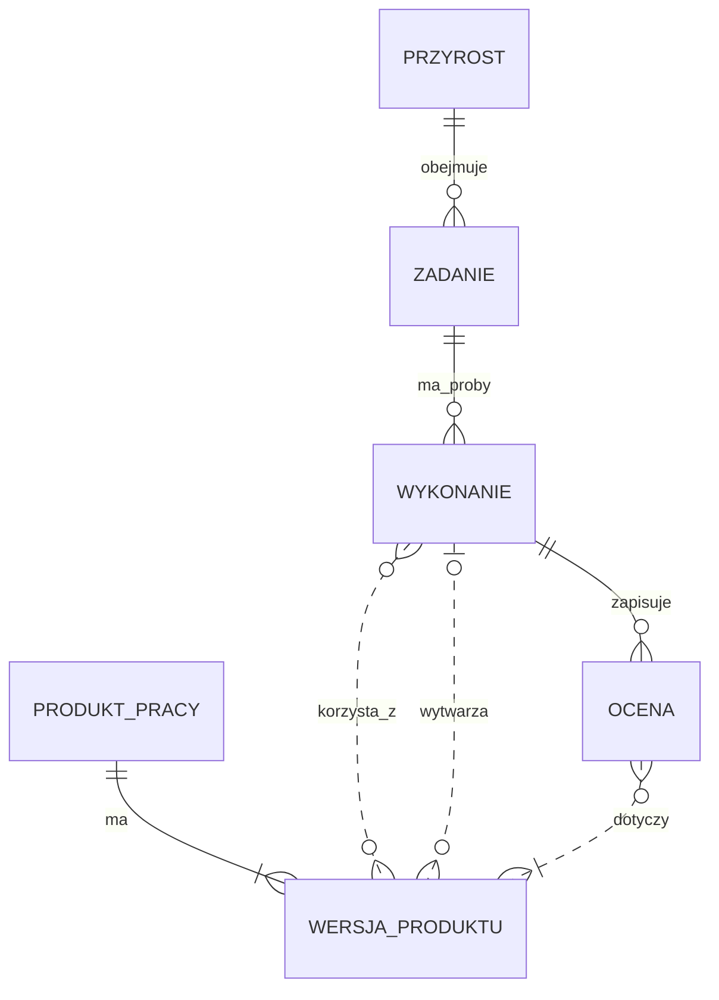
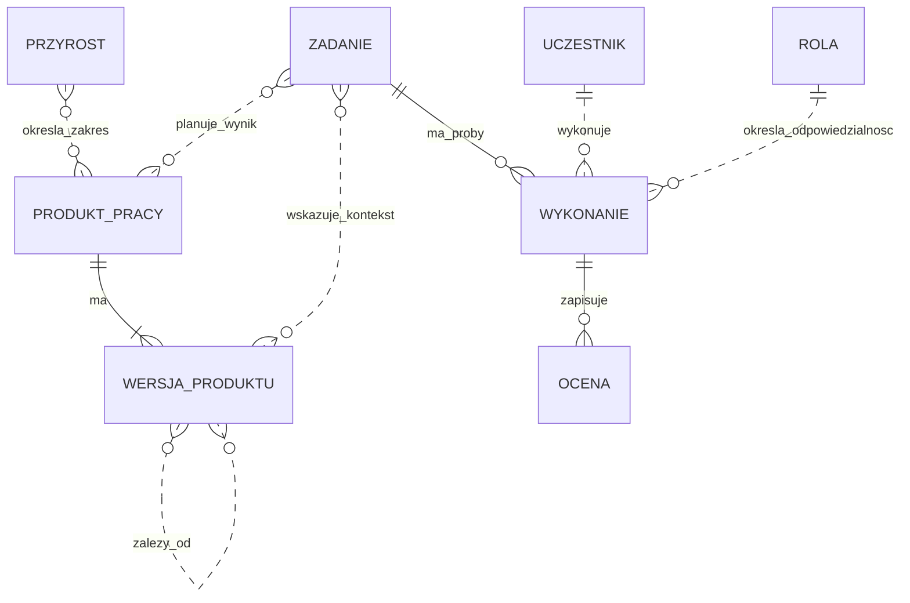
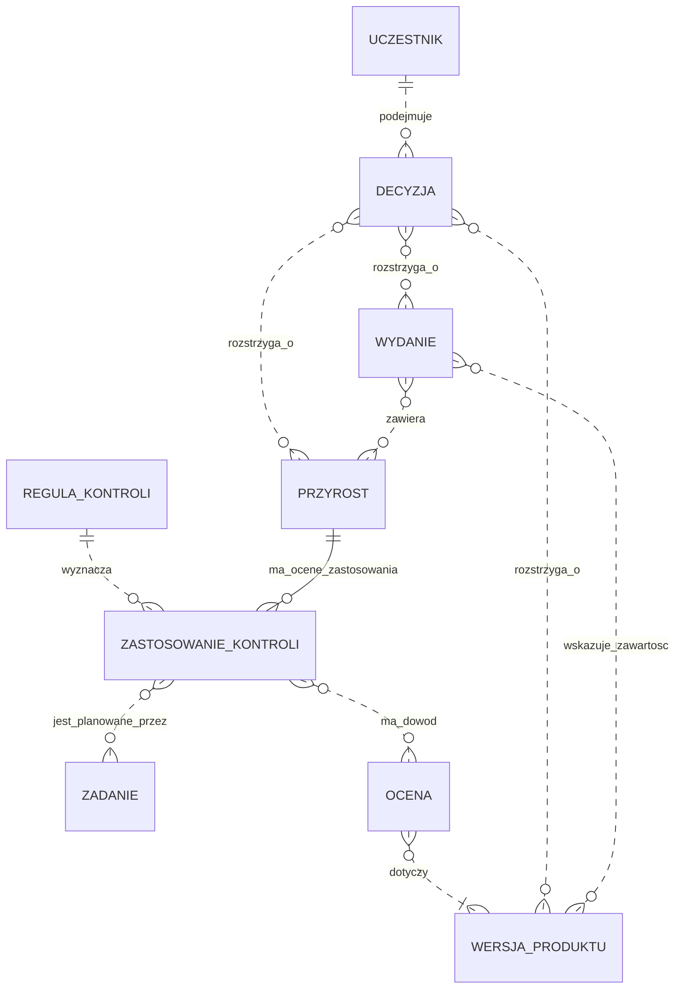
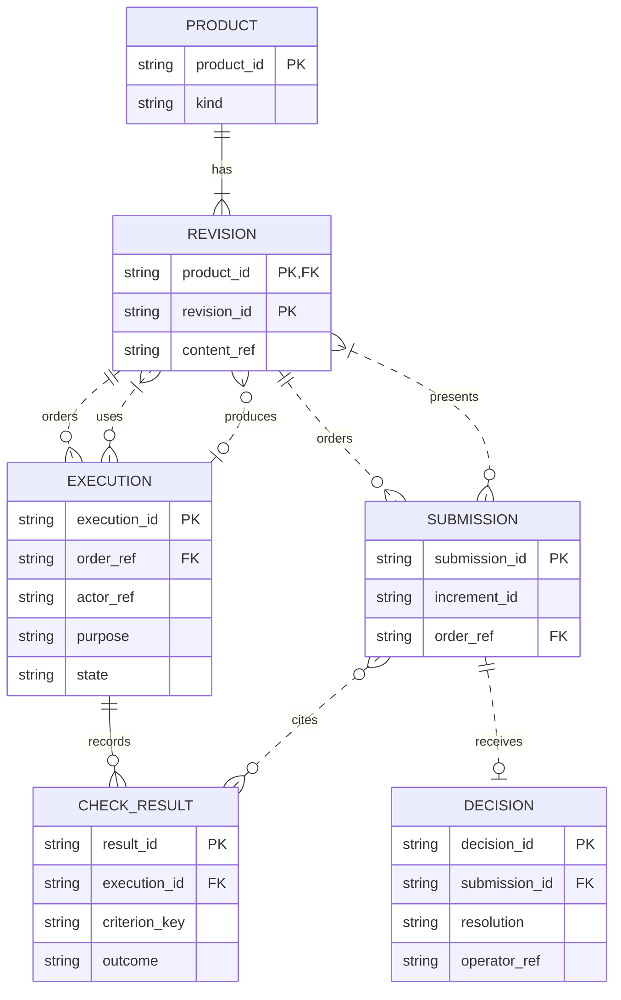

# Statyczny model procesu — diagramy encji Mermaid

2026-10-25. Model pojęciowy do nauki i dyskusji. Nie jest schematem istniejącej bazy, wymaganiem tworzenia nowych rejestrów ani wdrożeniem mechanizmu zgód. Pokazuje strukturę informacji na wybranym poziomie szczegółowości; nie wszystkie reguły zachowania procesu.

**Aktualne rozwinięcie:** [§4 — przekrój A-19](#4-przekrój-logiczny-a-19--od-zlecenia-do-odbioru) z 2026-11-08 doprecyzowuje jeden fragment. Poniższe §1–3 zachowują szerszy model pojęciowy z 2026-10-25.

## Jak czytać

Encja to rodzaj przedmiotu, np. zadanie lub wynik oceny. Linia opisuje relację, **nie kolejność czynności**. `||` oznacza dokładnie jeden, `o{` zero lub wiele, `|{` co najmniej jeden, `o|` zero lub jeden. Relacje są czytelne w obie strony. W notacji ER linia przerywana oznacza relację nieidentyfikującą; nie ma znaczenia „propozycja” lub „luka” z poprzednich widoków.

Składnia i przeznaczenie: [Mermaid — Entity Relationship Diagrams](https://mermaid.js.org/syntax/entityRelationshipDiagram.html). Ten sam model można przechowywać w Markdown, JSON lub programie; diagram nie przesądza technologii.

## 1. Rdzeń: zamiar, wykonanie i wynik

- **Przyrost** grupuje pracę prowadzącą do jednego użytecznego wyniku. Jego zakres może obejmować istniejące produkty, nie tylko nowe pliki.
- **Zadanie** opisuje zamiar, wynik i granice. W tym uproszczeniu pokazujemy zadania jednego przyrostu; utrzymanie całego projektu wymaga osobnego zakresu.
- **Wykonanie** to konkretna próba zadania. Jedno zadanie może mieć zero, jedno lub wiele wykonań, także nieudanych.
- **Produkt pracy** ma tożsamość, np. wymaganie R1. **Wersja produktu** to określona treść, np. R1 w rewizji 2. Do wersji odnosimy dowody.
- **Ocena** to zapis sprawdzenia: wynik testu albo przeglądu, wraz z kryteriami, ustaleniami i ograniczeniami. Przypadek testowy jest produktem pracy; wynik jego wykonania jest oceną. Raport jest nośnikiem jednej lub wielu ocen, nie dodatkowym źródłem wyniku.
- Wersja importowana ze źródła może nie mieć naszego wykonania wytwarzającego; stąd `0..1` po stronie wykonania dla relacji „wytwarza”. Jedno wykonanie może wytworzyć wiele wersji różnych produktów. Pochodzenie zewnętrzne trzeba wtedy opisać.

## 2. Zależności, plan oraz ludzie i agenci

**Uczestnik** oznacza wskazanego człowieka, przebieg agenta lub wykonawcę narzędziowego. Wykonanie ma przypisaną jedną rolę roboczą; ten sam uczestnik może pełnić różne role w różnych wykonaniach. Nie oznacza to, że agent ma prawo zastępować operatora. ID uczestnika i etykieta roli nie uwierzytelniają tożsamości ani nie egzekwują dostępu.

**Mandat** to źródło zlecenia i granice zadania, a nie nazwa roli. **Sesja agenta** jest kontekstem wykonawcy; może obejmować wiele wykonań. Do rozdzielenia sesji autora i recenzenta potrzebujemy wskazania ich przebiegów, nie tylko dwóch wartości pola role. Techniczne uprawnienia narzędzi należą do środowiska wykonania; nie powstają z linii na ERD.

Relacja zależności musi mieć znaczenie, np. „realizuje”, „sprawdza”, „opiera się na”. W implementacji można ją zapisać jako rekord z początkiem, końcem i typem. Nie każda relacja ma taką samą regułę oceny wpływu. Diagram celowo nie przesądza fizycznego modelu bazy ani jednego DAG dla całego procesu.

## 3. Potrzebne kontrole, decyzje i wydanie

**Ta część zawiera propozycję jawnego zapisu zastosowania kontroli. Nie ma dziś pełnego odpowiednika w narzędziach szablonu.**

**Reguła kontroli** mówi, kiedy i czego wymaga sprawdzenie. **Zastosowanie kontroli** odpowiada, czy reguła dotyczy konkretnego przyrostu: ustalone „wymagane”, uzasadnione „nie dotyczy” albo „nieustalone”. To trzy znaczenia do rozróżnienia, nie nowe zatwierdzone statusy szablonu. Brak rekordu zastosowania też wymaga rozpoznania; nie oznacza „nie dotyczy”.

**Decyzja** przechowuje rozstrzygnięcie, autora, źródło, datę i zakres. Może dotyczyć wymagania, zakresu przyrostu lub wydania. Rysunek dopuszcza różne rodzaje decyzji; reguły poza ERD wskazują, które może podjąć agent, a które operator. Propozycja odpowiedzi nie jest decyzją. Osobna encja decyzji służy tutaj uwidocznieniu odpowiedzialności, nie nakazuje powielania jej jako osobnego produktu i rekordu.

**Wydanie** określa zestaw konkretnych wersji. `0..n` pozwala przedstawić dopiero przygotowywane wydanie; kompletność i niezmienność odebranego zestawu są dodatkowymi regułami. Nie utożsamiamy odbioru przyrostu, zatwierdzenia wydania i uruchomienia produkcji CNC.

## Minimalne atrybuty do zrozumienia modelu

To opis informacji, nie specyfikacja nowych obowiązkowych pól.

| Encja | Co musimy umieć rozpoznać |
| --- | --- |
| Przyrost | ID, oczekiwany wynik, granice, kryteria |
| Zadanie | ID, cel, mandat, oczekiwany rezultat, odpowiedzialność |
| Produkt / wersja | ID produktu, rodzaj, rewizja, lokalizacja treści |
| Wykonanie | ID próby, zadanie, wykonawca i rola, wejścia, rezultat |
| Ocena | Oceniany materiał, kryteria, wynik, ustalenia, ograniczenia |
| Reguła / zastosowanie | Wyzwalacz, potrzebny dowód, zakres zastosowania i uzasadnienie |
| Decyzja | Rozstrzygnięcie, zakres, autor, źródło i data |
| Wydanie | ID, zawarte wersje, związane decyzje |

Wymaganie, projekt rozwiązania, kod, konfiguracja i przypadek testowy są **rodzajami produktu pracy**. Na tym poziomie nie potrzebujemy osobnej encji dla każdego rodzaju. Szczegóły, np. usterki i ich obsługę, można rozwinąć później w osobny widok, jeśli koszt lub skala tego wymagają.

## Jak ten model ujawnia naszą lukę

Przykład dydaktyczny: przyrost I-demo ma zastosowanie reguły „przegląd wymagany”, zadanie przeglądu istnieje, ale nie ma żadnego wykonania z oceną właściwego materiału. ERD pozwala **zapisać i odnaleźć** ten brak. Do zatrzymania zgłoszenia gotowości potrzebny jest programowy warunek, a nie samo narysowanie linii:

> Jeżeli przegląd jest wymagany, musi istnieć odpowiedni wynik dotyczący ocenianej podstawy oraz obsługa ustaleń wymagana przyjętymi kryteriami.

Wynik historycznej oceny pozostaje w modelu po zmianie produktu. O tym, czy nadaje się do użycia przy nowej wersji, rozstrzygają zasady aktualności i analiza wpływu. ERD nie określa ich samodzielnie.

## Czego nie pokaże sam diagram encji

- Dozwolonej kolejności i warunków przejść — do tego służy diagram stanów i reguły.
- Zakazu użycia starego dowodu jako potwierdzenia zmienionego materiału — potrzebna reguła wersji/aktualności.
- Zakresów uprawnień i dowodu tożsamości — potrzebne zasady oraz konfiguracja wykonania.
- Jakości kryteriów, prawdziwości dowodu i adekwatności oceny — powiązanie nie rozstrzyga treści.
- Warunków między kilkoma relacjami, np. każda decyzja ma przynajmniej jeden przedmiot, przegląd odrębny od autora, wynik zgodny z kryteriami, kompletne wydanie.

## Powiązanie z obecnym repozytorium

Plan i zadania: `project/plan.md`. Produkty oraz relacje: `id.toml`, pliki specyfikacji i generowany ślad. Oceny: VER/VAL i raporty testów. Decyzje: `project/decisions.md`; odbiory: ACC. Role: karty w `template/process/roles/`. Te mechanizmy nie tworzą jeszcze całego powyższego modelu. W szczególności jawne zastosowanie reguły do przyrostu, jednolita identyfikacja wykonań i wersji dowodów to część propozycji.

Źródła merytoryczne: [synteza ról, §12–13](../OPERATOR-AGENT-ROLES-AND-CONTEXT.md), [mapa i jej źródła](README.md), [WP.21 w normie](../../../iso-29110-5-1/chapters/09-description-of-work-products.md). Nie jest to oficjalny model danych ISO.

## Wykonanie i granice sprawdzenia

Decyzja agenta 2026-10-25: trzy małe diagramy pojęciowe zamiast jednej tablicy ze wszystkimi polami; powód: można czytać warstwami, zachowując te same nazwy encji. Relacje wiele-do-wielu są celowe; nie jest to znormalizowany projekt tabel SQL. Sprawdzono składnię względem dokumentacji Mermaid i znaczenie liczności podczas przeglądu autora. W środowisku nie znaleziono CLI Mermaid; nie instalowano zależności i nie wykonano lokalnego renderowania tych diagramów. Przeglądarka statycznego przewodnika nie renderuje Mermaid — ten plik trzeba otworzyć w podglądzie Markdown obsługującym Mermaid. To ograniczenie prezentacji, nie wynik testów procesu.

## 4. Przekrój logiczny A-19 — od zlecenia do odbioru

2026-11-08 · **propozycja modelu informacji, bez implementacji i bez odbioru operatora**. Rozwija §1–3, nie zastępuje ich katalogiem całego SDLC. Zlecenie: A-19 w [jedynym planie](../process-modeling/coverage-map.md#87-zalecenia-i-punkt-wznowienia). Cel i granice: [brief A-18](../process-modeling/brief.md#zamiar-i-granice-systemu--jedna-strona).

**Po ludzku:** „Zleciłeś policzenie słów według określonej reguły. Agent przygotował konkretną wersję programu. Sprawdzono tę wersję według wskazanych kryteriów. Przedstawiono Ci ten zestaw do odbioru. Przyjąłeś właśnie ten zestaw — następna wersja nie dziedziczy Twojej decyzji”. Wszystkie dane przykładu poniżej są fikcyjne, a nie wynikami uruchomienia TextStats.

### 4.1 Co wykorzystujemy, co doprecyzowujemy

| Istniejąca definicja | Rozstrzygnięcie w tym przekroju | Dlaczego obecny zapis nie wystarcza |
| --- | --- | --- |
| Zadanie / zlecenie (§1–2) | Zlecenie jednego przyrostu jest produktem rodzaju `work_order`; jego treść ma rewizję. Zadania implementacji i sprawdzeń wykonują to zlecenie, nie są synonimami przyrostu | Sama nazwa zadania nie identyfikuje obowiązujących granic i kryteriów. Rewizja korzysta z już istniejącego mechanizmu produktu, bez drugiego systemu wersji |
| Produkt i wersja (§1) | Zachowujemy oba pojęcia. Plik jest nośnikiem; plik może zawierać wiele elementów, a program wiele plików | ID pliku lub bieżący HEAD nie ustala treści elementu i wszystkich danych wykonania |
| Wykonanie i szeroka „ocena” (§1) | Oddzielamy próbę wykonania od jej wyników dla poszczególnych kryteriów | Próba może nie zakończyć sprawdzenia; zakończony test może mieć wynik negatywny. `completed` nie oznacza `pass` |
| Zgłoszenie i decyzja ([kontrakt odbioru §3–4](acceptance-contract.md#3-informacje-i-wiążące-źródła)) | Ponownie używamy zgłoszenia z niezmienną podstawą. Decyzja dotyczy jego ID, nie „aktualnej wersji projektu” | Bez zgłoszenia podstawa widziana przez operatora może zmienić się przed decyzją. Nie tworzymy drugiego kontraktu odbioru |
| Flowable oraz PY-01 ([porównanie A-17 §2](flowable-trial/python-comparison.md#2-struktury-danych)) | Mapowanie poniżej, bez utożsamienia istniejących klas z kompletnym modelem | Prototypy mają różne zakresy i kontrakty; ich typów nie można połączyć wyłącznie po podobnych nazwach |

Decyzja agenta, 2026-11-08: zastosować modelowanie pojęć i relacji, analizę niezmienników oraz przykłady z oczekiwanym wynikiem. Sześć rodzajów rekordów wystarcza do tego opisu. Nie dodajemy osobnych tabel dla każdego WP ani osobnego rejestru dla każdej karty. Zlecenie jako rodzaj produktu jest **propozycją reprezentacji**, nie zmianą obecnego `TSK` lub `id.toml`.

### 4.2 Diagram i reguła czytania

Czytaj od `PRODUCT` i `REVISION`, następnie `EXECUTION` → `CHECK_RESULT`, na końcu `SUBMISSION` → `DECISION`. To relacje danych, nie diagram kolejności. Rola `order_ref` ogranicza wskazywaną rewizję do rodzaju `work_order`.

Diagram pokazuje kluczowe pola; **pełny zakres informacji tego przekroju określa tabela poniżej**. `order_ref` jest złożonym odniesieniem do rewizji, mimo skrótu `string` na ERD. Relacja wiele–wiele nie przesądza tabeli SQL. Zależności rewizja–rewizja i poprzednik zgłoszenia są opisane osobno, aby diagram pozostał czytelny.

### 4.3 Słownik danych i źródła

Nazwy pól są propozycją kontraktu maszynowego. Polska etykieta karty może się zmieniać bez zmiany klucza. Lista nie jest nowym wymaganym formularzem; wartości można odczytać z istniejących wiążących zapisów. Źródłem prawdy pozostaje repozytorium według P-01; ewentualne przeniesienie do serwisu jest otwartą decyzją A-18.

| Rekord | Informacje i ich znaczenie | Kto dostarcza / warunek zapisu |
| --- | --- | --- |
| `PRODUCT` — produkt | `product_id`, `kind`, czytelne `title`. Rodzaje tego przykładu: `work_order`, `requirement`, `criterion_set`, `test_case`, `software` | Agent przygotowuje. Utworzony produkt ma co najmniej jedną zachowaną rewizję; planowany, jeszcze nieistniejący wynik pozostaje opisem w zleceniu |
| `REVISION` — rewizja | Klucz `(product_id, revision_id)`; `content_ref` wskazuje odtwarzalną treść; `created_by_execution_id` albo jawne `source_ref` importu. `relations[]` zawiera typ i dokładne odniesienie do innej rewizji | Agent/narzędzie zapisuje nową treść pod nową rewizją. Źródła zewnętrznego nie oznaczamy jako naszego wykonania |
| Treść rewizji `work_order` | `increment_id`, `goal`, `scope_refs`, `criteria_ref`, `authority_ref`, `expected_outputs`, `constraints`. `authority_ref` wskazuje faktyczne ustalenie operatora; nie jest flagą zatwierdzenia agenta | U ustala zamiar i zatwierdza zastrzeżone zmiany; agent przygotowuje i utrzymuje zapis. Zlecenie nie jest nowym źródłem zgody, jeśli jej nie ma |
| Treść rewizji `criterion_set` | Pozycje z lokalnym `criterion_key`, warunkiem, metodą, wymaganym pochodzeniem dowodu i etapem `before_submission` lub `operator_decision` | Kryteria w uzgodnionym zleceniu. ID kryterium jest jednoznaczne dopiero wraz z rewizją zestawu |
| `EXECUTION` — próba | `execution_id`, `order_ref`, `purpose` (`produce` / `review` / `test`), `actor_ref`, `session_ref` gdy agent, `input_refs`, `criteria_ref` gdy sprawdzenie, `state`, znaczniki rozpoczęcia/zakończenia, `evidence_ref`, dla narzędzia polecenie/runner i kod zakończenia | Wykonawca dostarcza informacje, system/adapter ustala ich pochodzenie. Start zamraża podstawę próby. Dozwolone stany: `running` → `completed` albo `failed`; `failed` oznacza niewykonanie próby, nie negatywną ocenę produktu |
| `CHECK_RESULT` — wynik sprawdzenia | `result_id`, `execution_id`, `criterion_key`, `subject_refs` będące podzbiorem wejść próby, `outcome` (`pass`, `fail`, `inconclusive`), ustalenia i ograniczenia. Kryteria, wykonawca i podstawa są odczytywane z wykonania, nie kopiowane | Osąd recenzenta lub wynik runnera. Wynik powstaje tylko dla próby `review`/`test`. Awaria bez oceny może pozostawić zero wyników; `inconclusive` oznacza zapisane nierozstrzygnięte sprawdzenie |
| `SUBMISSION` — przedstawiony zestaw | `submission_id`, `increment_id`, `order_ref`, `material_refs`, `result_ids`, `submitted_by`, `submitted_at`, opcjonalne `previous_submission_id`. Dokładne kryteria wynikają z `order_ref`. Zbiór jest niezmienny | Agent przedkłada, mechanizm sprawdza zgodnie z kontraktem odbioru. `previous_submission_id` zachowuje ciągłość, a nie kopiuje odbioru. Zastąpienie oczekującego zgłoszenia i nowy cykl po odebranym to różne operacje |
| `DECISION` — odbiór | `decision_id`, `submission_id`, `resolution` (`accept` / `reject`), `operator_ref`, `source_ref`, czas zapisu, `operator_assessments` dla kryteriów odbioru lub powód odrzucenia. Oceny operatora są treścią decyzji albo odnośnikami do zachowanych ocen | Wyłącznie operator dla tego rodzaju decyzji. Agent może przygotować tekst. Zakres, materiał i dowody odczytujemy przez zgłoszenie; nie utrzymujemy ich drugiej ręcznej kopii |

`source_ref` i `content_ref` muszą wskazywać zachowaną treść, nie ruchomą stronę lub samą ścieżkę. Dobór technicznego formatu pozostaje otwarty. Nie wymagamy tutaj manifestu wejść. Dla rzeczywistego wykonania trzeba jednak umieć odtworzyć istotny materiał, test, konfigurację i dane wejściowe; gdy adapter nie potrafi tego ustalić, nie może zgłosić aktualnej podstawy.

**Pochodzenie wyniku:** rozróżniamy `tool_observation`, `human_assessment`, `agent_claim` zgodnie z istniejącym kontraktem. Opinia recenzenta-agenta może spełniać kryterium dopuszczające taką opinię; nie zastępuje dowodu wykonania testu. Wartość pola roli nie uwierzytelnia autora. Zapis odrębnego `actor_ref/session_ref` pozwala sprawdzić rozdział wykonawców; nie dowodzi niezależności rozumowania.

**Dwa różne identyfikatory wersji:** rewizja produktu wskazuje treść; token kontroli opisany w kontrakcie odbioru wskazuje aktualność odczytanego kontekstu, także nowych blokad i wyników. Token nie jest nową rewizją produktu ani wersją BPMN. Nie dodajemy trzeciego licznika „stanu całego świata” do tego ERD.

### 4.4 Ślad w obu kierunkach i aktualność

Jedno odniesienie ma postać `RevisionRef(product_id, revision_id)`. Zapis relacji należy do rewizji zależnej: `(dependent_ref, relation_kind, basis_ref)`. W tym przekroju `implements` łączy kod z wymaganiem, `verifies` przypadek testowy z wymaganiem, `derived_from` inny produkt z podstawą. Zbiory tych relacji są niezmienne razem z rewizją. Zmiana relacji wymaga nowej rewizji nawet przy niezmienionej treści kodu; przyszłe ponowne uznanie starego dowodu wymagałoby osobnego, jawnego rozstrzygnięcia, nie cichego przepięcia.

- **W przód:** dla `test@1` odczytujemy, które `requirement@1` sprawdza; z wyniku dochodzimy do próby, testu i kodu.
- **Wstecz:** dla `requirement@1` wyliczamy zależne testy/kod, ich wykonania, zgłoszenia i decyzje. Nie utrzymujemy ręcznej listy odwrotnej.
- **Po zmianie:** przeszukanie zależności wyznacza kandydatów do analizy wpływu. Odwiedzone klucze chronią przed cyklem. Ścieżka w grafie nie dowodzi konieczności zmiany treści; ustalenie wpływu może wymagać osądu.
- **Nieaktualny względem czego:** nie ma globalnego `result.valid=true`. Wynik jest stosowalny lub niestosowalny **do wskazanego zgłoszenia i kryterium**; dawny wynik może nadal dokumentować dawno odebraną wersję.

Przedmiot bieżącej pracy wyznacza wskazana rewizja zlecenia, nie największy numer znaleziony w repo. Nowa propozycja wymagania bez wymaganej zgody nie zmienia automatycznie uzgodnionego zakresu. Dobór aktualnej rewizji nie może pomijać upoważnienia.

### 4.5 Niezmienniki i granica mechanizacji

Oznaczenia I1–I8 są lokalne dla tego rozdziału; nie są ID wymagań szablonu. Są **propozycjami reguł modelu**, nie deklaracją działających bramek.

| Reguła | Co da się sprawdzić | Co pozostaje poza takim sprawdzeniem |
| --- | --- | --- |
| I1 — jednoznaczne odniesienie | Każdy klucz rozwiązuje się do jednej zachowanej treści; brak/cel niewłaściwego rodzaju to jawny błąd | Czy treść wymagania odpowiada potrzebie |
| I2 — niezmienna podstawa | Nowa treść/relacja → nowa rewizja. Wynik nie zmienia badanego zestawu; korekta nie nadpisuje historii | Czy zmiana jest merytorycznie istotna |
| I3 — próba przed wynikiem | Wynik wskazuje istniejącą próbę sprawdzenia, jej wejścia i kryterium z jej zestawu; próba ma podstawę ustaloną przed wykonaniem | Prawdziwość opisu działania bez zaufanego źródła; timestamp wpisany ręcznie nie jest dowodem chronologii |
| I4 — wynik dla właściwej podstawy | Użycie wyniku wymaga zgodności ocenianego materiału, testu i kryteriów z potrzebą zgłoszenia. Inna rewizja nie dziedziczy `pass` | Adekwatność testu i kompletność rozpoznanych zależności |
| I5 — brak selekcji korzystnych wyników | Gotowość uwzględnia również inne znane, mające zastosowanie wyniki i blokady, nie tylko wybrane `result_ids`. Konflikt, błąd lub brak wymaganej oceny nie daje gotowości | Rozstrzygnięcie sprzecznych obserwacji i kwalifikacja wpływu; samo późniejsze `pass` nie zamyka `fail` |
| I6 — odbiór właściwego zestawu | Jedno zgłoszenie ma najwyżej jedną decyzję; przy `accept` ponowne sprawdzenie aktualności, uprawnień i ocen operatora. Niespełnione warunki → odmowa zapisu odbioru, nie `reject` za operatora | Wartość biznesowa odbioru i uwierzytelnienie bez wybranego kanału tożsamości |
| I7 — trwała historia | Nowy cykl ma nowe zgłoszenie. Wcześniejsza decyzja pozostaje przy swojej podstawie; nowy błąd nie usuwa faktu wcześniejszego odbioru | Ocena nowego ryzyka i decyzja o dalszym używaniu produktu |
| I8 — status jest wynikiem odczytu | `eligible/blocked/unknown`, lista braków i następny właściciel wynikają z faktów, kryteriów oraz wersji reguł. Brak decyzji nigdy nie staje się zgodą | Automatyczne odgadnięcie zamiaru i decyzji użytkownika |

Szczegółowy kontrakt stanów, odmów, atomowości i ponowień **pozostaje w [kontrakcie odbioru §4–8](acceptance-contract.md#4-stany-i-warunki-gotowości)**. Ten ERD go nie implementuje ani nie zastępuje. Stan życia zgłoszenia (`submitted/accepted/rejected/superseded`) i jego aktualna gotowość to różne informacje. Wyliczanie statusu z zapisanych decyzji i zastąpień nie wymaga wdrożenia architektury event sourcing.

**Wejścia spoza sześciu rekordów:** aktualne blokady, wiążące upoważnienie, wersja reguł kontroli i zaufane pochodzenie muszą zostać odczytane ze wskazanych źródeł. Ten przekrój nie modeluje ich całego cyklu życia. Samych sześć rodzajów rekordów nie wystarcza do wydania pozytywnej decyzji formalnej przy braku tych danych; odczyt ma wtedy wskazać brak, a nie domyślne spełnienie.

**Korekta wyniku i konflikt:** zachowujemy pierwotny rekord, dopisujemy nową ocenę z odniesieniem do kwestionowanego wyniku i uzasadnieniem. Ten przekrój nie specyfikuje jeszcze kompletnego protokołu rozstrzygania konfliktów. Do jego uzgodnienia wynik pozostaje nierozstrzygnięty; nie dodajemy przycisku „ignoruj fail”.

### 4.6 Przejście trzech przykładów oraz próby podważenia

Oznaczenia niżej są lokalne, fikcyjne i nie zmieniają schematów ID repozytorium. `order@1` zawiera przyrost `inc`, wymaganie `req@1`, kryteria `criteria@1` i odnośnik do fikcyjnej zgody U. `test@1 verifies req@1`, `code@1 implements req@1`. W tym fikcyjnym przykładzie `req@1` każe dzielić tekst po białych znakach, więc C1 wymaga wyniku `1` dla tekstu `a-b`; metodą jest wykonanie `test@1` na `code@1` z zachowanym wynikiem runnera. C2 wymaga, aby operator w demonstracji wprowadził `a-b`, zobaczył wynik `1` i niezmieniony tekst wejściowy. To kryteria ilustracyjne tego wycinka, nie komplet wymagań produktu ani opis istniejącego GUI.

| Przebieg | Dane i działania | Oczekiwany widok / zakończenie | Reguły |
| --- | --- | --- | --- |
| **P1: zwykła praca** | Zlecenie poprzedza próbę wytworzenia. Powstają `test@1`, `code@1`; próba `run1` wskazuje je, `req@1` i `criteria@1`. Wynik `check1` = C1/pass. `submission1` przedstawia ten zestaw. U w decyzji `decision1` ocenia C2 i przyjmuje `submission1` | Przed decyzją: „sprawdzenie gotowe, czeka odbiór”. Po decyzji: „odebrano wskazany zestaw”; bez automatycznego wydania | I1–I4, I6 |
| **P2: zmiana po odbiorze** | U upoważnia zmianę: myślnik też rozdziela słowa; `order@2`, `req@2`, `criteria@2` wymagają wyniku `2` dla `a-b` (także w C2). Wpływ wskazuje `test@1` i `code@1`; analiza uzasadnia ich nowe rewizje. Nowa próba i wyniki pozwalają przedłożyć `submission2`, powiązane z poprzednikiem | `decision1` nadal dotyczy `submission1`. Bieżąca praca pokazuje zależności do oceny, a potem oczekiwanie na nowy odbiór. Brak automatycznej kopii C1 lub C2 | I2, I4, I7 |
| **P3: wynik przychodzi za późno** | `run2` rozpoczęto dla `req@2/test@2/code@2/criteria@2`. Przed zakończeniem U uzgodnił `order@3` z inną podstawą. Późny wynik `check2=pass` nadal wskazuje wejścia `run2` | Można zachować wynik historyczny. Bieżąca praca nie otrzymuje `pass` dla rewizji 3; potrzebuje oceny wpływu i właściwego sprawdzenia. Nie przepisywać `run2.input_refs` | I2–I4, I8 |

Ręczne próby podważenia, z oczekiwaniami do późniejszych testów:

| Przypadek | Oczekiwane rozstrzygnięcie |
| --- | --- |
| K1: tylko kryteria zmieniono z rewizji 1 na 2, kod identyczny | Stary wynik nie potwierdza automatycznie nowych kryteriów; nowa ocena lub ponowne wykonanie według potrzeb. Odbiór nadal dotyczy starego zestawu |
| K2: agent przedkłada `pass`, lecz znany jest również nierozliczony `fail` dla tej samej podstawy | `blocked`, wskazanie obu wyników; brak „ostatni zapis wygrywa” |
| K3: po przygotowaniu widoku pojawia się nowa istotna blokada, operator wysyła stare `accept` | Ponowna kontrola odmawia; brak nowej decyzji. Operator otrzymuje aktualną podstawę i przyczynę |
| K4: narzędzie zakończyło się awarią, agent wpisał „testy OK” | Awaria próby i deklaracja nie spełniają kryterium wymagającego `tool_observation`; `unknown` albo wskazany brak |
| K5: nowy negatywny wynik po `decision1=accept` | Historia odbioru zachowana, bieżący widok ujawnia problem. Nie zmieniamy decyzji wstecz ani nie pokazujemy „produkt bez błędów” |
| K6: recenzent ma inne imię, ale brak identyfikowalnej sesji/wykonania | Nie da się potwierdzić rozdziału wykonawców; samo pole `role=reviewer` nie spełnia takiego kryterium |
| K7: produkt zmienił się w niezwiązanej części projektu | Nie unieważniać wszystkiego przez sam nowy commit. Użyć zakresu i zależności; jeśli wpływu nie da się ustalić, jawnie `unknown` |
| K8: wynik odnosi się do nieistniejącego `code@99` | Odmowa przyjęcia jako wyniku o ustalonej podstawie; nie tworzyć fikcyjnej rewizji na podstawie deklaracji |

### 4.7 Odniesienie do normy, implementacji i koszt

**Norma dostarcza znaczeń informacji, nie powyższego schematu.** Lokalny [rozdział 9](../../../iso-29110-5-1/chapters/09-description-of-work-products.md), wstęp i tabela 12, opisuje produkty/stany oraz dopuszcza łączenie informacji i nośnik elektroniczny. Tabela 13 / WP.01 opisuje zapis odbioru dostarczonych elementów; tabela 32 / WP.20 dokumentuje wykonanie testów; tabela 35 / WP.23 — wykonanie weryfikacji. Listy cech zawierają „may have/include”; nie są nakazem tworzenia każdego pola lub osobnego pliku. Nasze klucze, rewizje, sześć rekordów i I1–I8 są **lokalną propozycją**, nie dosłownymi wymaganiami ISO. Odbiór przyrostu pozostaje adaptacją opisaną w kontrakcie, nie utożsamieniem z pełnym zamknięciem projektu.

| Źródło | Wykorzystanie / rzeczywista różnica |
| --- | --- |
| [id.toml: TSK, VER, VAL, ACC](../../template/process/tools/id.toml) | Są zadania, odwołania do elementów, wyniki i decyzje odbioru kamienia. Ten schemat nie definiuje pełnego klucza rewizji, osobnej próby i przedstawionego zestawu. Nie modyfikujemy go w A-19 |
| [Flowable — struktury i testy](flowable-trial/python-comparison.md) | `ArtifactRef` i `ArtifactRevision` już rozdzielają ID i rewizję. `ReviewRecord`/`TestRunRecord` nie zapewniają całego opisu próby i pochodzenia z tabeli 4.3. `ChangeState`/`Acceptance` wiążą ograniczony zakres; nie są kompletnym zleceniem i zgłoszeniem tego modelu |
| PY-01 — ten sam raport porównania | Ma wersje, propozycje, decyzje zmian, oceny i trwałość. Decyzja o propozycji zmiany nie jest odbiorem przyrostu; `check_runs` nie stanowią ogólnego wykonawcy testów |
| [Karta TextStats — mapowanie pól](operator-preview/textstats-card-data-map.md) | Karta jest projekcją: sens pracy, podstawa, sprawdzenia, decyzja, następny krok. Nie potrzebuje ręcznej kopii każdego rekordu ani eksponowania ID jako głównej treści |

Koszt utrzymania tego modelu to aktualizacja jednej definicji przy zmianie znaczenia pola/reguły i związanych przykładów; koszt przyszłego użycia to przypięcie podstawy przy wykonaniu i zgłoszeniu. Nie proponujemy ponownego przepisywania dowodów do raportu i karty. Efekt sprawdzimy później: czy nowa sesja umie wskazać oceniany zestaw, brakujące sprawdzenie i właściciela następnego kroku. A-19 nie dowodzi jeszcze skrócenia czasu wznowienia.

### 4.8 Otwarte granice i kontrola zakończenia

| Co pozostaje otwarte | Właściciel / następny krok / kiedy potrzebne |
| --- | --- |
| Sposób identyfikacji zachowanej treści, konfiguracji i wejść wykonania | Agent opracuje wariant w ramach Q1 kontraktu odbioru; U rozstrzygnie ewentualną zmianę źródła prawdy. Przed trwałym zapisem i integracją rzeczywistych narzędzi |
| Pierwszy zakres operacyjny i kryteria konkretnego przyrostu | Agent przygotuje ograniczony scenariusz zgodnie z A-18; U wybierze przed implementacją. Bez wyboru funkcji Kitchen przed rozpoznaniem modułów |
| Uwierzytelnienie i wymagany rozdział wykonawców | Agent opisze granicę zaufania; U rozstrzygnie ryzyka przed operacyjnymi zgodami. Nie są wdrożone przez ten model |
| Korekta/rozstrzyganie konfliktujących wyników, uznawanie niezmienionego dowodu przy nowej podstawie | Agent przygotuje konkretny kontrprzykład i minimalny kontrakt; U rozstrzygnie zmianę przyjętych kryteriów/ryzyka. Przed wdrożeniem ścieżki rozliczającej taki konflikt; obecnie brak pozytywnej gotowości |

Sprawy te rozwijają istniejące niewiadome; nie wymagają teraz paczki pytań do operatora. Rekomendowany następny krok: dla **P3 — spóźnionego wyniku** zapisać dokładne wejście operacji, warunki, skutek i odmowę oraz oczekiwane dane widoku. To pozwoli sprawdzić jedno przejście bez rozbudowy modelu i przed wyborem stosu.

**Warunek zakończenia A-19:** odróżnione tożsamości/rewizje/próby/wyniki/odbiór, jawne odniesienia, niezmienniki i trzy przebiegi z historią; różnice wobec źródeł oraz niewiadome mają wskazane miejsce. To zakończenie opracowania, nie akceptacja projektu systemu. **Wykonane sprawdzenie, 2026-11-08:** przegląd autora względem §1–3, kontraktu odbioru §3–8, schematu ID i porównania A-17; dokumentacyjne przejście P1–P3 oraz K1–K8. W przeglądzie doprecyzowano konkretne wejście/oczekiwany wynik C1/C2 oraz zależność gotowości od zewnętrznych blokad i upoważnienia. Nie uruchamiano tych scenariuszy na silniku i nie jest to dowód niezależnej recenzji.

Kontrole narzędziowe: nowy ERD wyrenderowany istniejącym Mermaid CLI 11.17.0 / Mermaid 11.17.2; kod zakończenia 0, oględziny obrazu bez uciętych pól lub etykiet. Najpierw sandbox zablokował uruchomienie Chromium; render powtórzono po zgodzie narzędziowej poza sandboxem, bez instalacji. Sprawdzono 9 lokalnych odsyłaczy w §4, w tym 5 kotwic, oraz domknięcie bloków kodu. `make check`: 265 elementów, 0 błędów, wcześniejsze W1 MIG-01/02; `git diff --check` bez błędów. `make check` sam nie sprawdza semantyki tego modelu. Nie powtarzano regresji niezmienionych implementacji.

Odtworzenie renderu: wyodrębnić blok Mermaid z §4.2 do pliku `.mmd`; użyć istniejącego `mmdc -i <plik.mmd> -o <obraz.png> -p <konfiguracja-lokalnej-przegladarki.json> -w 1800`. Źródłem trwałym jest ten blok, a nie tymczasowy PNG; oględziny nie zastępują przeglądu liczności i warunków. Bez zmian pakietu procesu, kodu, drugiego repozytorium i bez commita.
