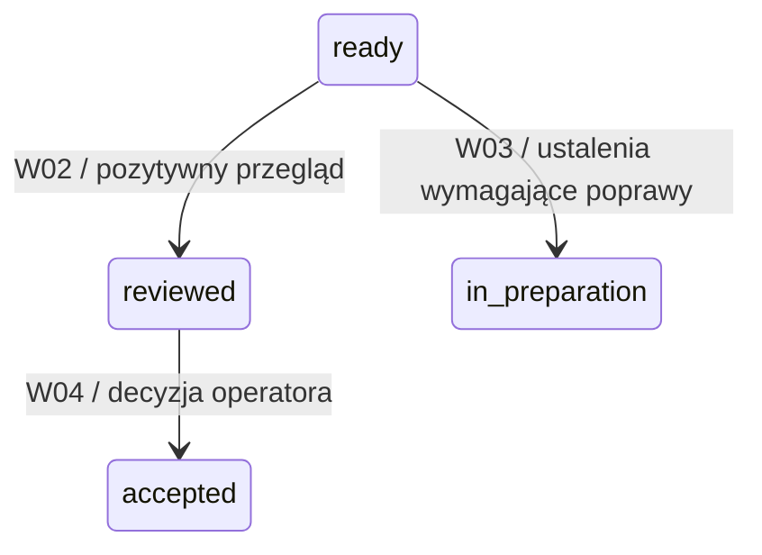

# Jeden przykład: od ISO do wykonywalnego przejścia

2026-10-26. **Opis do przeglądu, nie implementacja.** Przykład dotyczy przeglądu przygotowanego wydania. Nie wybiera funkcji Kitchen, nie wdraża mechanizmu zgód ani manifestów wejść. Identyfikatory z `DEMO` są fikcyjne.

Uzupełniono po prześledzeniu i osobnej recenzji: [wynik, uwagi i diagnostyka](transition-review.md). Zmiany opisu nie są zmianami działającego modelu.

**Nowy, odrębny przekrój:** [§11 — P3: spóźniony wynik](#11-p3--zapis-spóźnionego-wyniku-po-zmianie-podstawy), A-22 z 2026-11-08. Nie zmienia historycznego W02 ani zakresu jego recenzji.

## 1. Wybrany fragment i cel

Chcemy, aby system nie uznał wydania za przejrzane tylko dlatego, że agent wpisał taki status. Stan ma wynikać z wykonania odpowiedniego przeglądu i zapisanego wyniku.



Rozpisujemy **tylko W02: ready → reviewed**. W03 i W04 pokazują kontekst. `ready` oznacza tu przygotowanie do przeglądu w modelu, nie ukończenie wszystkich ocen. `reviewed` nie oznacza odbioru operatora.

## 2. Źródło ISO i nasza adaptacja

| Podstawa | Co z niej wynika | Czego nie należy jej przypisywać |
| --- | --- | --- |
| [Rysunek 4 — SI](../../../iso-29110-5-1/assets/figures/figure-04.png) | Czynności korzystają z produktów i tworzą/aktualizują m.in. Verification record. | To przepływ informacji; nie kompletna tabela przejść runtime. |
| [§7.2, SI.O7](../../../iso-29110-5-1/chapters/07-software-implementation-si-process.md) | Ocena według kryteriów, spójność wejść/wyjść, korekta usterek i zachowanie wyników. | Nie narzuca nazw `ready/reviewed`, JSON ani automatycznej bramki W02. |
| [§9, tabela 35, WP.23](../../../iso-29110-5-1/chapters/09-description-of-work-products.md) | Verification record dokumentuje wykonanie; przykładowa zawartość obejmuje uczestników, checklistę, wyniki i usterki. | Lista ma „may include”; wybór pól jest adaptacją projektu. |
| [PM.04.01](../../../iso-29110-5-1/chapters/06-project-management-pm-process.md) | Odbiór wymaga udziału klienta i zapisu odbioru. | Pozytywny przegląd agenta nie jest decyzją klienta. |

**Nasza adaptacja istniejąca w iso-model-state:** wydanie najpierw przygotowuje autor, następnie ocenia recenzent R, a odbiera użytkownik U. Norma dostarcza celu kontroli; model wybiera organizację i konkretne przejścia.

## 3. Co już działa w istniejącym modelu

Odczytany fragment [model/process.yaml](../../../iso-model-state/model/process.yaml), v0.6:

```yaml
- id: W02
  name: review_pass
  from: [ready]
  to: reviewed
  actor: R
  guard: "true"
  effects: []
  iso: [SI.O7]
```

[Wykonawca](../../../iso-model-state/src/isomodel/execution.py) sprawdza dozwolonego aktora, stan źródłowy, warunek i ograniczenia wykonania. Efekt zmiany stanu wynika z `to`, mimo pustej listy dodatkowych `effects`. Istniejące [testy](../../../iso-model-state/tests/test_execution.py), `test_forbidden_steps_are_atomic`, obejmują odmowę W02 dla A oraz odmowę W04 przed osiągnięciem reviewed. W późniejszym prześledzeniu uruchomiono siedem prób diagnostycznych na kopii modelu; wyniki i odtworzenie są w raporcie powyżej. Nie jest to pełna regresja.

**Granica:** W02 ma guard true, nie deklaruje wymaganego dowodu; funkcja `_check_evidence` pozwala na brak evidence, gdy przejście go nie wymaga. Zatem model reprezentuje oświadczenie recenzenta o pozytywnym przeglądzie, ale nie sprawdza pliku raportu, materiału ani rzeczywistego przebiegu sesji. To granica abstrakcji, nie dowód wykonania recenzji w repozytorium. W03 jest obsługiwane w wykonawcy symulacyjnym: próba z findings=[q1] cofnęła wydanie do in_preparation i utworzyła pytanie blokujące. Integracja ustaleń z rzeczywistym repozytorium i przebiegiem korekty pozostaje do zaprojektowania. Wcześniejszy wniosek o braku obsługi, wyprowadzony ze STAN.md, był błędny.

## 4. Konkretna instancja dydaktyczna

| Obiekt | Wartość i znaczenie |
| --- | --- |
| Wydanie | REL-DEMO-1, stan ready |
| Przedmiot oceny | BASIS-DEMO-A: jednoznacznie wskazana, ustalona wersja materiału wydania |
| Zlecenie | TASK-DEMO-REVIEW: przejrzeć ten materiał według wskazanych kryteriów |
| Wykonawca | RUN-DEMO-R: przypisany przebieg recenzenta, odrębny od przebiegu autora |
| Wynik | VER-DEMO-1, pozytywny wynik i zapis sprawdzenia wszystkich wymaganych kryteriów |
| Ustalenia | Brak nierozwiązanych ustaleń, które według kryteriów wykluczają wynik pozytywny |

ID BASIS-DEMO-A symbolizuje podstawę oceny, nie nowy manifest. Może nią być wskazana wersja repozytorium i zakres ocenianego materiału. Sam numer HEAD nie identyfikuje niezacommitowanych zmian. Jeżeli nie umiemy wskazać ocenianej treści, wynik ma nieustaloną podstawę; nie wolno zgadywać zgodności wersji.

## 5. Proponowane połączenie z rzeczywistym repozytorium

To brakująca warstwa wejścia do modelu, **nie funkcja już dostarczona przez W02**.

1. Agent przygotowuje pakiet do oceny: zlecenie, zakres, kryteria, oceniany materiał i dowody. Nie pyta ponownie o pracę już objętą mandatem.
2. Recenzent wykonuje zlecenie i pozostawia wynik. Materiały oceniane nie są poprawiane w tej samej roli.
3. Adapter odczytuje wynik i ustala, do czego się odnosi. Nie przyjmuje samego `review_ok: true` jako raportu.
4. Przed zastosowaniem W02 kontrola sprawdza poniższe warunki.
5. Dopiero po ich spełnieniu model zmienia stan na reviewed. Wynik kontrolowany i zmiana stanu są utrwalane spójnie; błąd nie pozostawia częściowego sukcesu.

| Warunek przed W02 | Mechaniczne sprawdzenie | Wynik negatywny |
| --- | --- | --- |
| Wydanie jest nadal ready | Odczyt bieżącego stanu i oczekiwanej rewizji stanu | Odmowa: stan zmienił się; odczytaj ponownie |
| Przesłanki gotowości nadal obowiązują | Ponowna ocena przesłanek W01 na aktualnych wynikach testów, stanie zakresu i rejestrze pytań, podczas utrwalania przejścia | Odmowa: nowa blokada lub negatywny wynik; samo ready nie wystarcza |
| Jest wykonanie właściwego przeglądu | Powiązania zlecenie → wykonanie → rekord wyniku | Odmowa: brak wyniku lub nie to zlecenie |
| Wynik dotyczy tego wydania i materiału | Porównanie zakresu oraz wskazanych wersji | Odmowa: przegląd innego/nieaktualnego materiału |
| Zapisano ocenę wymaganych kryteriów | Zlecenie wskazuje wersję treści kryteriów i reguł wyniku; raport wskazuje tę samą podstawę i oceny wszystkich wymaganych pozycji | Odmowa: brak oceny lub nieustalona aktualność kryteriów; samo ID nie wystarcza |
| Wynik pozwala zakończyć przegląd | Zapis wyniku i stanu ustaleń zgodny z kryteriami | Brak W02; potrzebna obsługa ustaleń |
| Wykonanie pochodzi z przypisanej roli | Powiązanie z uruchomionym przebiegiem i dozwoloną operacją | Odmowa: niewłaściwa rola/przebieg |

Te warunki kontrolują zapis wykonania. Nie orzekają jakości rozumowania recenzenta. Etykieta `R` nie uwierzytelnia tożsamości; sposób egzekwowania uruchomień i dostępu wymaga osobnego rozwiązania przy wdrożeniu. Rozdział przebiegów nie dowodzi niezależności poznawczej.

Ponowna ocena gotowości oznacza odczyt aktualnych, mających zastosowanie wyników i blokad, nie automatyczne uruchamianie całego zestawu testów przy każdym odczycie. Przed implementacją trzeba wskazać ich wiążące źródła. Nowe pytanie nieblokujące samo nie zabrania W02. Zmiana znaczenia kryterium wymaga ponownej oceny odpowiedniej pozycji; zmiana wyłącznie redakcyjna wymaga jawnego uzasadnienia braku wpływu, bez udawania nowego przeglądu. Są to propozycje reguł adaptera, nie przyjęta zmiana YAML ani nowa polityka akceptowania ryzyka.

## 6. Czytelny wynik operacji

Przy powodzeniu — przykład oczekiwanego komunikatu, nie log wykonania:

```text
REL-DEMO-1: ready → reviewed
Podstawa: BASIS-DEMO-A
Przegląd: TASK-DEMO-REVIEW / RUN-DEMO-R / VER-DEMO-1
Następne: przedstawienie do odbioru operatorowi
Odbiór: nie wykonano
```

Przy pominięciu recenzji:

```text
REL-DEMO-1 pozostaje ready
Brak wyniku przeglądu TASK-DEMO-REVIEW dla BASIS-DEMO-A
Następne: wykonać wskazany przegląd
```

Tak działający raport odciąża pamięć: wskazuje brak, obiekt i następny krok. Nie zmienia automatycznie odmowy w zgodę, nie wpisuje odbioru i nie uruchamia produkcji.

## 7. Zmiana, błąd i wznowienie

- **Materiał A zmienił się na B:** wynik A zostaje w historii. Nie stosujemy go automatycznie do B. Sprawdzamy wpływ zmiany i wymagane nowe oceny. Sama publikacja pliku raportu nie powinna unieważniać oceny niezmienionego produktu — porównujemy właściwy zakres.
- **Recenzent zgłosił ustalenia wykluczające wynik pozytywny:** nie wykonujemy W02. Autor otrzymuje ustalenia; po poprawce ponawia wymagane sprawdzenia i przegląd. W03 działa w symulacji; połączenie tej ścieżki z rzeczywistymi poprawkami pozostaje do wdrożenia. Ustalenie nieblokujące, dopuszczone przez obowiązujące kryteria, samo nie wymusza odmowy; agent nie może sam zmienić kryteriów ani przyjąć ryzyka za operatora.
- **Awaria zapisu:** nie może pozostać reviewed bez zachowanego odniesienia do wyniku. Sposób atomowego utrwalenia należy zaprojektować dla adaptera; obecna atomowość operacji w pamięci nie zapewnia trwałości.
- **Ponowienie tej samej operacji:** ma rozpoznać już zapisany rezultat albo odmówić bez nowych skutków; nie tworzyć fikcyjnego drugiego przeglądu.
- **Nowa sesja:** odczytuje stan i podstawę ostatniego przejścia, zamiast rekonstruować je z rozmowy.

## 8. Jak sprawdzić wdrożenie — przyszłe kryteria

| Próba | Oczekiwany wynik |
| --- | --- |
| Właściwy przegląd, zgodna podstawa i kryteria | reviewed; odniesienie do wyniku zachowane; brak odbioru |
| Brak raportu mimo zdarzenia z actor R | Odmowa; ready bez zmian |
| Raport innego wydania lub starszego materiału | Odmowa z identyfikatorem rozbieżności |
| Brak oceny jednego wymaganego kryterium | Odmowa ze wskazaniem brakującego kryterium |
| Treść kryterium zmieniona bez zmiany jego ID | Odmowa do oceny wpływu i wymaganej ponownej oceny; stary pass nie wystarcza |
| Nowe otwarte pytanie blokujące po W01 albo aktualny negatywny wynik testów | Odmowa mimo niezmienionego materiału i stanu ready |
| Nowe pytanie nieblokujące lub jawne ustalenie dopuszczone przez kryteria | Samo w sobie nie blokuje W02; pozostałe warunki nadal obowiązują |
| Nierozwiązane ustalenie wykluczające wynik pozytywny | Brak W02; jawna ścieżka poprawki |
| Próba autora bez właściwego przydziału | Odmowa; stan bez zmian |
| Materiał zmieniony pomiędzy sprawdzeniem a zapisem | Odmowa lub ponowna ocena na aktualnym stanie; brak użycia starej podstawy |
| Przerwanie utrwalenia / powtórzenie polecenia | Spójny stan po wznowieniu; bez podwójnych skutków |
| Próba W04 przed W02 | Odmowa przejścia; istniejący model już ma tę granicę stanów |

Do TDD: najpierw negatywna próba „R bez raportu” na planowanej granicy adaptera, potem minimalna implementacja i przypadek poprawny. Test istniejącego W02 nie powinien błędnie oczekiwać od niego funkcji, której model jeszcze nie deklaruje. Zmiana semantyki przyjętego modelu wymaga właściwej decyzji w iso-model-state; opracowanie przykładu nie udziela takiej zgody.

## 9. Koszt i decyzje pozostające przy wdrożeniu

Koszt minimalny: utrzymanie odnośnika zlecenia, ocenianej podstawy, kryteriów i wyniku; adapter do rzeczywistych zapisów oraz testy odrzucenia błędnych powiązań. W pierwszej próbie mierzymy pominięte/nieaktualne wyniki wykryte przez kontrolę, fałszywe blokady i czas utrzymania zapisów. Wykorzystujemy istniejący rekord przeglądu; nie tworzymy drugiej ręcznej kopii.

Otwarte do etapu wdrożenia: wybór identyfikacji ocenianego materiału, trwałego zapisu i technicznego rozdziału sesji; zakres kryteriów danego przeglądu. Przygotowanie wariantów należy do agenta. Nie blokują przeczytania tego przykładu. W5 pozostaje ostrzeżeniem i nie jest zastępowane tym opisem.

## 10. Status wykonanej pracy

Pierwotny opis powstał przez odczyt źródeł, bez uruchomienia. Następnie na zlecenie użytkownika wykonano prześledzenie, osobną recenzję i siedem prób istniejącego modelu na kopii; [raport](transition-review.md) zachowuje ocenianą wersję, wynik recenzenta, rozstrzygnięcia i trwałe logi. Nie zmieniono modelu, kodu produkcyjnego, zgód ani zewnętrznych repozytoriów. Proponowanego adaptera nie uruchomiono, ponieważ nie jest zaimplementowany. Dokument jest doprecyzowanym przykładem; wybór wiążących źródeł danych i sposobu utrwalenia nadal poprzedza implementację.

## 11. P3 — zapis spóźnionego wyniku po zmianie podstawy

2026-11-08 · A-22 · **proponowany kontrakt jednego przejścia, bez implementacji**. §1–10 pozostają historycznym przykładem W02 dotyczącym wydania; P3 dotyczy zapisu wyniku konkretnego wykonania i nie redefiniuje W02. Baza opracowania: commit `907486c` (A-18–A-21). Zlecenie U: po częściowym commicie wykonać rekomendowany krok, wskazując źródła i wnioski.

**Wniosek główny:** przyjęcie wyniku do historii i użycie go jako podstawy bieżącej gotowości to osobne rozstrzygnięcia. Wynik starego materiału może być prawidłowym zapisem wykonania; nie staje się przez to wynikiem sprawdzenia nowego materiału. Jego spóźnienie nie jest samo w sobie błędem produktu ani powodem wymagania decyzji operatora.

### 11.1 Źródła przesłanek i granice wniosków

| Źródło / status | Wniosek użyty w P3 | Granica |
| --- | --- | --- |
| [Macierz A-21 §12.2 i L2/L4](concepts-and-context.md#12-macierz-kontekstu--a-21), analiza | Osobno ustalić przedmiot, mandat, podstawę wykonania, aktualne potrzeby i źródła reguł | Macierz nie jest selektorem kontekstu ani działającą kontrolą zgód |
| [Model A-19 §4.3–4.5](static-model.md#4-przekrój-logiczny-a-19--od-zlecenia-do-odbioru), propozycja | Wynik wskazuje wykonanie; wykonanie ma zamrożone wejścia i kryteria. Historia nie jest przepisywana | Nie ma jeszcze pełnej integracji rzeczywistych wykonań z tym modelem |
| [Kontrakt odbioru §3–7](acceptance-contract.md#3-informacje-i-wiążące-źródła), propozycja | Zgłoszenie ma niezmienną podstawę; gotowość wymaga aktualnego odczytu, pochodzenia i obsługi negatywnych ustaleń. Ponowienia i zapis muszą być spójne | Kontrakt dotyczy submit/decide; użycie tych zasad dla zapisu wyniku jest jawną propozycją tego rozdziału |
| [D-78 / kontrakt współpracy](../process-simulator/collaboration.md), przyjęte ustalenie | Agent działa w zleconym zakresie; nie odbiera za U. Nie trzeba pytać o sam zapis rzetelnego wyniku zleconej pracy | Zmiana zakresu lub przyjęcie ryzyka nadal należą do U; etykieta roli nie uwierzytelnia |
| [SI.O7 i uwaga 2](../../../iso-29110-5-1/chapters/07-software-implementation-si-process.md), opis celu i zalecenie lokalnego przewodnika | Sprawdzenie według kryteriów, spójność produktów i zachowanie zapisów; swoboda obiektywnej oceny | ISO nie definiuje `record_check_result`, tokenu, kodów odmowy ani algorytmu świeżości |
| [ChangeProcessTest.F4_04_changeDuringReviewRejectsLateCommandAndPreservesOldResults](flowable-trial/src/test/java/org/example/processlab/ChangeProcessTest.java), istniejący test | Stare polecenie jest odrzucane; nowe polecenie może zapisać stare oceny, bez odnowienia nowej podstawy | Test używa danych fikcyjnych, nie wykonuje TextStats i nie sprawdza tożsamości rzeczywistego runnera |
| [ChangeProcess.execute](flowable-trial/src/main/java/org/example/processlab/workflow/ChangeProcess.java) oraz [Rules.review/testRun](flowable-trial/src/main/java/org/example/processlab/rules/Rules.java), implementacja | Fasada sprawdza wersję stanu, aktywne zadanie i znane odniesienia; reguły rozróżniają rewizje przy ocenie | `Assess` jest operacją etapu BPMN, a nie ogólnym odbiornikiem zakończeń asynchronicznych. Prototyp odmawia powtórzonych ID poleceń; nie realizuje proponowanego poniżej zwrotu zapamiętanego wyniku |

### 11.2 Granica i konkretne dane przykładu

P3 obejmuje **jedno zakończone sprawdzenie jednego kryterium**, którego wykonanie wcześniej zarejestrowano. Odbiór końcowego komunikatu zapisuje wynik i zakończenie tej próby. Wieloczęściowe raporty, anulowanie/odwoływanie wykonawcy, rozliczenie sporów oraz automatyczny start kolejnych testów są poza tym przekrojem. Nie wprowadzamy zakazu wielokryterialnych wykonań do całego modelu A-19.

Wszystkie poniższe ID i zdarzenia są dydaktyczne. Przyjęcie nowego zakresu przez U jest **założeniem przykładu**, nie decyzją podjętą w rzeczywistym projekcie.

| Informacja | Przed nadejściem wyniku |
| --- | --- |
| Przedmiot | Jeden przyrost `inc-demo` produktu TextStats w fabule |
| Zarejestrowana próba | `run-2`, cel `test`, stan `running`, jedno zaplanowane kryterium C1 z `criteria@2` |
| Zamrożona podstawa `run-2` | `order@2`, wejścia `req@2/test@2/code@2`, `criteria@2`, odtworzenie wejścia `a-b`. Reguła i C1 oczekują `2` |
| Znane powiązania | `test@2 verifies req@2`; `code@2 implements req@2`; zlecenie wskazuje kryteria i mandat |
| Bieżąca uzgodniona praca | `order@3`, `req@3/test@3/code@3`, `criteria@3`. W fabule U uzgodnił ponownie traktowanie myślnika jako części słowa: dla `a-b` oczekiwane `1`. Materiały już przygotowane; nowego sprawdzenia brak |
| Zdarzenie | Przychodzi końcowy wynik `pass`, obserwowane `2`, z zachowanym dowodem wykonania `run-2` i potwierdzonym źródłem. Wynik odpowiada C1@2 |
| Odbiór | Nie ma decyzji o bieżącym zestawie. Ewentualne wcześniejsze odbiory innych zestawów pozostają niezmienione |

Zmiana rewizji zlecenia nie przepisuje rozpoczętej próby. `run-2` sprawdza rewizje 2 nawet wtedy, gdy bieżąca praca używa już rewizji 3. Porównanie oczekiwanych wyników w przykładzie pokazuje sens różnicy, ale mechanizm wykrywa niezgodność odniesień — nie musi rozumieć języka polskiego lub znaczenia myślnika.

### 11.3 Kontrakt operacji record_check_result

To nazwa robocza operacji dziedzinowej, nie nowy endpoint ani polecenie istniejącego CLI. Role i pola są proponowanym kontraktem; nie dodajemy ich teraz do id.toml. ID wyniku i czas jego zapisu nadaje system; czas zdarzenia zgłoszony przez wykonawcę pozostaje oddzielną informacją o określonym pochodzeniu.

| Element | Ustalenie kontraktu |
| --- | --- |
| Wyzwalacz | Dostępny końcowy wynik wcześniej zleconego sprawdzenia |
| Wykonawca | Przypisany agent lub adapter narzędzia uprawniony do zgłoszenia wyniku tej próby. U nie musi akceptować rzetelnego zapisu wyniku; odbiór produktu to inna operacja |
| Wejście klienta | `project_id`, `execution_id`, `request_id`, `expected_control_revision`, `criterion_key`, `outcome` (`pass/fail/inconclusive`), `evidence_ref`, ustalenia/ograniczenia. Tożsamość klienta pochodzi z kanału, nie dowolnego pola w treści |
| Podstawa pobrana przez system | Zachowane zlecenie próby, jej wejścia, kryteria i oczekiwane pochodzenie. Dowód musi pozwalać porównać badaną podstawę z tym zapisem. Klient nie może przekazać „zamiast niej użyj latest” |
| Kontekst bieżącej pracy | Wiążące zlecenie przyrostu, jego materiały/kryteria, istotne wyniki i blokady oraz wersja reguł. Część danych może być niedostępna — wtedy aktualna przydatność jest `unknown`, a nie `pass` |
| Skutek zapisu | Nowy niezmienny `CHECK_RESULT` powiązany z `run-2`, zakończenie tej jednorazowej próby jako `completed`, zapis pochodzenia i potwierdzenia żądania. `fail` kryterium również oznacza zakończone sprawdzenie, nie awarię procesu |
| Odpowiedź | `recorded`, ID wyniku/wykonania, **oceniona podstawa**, odnośnik do bieżącego odczytu. Oddzielnie: stosowalność do wskazanej bieżącej pracy i braki. Sukces zapisu nie nazywa się „accepted” |
| Bezpośrednio nie zmienia | Rewizji produktów, zakresu, wejść próby, podstawy istniejącego zgłoszenia, decyzji U ani stanu nowego zadania. Nie wywołuje `decide` ani automatycznego powtórzenia testu |

Jeżeli runner uległ awarii i nie wytworzył oceny kryterium, nie tworzymy z tego fikcyjnego `pass` lub `fail` produktu. Takie zakończenie wymaga zapisu awarii wykonania (`failed` w A-19), poza pozytywną ścieżką P3. `inconclusive` jest rzeczywistym nierozstrzygniętym sprawdzeniem; nie zamienia nieobecnego logu w dowód.

### 11.4 Warunki, odmowy i kolejność sprawdzenia

**Brama zapisu historii** i **ocena stosowalności** mają inne przesłanki. Znana stara podstawa wystarcza do historii; brak wiedzy o bieżącym zakresie nie daje prawa do pozytywnej gotowości.

| Kolejność / warunek | Wynik przy niespełnieniu | Skutek dla danych |
| --- | --- | --- |
| 1. Uprawnienie do projektu i wykonania; rozpoznane źródło zgłoszenia | `FORBIDDEN` lub `PROVENANCE_UNRESOLVED` | Brak wyniku procesu; nie ujawniać obcych danych. Agent wyjaśnia dostęp/pochodzenie |
| 2. Rozpoznanie ponowienia po `project + klient + request_id` | Ten sam klucz i treść: poprzedni wynik operacji; inna treść: `REQUEST_ID_REUSED` | Bez drugiego wyniku. Zwrot poprzedniego potwierdzenia nie deklaruje dzisiejszej gotowości |
| 3. Aktualny token kontroli dla nowego żądania | `CONFLICT` | Bez zapisu wyniku; odczytać stan, wysłać nowe żądanie z nowym ID. Zachować dowód i jego stare odniesienia |
| 4. Próba istnieje, należy do projektu, ma jedną wskazaną ocenę do zakończenia i jest `running` | `EXECUTION_NOT_FOUND`, `WRONG_EXECUTION` lub `EXECUTION_CLOSED` | Nie tworzyć wykonania wstecz z samej deklaracji. Kolejna próba lub korekta wymaga właściwej osobnej ścieżki |
| 5. Podstawa próby i kryterium są odtwarzalne; dowód wskazuje tę samą podstawę i właściwy rodzaj źródła | `BASIS_UNRESOLVED`, `CRITERION_MISMATCH`, `EVIDENCE_MISMATCH` lub `SOURCE_UNAVAILABLE` | Bez uznanego wyniku. Oryginalny plik może pozostać u dostawcy jako materiał do diagnozy; nie udajemy tutaj wdrożonej kwarantanny |
| 6. Wartość wyniku jest zgodna z zachowanym raportem według reguł adaptera, a minimalne dane dowodu są poprawne dla metody; brak nie może być zmapowany na pass | `INVALID_RESULT` | Odmowa z konkretnym brakiem; nie decyzja `reject` operatora |
| 7. Ponowne sprawdzenie warunków modyfikowalnych i wspólny trwały zapis | Konflikt równoległej zmiany lub błąd zapisu | Albo cały wynik/zakończenie/potwierdzenie, albo żaden. Nie zwracać sukcesu przed utrwaleniem |

Pochodzenie i treść badanego dowodu muszą być zachowane przed zatwierdzeniem operacji; nie wystarcza URL, pod którym dostawca może później podmienić log. Dobór technicznej identyfikacji nadal jest otwartym Q1 kontraktu odbioru. Nie żądamy instalacji manifestów w szablonie.

**Ponowienia i równoległość — propozycja zastosowania istniejącego kontraktu §7:** identyczne równoległe żądania współdzielą jeden skutek; różne żądania zamykające tę samą próbę nie mogą dopisać dwóch końcowych wyników. Rozpoznanie ponowienia następuje przed sprawdzaniem tokenu i stanu `running`, aby utrata odpowiedzi po udanym zapisie nie wymusiła nowej próby. Po odmowie dziedzinowej poprawione zgłoszenie ma nowy `request_id`; po nieustalonym wyniku transportu ponawiamy to samo ID. Uprawnienia sprawdzamy także przy ponowieniu. Wygaśnięcie zapamiętanego żądania nie może obejść końcowego stanu wykonania; retencja i odzyskiwanie po awarii wymagają wyboru przed wdrożeniem. To opis własności, nie dowód transakcyjności istniejącego systemu.

### 11.5 Co wynika z zapisu dla bieżącej pracy

Odczyt bieżącej gotowości odbywa się względem wskazanego kontekstu i jego tokenu. To projekcja wszystkich istotnych faktów, nie zapisywane ręcznie `valid=true` na wyniku.

| Relacja zapisanego wyniku do bieżącej potrzeby | Odczyt i dalsze działanie |
| --- | --- |
| Znana podstawa wykonania różni się od wymaganej — przypadek P3 | `different_basis`: wynik zachowany dla rewizji 2; nie zalicza C1 rewizji 3. W przykładzie brak nowego wyniku blokuje przedłożenie; agent przygotowuje właściwe sprawdzenie w już uzgodnionym zakresie |
| Odpowiednia podstawa jest zgodna | `matches_basis`: wynik może uczestniczyć w ocenie wskazanego kryterium. Samo dopasowanie nie daje odbioru; nadal obowiązują inne kryteria, pochodzenie i konflikty |
| Nie można wiarygodnie ustalić bieżącej potrzeby lub zastosowania wyniku | `unknown`: historia pozostaje poprawnie zapisana, ale nie deklarujemy bieżącej gotowości. Agent ustala brakujące źródło, U rozstrzyga dopiero rzeczywistą niejasność zamiaru |
| Istnieje już właściwy bieżący wynik; przychodzi stary pass | Nie blokować sprawy tylko z powodu spóźnienia. Stary wynik nie dodaje ani nie odbiera aktualnego pokrycia; ocena korzysta z właściwych dowodów |
| Przychodzi stary fail lub ustalenie mogące dotyczyć także nowej wersji | Brak dopasowania rewizji nie dowodzi braku wpływu usterki. Agent ocenia zastosowanie ustalenia; nieustalony wpływ istotnego ustalenia pozostaje jawny. Zastosowany negatywny wynik/blokada podlega regułom kontraktu odbioru, nie jest ukrywany przez nowszy pass |

**Wniosek:** spóźniony pozytywny wynik nie jest automatycznym blokerem całej pracy; blokerem w P3 jest brak wymaganego wyniku dla nowej podstawy. Zarazem starego ustalenia o błędzie nie wolno odrzucać wyłącznie dlatego, że dotyczy wcześniejszej rewizji. Pierwszą różnicę da się policzyć z danych, drugie zastosowanie może wymagać analizy.

Nowy zapis nie dopisuje się sam do `result_ids` istniejącego zgłoszenia odbioru — zmiana jego przedstawionego zestawu wymaga nowego zgłoszenia według kontraktu §6. Nowe istotne ustalenie może natomiast zmienić gotowość starego zgłoszenia, a zatem token odczytu przed decyzją. Historyczna decyzja o już odebranym zestawie pozostaje zapisem tego zdarzenia; nie daje zgody na nową wersję.

### 11.6 Przebieg P3 i widok operatora

1. Agent/adapter odczytuje zachowany `run-2` i bieżący kontekst. Nadal przypisuje log do rewizji 2.
2. Nowe żądanie z aktualnym tokenem przechodzi bramę zapisu; system utrwala wynik i zakończenie `run-2`.
3. Odczyt porównuje podstawy: `2 ≠ 3`. Zapisany pass nie uzupełnia brakującego C1@3.
4. Widok wskazuje brak i następny krok agenta. Nie otwiera pytania o odbiór lub o zgodę na sam zapis historii.

Przykładowa karta, **projekt treści, nie eksport działającego generatora**:

> **Zapisano wynik wcześniejszego sprawdzenia.** Test starej wersji dał oczekiwane wtedy `2` dla `a-b`.
>
> Obecna uzgodniona wersja ma zwracać `1`. Nie mamy jeszcze wyniku jej sprawdzenia.
>
> **Rekomendacja:** agent sprawdza bieżący zestaw według aktualnych kryteriów. Wynik wcześniejszego sprawdzenia pozostaje w historii.
>
> **Od Ciebie teraz:** nic — zakres jest już uzgodniony. Jeżeli analiza ujawni sprzeczność zakresu lub potrzebę przyjęcia ryzyka, agent przygotuje osobną decyzję.
>
> Szczegóły: zapisany `run-2 / C1@criteria@2`; oceniono `req@2/test@2/code@2`; bieżąca podstawa `req@3/test@3/code@3/criteria@3`; brak C1@3. Odbiór bieżącego zestawu: brak.

Granica odpowiedzialności: agent nie pyta „zaakceptować stary wynik mimo zmiany?”. Takie pytanie miesza historię z odbiorem. Może natomiast zgłosić: „aktualne kryterium jest sprzeczne z przyjętym zakresem” — wtedy potrzebna jest decyzja U przed zależną pracą.

### 11.7 Przypadki do sprawdzenia kontraktu

Tabela to **przegląd dokumentacyjny i oczekiwania do przyszłych testów**, nie raport z wykonania nowego API. P3-T01–T12 są lokalne dla tego rozdziału.

| Przypadek | Oczekiwany skutek | Podstawa w kontrakcie |
| --- | --- | --- |
| T01: stary pass, istniejąca próba, zgodny log, aktualny token; brak wyniku rewizji 3 | Jeden wynik historii, próba 2 completed; brak C1@3 nadal widoczny; brak decyzji U | §11.3–11.5 |
| T02: te same dane, lecz token sprzed zmiany | CONFLICT, zero nowych wyników; nowy odczyt/ID pozwala zapisać historyczny wynik bez zmiany jego podstawy | §11.4/3 |
| T03: w treści zgłoszenia podmieniono ID wykonania na nowe, lecz log wskazuje stare | EVIDENCE_MISMATCH; brak dopisania do nowej próby | §11.4/4–5 |
| T04: nieznane wykonanie lub rewizja, nieodtwarzalna podstawa | Właściwa odmowa; brak tworzenia brakującej historii na podstawie deklaracji | §11.4/4–5 |
| T05: zmieniły się tylko kryteria, kod i test identyczne | Stary wynik nie spełnia automatycznie nowego kryterium; nowe sprawdzenie lub osobno uzasadnione rozliczenie wpływu, bez cichego przeniesienia | §11.5; A-19 I4 |
| T06: utracono odpowiedź po zapisie, identyczne ponowienie ma już stary token | To samo potwierdzenie i ID wyniku, jeden skutek; aktualną gotowość odczytać osobno | §11.4/2 i ponowienia |
| T07: dwa różne żądania kończą tę samą próbę albo pod tym samym kluczem zmieniono treść | Najwyżej jeden wynik końcowy; odpowiednio konflikt/zamknięta próba albo REQUEST_ID_REUSED | §11.4/2,4,7 |
| T08: awaria trwałego zapisu albo nieustalony wynik transportu | Brak częściowego wyniku/zakończenia; przy nieustalonym skutku ponowić to samo żądanie | §11.4/7 |
| T09: dowód dla starej próby dostępny, ale bieżący zakres niedostępny | Można zapisać historię przy spełnionej bramie zapisu; bieżące zastosowanie unknown, bez pozytywnej gotowości | §11.4–11.5 |
| T10: agent żąda jednocześnie zapisania pass i odbioru albo próbuje zastąpić log deklaracją | Odbiór nie jest częścią operacji; niedozwolone pola odrzucić. Deklaracja nie spełnia wymaganego pochodzenia | §11.3–11.4; D-78 |
| T11: właściwy bieżący wynik już istnieje, potem dochodzi stary pass; zmienił się tylko niezwiązany dokument | Nie unieważniać właściwego wyniku przez sam stary pass lub niezwiązaną edycję. Ponowny odczyt przy zmianie tokenu zachowuje rozdział podstaw | §11.5; kontrakt odbioru §7 |
| T12: spóźniony wynik zawiera istotny defekt, możliwy także w aktualnej wersji | Nie uznać go automatycznie za nieistotny; jawna analiza wpływu/niepewność, a rozstrzygnięcie nie nadpisuje dawnego wyniku | §11.5; kontrakt odbioru §4/7 |

**Granica T09:** musi być dostępny wiarygodny odczyt magazynu procesu, aktualny token jego dostępnego kontekstu oraz odtwarzalna podstawa starej próby. Niedostępność samego magazynu lub starego dowodu nie jest tym przypadkiem i uniemożliwia udany zapis. Token nie potwierdza kompletności niedostępnych źródeł.

**Wrażliwe miejsce T05/T11:** zmiana związanych kryteriów jest zmianą podstawy; niezwiązana edycja nie musi nią być. Jeśli nie umiemy określić zakresu wpływu, raportujemy niepewność, zamiast liczyć wszystkie commity jako unieważnienie wszystkich dowodów.

### 11.8 Ocena wpływu, koszt i warunek zakończenia

Nie zmieniamy delegowania D-78, ostrzegawczego W5, starych odbiorów ani kontraktu istniejącego `Assess`. Propozycja rozdziela zapis wykonania i odczyt jego zastosowania; używa pojęć A-19 i przesłanek macierzy A-21. Osobna operacja zapisu wyniku oraz jej ponowienia to **nowa propozycja kontraktu**, nie funkcja Flowable przyjęta jako gotowa. Pojedynczy późny wynik nie wymaga nowej akceptacji operatora; granica ta wynika z istniejącego delegowania, a nie nowej zgody w tej tabeli.

Koszt przyszłej realizacji: identyfikowalna podstawa przy rozpoczęciu próby, adapter pochodzenia oraz spójny zapis wyniku/zakończenia/potwierdzenia. Dlaczego istniejące mechanizmy nie wystarczają: W5 nie rejestruje wykonań; Flowable `Assess` wiąże się z aktywnym zadaniem i zapisuje fikcyjne oceny, a nie dowody runnera; A-19 jest opisem danych. Efekt oceniają T01–T12 i odczyt karty, nie liczba nowych pól. Nie wyceniono kosztu czasowego.

**Otwarte przed wdrożeniem, nie przed oceną tego opisu:** agent przygotuje techniczną identyfikację materiału/źródła i wariant trwałości/ponowień (Q1/Q3/Q4 istniejącego kontraktu odbioru); U rozstrzygnie zmianę źródła prawdy i ryzyka, jeśli proponowane rozwiązanie ich wymaga. Rozliczenie wpływu starego defektu i przenoszenie dowodu między podstawami pozostają osobnymi kontraktami; do tego czasu nie zakładamy pozytywnego rozstrzygnięcia. Dobór pierwszego operacyjnego zastosowania nadal poprzedza implementację. Nie ustalamy stosu, transportu lub mechanizmu uprawnień w P3.

**Koniec A-22:** opis pozwala rozróżnić odmowę starego polecenia, zapis starego wyniku i brak dowodu dla nowej pracy; wskazuje właściciela dalszego działania oraz zachowuje historię. Weryfikacja dokumentacyjna nie jest dowodem działania proponowanej operacji. Rekomendowany następny krok: osobny przegląd kontrprzykładów T01–T12 i czytelności karty przed decyzją o implementacji; nie rozbudowa całej architektury.

**Sprawdzenie wykonane w A-22:** przegląd autora porównał kontrakt z A-19 I1–I8, macierzą K1–K6, istniejącym kontraktem odbioru §3–7 oraz wskazanym kodem i testem Flowable. T01–T12 prześledzono dokumentacyjnie, rozdzielając wynik operacji od gotowości przyrostu. Doprecyzowano T09 (dostępny magazyn i stara podstawa), T11 (brak fałszywego unieważnienia), pochodzenie czasu/ID oraz zgodność zadeklarowanego wyniku z zachowanym raportem. Nie rozstrzygnięto za operatora źródła prawdy, modelu zagrożeń ani kryteriów rzeczywistego przyrostu.

**Kontrole narzędziowe:** 8 lokalnych odsyłaczy, w tym 3 kotwice — bez braków; obecność T01–T12 i domknięcie bloków Markdown sprawdzone; make check: 265 elementów, 0 błędów, wcześniejsze W1 MIG-01/02; git diff --check bez błędów. Nie wykonywano nowego API, nowych testów Flowable ani niezależnej recenzji. Odczyt istniejącego testu nie jest jego ponownym uruchomieniem. Źródła i wyniki pozostają w tym pliku i Z-82, bez zależności od plików tymczasowych. Praca po commicie 907486c pozostaje robocza.

### 11.9 Możliwa formalizacja — odpowiedź na pytanie U

2026-11-08 · **rekomendacja, nie zlecenie ani wykonany model**. Tak: mechaniczna część P3 nadaje się do opisu jako typy danych, warunki wejściowe, relacja przejścia, niezmienniki i warunki kontynuacji. Krótka tabela jest widokiem dla operatora; proza zachowuje uzasadnienia, źródła, granice i kwestie wymagające osądu. Sam YAML, JSON Schema lub Mermaid nie określi całego zachowania operacji i przeplotów.

Rekomendacja autora: mały model **TLA+** dla P3, po mapowaniu istniejących reguł i przed deklaracją jego zgodności z kontraktem. TLA+ opisuje stan i relację następnego kroku; TLC służy do sprawdzania modelu. [Opis autora języka — State Machines / Checking Properties](https://lamport.azurewebsites.net/tla/high-level-view.html). **Alloy** jest także możliwy, zwłaszcza do badania relacji i ograniczeń danych, również zmiennych w czasie; nie jest ograniczony do statycznych diagramów. [Opis projektu Alloy](https://alloytools.org/about.html). Nie utrzymywać obu modeli tego samego P3 bez wykazanej potrzeby.

Półformalny fragment, tylko ilustracja, nie kompletna wykonywalna specyfikacja:

```text
DopasowanyPass(r, b) := r.podstawa = b AND r.wynik = PASS AND PochodzenieOK(r)

ZapisWyniku(r):
  wymaga: wszystkie warunki zapisu z §11.4
  efekt:  wyniki' = wyniki ∪ {r}
  nie zmienia: bieżącej podstawy, decyzji operatora, dawnych wyników
```

`DopasowanyPass` dotyczy konkretnego kryterium i podstawy, nie pełnej gotowości przyrostu; nie pomija kontroli innych wyników/blokad. Apostrof oznacza stan po operacji. Pełny model musiałby również określić zakończenie wykonania, potwierdzenia, odmowy i ponowienia — szkic ich nie dowodzi.

Warunek sensownego następnego eksperymentu: jawne mapowanie §11.3–11.7/T01–T12 na elementy modelu, założenia i wyłączenia; niewielka dziedzina obejmująca starą/nową podstawę oraz konkurujące/ponawiane żądania; sprawdzenie niezmienników, osiągalności legalnego zapisu oraz celowych uszkodzeń reguł. Nie traktować braku kontrprzykładu w zadanej konfiguracji jako dowodu wszystkich rozmiarów ani poprawności kodu. Nie zakładać, że operator kiedyś zaakceptuje wynik, aby dowieść postępu.

Ochrona przed rozjechaniem opisów: po przeglądzie zgodności i przyjęciu zmiany źródła specyfikacji formalny model może wyznaczać mechaniczne zachowanie, a tabela, scenariusze i krótkie objaśnienie służą jego odczytowi/sprawdzeniu. Do tego czasu model byłby kandydatem, a nie automatycznym unieważnieniem prozy. ID reguł i testy zgodności wiążą implementację z modelem; samo podobieństwo tekstu nie wystarcza. Przed wyborem miejsca modelu sprawdzić istniejące formalizacje iso-model-state bez zmieniania ich planu. Zaufanie do źródła dowodu lub merytoryczna ocena defektu są jawnymi wejściami/założeniami; formuła nie wytwarza tych faktów.

Propozycję zachowano do decyzji o dalszym kroku; nie uruchamiano TLC/Alloy, nie instalowano zależności i nie zmieniono zakresu bieżących implementacji. Właściciel przygotowania: agent. Rejestr: Z-83.

**Kontynuacja zlecona przez U „Dalej”, A-23:** przygotowano [mapę P3 na stan, akcje, własności i granice](p3-formal-map.md). Rozlicza T01–T12 oraz ponowne użycie istniejących formalizacji. Jest mapowaniem półformalnym do tego kontraktu, nie wykonanym modelem TLA+ ani zmianą źródła specyfikacji. Wynik sprawdzenia: Z-85 w rejestrze wykonania.
