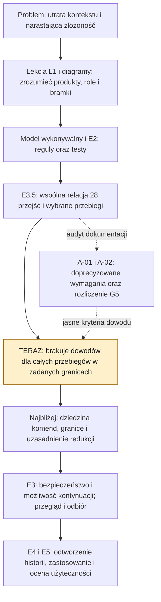

# Brief: wykonywalny model procesu operator–agenci

2026-10-29 · D-83 · propozycja do uzgodnienia z istniejącym zakresem `iso-model-state`; nie nowa obowiązująca instrukcja procesu.

## Punkt wznowienia

Aktualizacja 2026-11-08: wykonano zlecenie commitów i porównania Flowable z Pythonem. Gotowa paczka A-13–A-15 zapisana w **299edf2**. A-16 zakończone: [bilans w raporcie F5](../process-map/flowable-trial/f5-report.md#bilans-wobec-pythona--2026-11-08); niniejszy rejestr i bilans tworzą drugą paczkę lokalnego zapisu na to samo zlecenie.

- **Jedyny plan:** [mapa §8.7–8.8](coverage-map.md#87-zalecenia-i-punkt-wznowienia), A-16 / Z-68–70. Poprzednie objaśnienia: A-15 / Z-63–67; audyt i nawigacja A-13/A-14. Nie uruchamiać historycznych rekomendacji jako nowego zlecenia.
- **Wniosek bilansu:** Flowable dostarczył rzeczywiste zadania/historię BPMN, wykonanie DMN i trwały atomowy krok w granicach próby. Model rewizji, ślad, aktualność, komendy i karta są własnym kodem. Nie wykazano przewagi kosztu lub użyteczności całego rozwiązania nad Pythonem.
- **Nowe rozpoznanie porównawcze:** iso-model-state przy czystym HEAD f74f55f ma oprócz modelu referencyjnego osobny PY-01/src/isowork — SQLite, transakcje, komendy i replay. Jego zakres nie obejmuje odbioru wydania. Odczyt kodu/testów, bez nowej regresji i bez zmiany źródłowego repo. Nie twierdzić, że trwałość dostępna jest tylko dzięki Flowable, ani łączyć zakresów wszystkich prototypów Python w jedną aplikację.
- **Rekomendacja:** zachować próbę Flowable i dowody, nie migrować teraz procesu. Najbliższy proponowany kierunek nadal A-12: rozpoznanie istniejącego Kitchen przed wyborem przyrostu, na osobne zlecenie. Nie rozpoczynać równoległego przepisywania silników. Właściciel przygotowania następnego kroku: agent; operator wybiera zakres i przyjmuje ryzyko.
- **Kontrole i granice:** make check bez błędów, wcześniejsze W1 MIG-01/02; odtwarzalny wykaz, odsyłacze i whitespace sprawdzone. Nie uruchamiano ponownie testów niezmienionych produktów, TLC ani prób użytkowych. Trzy przystanki TST-02 są zapisane; nie oznaczono zrozumienia przez U jako potwierdzonego.
- **Odłożone:** D-85 oraz plan wydania szablonu zachowują własny status. WR bez definicji — agent poprosi U o rozwinięcie dopiero przed formalizacją. Karta pozostaje odczytem archiwalnym, nie API rzeczywistego projektu. Eksport użytkownika w korzeniu nietknięty; polecenie dotyczy lokalnych commitów, bez pushu.

## Orientacja po F5 — 2026-11-07

Cel użytkownika pozostaje praktyczny: przewidywalnie dostarczać oprogramowanie z agentami, bez utrzymywania zależności i decyzji w pamięci operatora; docelowo sprawdzić to na Kitchen CAD/CAM. W tej sesji rozwijaliśmy środki do osiągnięcia tego celu, nie sam produkt Kitchen.

Droga: recenzja i dwie naprawy kontroli szablonu → lekcja L1/TextStats → mapy ról, produktów, śladu i granic kontroli → kontrakty API/przejść, wywiad vcs-lite i porównania metod → mapowanie istniejącego modelu i audyt wymagań/DoD → ograniczona próba Flowable F1–F5. Materiały objaśniające, propozycje i wyniki wykonania mają różną moc; samo ich istnienie nie wdraża procesu.

- **iso-template-agent:** szablon instrukcji, dokumentów i kontroli repozytorium; tutaj także laboratorium edukacyjne i Flowable w reference/.
- **iso-model-state:** osobny projekt modelowania zachowania/badań formalnych, analizowany i mapowany w tej sesji; F5 nie zmienia jego planu ani nie zamyka jego dowodów. Bieżącego stanu drugiego repo nie aktualizowano podczas tego podsumowania.
- **Kitchen CAD/CAM:** przyszły sprawdzian użyteczności procesu; w tej sesji nie wykonano jego pełnego przyrostu ani integracji z silnikiem.

Udowodniono technicznie wybrane zachowania oraz trwałe wznowienie jednej sprawy. Nie wykazano jeszcze, że operator prowadzi dzięki temu rzeczywisty projekt sprawniej i z mniejszym obciążeniem. Najbliższa praca pozostaje oceną konkretnego raportu, bez automatycznej rozbudowy modelu, API lub UI. Ta orientacja nie jest nowym planem; statusy pozostają w mapie §8.7.

## Widok orientacyjny po A-02 — 2026-10-30

To skrót drogi rozumowania i aktualnego problemu, nie dokładna oś czasu tworzenia plików ani nowy plan. Wiążąca kolejność nadal w PLAN/STAN modelu. Zasadnicza luka: znana lista operacji i poprawne wybrane przebiegi nie dowodzą zachowania wszystkich ich kombinacji w przyjętych granicach. Zamknięcie G5 usuwa sprzeczność kryteriów, ale nie zamyka tej luki.

Proponowany kierunek, zgodny z aktualnym planem:

1. **Domknąć opis badania:** jakie polecenia i argumenty wolno generować, skąd zaczyna się badanie, co oznacza osiągnięcie granicy i które uproszczenia są poprawne. Rezultat: specyfikacja badania oceniona przez R przed kodem; limit badania nie może udawać odmowy procesu. Nie powiększać rodziny S10 bez wykazanej luki.
2. **Wykonać pozostałe dowody E3:** badać przyjęte właściwości właściwymi metodami w tych granicach, wykryć wymagane mutanty, zapisać ograniczenia i poddać wynik niezależnemu przeglądowi. Rezultat: rozliczone kryteria E3 i konkretna podstawa odbioru U; jeden udany przebieg nie zastępuje tego dowodu.
3. **Wrócić do zastosowania według E4/E5:** odtworzyć historię projektu, następnie sprawdzić wsparcie pracy operatora i wznowienie przez agenta. Rezultat: dowód, że proces pomaga wskazać stan, blokady i następną decyzję. Nie rozpoczynamy nowego API ani pilota Kitchen bez rozpoznania jego modułów i właściwego zlecenia.

Ograniczona kontrola S10 jest już opisana w bieżącym raporcie modelu, lecz nie dowodzi całego P1/P2/P6 ani AC03. To odczyt cudzej dostawy, nie nowe uruchomienie. D-91 prosi o przedstawienie kierunku; nie zleca tu wykonania kroków 1–3. A-03 pozostaje propozycją w jedynym planie §8.7.

## Cel i efekt dla operatora

Operator ma móc ustalić z utrzymywanego stanu: **co wykonano, na jakiej podstawie, co jest nieaktualne, co blokuje następny krok i jaka decyzja należy do niego**. Agent ma podejmować pracę z tych zapisów, a narzędzie odmawiać działań naruszających jawne reguły.

Wynikiem całej pracy ma być sprawdzony, wykonywalny model uzgodnionego zakresu procesu wraz z czytelnymi widokami i dowodami jego ograniczeń. „Kompletny” oznacza rozliczenie wszystkich elementów i zachowań w zatwierdzonej granicy. Nie oznacza odtworzenia każdej interpretacji ISO ani wszystkich sytuacji rzeczywistego projektu.

## Co już istnieje — stan odczytu 2026-10-29

| Materiał | Fakty istotne dla tej pracy | Ograniczenie |
| --- | --- | --- |
| [Model procesu](../../../iso-model-state/model/process.yaml) i [plan](../../../iso-model-state/PLAN.md) | Model v0.7, wykonawca Python, scenariusze WIT1–WIT5 i własny DoD | Nie należy rozpoczynać konkurencyjnego silnika |
| [Stan badań i decyzje](../../../iso-model-state/docs/STAN.md) | Badania TLC wybranych fragmentów, dalszy zakres formalizacji otwarty; próba vcs-lite zamknięta z ograniczeniami przez DEC-PRO-016 | W tej pracy odczytano zapisy, nie powtórzono testów; zamknięcie próby nie oznacza spełnienia całego DoD |
| [Model encji](../process-map/static-model.md), [przejście W02](../process-map/worked-transition.md), [kontrakt odbioru](../process-map/acceptance-contract.md) | Materiał do porównania pojęć, przejść i granicy decyzji | Propozycje i przykłady; nie cały wdrożony proces ani jeden wspólny schemat |
| [Lekcja L1](../process-simulator/README.md) | Działająca edukacyjna ilustracja powstawania przyrostu | Nie zastępuje WIT3/WIT5 wykonawcy `iso-model-state` ani rzeczywistych dowodów projektu |

Pierwszy odczyt roboczych plików `iso-model-state` wykonano przy HEAD `0bf7addff2242e2dea2c12515c18b397dc6aa2e1`; repozytorium miało niezapisane zmiany, m.in. w planie i stanie. Końcowy odczyt planu uwzględnił DEC-PRO-016 i powrót do E3. To nie jest analiza wyłącznie wskazanego commita ani zamrożona kopia wszystkich źródeł. Skrót SHA-256 odczytanego `model/process.yaml`: `2d329822e239555c1642d0a5a20aae0eb28fee17a6f2ff13968e48d7f428fc07`. Przed realizacją trzeba ponownie ustalić wersję wejścia.

## Zakres proponowanego rezultatu

1. **Granica i pojęcia:** aktorzy i uprawnienia; przyrost i wydanie; plan; wymaganie; produkt pracy i jego rewizja; zależność; wykonanie; wynik kontroli; pytanie; decyzja. Mapowanie na istniejące typy modelu, bez automatycznego dodawania encji dla każdego pojęcia.
2. **Zachowanie:** dozwolone operacje, warunki, efekty i odmowy; iteracja, poprawka, zmiana oraz wznowienie. Cykl produktu pracy, cykl wykonania i cykl decyzji nie są jednym statusem.
3. **Reguły przekrojowe:** ślad w obu kierunkach, wpływ zmiany, aktualność dowodów, zachowanie historycznych odbiorów, brak zgody i konflikty kontekstu.
4. **Wykonanie i sprawdzenie:** obecny wykonawca, testy, ograniczone badanie przestrzeni stanów oraz odtworzenie rzeczywistych zdarzeń. Powiązanie z rzeczywistymi dowodami tylko w wybranym, uzgodnionym przekroju.
5. **Widoki i obsługa:** statyczne encje, przejścia oraz przebieg konkretnej instancji z blokadami, decyzjami i powiązaniami. Widok nie staje się drugim ręcznie utrzymywanym stanem.

Poza zakresem: certyfikacja, automatyczny osąd poprawności reguł domenowych, automatyczny odbiór, metryki wydajności/czasu pracy i predykcje harmonogramu, nowy uniwersalny system workflow, domyślne wdrożenie API, sterowanie CNC i produkcja. Zabezpieczenia przed celowym fałszowaniem wymagają osobnego modelu zagrożeń; nie uznajemy ich za zbędne ani wykonane przez etykietę autora.

## Dlaczego obecne mechanizmy nie wystarczają

| Potrzeba lub ryzyko | Minimalny mechanizm uzupełniający | Dowód działania | Koszt utrzymania | Decyzja operatora |
| --- | --- | --- | --- | --- |
| Diagramy, kontrakt odbioru i model używają częściowo innych granic; osobne zielone kontrole nie rozstrzygają różnicy | Mapa pojęć i zachowań do istniejącego modelu, źródła i testu | Każda różnica ma rozstrzygnięcie albo jawne wyłączenie | Aktualizacja przy zmianie zakresu/reguły | Zatwierdzenie granicy i zmian znaczenia |
| Przykładowe ścieżki nie badają wszystkich interakcji | Uzupełnić istniejące badania własności i kontrprzykładów w określonych granicach | Raport narzędzia, granice, wykryte mutacje, rozliczone przykłady | Utrzymanie własności i małych konfiguracji | Zgoda na zmianę zakresu badania, jeśli potrzebna |
| `tests_ok` i `checks_ok` są w modelu założeniami, a nie dowodami uruchomienia | Jawnie oznaczyć abstrakcję; dla wybranego rzeczywistego przebiegu powiązać wynik z badaną wersją i wykonaniem | Zmiana wejścia unieważnia gotowość; deklaracja bez dowodu nie wystarcza w tym przebiegu | Powiązanie dowodów przy kontroli lub zmianie | Wybór operacyjnego zakresu; bez narzucania manifestów wejść |
| Autor może powtórzyć błąd we własnych testach | Recenzja kontrprzykładów i osobne odtworzenie dowodów według karty | Własne przypadki recenzenta i rozliczone ustalenia | Dwie recenzje na granicach etapu, nie każda czynność | Rozstrzygnięcie sporu o zakres lub ryzyko |
| Model może być spójny, lecz nie pomagać w codziennej pracy | Próba operatora i wznowienie przez nową sesję na istniejących zapisach | Poprawnie ustalony stan, blokady i następny krok | Jedna reprezentatywna próba; zapis konkretnych problemów | Odbiór użyteczności |

## Kolejność całej pracy i punkty zakończenia

To propozycja uporządkowania istniejących prac, nie polecenie przestawienia planu w drugim repozytorium.

| Krok | Rezultat | Warunek zakończenia | Relacja do istniejącego planu |
| --- | --- | --- | --- |
| 1. Uzgodnić granicę i mapę luk | Zestaw: element/operacja/własność → źródło → realizacja → brak/wyłączenie; porównanie kryteriów | Operator rozstrzyga zmiany zakresu; brak ukrytych sprzeczności kryteriów | Uznaje zakończone E1/E2, uwzględnia N1–N3 i wyniki zamkniętej próby vcs-lite |
| 2. Domknąć zachowanie w tej granicy | Uzupełniony model, kontrakty, testy i wyniki badań; widoki z tych samych danych | Każda luka w zakresie ma realizację i dowód; recenzja rozliczona | Kontynuacja odpowiednich prac E3, bez restartowania E1/E2 |
| 3. Sprawdzić użyteczność i gotowość operacyjną | Odtworzenie historii, próba wznowienia, wybrany przekrój rzeczywistych dowodów i pakiet odbioru | Spełnione uzgodnione kryteria oraz osobny odbiór operatora | Wykorzystuje wyniki prób i E4/E5; API nadal wymaga wykazanej potrzeby |

Technicznie: model YAML i wykonawca Python pozostają punktem wyjścia; TLA+/TLC służy badaniu wybranych własności, a nie wykonaniu decyzji człowieka. ER i diagramy stanów opisują strukturę oraz zachowanie. Scenariusze pokazują konkretne ścieżki. Nie wybieramy teraz nowych frameworków, bazy ani protokołu API. Szczegóły: [karta](work-card.md), [DoD](acceptance.md).

## Źródła i ich moc

- **Zlecenie użytkownika / D-83:** przygotowanie dokumentów; D-78 określa współpracę, D-81 zachowuje kierunek Kitchen. [Rejestr](../../project/decisions.md).
- **Wiążące ustalenia drugiego projektu:** [karta celu](../../../iso-model-state/docs/KARTA-CELU-I-ZAKRESU.md), [plan i DoD](../../../iso-model-state/PLAN.md), model, własności, interpretacje i decyzje według [katalogu](../../../iso-model-state/docs/KATALOG.md). Niniejszy brief ich nie nadpisuje.
- **Źródło normatywne do interpretacji:** ISO/IEC 29110, lokalne rozdziały 6 (PM), 7 (SI), 9 (produkty pracy); konwencje diagramów w rozdziale 4 §4.2. [Rozdziały](../../../iso-29110-5-1/chapters). Przeniesienie do reguł programu jest decyzją interpretacyjną z uzasadnieniem, a nie dowolnym dopisaniem wymogu normy.
- **Materiały pomocnicze:** [porównanie kontraktów](../process-map/api-contract-comparison.md) i [próba karty zmiany](../process-map/change-card-check.md). Historyczne analizy nie potwierdzają bieżącego stanu innego repozytorium.

## Sprawy do rozstrzygnięcia w odpowiednim momencie

| Sprawa | Właściciel i następny krok | Kiedy potrzebna |
| --- | --- | --- |
| Dokładna granica kompletności oraz zgodność tego DoD z już przyjętym | Agent przygotowuje mapowanie i jedną rekomendację do decyzji operatora | Przed zmianą zakresu implementacji |
| Starsze kryteria prób a wyłączenie pomiaru czasu/wydajności w tej rozmowie | Agent wskazuje różnicę; operator rozstrzyga zmianę, jeśli dotyczy przyjętych kryteriów | Przy uzgodnieniu kryteriów kolejnej próby, bez cichej zmiany poprzednich |
| Zakres rzeczywistych dowodów i sposób przypisania decyzji | Agent wykorzystuje istniejącą próbę vcs-lite, identyfikuje brak do pokrycia | Przed wyborem adaptera lub nowej próby; model symbolicznego aktora nie jest uwierzytelnieniem |
| Funkcja Kitchen, środowisko, dane, skutki dla bezpieczeństwa i integracja CNC | Agent rozpoznaje moduły; operator podejmuje potrzebne decyzje | Przed wyborem przyrostu Kitchen; kwestie produkcji przed rzeczywistą produkcją |

## Dziennik decyzji agenta i punkt wznowienia

- **A1, 2026-10-29:** pakiet zapisuję w `reference/process-modeling/`, z odnośnikami z istniejącej mapy i punktu wznowienia. Powód: to propozycja pracy nad modelem, nie aktywacja nowych reguł szablonu.
- **A2, 2026-10-29:** zachowuję obecny model i jego wykonawcę jako bazę i mapuję nowe kryteria do istniejącego DoD. Powód: uniknięcie konkurencyjnej implementacji procesu i ponawiania wykonanej pracy.

**Stan:** trzy dokumenty przygotowane; realizacja całego przedsięwzięcia nie jest tym samym co wykonanie tego zlecenia. Kryteria są propozycją, a nie potwierdzeniem spełnienia.

**Sprawdzenie dokumentacji, 2026-10-29:** `make check` — kod 0, 249 elementów, 0 błędów; ostrzeżenia W1 dla MIG-01/MIG-02 oraz W2 dla D-83 bez powiązanego commita. Osobno sprawdzono istnienie 88 lokalnych odnośników i domknięcie bloków kodu w trzech nowych dokumentach, indeksie mapy i rejestrze postępu: 0 błędów. `git diff --check` bez błędów. Kontrola odnośników sprawdza pliki, nie kotwice ani prawdziwość treści. Nie uruchamiano testów niezmienionego kodu, TLC ani symulatora. Nie wykonano recenzji przez subagenta, commita lub zmian w drugim repozytorium.

**Aktualizacja po poleceniu „commit(y), a następnie Dalej”, 2026-10-29:** pakiet zapisany w `d6f932d`. Wykonano [mapowanie kryteriów i luk](coverage-map.md), odtworzono pięć WIT i trzy próby diagnostyczne na kopii. Wyniki i ich ograniczenia są w mapie; nie ponawiano całego E2/E3. To wykonanie analizy, nie odbiór AC ani zmiana reguł drugiego repozytorium.

**Kontynuacja D-84:** zapisano przed wykonaniem [plan i kryteria cyklu wydań](release-cycle-plan.md), następnie opracowano [kontrakt W01–W07](release-cycle.md), wykonano próby i osobną recenzję. [Raport](release-cycle-report.md): RC-01–07 spełnione technicznie, 36/36 oczekiwań odtworzonych przez R i sześć dodatkowych przebiegów R. Model v0.7 bez zmian; cały E3 nadal otwarty.

**Wykonanie D-86, 2026-10-30:** [audyt wymagań i kryteriów](coverage-map.md#8-audyt-wymagań-i-kryteriów-2026-10-30) zapisany. D-87 porządkuje dalszą pamięć pracy; bieżący punkt wznowienia jest na początku tego briefu, a plan i rejestr wykonania tylko w mapie §8.7–8.8.
