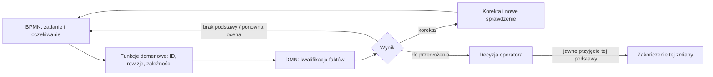

# Mapa kryteriów, istniejącego modelu i braków

2026-10-29 · D-83 · wykonanie polecenia „commit(y), a następnie Dalej”. Analiza i ograniczone próby na kopii; bez zmian reguł modelu i bez odbioru za operatora.

**Aktualizacja 2026-10-30 — D-86:** bieżący [audyt wymagań i kryteriów](#8-audyt-wymagań-i-kryteriów-2026-10-30) jest w §8. Sekcje 1–7 zachowują wynik odczytu z 2026-10-29; ich „następne działania” nie są aktualnym poleceniem. W drugim repozytorium wykonano już translację E3.5 i przyjęto korektę L/F przez DEC-PRO-017. Nie należy ponownie implementować tej dostawy na podstawie starej mapy.

Bieżący wynik 2026-11-05, D-97: [F4 — wykonywalny przebieg BPMN](../process-map/flowable-trial/README.md), 51/51 PASS, 12/12 wybranych uszkodzeń wykrytych i pięć widoków faktycznego przebiegu. Status A-06 w §8.7; F5 niezlecone. Poniższy wniosek o E3 zachowuje kontekst wcześniejszego audytu, nie zleca pracy w drugim repozytorium.

## Wniosek decyzyjny

**Mamy działający rdzeń symulacyjny, ale nie kompletny mechanizm prowadzenia rzeczywistego projektu.** Istniejące E1/E2 należy zachować. Najbliższa praca to domknięcie pokrycia pełnego zachowania w E3, zgodnie z obecnym planem `iso-model-state`. Późniejsze E4/E5 mają sprawdzić przejście od symbolicznych danych do historii i dowodów projektu.

Nasze AC-01–AC-10 nie są zamiennikiem przyjętego DoD. Część porządkuje już istniejące zobowiązania, część łączy różne etapy, a część proponuje dodatkowe wymagania operacyjne. Nie wolno z ich redakcji wywnioskować zgody na nowy system, API czy obowiązkowe formularze.

## 1. Przedmiot i sposób sprawdzenia

Odczytano robocze `iso-model-state`, HEAD `0bf7addff2242e2dea2c12515c18b397dc6aa2e1`, z niezacommitowanymi zmianami dokumentów. PLAN/STAN zawierają DEC-PRO-016: próba P0–P4 zamknięta z ograniczeniami, dalej E3; odbiór N1–N3 pozostaje otwarty. To rozpoznanie źródeł, nie nowa decyzja naszego operatora.

Model YAML, kod wykonawcy i dane WIT skopiowano do katalogu tymczasowego, a następnie uruchomiono pięć świadków i trzy próby diagnostyczne. Trwały [wynik JSON w gzip](evidence/mapping-probes.json.gz) zawiera pełne stany przed/po, zdarzenia i SHA-256 skopiowanych plików oraz głównych dokumentów. Kopia tymczasowa nie jest potrzebna do odczytania wyniku ani ponowienia prób. Skrót pliku YAML i skrót jego sparsowanej postaci są różnymi tożsamościami; nie porównujemy ich jako tej samej wartości.

**Nie wykonano:** pełnej regresji E2/E3, TLC, nowego pilota użytkowego ani recenzji przez osobnego agenta. Wyniki dawnych raportów są oznaczone niżej jako zastane. Wykonanie pięciu ścieżek nie dowodzi własności dla wszystkich kombinacji.

## 2. Najważniejsze ustalenia

| Kategoria | Problem → plik i dowód | Skutek | Minimalne dalsze działanie |
| --- | --- | --- | --- |
| **Brak w wykonaniu przyjętego planu** | [Raport E3.4](../../../iso-model-state/docs/E3-04-RAPORT.md), „Granice”: wycinek z głębokością 16, `CHECK_DEADLOCK FALSE`, bez pełnych S/L/F i L1 | Brak podstaw do twierdzenia o zakończonym badaniu całego zachowania | Dokończyć istniejące E3; nie budować drugiego silnika |
| **Brak operacyjnego powiązania** | [Model](../../../iso-model-state/model/process.yaml), `notation`: `tests_ok` i `checks_ok` to założenia. Próba `tests_false_only_at_W04` dochodzi do accepted, natomiast późne pytanie blocking zatrzymuje W04 | Negatywny wynik musi zostać odwzorowany na właściwy stan/ustalenie; samo przekazanie flagi przy W04 nie blokuje odbioru | W E4 określić mapowanie faktów do zdarzeń i blokad, a w E5 sprawdzić wybrany adapter. Nie zmieniać teraz W04 bez decyzji o regule |
| **Brak kompletnego pokrycia pojęć operacyjnych** | [Model](../../../iso-model-state/model/process.yaml), `item_types`: PLAN/REQ/AT/DES/CODE; [N3](../../../iso-model-state/docs/preparations/n3/REPORT.md) to próba modelu informacji, nie wdrożony profil Task/Run/material/result | Nie można utożsamić zatwierdzenia PLAN z istnieniem pełnej mapy prac ani śladu ID z rzeczywistym wykonaniem testów | Wykorzystać N3 do doboru minimalnych informacji na podstawie E4; nie wdrażać pełnego ręcznego profilu |
| **Brak pełnego dowodu użytkowego** | [Próba vcs-lite](../../../iso-model-state/docs/PROBA-ZMIANY-ARCHIWIZACJA.md), §16–17 i DEC-PRO-016: wznowienie wykonane, pełny ARC-11 oraz koszt U niesprawdzone; N3 ujawniło narzut ręcznych zapisów | Sukces wybranej próby nie potwierdza całej obsługi zgód ani wygody przyszłego narzędzia | Zachować wyniki i ograniczenia; brakujące aspekty sprawdzić w istniejących E4/E5, bez ponownego otwierania P0–P4 |
| **Propozycja porządkująca** | [Nasze AC](acceptance.md) łączą model, trwałość operacji i użyteczność widoków; [przyjęty plan](../../../iso-model-state/PLAN.md) oddziela E3, E4, E5 | Łatwo dołożyć do E3 nowy zakres i ponownie rozmyć cel | Zachować przyjęty DoD jako wiążący; AC stosować jako mapę pytań do dowodów, z rozszerzeniami jawnymi przed ich realizacją |

Nie zgłaszamy tutaj nowego potwierdzonego defektu rdzenia. Drugi wiersz jest wykazaną granicą abstrakcji modelu wobec przyszłego użycia operacyjnego, a nie niezgodnością implementacji z obecnym guard W04.

## 3. Mapowanie każdego kryterium

„Pokrycie” poniżej oznacza zakres istniejących mechanizmów i dowodów; nie nadaje statusu odbioru całego AC.

| AC | Przyjęty DoD / etap | Istniejący mechanizm lub dowód | Co pozostaje; kwalifikacja |
| --- | --- | --- | --- |
| 01: granica i źródła | DoD 1, 8; E1 | [Katalog](../../../iso-model-state/docs/KATALOG.md), §„Moc dokumentów”; model z `iso`, [interpretacje](../../../iso-model-state/docs/INTERPRETACJE.md); E1/E2 odebrane według PLAN | Źródła i granica modelu są ustalone. G6 sprawdza adnotacje, nie realizację wszystkich składowych ISO. Rozszerzona granica naszego briefu pozostaje propozycją |
| 02: tożsamości i historia | DoD 1, 3; E1/E2 | `item_variables`, `predecessor`, kopie odbiorów; WIT3 i WIT5 ponownie wykonane | Rdzeń wersji działa. Materiał pliku, wykonanie i wynik nie są pełnymi encjami tego rdzenia; ich profil jest propozycją N2/N3 |
| 03: kontrakty operacji i błędy | DoD 1–3, 9; E2, potem E5 | [execute_step](../../../iso-model-state/src/isomodel/execution.py): odczyt actor/from/guard/effects, praca na kopii; [testy atomowości](../../../iso-model-state/tests/test_v07_scope.py), `test_observer_failure_rolls_back_external_change_and_consumed_consent` | Atomowość operacji w pamięci nie dowodzi odporności trwałego magazynu na awarię. Trwałość i idempotencja przyszłego adaptera są warunkowym rozszerzeniem, nie luką w czystej funkcji |
| 04: wpływ i dowody | DoD 3, 9; S4–S7/S10–S14 | `dependents`, `suspect`, T11/T14/W07, obserwatory; [testy zastąpienia](../../../iso-model-state/tests/test_replacement.py), WIT3/WIT5; odmowa późnego blocking ponowiona | Powiązania i zmiana formalnego PLAN są objęte modelem; wykrycie ręcznej zmiany pliku, semantycznie starego planu lub sprzecznej prozy wymaga E4/E5 i osądu. `suspect` nie jest pełną kontrolą świeżości testu |
| 05: struktura i postęp | DoD 2–5; G/S/L/F | [E2](../../../iso-model-state/docs/E2-RAPORT.md): świadek każdego z 28 przejść; [E3.4](../../../iso-model-state/docs/E3-04-RAPORT.md): zgodność wycinka z osobną wyrocznią | Przyjęte zobowiązanie nadal otwarte: pełna relacja w granicach, pełne własności, CTL L1, OBS. Pokrycie przejść nie oznacza pokrycia ich interakcji |
| 06: czułość i semantyka | DoD 6, 9 | Zastane raporty E2: mutanty S; E3.4: 34 mutanty oraz osobne wyrocznie; [testy danych dowodowych](../../../iso-model-state/tests/test_evidence.py) | Domknąć macierz własność → konkretny mutant → właściwa przyczyna naruszenia dla pozostałego E3. Nie zastępować tego procentem testów. Nie powtarzano tych badań tutaj |
| 07: scenariusze | DoD 7; E2/E3 | WIT1–WIT5 ponownie wykonane: 29/33/54/13/40 kroków | To świadkowie symulacji Python. DoD wymaga także wygenerowania/przeglądu U w zakresie E3. Nasze dodatkowe awarie trwałego wykonania nie są automatycznie objęte WIT |
| 08: fakty i decyzje | DoD 3, 9; cel użytkowy | Wymagane pola evidence, pytanie związane z elementem/wersją/operacją, odrębne `simulation`; W04 odmówił aktorowi A | Źródło tekstowego dowodu i rzeczywista tożsamość nie są uwierzytelniane. E4/E5 mają powiązać rekord z realnym materiałem; sam parametr actor=U nie chroni przed podszyciem |
| 09: orientacja i wznowienie | [Karta celu](../../../iso-model-state/docs/KARTA-CELU-I-ZAKRESU.md), kryteria użytkowe; E5 | Katalog, STAN, raporty; N3: osobny odczyt; próba P3: dwa wznowienia według jej raportu | Wykorzystać istniejące dowody, nie zaliczać ich jako próby końcowego narzędzia. Automatyczne, wspólne widoki z jednego stanu są naszą propozycją realizacji, nie warunkiem już odebranego E2 |
| 10: odtwarzanie i recenzja | DoD 5, 10; bramki etapów | Raporty i archiwa E3; [recenzja E2](../../../iso-model-state/docs/reviews/E2-V07-PRZEGLAD-2026-10-26.md); osobne recenzje E3.4 | Istnieją przeglądy konkretnych dostaw. Końcowa recenzja/odbiór E3 oraz E5 nadal przyszłe; ta mapa jest analizą autora |

## 4. Pokrycie zachowania — bez mieszania wykonawcy z dowodem formalnym

| Operacje | Wykonawca Python | Zastane badania TLA+/TLC | Następne rozliczenie |
| --- | --- | --- | --- |
| T00–T04: utworzenie, sprawdzenie, zatwierdzenie/odrzucenie, baseline | Zdefiniowane w YAML; świadkowie i testy E2 | E3.1–E3.3 oraz wybrane użycia w E3.4 | Zachować wyniki wycinków; złożyć z pełną relacją i historią |
| T05, T11–T13: otwarcie zmiany i obsługa suspect | Modelowane, wykonywane przez WIT3/WIT5 | E3.4 bada wybrane interakcje od jawnego prefiksu | Nie przenosić dowodu wycinka na dowolny stan pełnego procesu |
| T06–T10, T14: podważenie, zastąpienie, wycofanie, odłożenie/wznowienie, przepięcie | Istnieją świadkowie E2, T14 wykonane w WIT3 | Pełne mapowanie wymienione jako pozostała praca E3 | Kontrakt → oczekiwane skutki/odmowy → własności → mapowanie do TLA+ |
| P00–P05: pytania | WIT4 oraz zgody w WIT3/WIT5 | E3.4 obejmuje wybrane P01/P02; nie całą kolejkę i jej postęp | Pełna relacja P, L2 przy założeniach; nie utożsamiać kolejki modelu z rozumieniem odpowiedzi w języku naturalnym |
| W01–W07: wydanie | WIT1/WIT5, odmowy W03/W05 w zastanym E2, W07 w WIT3 | Konteksty wydań w E3.4 nie są pełnym cyklem W | Pełny cykl „odbiór v1 → zmiana → odbiór v2”, także odmowy i powrót do przygotowania |
| Obserwatory wpływu przed/po odbiorze | Testy E2 i E3.4, wpływ spoza zakresu | Wycinki i izolowane konteksty | Złożenie z całym procesem; historyczny accepted pozostaje niezmienny |

Źródła tej tabeli: [model](../../../iso-model-state/model/process.yaml), [E2](../../../iso-model-state/docs/E2-RAPORT.md), [plan dokończenia E3](../../../iso-model-state/PLAN.md), [E3.4](../../../iso-model-state/docs/E3-04-RAPORT.md). To mapa zobowiązań, nie gotowy kontrakt translatora dla pozostałych operacji.

## 5. Wykonane próby

| Próba | Oczekiwanie zapisane przed wykonaniem | Rzeczywisty wynik |
| --- | --- | --- |
| WIT1 / WIT2 / WIT3 / WIT4 / WIT5 | completed; odpowiednio 29/33/54/13/40 kroków | Zgodne we wszystkich pięciu |
| Odbiór W04 przez A | Odmowa z przyczyny actor | rejected / actor |
| P00 blocking po W02, przed W04 | Odmowa W04 z przyczyny guard | rejected / guard |
| Samo `tests_ok=False` dopiero przy W04 | Według obecnego guard nadal completed; próba granicy abstrakcji | completed, stan accepted |

Ostatni wynik **nie potwierdza poprawności takiego odbioru w realnym projekcie**. Pokazuje, że model reaguje na jawne zdarzenia i przesłanki, a nie na każdą informację, którą wykonawca może otrzymać. Aby realny późny wynik ujemny blokował odbiór, trzeba zdefiniować jego odwzorowanie na blokadę/utratę gotowości. To przedmiot przyszłego adaptera albo decyzji o zmianie reguły, nie automatyczna zmiana przyjętego YAML.

Odtworzenie z katalogu `iso-template-agent`, z użyciem istniejącego środowiska drugiego repozytorium:

```sh
/Users/michal/PycharmProjects/iso-model-state/.venv/bin/python -B reference/process-modeling/probe.py --source ../iso-model-state --output reference/process-modeling/evidence/mapping-probes-rerun.json.gz
```

[Skrypt](probe.py) odmawia nadpisania wyniku. Używa nowej kopii źródeł; porównaj ich hashe z zapisanym wynikiem. Kopiuje aktualne źródła, nie odtwarza sam dawnego stanu zmienionego repozytorium. Pierwsze wykonanie przez względną ścieżkę środowiska dało ostrzeżenie Python o `sys.prefix`; zakończyło się kodem 0 i wszystkimi wynikami powyżej. Polecenie odtworzenia używa ścieżki kanonicznej. Nie instalowano zależności.

## 6. Rozbieżności do obsłużenia w odpowiednim momencie

| Temat | Właściciel / najmniejszy następny krok | Moment decyzji |
| --- | --- | --- |
| Zakres DoD: rdzeń versus dowody operacyjne i widoki | Agent utrzymuje to mapowanie; wiążący pozostaje DoD `iso-model-state`, AC są propozycją uzupełniającą | Przed aktywacją wymagań wykraczających poza E3–E5, nie przed samym dokończeniem mapowania |
| Swoboda A versus T04 zawsze wykonywane przez U, także dla DES/CODE | Agent rozróżni techniczne sprawdzenie, baseline i odbiór; opisze liczbę i sens rzeczywistych decyzji w E4 | Przed przeniesieniem modelu do procesu Kitchen; nie zmieniamy odebranej semantyki E2 |
| W02/W04 symbolicznym aktorem versus rzeczywisty recenzent i operator | Agent dobierze zapis źródła decyzji/recenzji do konkretnej integracji; autentyczność oddzieli od kontroli pomyłek | Przed operacyjnym użyciem narzędzia; osobny model zagrożeń przed obietnicą odporności na fałszowanie |
| Pomiar czasu w starszej karcie celu versus wyłączenie go w tej rozmowie | Agent zachowuje historyczny brak pomiaru; dla przyszłej próby proponuje obserwacje błędów, fałszywych alarmów i duplikacji | Przy uzgodnieniu przyszłych kryteriów użytkowych; bez cichego przerabiania dawnego odbioru |

## 7. Następne działania i punkt wznowienia

1. **Agent: uszczegółowić mapowanie pozostałego E3**, zaczynając od pełnego cyklu wydań. Rezultat: dla każdej operacji W oraz powiązanych T/P wejścia, warunki, efekty, odmowy, własności i oczekiwane przypadki. Koniec: brak nieopisanej operacji w wybranym przekroju, rozliczone różnice ze źródłami, pakiet gotowy do osobnej recenzji. Nie dodawać nowych reguł.
2. **Po mapowaniu: osobny recenzent ocenia kontrprzykłady**, zanim zmieni się generator. Rezultat: uwagi powiązane z regułami i przypadkami. Koniec: brak nierozstrzygniętej sprzeczności blokującej implementację; zmiana zaakceptowanej reguły trafia do U. To przyszły punkt recenzji z karty pracy, nie recenzja już wykonana.
3. **Następnie implementacja w istniejącym E3 i jego bramka.** Rezultat: TDD, porównanie z osobną wyrocznią, badanie w jawnych granicach i raport. Koniec: spełniony przyjęty zakres E3, odtworzenie dowodów i osobny odbiór U. E4/E5 następują w przyjętej kolejności; żadnego nowego pilota ani API teraz.

**Stan tego zlecenia:** wcześniejszy pakiet zapisany w commicie `d6f932d`; mapa przygotowana, osiem prób wykonanych. Nie zmieniono drugiego repozytorium. Karta/brief/AC nadal mają status propozycji tam, gdzie wykraczają poza wcześniej przyjęty zakres. Otwarta praca agenta: krok 1 powyżej; pytania dla U dopiero przy wykazanej zmianie reguły lub zakresu.

**Decyzja agenta A3, 2026-10-29:** mapa rozdziela pokrycie Python, badania TLC i użycie operacyjne, bo ich połączenie w jeden status dawałoby fałszywe „gotowe”. Osiem prób to diagnostyka istniejącej semantyki, nie nowe kryteria odbioru ani pełna regresja.

**Kontrola dokumentacji:** `make check` — kod 0, 249 elementów, 0 błędów; dwa wcześniejsze ostrzeżenia W1 MIG-01/MIG-02. Osobna kontrola sześciu dokumentów: 113 lokalnych odnośników do istniejących plików/katalogów, domknięte bloki kodu, brak błędów; kotwic nie sprawdzano. Skompresowany dowód odczytano: osiem wyników zgodnych z zapisanymi oczekiwaniami. `git diff --check` bez błędów. Mapa, skrypt i wyniki powstały po commicie wcześniejszego pakietu i pozostają zmianami roboczymi.

## 8. Audyt wymagań i kryteriów 2026-10-30

**Wynik:** nie ma podstaw, by uznać całą specyfikację za jednoznaczną i wolną od duplikacji znaczenia. Nie znaleziono identycznych zdań w 57 wymaganiach szablonu. Potwierdzono natomiast rozbieżności zakresu zapisów, niejasność domknięcia DoD i nieaktualne wskazówki kontynuacji. Część powtórzeń jest uzasadniona: opisuje regułę, sposób jej sprawdzenia i wynik. Problemem są niezależnie utrzymywane definicje tej samej reguły.

To ograniczony audyt semantyczny autora, z kontrolą historii i jedną wykonaną próbą narzędzia. Nie jest certyfikacją, pełną weryfikacją kodu ani niezależnym przeglądem. Nie nadaje `verified` lub `approved` wymaganiom, nie odbiera D-85 ani E3. Zalecane zmiany znaczenia pozostają propozycjami.

### 8.1 Zakres i wykorzystanie Git

Stan wejściowy: `iso-template-agent` **dd8f353e92abb5a227231eb8ab73e25c4b527427**, 302 pliki śledzone, w tym 112 Markdown; jedyny nieśledzony plik to eksport użytkownika `ISO 29110 a nasz model śladu.md`, pozostawiony bez zmian. `iso-model-state` **79cab4da4284b6bac1ee9f5fc2d88b0d97dba4dc**, 626 plików śledzonych, 118 Markdown, czyste drzewo przy odczycie. Liczby dotyczą wejścia, nie rozmiaru specyfikacji; większość plików drugiego repozytorium stanowią kod i dowody.

Przeskanowano nagłówki wszystkich 230 śledzonych Markdown pod kątem wymagań, kryteriów i DoD: 19 kandydatów tutaj, 28 w modelu. Ten filtr służył nawigacji, nie dowodzi braku reguł ukrytych w innych akapitach. Czytanie szczegółowe objęło wszystkie 57 zdań REQ i 55 AT szablonu, słownik, instrukcje, plan i decyzje; pełne DoD 1–10 modelu, definicje G0–G6, S1–S15 z S7a/S7b, L1–L5, F1–F3 i WIT1–WIT5; kartę celu, hierarchię i aktualny plan; dziewięć E3-AC, dziesięć naszych AC i siedem RC. Implementacje i raporty czytano celowo przy konkretnym ustaleniu, nie wszystkie linie kodu i archiwa dowodów.

Materiały edukacyjne, propozycje API, N1–N3 i zamknięta próba vcs-lite zostały rozdzielone według statusu i przedmiotu. Nie przeprowadzono ponownego szczegółowego audytu wszystkich ich historycznych kryteriów, implementacji L1 ani normy. Ten audyt nie upoważnia do twierdzenia „sprawdzone wszystkie 300 plików”.

| Użycie historii | Co rzeczywiście ustalono | Praca, której nie trzeba powtarzać |
| --- | --- | --- |
| `git log`, `git blame`, `git show` dla REQ/AT i narzędzi | UPD-04 oraz LAY-03 mają obecne problematyczne brzmienie od `11ddded`; nie powstało ono przy ostatnim mapowaniu. D-53/D-64 zapisują wyjątki; przeniesienie `b866213`/`12acb1d` nie jest nową regułą | Nie przypisywać błędu przeniesieniu plików; nie badać każdej dawnej lokalizacji jako osobnej specyfikacji |
| Początek DoD i G5 w modelu | „Każda właściwość ma mutanta” oraz G5 „raport, nie test” współistnieją już w `d60d7f9`; późniejszy raport E2 jawnie wyłącza G5 | Nie otwierać ponownie testów E2 w poszukiwaniu regresji, której historia nie wskazuje |
| `d6f932d` → `dd8f353` | Nasze AC od początku są propozycją; RC dotyczą tylko mapowania. Commit nie jest zatwierdzeniem AC ani odbiorem D-85 | Nie scalać wszystkich AC/RC z przyjętym DoD jako nowych obowiązków |
| Model: `04485cc` → `36819a0` → `79cab4d` | Zapisano E3-AC, przyjęto warunkowe L/F (DEC-PRO-017), wykonano E3.5. Relacja YAML v0.7 pozostaje bez zmiany, zmieniły się gwarancje i wykonanie translatora | Nie odtwarzać starej diagnozy „brak translacji 17 przejść”; nie powtarzać jej implementacji |

Git zawęża dochodzenie i identyfikuje przedmiot. Nie dowodzi sensu wymagania, autorstwa decyzji U ani kolejności pisania plików wewnątrz jednego commita. Każdą podejrzaną parę porównano również w bieżącej treści; brak zmiany od pierwszego commita nie oznacza poprawności.

### 8.2 Gdzie obowiązuje które kryterium

| Przedmiot | Źródło definicji i mocy | Sprawdzenie i wynik | Czego z nim nie scalać |
| --- | --- | --- | --- |
| Szablon procesu | [REQ](../../spec/requirements.md), [decyzje](../../project/decisions.md), instrukcje i słownik; wszystkie 57 REQ mają obecnie `initiated`, nie `approved` | [AT](../../spec/tests/process-kit.feature); kryteria wydania MS-01 w [planie](../../project/plan.md); wyniki testów i rekordy przeglądów są odrębne | Formalne S/L modelu ani fikcyjne wymagania TextStats nie są wymaganiami tego produktu |
| Abstrakcyjny model procesu | [YAML](../../../iso-model-state/model/process.yaml), [WLASCIWOSCI](../../../iso-model-state/docs/WLASCIWOSCI.md), [INTERPRETACJE](../../../iso-model-state/docs/INTERPRETACJE.md), decyzje STAN według [katalogu](../../../iso-model-state/docs/KATALOG.md) | Pełne DoD w WLASCIWOSCI; PLAN zawiera skrót i etapy; raport odpowiedniego E identyfikuje zakres dowodu | Raport z przykładowych ścieżek nie zamyka całego DoD |
| Domknięcie E3 | Powyższe reguły i [E3-AC01–09](../../../iso-model-state/docs/E3-KRYTERIA-ODBIORU.md) jako konkretyzacja dowodów | [Raport E3.5](../../../iso-model-state/docs/E3-05-RAPORT.md) rozlicza dostawę krokową; pełny graf, S/L/F i odbiór E3 nadal otwarte | Nasze wcześniejsze „co przenieść do generatora” nie jest aktualną listą braków |
| Użyteczność narzędzia | [Przyjęta karta celu](../../../iso-model-state/docs/KARTA-CELU-I-ZAKRESU.md), decyzje i przyszły zakres E4/E5 | Próby wznowienia, wpływu, zgód i działania operatora na określonym materiale; dotychczasowe próby mają jawne ograniczenia | `tests_ok`, aktor `U` w symulacji i green TLC nie dowodzą realnego wykonania lub zgody |
| Nasza propozycja całej pracy | [AC-01–10](acceptance.md), D-83: zlecenie opracowania, nie odbiór kryteriów | Mapa w §8.5 poniżej; rozszerzenia nie są obowiązkowe bez decyzji | Nie ustanawia drugiego nadrzędnego DoD |
| Nasze mapowanie wydań | [RC-01–07](release-cycle-plan.md), D-84 | [Raport i 36 prób](release-cycle-report.md); odbiór D-85 osobny | RC-05 wymaga mapy do formalizacji, nie dowodu całej żywotności |
| Lekcja edukacyjna L1 | [I1](../process-simulator/increment-01.md), D-79 | Testy i próba interfejsu opisane w rejestrze L1 | Odbiór w fabule nie jest odbiorem modelu lub symulatora |
| API, przykłady planowania i ewolucji repo | Własne nagłówki „propozycja”/„przykład”; [kontrakt API](../process-map/acceptance-contract.md), [przykład planu](../planning-examples/increment-plan.md) | Materiały do nauki i późniejszej decyzji, nie obecna specyfikacja wdrożenia | Ich manifesty, budżety, stany lub kryteria nie rozszerzają automatycznie E3 ani Kitchen |

### 8.3 Pięć najważniejszych ustaleń

Identyfikatory AUD służą tylko lokalizacji ustaleń tego przeglądu; nie są nowym katalogiem wymagań. „Defekt” poniżej dotyczy dokumentacji, chyba że wskazano inaczej.

| ID / kategoria | Problem i dowód | Konsekwencja | Najmniejsza poprawka i priorytet |
| --- | --- | --- | --- |
| AUD-01 — **potwierdzony defekt** | [UPD-04](../../spec/requirements.md), linia 325: każdy plik projektu poza pakietem ma pozostać identyczny; [AT-40](../../spec/tests/process-kit.feature) powtarza „wszystkie”. UPD-03 dopuszcza zmianę Answers File, a [snapshot](../../tests/test_distribution.py), linie 157–166, wyłącza answers i `.git`. G-DST-03 lokuje answers w projekcie | Wymaganie i kryterium obiecują więcej niż sprawdza test; prawidłowa zmiana wersji copiera narusza dosłowne „wszystkie” | Dopisać jawny zakres porównania: poza pakietem, Answers File i metadanymi Git; odesłać do UPD-03/D-53. **P1 przed następnym odbiorem szablonu** |
| AUD-02 — **potwierdzony defekt** | [LAY-03](../../spec/requirements.md), linia 392: nieistniejąca ścieżka w dokumencie/skrypcie ma dać błąd, chyba że ma uzasadniony wyjątek. [check_refs.py](../../template/process/tools/check_refs.py), `scanned`, pomija m.in. całe `reference/`, decyzje i testy; D-64(3) zatwierdza to wyłączenie. Próba §8.6: ten sam błędny link daje kod 1 w korzeniu, kod 0 w reference | Czytający REQ może błędnie uznać nasze materiały za skontrolowane przez zielone `make check` | Ograniczyć LAY-03 do jawnie zdefiniowanego zakresu skanowania i wskazać zatwierdzone wyłączenia; nie poszerzać skanera. **P1 przed deklaracją pokrycia dokumentów** |
| AUD-03 — **potwierdzony defekt** | [WLASCIWOSCI](../../../iso-model-state/docs/WLASCIWOSCI.md): DoD 2 mówi „G1–G6 / testy pytest”, DoD 6 „każda właściwość / 100% mutantów”; G5 ma „raport, nie test”. [E2-RAPORT](../../../iso-model-state/docs/E2-RAPORT.md), tabela G5: `report_not_test`, mutant „nie dotyczy”. E3-AC06 mówi już „właściwość wymagająca dowodu” | Brak jednolitej odpowiedzi, czy raport G5 wystarcza do końcowego DoD i jaki jest mianownik pokrycia mutantami | W jednym pełnym DoD jawnie przypisać G5 do przeglądu raportu, pozostałe właściwości do właściwych testów/mutantów; decyzja U, bo zmienia dosłowne przyjęte kryterium. Nie cofać historycznego odbioru E2. **P1 przed zamknięciem całego DoD** |
| AUD-04 — **brak** | [AC-03/04/07/08](acceptance.md) mieszają kontrolę modelu z trwałością operacji, aktualnością rzeczywistych dowodów i konfliktem prozy. „Poprawnie wpływa” w AC-04 nie określa samodzielnie wejścia ani oczekiwanego zbioru; mapa §3 ostrzega, ale nie dzieli każdego AC na odsyłacz i rozszerzenie | Autor może uznać zgodność z modelem za spełnienie operacyjne albo dołożyć niezlecony adapter do E3. WIT1 dodatkowo używa nieostrego określenia „rzeczywista decyzja … w granicy trybu” | Używać mapowania §8.5: źródłowe S/DoD są kryteriami, a brakujące zachowania operacyjne pozostają propozycją. Doprecyzować przy wyborze E4/E5; nie dopisywać nowych REQ teraz. **P1 przed użyciem AC jako bramki** |
| AUD-05 — **potwierdzony defekt** | Przed audytem [brief](brief.md), [rejestr](../process-simulator/progress.md) i [raport](release-cycle-report.md) wskazywały dalsze mapowanie/generator. `iso-model-state` ma już `79cab4d` i E3.5. [Kontrakt](release-cycle.md) §6 mówi o „trwałym odbiorze po ustaniu zmian”, podczas gdy DEC-PRO-017 przyjmuje warunkową gotowość i nie wymusza pozytywnej decyzji | Nowy agent może powtórzyć ukończoną translację lub zaimplementować dawną, zbyt silną gwarancję | Zaznaczyć datę starego odczytu i odsyłać bieżącą kontynuację do PLAN/STAN oraz L/F w WLASCIWOSCI. **P1 przed wznowieniem implementacji**; lokalne ostrzeżenia i punkty wejścia poprawiono w tym audycie, historycznych wyników nie nadpisano |

Pierwsze dwa ustalenia są niezgodnością treści z zapisanymi wyjątkami, nie nowymi awariami aktualizatora/skanera. AUD-03 wymaga rozstrzygnięcia treści kryterium; nie dowodzi, że E2 miał ukryte nieudane testy. AUD-04 jest brakiem precyzji propozycji, nie naruszeniem już przyjętego nowego wymagania.

### 8.4 Przegląd wymagań szablonu i duplikacji

Każde z 57 REQ ma `source`, `quality`, wzorzec i status `initiated`. Każde poza MIG-01/02 ma wskazujący je AT; dwa AT są ręczne. Istniejący [VER-01](../../records/verification.md) dotyczy kopii repozytorium, nie semantycznego odbioru wszystkich REQ. „TSK-01 completed” oznacza wykonanie dokumentacji, nie zatwierdzenie każdego wymagania. Dlatego poniższa tabela jest oceną treści, nie wynikiem testów produktów.

| Zakres przeczytanych REQ | Powiązane AT | Ocena relacji i precyzji |
| --- | --- | --- |
| TRC-01–19 | AT-01–17, AT-50, AT-52 | Warunki i obserwowalne błędy są przeważnie konkretne. TRC-14 wymaga odczytania wspieranych interpreterów z planu; TRC-13 „changed” trzeba czytać z D-39/AT-12 (bez samej zmiany statusu). Brak duplikatu zdania, ale sama EARS nie usuwa zależności od definicji |
| HKS-01–05 | AT-18–21, AT-53 | HKS-01 i 03 kontrolują inne raporty; HKS-05 precyzuje przedmiot kontroli wszystkich hooków. To rozdzielone aspekty, nie kandydaci do usunięcia |
| SEP-01–02 | AT-22–23 | Zasada i wyjątek pierwszego commita. SEP-01/G-ART-08 nazywa tylko VER, podczas gdy D-38/P-Role opisują także VAL: katalog nie wyczerpuje całej instrukcji E9. Test nazwany „autor nie weryfikuje sam siebie” sprawdza rozdział commitów, nie tożsamość osoby |
| PLN-01–03 | AT-24–26 | PLN-02 jest konkretyzacją jednego pola wyniku PLN-01; utrzymywać jako odrębny sprawdzalny aspekt, bez drugiej definicji osiągnięcia kamienia |
| REC-01–02 | AT-27–28 | Nieznany punkt listy i sprzeczny wynik pass to różne błędy; podobne słownictwo nie jest duplikatem |
| REP-01–02 | AT-29–30 | Porównanie kopii i opcjonalny zapis wyniku to różne efekty; dwa AT mogą legalnie używać wspólnego runnera |
| ISO-01 | AT-31 | Generowanie strony z danych; nie wymaganie osiągnięcia zgodności produktu z normą |
| INI-01–03 | AT-32–34 | Odmowa startu, utworzenie dokumentów, przejście hooków to różne zachowania. „Niezacommitowana zmiana” w AT-32 jest skrótem — REQ mówi o plikach śledzonych |
| DST-01–02 | AT-35–36 | Zakres dostawy i identyfikacja wersji; stanowią również kontekst AUD-01 |
| UPD-01–08 | AT-37–44 | UPD-03 jest odmową, UPD-04 gwarancją udanej operacji — uzasadnione uzupełnienie, ale muszą używać tego samego wyjątku (AUD-01). UPD-07 określa ponowienie, nie drugi ogólny zakaz zmian |
| MIG-01–02 | brak | Znany zaplanowany brak AT, nie nowo odkryta awaria. Zakres migracji nadal zależy od zmian wydania i TSK-07 |
| LAY-01–03 | AT-45, AT-54–55 | LAY-02 chroni dokument wygenerowany wcześniej z wzorca; jest konkretnym przypadkiem ochrony z UPD-04. LAY-03: AUD-02 |
| LEK-01–02 | AT-46–47 | ID i pojęcie to inne wejścia. Zakres słownika jest już otwartą sprawą D-75; przegląd jej nie rozstrzyga |
| TST-01–02 | AT-48–49 | Istnienie runnera i wiarygodna interpretacja wyniku to różne kontrole. Naprawa D-76 doprecyzowała TST-02 i AT razem; nie ma powodu powtarzać naprawy |
| LNG-01 | AT-51 | Szerokie „every … file … English” ma znany wyjątek `kontrakt-decyzji.md` w D-20. Przy przyszłym porządkowaniu ograniczyć kwantyfikator do zakresu decyzji; EARS nie dowodzi precyzji tej deklaracji |

Powyższe drobniejsze uwagi SEP/TRC/LNG pozostają po stronie agenta do redakcyjnego porównania z odpowiednimi decyzjami podczas następnej zmiany danego obszaru; nie dopisano dla nich nowych obowiązków produktu ani nowych pytań do U. Nie wydajemy zbiorowego „pass” dla całych 57 REQ.

Uzasadnione powtórzenia w modelu: S2 pilnuje zatwierdzenia, S3 wcześniejszej weryfikacji; S7a aktualnej gotowości, S7b chwili odbioru, S10 historii po odbiorze; S13 zakresu rekordu roboczego. S15 i L4 współdzielą budżet odrzuceń wersji — L4 już odsyła do S15. Nie należy usuwać jednej z własności tylko dlatego, że wymienia ten sam licznik. Skrót DoD w PLAN jest pochodny wobec pełnego WLASCIWOSCI; E3-AC określają sposób dowodzenia, a RC zakres naszego mapowania. Potrzebna jest zgodność znaczenia, nie usunięcie wszystkich powtórzonych słów.

### 8.5 Rozliczenie naszych AC bez tworzenia drugiej specyfikacji

| AC | Co odsyła do istniejącego zobowiązania | Konkretyzacja lub proponowane rozszerzenie |
| --- | --- | --- |
| 01 | DoD 1/8, hierarchia KATALOG, INT i decyzje | Mapa zakresu jest sposobem rozliczenia; szersza granica briefu nie została przyjęta |
| 02 | YAML + DoD 1/3; tożsamość, wersja, predecessor, S10 | Task/Run/material/result poza obecnym rdzeniem: propozycja informacji, nie warunek odbioru E3 |
| 03 | Kontrakty YAML/wykonawcy, DoD 2/3/9; odmowy i atomowy krok | Trwały magazyn, odporność na przerwanie i idempotencja dotyczą przyszłego adaptera, jeśli będzie objęty zakresem |
| 04 | S4–S7, S10–S14; E4 w DoD 9 | Dla modelu używać dokładnego S i oczekiwanego stanu. Świeżość testu rzeczywistego pliku i rozumienie sprzecznej prozy wymagają osobno wybranego przypadku operacyjnego |
| 05 | DoD 2–5, E3-AC03–05/08; G/S/L/F | Nie nowy katalog właściwości. Odwołanie do aktualnych L/F po DEC-PRO-017, zamiast kopiowania starej gwarancji |
| 06 | DoD 6/9; E3-AC02/06 oraz TDD z PLAN | Osobna wyrocznia doprecyzowuje metodę. Wyjątek G5 wymaga AUD-03; nasze AC go nie rozstrzygają |
| 07 | DoD 7, WIT1–5, E3-AC07 | Awarie trwałego zapisu i semantyczny konflikt kontekstu nie są automatycznie częścią WIT. Symulowany W04 to krok aktora U; prawdziwa decyzja U dotyczy późniejszego przeglądu/odbioru świadków, nie każdego kliknięcia fabuły |
| 08 | DoD 9, karta celu; rozróżnienie simulation i rzeczywistego wykonania | Powiązanie realnego uruchomienia z materiałem należy doprecyzować w E4/E5; nie dowodzą go same pola evidence. Mechanizm tożsamości nie został przyjęty |
| 09 | Karta celu: wznowienie i możliwość podjęcia działania; E5 | Próba odczytu jest konkretyzacją. Obowiązkowy zestaw nowych widoków byłby wyborem rozwiązania, nie zatwierdzonym już wymaganiem |
| 10 | DoD 5/10, E3-AC08/09 | Odtworzenie i rozliczenie recenzji konkretyzują dowody; nie zastępują podpisu U |

DoD modelu rozliczamy nadal osobno: 1 → G0; 2 → G1–G6 z niejasnością G5; 3 → 16 właściwości S; 4 → L1–L5/F według DEC-PRO-017; 5 → OBS/bounds; 6 → macierz mutacji z AUD-03; 7 → świadkowie i ich przegląd U; 8 → G6/adnotacje, bez obietnicy pełnej zgodności ISO; 9 → wspólny YAML oraz rzeczywista historia w E4; 10 → R i U. E3-AC01/02 konkretyzują relację i zgodność, 03 bezpieczeństwo, 04 CTL L1, 05 pozostałe L/F, 06 czułość, 07 świadków, 08 odtwarzalność, 09 recenzję. Nie zmieniają same z siebie kryterium nadrzędnego.

RC-01–07 mają zachować własne wyniki mapowania: kontrakty, dwie migawki, legalne kroki/odmowy, wpływ zmiany, granica formalizacji, czułość oczekiwań i odtwarzanie/R. Ich obecne spełnienie nie jest siedmioma dodatkowymi „zaliczonymi” punktami DoD całego modelu. Raport RC pozostaje dowodem przedmiotu opisanego jego hashami.

### 8.6 Co uruchomiono i jak odtworzyć ustalenia

Uruchomiono inwentaryzację Git, skan nagłówków Markdown, ekstrakcję REQ/AT i dokładne porównanie zdań `text:`: **57 REQ, 55 AT, 0 identycznych zdań, MIG-01/02 bez AT, 57 statusów initiated**. To kontrola struktury i podobieństwa dosłownego; semantyczne pary oceniono ręcznie powyżej.

Próba AUD-02 odbyła się w świeżym lokalnym klonie `dd8f353` w katalogu tymczasowym, bez zapisów w źródłowym repozytorium. Do indeksu kopii dodano `audit-control.md` i `reference/audit-control.md` o tej samej treści: `[Kontrola](audit-missing/never-exists.md)`. Nie utworzono commita. Dla każdego pliku wykonano `python3 -B template/process/tools/check_refs.py <ścieżka>`:

```text
audit-control.md:
  audit-control.md:1: brak ścieżki „audit-missing/never-exists.md”
  check_refs: 1 plików, 1 błędów, wyjątków użytych 0
  exit = 1
reference/audit-control.md:
  check_refs: 0 plików, 0 błędów, wyjątków użytych 0
  exit = 0
```

Do odtworzenia wystarczają wskazany commit, dwa podane pliki i polecenie; żadna ścieżka `/private/tmp` nie jest częścią dowodu. Próba pokazuje świadome wyłączenie, a nie uszkodzenie skanera. AUD-01 oceniono przez odczyt AT, słownika, decyzji i `snapshot`; nie uruchamiano ponownie copiera. Nie powtarzano pytest, TLC ani dawnych dowodów tylko z powodu zmian w prozie. W szczególności liczby z E3.5 są wynikami zastanego raportu, nie testami tego audytu.

**Kontrola zapisu audytu:** `make check` zakończone kodem 0: 252 elementy, 0 błędów; wcześniejsze W1 MIG-01/02 oraz W2 dla nowego D-86 bez commita. Osobna kontrola ośmiu zmienionych Markdown: 140 lokalnych odnośników do istniejących plików, sześć odwołań do kotwic audytu, domknięte bloki kodu; 0 błędów. Pierwszy prosty skaner linków błędnie potraktował dosłowny przykład brakującej ścieżki wewnątrz kodu jako link dokumentu; po wyłączeniu treści kodu kontrola przeszła. Innych kotwic nie walidowano. `git diff --check` bez błędów; drugie repozytorium pozostało czyste. Te kontrole nie zatwierdzają semantyki wymagania.

### 8.7 Zalecenia i punkt wznowienia

**Jedyny bieżący plan działań po audycie — D-87, 2026-10-30.** Opiekun: agent. Zakres tego planu to obsługa ustaleń audytu, nie zastąpienie planu wydania szablonu ani PLAN drugiego projektu. Decyzje U są w [rejestrze decyzji](../../project/decisions.md); przebieg i dowody w §8.8; krótki wskaźnik bieżącej pracy w [briefie](brief.md). Pozostałe dokumenty odsyłają tutaj zamiast utrzymywać własną kopię tabeli.

Statusy: `proposed` — przygotowana propozycja, bez zlecenia wykonania; `planned` — wykonanie zlecone, nierozpoczęte; `in_progress` — rozpoczęte; `blocked` — rozpoczęte lub zlecone, zatrzymane konkretną przeszkodą; `completed` — rezultat i sprawdzenie zapisane. Zakończenie techniczne nie oznacza odbioru U. Lokalne identyfikatory A-01–08 oznaczają działania, nie nowe wymagania. Przy zmianie statusu, zakresu lub kolejności dopisz przyczynę i dowód w §8.8; zmianę przyjętego ustalenia powiąż z rzeczywistą decyzją U.

| Działanie / przedmiot | Właściciel / status | Zależności i upoważnienie | Rezultat i warunek zakończenia | Następny krok |
| --- | --- | --- | --- | --- |
| **A-01 — szablon:** doprecyzowanie UPD-04/AT-40 i LAY-03 (AUD-01/02) | Agent / `completed` | D-88: „Dalej” po wskazaniu A-01. Korekta zgodna z wyjątkami D-53/D-64, bez zmiany narzędzi | UPD-04/AT-40 mają jawne wyjątki; LAY-03 i wejście AT-45 wskazują zakres kontroli. Przypadki zgodne z przyjętymi wyjątkami, kontrola dokumentów bez błędów; dowód Z-05 | Brak dalszej pracy w A-01; nie zmieniać statusu REQ na verified/approved na podstawie samej korekty |
| **A-02 — model:** jednoznaczne rozliczenie G5 (AUD-03) | Agent / `completed` | D-89 zleca analizę i propozycję; D-90: U „D1 tak” zatwierdza korektę przyjętego DoD; zapis w modelu DEC-PRO-018. Uzgodnienie przed zamknięciem tego kryterium. Nie zależy technicznie od A-01 i nie blokuje całego E3. Zmiana w drugim repozytorium wymaga właściwego upoważnienia | Jeden pełny DoD i pochodny skrót. Koniec: jawny zbiór właściwości wymagających mutantów oraz osobny dowód przeglądu G5; zachowany odbiór historycznego E2 | Zamknięte wynikiem Z-09: korekta, pełna macierz i niezależny przegląd. Kontynuację E3 prowadzi aktualny plan modelu; brak zgody na commit/push |
| **A-03 — model:** dalsza realizacja według aktualnego źródła (AUD-04/05) | Agent / `proposed` | Odczyt aktualnych PLAN/STAN, E3-AC i właściwego zlecenia przed kontynuacją. E3.5 już istnieje. D-85 pozostaje osobnym odbiorem naszego mapowania | Poprawnie wybrany następny przyrost z planu źródłowego, bez powtarzania translacji i rozszerzania E3 o operacyjne propozycje. Koniec tego działania: zapisany aktualny przedmiot, podstawa upoważnienia i odsyłacz do źródłowego planu; nie zakończenie całego E3 | Przy zleceniu kontynuacji sprawdzić bieżące źródło; propozycje operacyjne z §8.5 rozpatrzyć dopiero we właściwym zakresie E4/E5 |
| **A-04 — szablon:** karta zachowania zmiany wymagania | Agent / `completed` | D-92, nowe zlecenie lokalnego opisu; nie uruchamia A-03 | Jedna karta w istniejącym change-card-check.md: źródła, kontrakt, przykłady obecnych i proponowanych reakcji, dowody i granice. Koniec: sprawdzone odsyłacze i zgodność opisu z kodem; jawne niewiadome z właścicielami | Karta zakończona w Z-13; przykład C1 → C2 → C4 opisany w Z-14. Dalej edukacyjne porównanie z C5; P1/P2 bez zgody na implementację |
| **A-05 — szablon:** plan oceny Flowable | Agent / `completed` | D-93: zlecono plan, dokumentacja i odczyt środowiska | Plan §9 z zakresem, źródłami, kolejnością, kryteriami i granicami. Koniec: odsyłacze i spójność dokumentacji sprawdzone; brak deklaracji wykonania próby | Wynik Z-16; późniejsze wykonanie F1 rozliczone w A-06 |
| **A-06 — szablon:** ograniczona próba Flowable | Agent / F1–F5 technicznie `completed`; U zgłosił problem czytelności | D-94–97 zleciły zakończone F1–F4; D-99 zleca F5 | F5: trwałość w 10 JVM, 58/58 PASS; 4/4 usterki wykryte, osobne odtworzenie 58+2 PASS i demo 8/8; raport f5-report.md, Z-27. Odbiór użyteczności nie został wykonany | Agent: kontynuować tekstowe przejście od mapy kilku funkcji i ich zależności. U rozumie dotychczasowe objaśnienia; nie jest to odbiór użyteczności F5. Pięć odpowiedzi zachowano verbatim oraz dopisano podstawę odbioru; Z-29–33. Przebudowa widoku nie jest zlecona |
| **A-07 — szablon:** diagramy F4 | Agent / `completed` | D-98: diagramy przed F5 | architecture.md: 8 diagramów, odnośniki do kodu, 8/8 renderów i przegląd semantyczny; Z-25 | Czytać C4 1–3, następnie ślad 5 i dane 6–8. Wariant przechowywania zaktualizowano po F5/D-99 |
| **A-08 — objaśnienie:** relacja ISO–Scrum | Agent / `completed` | Jawne zlecenie U z 2026-11-07: sprawdzić lokalne ISO i assets, zapisać Mermaid do pliku | [iso-and-scrum.md](../process-map/iso-and-scrum.md): źródła, oględziny sześciu grafik, trzy sprawdzone diagramy; Z-30 | Bez zmiany procesu, implementacji lub commita |


Kolejność A-01 → A-02 → A-03 jest kolejnością rekomendacji audytu; zależności i moment decyzji podano osobno. Nie ustanawia nowego harmonogramu drugiego projektu. Utrzymanie to aktualizacja jednego wiersza i dopisanie wyniku przy rzeczywistej zmianie. Obecne kontrole nie wystarczają: dla A-01 składnia EARS i link AT nie wykrywają szerszego kwantyfikatora; dla A-02 raport N/A nie rozstrzyga dosłownego „każda”; dla A-03 niezależne kopie planu już spowodowały nieaktualną instrukcję wznowienia.

**Zastosowana korekta A-01 — D-88, wynik Z-05:** UPD-04 i AT-40 wyłączają z ochrony plik copiera i metadane git; notatka wymagania zachowuje ochronę także plików ignorowanych. LAY-03 ogranicza obowiązek do objętych kontrolą plików i rozpoznawanych lokalnych odwołań; notatka odsyła do zakresu D-64(3) i opisu `check_refs.py`, a AT-45 jawnie wymaga śledzonego dokumentu objętego kontrolą. Źródła REQ uzupełniono o odpowiednie decyzje. Pozytywny przypadek aktualizacji może zmienić answers; zmiana README poza pakietem nadal wymaga odmowy. Próby skanera z §8.6 nadal ilustrują właściwą granicę 1/0; nie ponawiano ich w A-01. Kod i wyjątki nie zostały zmienione.

**Korekta A-02 / D-90 — przyjęta przez U „D1 tak”, 2026-10-30; wdrożona jako DEC-PRO-018.** Poniższy odczyt i tabela zachowują treść przedstawioną do decyzji; bieżący wynik wdrożenia jest w §8.8. Ponowny odczyt przy HEAD modelu `7215b9c13a7de602e91d72a4704d5957def62808`: [pełny DoD](../../../iso-model-state/docs/WLASCIWOSCI.md), [skrót planu](../../../iso-model-state/PLAN.md), [E3-AC06](../../../iso-model-state/docs/E3-KRYTERIA-ODBIORU.md). Sprzeczność „każda właściwość ma mutanta” wobec G5 „raport, nie test” nadal występuje. Bieżąca praca drugiego projektu dotyczy S10/P1–P6; nie przestawiamy jej kolejności.

**Istniejący mechanizm:** [completeness_matrix](../../../iso-model-state/src/isomodel/graph.py) klasyfikuje pary zadeklarowany stan–przejście: `forbidden_by_source`, `current_instance_if_guard`, `new_instance_if_guard`. [Test G5](../../../iso-model-state/tests/test_graph.py) sprawdza liczbę par wydania i trzy klasyfikacje. [Raport E2](../../../iso-model-state/src/isomodel/evidence.py) zapisuje liczby par oraz `report_not_test`. **Test raportu istnieje**, ale nie dowodzi spełnialności warunków, uprawnień, efektów ani osiągalności. Usunięcie przejścia zmniejsza dziedzinę raportu; wewnętrzna kompletność nie dowodzi kompletności względem potrzeb. Dlatego zielony test ani samo N/A nie usuwają sprzeczności DoD.

Teksty przyjęte w D-90 — jeden pełny DoD i odwołania w skrótach:

| Miejsce | Docelowa treść korekty |
| --- | --- |
| `docs/WLASCIWOSCI.md`, zdanie wstępu o mutantach | „Właściwości G0–G4, G6, S1–S15 (S7a i S7b zamiast S7) oraz L1–L5 wymagają wykazania czułości według DoD 6. G5 wymaga kontroli i przeglądu raportu według DoD 2, nie mutanta właściwości procesu.” Zachować historię zatwierdzeń. |
| Pełny DoD 2 | Kryterium: „Struktura G1–G4/G6 oraz raport kompletności G5”. Dowód: „Właściwe testy struktury i raportu przechodzą; przegląd G5 rozlicza dziedziny, klasyfikacje oraz ograniczenia opisane przy G5.” |
| Pełny DoD 6 | Kryterium: „Każda właściwość G0–G4, G6, S1–S15 (S7a i S7b zamiast S7), L1–L5 ma co najmniej jeden celowo zepsuty model wykrywany właściwą metodą”. Dowód: „Macierz właściwość → mutant → oczekiwane naruszenie → rzeczywisty wynik obejmuje cały wymieniony zbiór; wszystkie wymagane mutanty wykryte. G5 rozliczane osobno w DoD 2, poza wynikiem mutacji. Dla własności semantycznych błąd składni, środowiska lub timeout nie zastępuje naruszenia własności.” |
| Wiersz G5 i objaśnienie pod tabelą | Nazwa: „Kompletność zadeklarowanej struktury”. Treść: „Dla każdego rodzaju item/question/release raport obejmuje iloczyn zadeklarowanych stanów wraz ze stanem początkowym i zadeklarowanych przejść; klasyfikuje parę jako wykluczoną przez from albo dotyczącą obecnej/nowej instancji pod warunkiem spełnienia pozostałych reguł”. Mutant: „Nie dotyczy; testy raportu i przegląd według DoD 2”. Objaśnienie: przegląd wskazuje wersję modelu, pełną macierz, wynik sprawdzenia dziedzin i klasyfikacji oraz rozbieżności wobec przyjętej listy przejść. Sama liczba par nie zastępuje przeglądu. G5 nie dowodzi spełnialności guard, osiągalności ani kompletności potrzeb; wykonalność pozostaje przedmiotem G2 i właściwych badań E3. |
| `PLAN.md`, skrót DoD 2 i 6 | „2. Struktura oraz raport G5 — według pełnego DoD 2 w docs/WLASCIWOSCI.md.” / „6. Czułość sprawdzeń w zbiorze określonym przez pełny DoD 6; G5 rozliczane osobno według DoD 2.” |
| `docs/E3-KRYTERIA-ODBIORU.md`, E3-AC06 | Dopisać: „Zakres właściwości zgodny z pełnym DoD 6 w docs/WLASCIWOSCI.md; G5 rozliczane według DoD 2.” Zachować obecne wymagania kontrprzykładów i niezależnego oczekiwania. |

**Granice:** doprecyzowanie rozliczenia nie zalicza kryterium. Zachowujemy istniejące testy raportu; bez zmian S/L/F, YAML, wykonawcy, generatora i zakresu E3. F pozostają założeniami podlegającymi obecnym kontrolom czułości i niepustości; nie otrzymują zwolnienia. G0/G4 nadal mogą wykrywać właściwe błędy schematu — wymóg semantycznego kontrprzykładu nie dotyczy błędów struktury. E2/DEC-PRO-012 i jego raport pozostają historycznym wynikiem z ograniczeniami; nowego przeglądu G5 nie dopisujemy wstecz.

**Koszt i ocena efektu:** jednorazowa korekta trzech dokumentów; potem aktualizacja raportu/przeglądu przy zmianie stanów lub przejść w istniejącej bramce przeglądu. Bez nowej usługi lub roli. Efekt: można jednoznacznie przypisać dowód każdej pozycji DoD, bez fikcyjnego mutanta G5 i uznawania liczby par za dowód procesu. Przed wdrożeniem ponownie odczytać źródła, zapisać rzeczywistą zgodę w rejestrze modelu, skontrolować zgodność trzech miejsc i rozliczyć przegląd G5. Odmowa pozostawia AUD-03 otwarte do innego rozstrzygnięcia przed zamknięciem kryterium; nie blokuje całego E3.

**Wykonane porządkowanie:** datowany audyt dopisano do istniejącej mapy, a punkty wejścia odsyłają do niego i aktualnego źródła modelu. Następnie w A-01 doprecyzowano dwa istniejące REQ i dwa teksty AT; w A-01 nie tworzono kolejnego katalogu wymagań ani nie zmieniono DoD. W A-02, po D-90, doprecyzowano rozliczenie G5 w modelu; pakiet procesu i Kitchen bez zmian. D-85 pozostaje otwarte. D-89 upoważniło do commita wcześniejszej pracy (Z-06); korekta A-02 zapisywana w Git na polecenie D-91; wynik Z-10. Pozostałe sprawy z §6 zachowują właścicieli i moment decyzji.

**Decyzja agenta A4, 2026-10-30 — zapis z audytu:** użyć historii Git do doboru źródeł i wykluczenia powtórnej pracy, ale oceniać aktualne znaczenie; raport zachować w istniejącej mapie, zamiast mnożyć specyfikacje. Zaproponowana wtedy korekta A-01 została później zlecona w D-88 i wykonana (Z-05); prace w modelu wymagają odczytania jego aktualnego stanu i właściwego upoważnienia, nie przenoszenia starego polecenia.

### 8.8 Rejestr zmian i wykonania

Dopisuj zdarzenia w kolejności wykonania. Plan w §8.7 pokazuje aktualny zamiar i status; ten rejestr zapisuje fakty i wyniki. Korekta wcześniejszego wyniku jest nowym wpisem wskazującym poprzedni, nie zmianą dawnych danych. Zgody nie powstają przez wpis agenta — wskazujemy decyzję U w rejestrze projektu. Lokalne numery Z-01… identyfikują wpisy, nie commity ani rekordy odbioru.

| Wpis / data / podstawa | Działanie i powód | Zmienione pliki | Sprawdzenie i rzeczywisty wynik |
| --- | --- | --- | --- |
| Z-01 / 2026-10-30 / D-86; wpis retrospektywny przy utworzeniu rejestru | Wykonano audyt i poprawiono odsyłacze do aktualnego stanu, ponieważ kryteria i instrukcje kontynuacji zaczęły się rozchodzić. A-01/02 pozostały propozycjami; nie zmieniono REQ/DoD | `coverage-map.md`, `acceptance.md`, `brief.md`, `release-cycle.md`, `release-cycle-report.md`, `reference/process-simulator/progress.md`, `project/decisions.md`, wygenerowany `reports/trace.md` | Szczegóły i granice w §8.6: próba skanera 1/0, `make check` 252 elementy / 0 błędów, osobne linki i diff poprawne. To wcześniejsze wykonanie, nie nowe uruchomienie |
| Z-02 / 2026-10-30 / D-87 | Utrwalono plan z właścicielami, statusami, zależnościami i warunkami zakończenia; dodano rejestr oraz drogę wejścia po kompakcji. Nie zastosowano proponowanych poprawek | `AGENTS.md`, `coverage-map.md` §8.7–8.8, `brief.md`, `project/decisions.md`; odświeżenie `reports/trace.md` przez narzędzie | Zapis przygotowany; kontrola dokumentów i przejścia od instrukcji startowej do następnego kroku do wykonania |
| Z-03 / 2026-10-30 / D-87, sprawdzenie Z-02 | Zakończono utrwalenie i kontrolę drogi wznowienia. Odczyt autora: AGENTS → brief → plan/rejestr/decyzje pozwala wskazać A-01, właściciela, status propozycji, granicę zlecenia D-87 i brak commita; to przegląd dokumentów, nie próba nowej niezależnej sesji | Wynik dopisany tutaj; brief odsyła do tego wpisu. `reports/trace.md` odświeżony przez `make check` | `make check`: kod 0, 253 elementy, 0 błędów; W1 MIG-01/02 i W2 D-86/87 bez commitów. Cztery dokumenty: 83 lokalne linki, cztery kotwice mapy i bloki kodu poprawne. `git diff --check` bez błędów. Zlecenie utrwalenia wykonane; statusów A-01–03 nie podniesiono. Bez testów niezmienionego kodu, commita i pushu |
| Z-04 / 2026-10-30 / D-88 | Rozpoczęto A-01 po poleceniu „Dalej”. Sprawdzono wyjątki D-53/D-64, zakres `check_refs.py`, `snapshot` testów dystrybucji i istniejące REQ/AT. A-01 zmieniono z `proposed` na `in_progress` | `project/decisions.md`, plan §8.7 i ten rejestr; dalsza zmiana obejmie `spec/requirements.md` i tekst AT | Przegląd źródeł potwierdza korektę dokumentacji bez zmiany kodu; wynik końcowy jeszcze nieustalony |
| Z-05 / 2026-10-30 / D-88, zakończenie A-01 | Zastosowano korekty UPD-04/AT-40 i LAY-03/wejścia AT-45. Przegląd autora: chronione pliki, w tym ignorowane, odpowiadają `snapshot`; answers i `.git/` są wyłączone; niedozwolona zmiana README nadal odpowiada odmowie UPD-03/AT-39. LAY-03 rozróżnia zakres skanowania i wyjątek ścieżki | `spec/requirements.md`, `spec/tests/process-kit.feature`, `project/decisions.md`, plan/rejestr, punkt wznowienia w `brief.md`; `reports/trace.md` wygenerowany | `make check`: kod 0, 254 elementy, 0 błędów; W1 MIG-01/02 i W2 D-86/87. Tekst oraz kod istniejących przypadków porównano, bez ponownego uruchomienia dystrybucji i prób skanera. Brak zmian kodu/runnerów: nie deklarujemy TDD RED/GREEN ani nowej regresji produktu. A-01 `completed`; REQ nadal `initiated`. Bez commita i zmian drugiego repozytorium |
| Z-06 / 2026-10-30 / D-89 | Na polecenie „commit i Dalej” zapisano audyt, plan i A-01; rozpoczęto analizę A-02 (`proposed` → `in_progress`) | Commit `8849a3b`: 11 plików, 222 dodania / 14 usunięć; eksport użytkownika poza commitem | Przed commitem `make check`: 255 elementów, 0 błędów, W1 MIG-01/02 i W2 D-86/87/89. Diff indeksu sprawdzony, commit udany. Bez pushu. Bezpośrednio po commicie jedyny nieśledzony plik to eksport użytkownika |
| Z-07 / 2026-10-30 / D-89, propozycja D-90 | Sprawdzono DoD, raport, implementację i test G5; przygotowano tekst korekty w §8.7. A-02 pozostaje w toku: propozycja gotowa, wdrożenie i przegląd oczekują D-90 | Mapa, brief, rejestr decyzji; ślad odświeżany narzędziem. Bez zmian źródeł modelu | Na kopii `7215b9c`: istniejący test G5 — 1 passed. item 120, question 30, release 28 par. Diagnostyczne guard W04=false nie zmienia macierzy G5. To granica raportu, nie wykryty mutant procesu ani pełna regresja. Przegląd autora, bez niezależnego R. Cudze zmiany w drugim repo pozostawione bez ingerencji |
| Z-08 / 2026-10-30 / D-90, DEC-PRO-018 | U „D1 tak” zatwierdził korektę; po świeżym odczycie zastosowano teksty w źródle i zapisano rzeczywistą zgodę. Wygenerowano pełną macierz G5 i sprawdzono dziedziny/klasyfikacje | Model: WLASCIWOSCI, PLAN, E3-KRYTERIA-ODBIORU, STAN; tutaj decyzje, mapa i brief | 178/178 par zgodnych z deklaracjami, inwentarz 28 przejść zgodny z E3-AC01; check_model.py: 413 kontroli OK. Dokumentacyjny diff bez błędów. To nie dowód wykonalności ani całego G/S/L. Osobny R w toku; A-02 nadal in_progress |
| Z-09 / 2026-10-30 / D-90, zamknięcie A-02 | Niezależny R sprawdził dokumenty i pełną macierz. Zamknięto dwie uwagi: semantyczny zakres zdania E3-AC06 oraz ciągłość tabeli DEC-PRO-018. Wynik i hashe poniżej | Cztery dokumenty modelu; lokalnie decyzje, mapa, punkt wznowienia i wygenerowany ślad | R: PASS bez blokerów; 178/178 par, 13 testów PASS. make check: 256 elementów, 0 błędów; W1 MIG-01/02 i W2 D-90 bez commita. A-02 completed oznacza zakończenie korekty i przeglądu G5, nie odbiór E3/DoD całego modelu. Bez commita/pushu |
| Z-10 / 2026-10-30 / D-91 | Zlecono commit i przedstawienie kierunku. W modelu wybrano tylko cztery dokumenty korekty G5, odtwarzając dokładnie hashe R w indeksie; cudze fragmenty PLAN/STAN i reszta S10 pozostawione roboczo. Diagram i kierunek zapisano w istniejącym briefie | Model: commit `ea77055`, 4 pliki, 12 dodań / 8 usunięć. Tutaj: decyzje, brief, mapa i generowany ślad, zapisane razem z tym wpisem | Commit modelu udany, diff indeksu poprawny i zakres zgodny z R. Brak pushu. Bieżący raport/STAN wskazuje wykonaną ograniczoną kontrolę S10 i następny opis dziedziny komend; odczyt, nie powtórne badanie. D-91 nie uruchamia A-03. Kontrola lokalnego zapisu poniżej |
| Z-11 / 2026-10-30 / polecenie U wyjaśnienia z drugą sesją | Na wyraźną prośbę U wysłano wiadomość do istniejącej sesji `01a16ac7-ae4a-79c2-9709-aa1924fc3fc8`, z ograniczeniem do odczytu i wyjaśnienia. Przekazano commit ea77055, zakres G5 i brak zlecenia zmiany planu lub ponowienia S10 | Tylko lokalny raport i punkt wznowienia; bez edycji repo modelu | Odpowiedź sesji po sprawdzeniu diffu i PLAN/STAN przy HEAD f93f8ae: G5 uwzględnione, brak konfliktu i zmiany kolejności. S10/13a6478 oraz specyfikacja grafu/f93f8ae wynikały z wcześniejszych poleceń U w tamtej sesji. Następny krok prowadzi tamten agent: TDD generatora komend i wyjść poza bounds, niezależna ocena i jedna próba według §11.6. Potwierdził brak potrzeby dodatkowego rozstrzygnięcia do tego kroku i brak uruchomienia prac w ramach kontaktu. Lokalnie dalsza implementacja wstrzymana; nie powielać jego planu |
| Z-12 / 2026-10-30 / D-92 | Rozpoczęto lokalną kartę zachowania po zleceniu „Dalej”. Odczytano istniejącą próbę TST-02, TRC-13, SEP-01/02, AT-12/22/23 oraz kod W5/E9 | Rejestr decyzji i plan A-04; karta powstaje w istniejącym dokumencie | Plan zapisany przed redakcją karty; brak zmian wymagań, narzędzi i drugiego repozytorium |
| Z-13 / 2026-10-30 / D-92, zakończenie A-04 | Dopisano kartę do istniejącej próby: źródła, kontrakt, C1–C10, dwie propozycje i pytania z właścicielami. Zachowano historyczną próbę TST-02 | change-card-check.md; decyzje, plan/rejestr, brief; trace wygenerowane | Przegląd autora z kodem i REQ/AT; make check: kod 0, 258 elementów, 0 błędów, W1 MIG-01/02 i W2 D-92 bez commita. 104 lokalne linki/kotwice poprawne po wyłączeniu kodu przykładowego (pierwszy prosty skan błędnie potraktował zapis celowo brakującej ścieżki jako link). Bloki kodu domknięte, git diff --check bez błędów. Bez nowych prób C1–C10, regresji kodu, niezależnej recenzji i odbioru U; brak zmian REQ/AT, template/, Kitchen i modelu |
| Z-14 / 2026-11-01 / polecenie U „Wykonajlmy Dalej jak sugerujesz”, kontynuacja objaśnienia D-92 | Przygotowano dydaktyczne przejście C1 → C2 → C4: TextStats, zmiana wyniku dla biało-czerwony z 1 na 2. Rozdzielono przegląd wymagania, przegląd testu, wykonanie testu i historyczny wynik | Karta §7, plan i punkt wznowienia; dopisek w rejestrze decyzji | Analiza przykładu, bez uruchomienia testów, nowych VER/ACC, zmian reguł i commita. Zrozumienie przez U nie zostało jeszcze ocenione. Kontrola dokumentacji: make check kod 0, 258 elementów, 0 błędów, znane W1 MIG-01/02 i W2 D-92; git diff --check bez błędów |
| Z-15 / 2026-11-01 / D-93 | Rozpoczęto plan oceny Flowable. Odczytano dokumentację producenta, release notes 7/8, POM 8.0.0 i lokalne narzędzia | Rejestr decyzji, plan A-05/A-06 oraz §9 | Źródła i inwentarz w §9. java/javac są launcherami, java_home nie znajduje runtime; mvn brak w PATH, docker CLI jest. Nie pobierano zależności, nie uruchamiano silnika ani kontenerów |
| Z-16 / 2026-11-01 / D-93, zakończenie A-05 | Zapisano plan F1–F5, mapowanie warstw architektury, kryteria próby, zakres ręcznych ocen, role recenzji oraz sprawy z właścicielami | Mapa §9 i statusy §8.7, rejestr, brief, decyzje; trace wygenerowany | make check: kod 0, 259 elementów, 0 błędów; W1 MIG-01/02, W2 D-92/93 bez commitów. 88 lokalnych linków/kotwic poprawnych, git diff --check bez błędów. Przegląd dokumentacyjny autora, bez wykonania F1–F5, testów silnika i niezależnej recenzji; bez instalacji, commita/pushu i zmian w innych projektach |
| Z-17 / 2026-11-04 / D-94 | Rozpoczęto F1: odczyt planu i zlecenia, karta C1–C10, repozytorium producenta i przypięte wydanie 8.0.0 | Decyzje i plan; wynik będzie dopisany w §10 | A-06 in_progress wyłącznie dla F1; bez instalacji i wykonywania kodu Flowable |
| Z-18 / 2026-11-04 / D-94, zakończenie F1 | Macierz dopasowania, rozliczenie C1–C10, rekomendacja BPMN + jednej DMN i koszt własnych mechanizmów w §10. Osobna sesja review_flowable_f1 opracowała kontrprzykłady i sprawdziła zamknięcie uwag: brak otwartych blokerów dokumentacyjnych | Mapa §10 oraz plan/rejestr, brief, D-94; trace wygenerowany. Źródła i odtwarzalność przez commit Flowable 0779d68e5a3385b74d8acb8bc37901ff54513249, bez zależności raportu od kopii tymczasowej | make check: kod 0, 260 elementów, 0 błędów; W1 MIG-01/02, W2 D-92/93/94 bez commitów. 90 lokalnych linków/kotwic i 17 odsyłaczy do istniejących plików przypiętych źródeł poprawnych; domknięte bloki kodu, git diff --check bez błędów. Pierwszy skan błędnie uznał dawny przykład brakującej ścieżki w inline code za link; poprawiony skan wyłącza kod przykładowy. Diagram przejrzany tekstowo, bez renderowania. Bez testów silnika/C1–C10, instalacji, implementacji, odbioru U, commita/pushu i zmian innych repo. F1 completed; F2–F5 proposed, niezlecone |

| Z-19 / 2026-11-04 / D-95 | Rozpoczęto F2; sprawdzono plan, źródła Maven/Flowable i lokalne JDK. java_home nie znajduje runtime, ale PyCharm zawiera JBR 21.0.10 z javac; brak mvn w PATH | Projekt próby powstaje w reference/process-map/flowable-trial; szczegóły techniczne i wynik w jego README | Plan: standardowy Maven, Java 17, Flowable BOM 8.0.0, JUnit Jupiter; lokalne archiwa i cache, bez zmian systemowych. Najpierw test uruchomienia i struktury danych, potem minimalny kod; reguły F3 i przebieg F4 nie są implementowane |
| Z-20 / 2026-11-04 / D-95, zakończenie F2 | Utworzono izolowany Maven/JDK17, minimalne rekordy domenowe, konfigurację BPMN+DMN oraz 5 testów. RED 4/5 porażek asercji; poprawiono wykryty błąd kolejności zamknięcia bazy. Recenzent wykrył dodatkowo domyślne IDM/Event Registry: nowy RED, jawne wyłączenie, końcowe GREEN i potwierdzenie zamknięcia uwagi | reference/process-map/flowable-trial/README.md, pom.xml, Wrapper, skrypty, src i evidence; plan/brief, D-95, wygenerowany trace. Decyzja agenta A12 w README. Binarne narzędzia i cache tylko w ignorowanym .tooling | Końcowe offline clean verify: kod 0, 5/5 PASS i JAR; dokładnie BPMN/DMN, wyrejestrowanie obu i zniknięcie H2 po close. JDK21 odrzucony zgodnie z Enforcer. make check: 261 elementów, 0 błędów, W1 MIG-01/02 i W2 D-92–95. 104 lokalne linki/kotwice poprawne, sh -n i git diff --check bez błędów, odwrotna łata RED przechodzi apply --check. R: brak otwartych blokerów F2, odczyt kodu i logów bez własnego uruchomienia. F3–F5 niezlecone; bez commita/pushu, instalacji systemowej, zmian template/ i innych repozytoriów |


| Z-21 / 2026-11-04 / D-96 | Rozpoczęto F3: odczyt planu, F1/F2 i istniejących typów. Przed implementacją reguły i przypadki zostają dopisane do README próby | D-96, A-06, README i późniejsze źródła/testy próby | F3 in_progress. Bez nowych zależności, zmiany pakietu procesu i prac F4/F5 |
| Z-22 / 2026-11-05 / D-96, zakończenie F3 | Reguły R1–R6, testy JUnit i rzeczywista kwalifikacja DMN. RED 31/25/0; po recenzji izolowany RED błędu fallbacku 1/1/0, poprawka, GREEN 38/38; odtworzony RED 38/32/0 i 14/14 wykrytych mutacji | README próby, źródła/testy, skrypt odtwarzania oraz trwałe evidence/. Pierwotne logi i szkielety zachowane; końcowe wejścia wskazane SHA-256. Plan A-06 i brief odświeżone | R odczytał kontrakt, kod, logi i własne kontrprzykłady: zgłosił jeden bloker wyboru obcego wdrożenia, po poprawce zamknął go i potwierdził brak dalszych blokerów; bez własnych uruchomień. make check: 262 elementy, 0 błędów, W1 MIG-01/02 i W2 D-92–96; diff bez błędów. F3 jest eksperymentem sekwencyjnym z fikcyjnymi ocenami, nie workflow, odbiorem ani wdrożeniem P1/P2. Bez zmian template/, drugiego repo, Kitchen, commita/pushu; F4/F5 niezlecone |
| Z-23 / 2026-11-05 / D-97 | Rozpoczęto F4 po poleceniu „wykoanj Dalej”; odczytano plan, przypadki F1 i ograniczenia F3 | Kontrakt i decyzja techniczna A14 w README próby; A-06 i D-97 | TDD oraz osobna recenzja przed kodem i na końcu. Jedna migawka JSON w zmiennej procesu, kompletowanie zadania i zapis w jednej komendzie silnika; atomowość dopiero do sprawdzenia. Bez F5 i zmian pakietu |
| Z-24 / 2026-11-05 / D-97, zakończenie F4 | BPMN + lokalna fasada, rozdzielone zgoda i odbiór, odmowy starych/obcych poleceń, zachowanie historii i nowa instancja po odbiorze. RED 48/10/0; dodatkowe RED historii DMN 48/1/0, przyszłych dowodów 2/2/0 i widoku 1/1/0; końcowe GREEN 51/51. Rollback sprawdzony rzeczywistą awarią po kwalifikacji | README, kod/testy/BPMN, trwałe logi/JSON, raport pięciu stanów demo i skrypty odtwarzania. F4 replay 13/13 porażek asercji, 12/12 wybranych usterek wykrytych; F3 replay/mutacje i F2 RED/GREEN nadal odtwarzalne po rozszerzeniu | Osobny R odczytał kontrakt, kod, dowody i własne kontrprzykłady; R-F4-01 (priorytety DMN) i R-F4-02 (przyszłe referencje dowodów) zamknięte. Brak otwartych blokerów. Mutant task-id wykrywa typ odmowy fasady; silnik nadal chroni skutek. make check: 263 elementy, 0 błędów, W1 MIG-01/02, W2 D-92–97. Bez własnych uruchomień R, odbioru użytkowego, restartu F5, zmian template/ i innych repozytoriów, commita/pushu |
| Z-25 / 2026-11-05 / D-98 | Udokumentowano istniejące F4: 3 poziomy C4, zależności pakietów i produktów oraz 3 widoki rekordów/poleceń. A15: C4 odwzorowane w Mermaid flowchart po nieczytelnym renderze natywnego C4 | architecture.md i evidence/architecture-check.json w próbie; README i punkt wznowienia. 8/8 diagramów wyrenderowanych lokalnym Mermaid CLI 11.17.0, oględziny wszystkich widoków | R porównał dokument z kodem, wskazał mylące odwrotne kardynalności: usunięto je i opisano współdzielenie niezmiennych rekordów. Autor sprawdził poprawkę; R bez własnego renderowania/testów. make check: 264 elementy, 0 błędów, 9 ostrzeżeń W1/W2. Zmiana dokumentacyjna, bez nowego uruchomienia testów Java, F5, kodu, template/, innych repozytoriów ani commita/pushu |
| Z-26 / 2026-11-06 / D-99 | Commit 8fa127b: dotychczasowe F1–F4 i diagramy, 116 plików. Rozpoczęto F5 według kontraktu w README | Zapisano zakres i przypadki przed kodem; A16 — jawne create/reopen, H2 plikowe, testy w osobnych JVM | Hooki commita przeszły. Surowe logi Maven i vendor wrapper mają końcowe spacje — nie zmieniano historycznych dowodów. Eksport użytkownika poza commitem. F5 w toku, bez deklaracji odbioru |
| Z-27 / 2026-11-06 / D-99, F5 technicznie zakończone | H2 plikowe, create/reopen bez migracji/redeployu, testy 10 JVM i lokalne demo. RED 5/5 porażek asercji; po rozszerzeniu GREEN 58/58, RED replay 7/7, 4/4 celowe usterki wykryte. Historyczny replay F4 nadal 13/13 | flowable-trial/f5-report.md, README, architecture.md, trwałe evidence/f5-*, źródła i skrypty. R odtworzył 58/58 na kopii, 2 własne kontrprzykłady i 8/8 demo; dowody przeniesione do evidence/f5-review. Sumy odczytanych plików R zgodne z końcowym kodem | Bez otwartych blokerów technicznych. Agent odczytał stan bez XML; odbiór użyteczności U nadal oczekuje. Objaśniono zużytą zgodę. Diagramy 8/8 renderów; make check: 265 elementów, 0 błędów, W1 MIG-01/02 i W2 D-99. 190 lokalnych odnośników bez braków. R potwierdził końcowy raport. Błędy libexpat i brak pluginu offline rozliczono jako środowisko, nie RED. Bez pushu, commita F5, template/ i innych repozytoriów |
| Z-28 / 2026-11-07 / kontynuacja D-99 | Zlecono zapis własnych zmian F5 i podsumowanie całej drogi pracy. Sprawdzono diff i zgodność wszystkich 38 sum wejść F5 z zapisanym GREEN/recenzją; kod bez nowych zmian | Commit F5 identyfikowany przez D-99; brief rozróżnia szablon, edukację, model formalny i próbę Flowable | Kontrole repo i hooki przy commicie; nie ponawiano niezmienionej regresji. Odbiór użytkowy nadal otwarty. Bez pushu, innych repozytoriów i eksportu użytkownika |
| Z-29 / 2026-11-07 / obserwacja użytkownika po F5 | Użytkownik nie rozumie interpretacji 07-show, ID i nazwy niewiele mu mówią; mniejszy udział w przebiegu jest jego hipotezą przyczyny, nie wynikiem badania | Zapis w briefie i f5-report.md; prośba o objaśnienie struktury projektów, granulacji, produktów pracy i workflow z perspektywy PO/PM/developera | Wynik techniczny F5 bez zmian, brak odbioru użyteczności. Właściciel dalszego objaśnienia: agent. Bez zlecenia implementacji nowego widoku, zmiany zakresu Kitchen lub commita |
| Z-30 / 2026-11-07 / jawne zlecenie U dotyczące ISO i Scrum | Zakończono A-08: lokalne źródło d62e8c0, sześć PNG obejrzanych, oficjalny Scrum Guide; trzy autorskie diagramy z wyraźnym oddzieleniem interpretacji od źródła | reference/process-map/iso-and-scrum.md; plan i brief. Decyzja agenta: jeden dokument edukacyjny, bez zmiany instrukcji procesu, ponieważ zlecenie dotyczy wyjaśnienia relacji | 3/3 renderów Mermaid CLI 11.17.0 i oględziny; poprawiono układ drugiego diagramu. 15 lokalnych linków/kotwic OK; make check: 265 elementów, 0 błędów, 2 wcześniejsze ostrzeżenia W1 MIG-01/02; git diff --check OK. Renderer wymagał uruchomienia poza sandboxem. Bez testów kodu, niezależnej recenzji, odbioru U, commita i zmian innych repozytoriów |
| Z-31 / 2026-11-07 / prośba U o wyobrażenie widoków operatora | Przygotowano makietę jednej karty TextStats: teraz, podstawa, historia oraz edytowalny szkic wiadomości | operator-preview/textstats-card.html; dane z 07-show i raportu F5. Decyzja agenta: sens i następny krok na pierwszym planie, ID w szczegółach; bez zmiany silnika | Kontrola logiki w Node: 3 przełączenia i 4 szkice OK; bez testu w przeglądarce. Makieta historycznej symulacji, brak odczytu bazy, wysyłania i zatwierdzania. Właściciel dalszego objaśnienia A-06: agent; ocena zrozumiałości należy do U. Bez wdrożenia nowego UI i commita |
| Z-32 / 2026-11-07 / jawne zlecenie U: zachować opisy verbatim i kontynuować | Zapisano pięć pełnych odpowiedzi o karcie, w kolejności rozmowy, bez parafrazy; kontynuacja o podstawie odbioru osobno w §6 | operator-preview/textstats-walkthrough-verbatim.md; punkt wznowienia i A-06. Decyzja agenta: archiwum wypowiedzi odrębne od instrukcji procesu; przykładowe polecenia nie są upoważnieniami | Sprawdzono kompletność pięciu sekcji względem dostępnej rozmowy oraz lokalne odnośniki. U zgłosił niedostępność wizualizacji, następnie zrozumienie wyjaśnień tekstowych; brak odbioru programu. Bez zmian kodu i commita |

| Z-33 / 2026-11-07 / U: „zrob commit i Dalej” | Zlecono commit własnych zmian dokumentacyjnych po F5. Zachowano historię opisów; dodano §7 o zmianie po odbiorze. Scalono rozdzielone pustymi liniami wiersze tego rejestru w jedną tabelę | Objaśnienie ISO–Scrum, makieta, zapis przejścia, obserwacja F5, mapa i brief. Commit identyfikowalny opisem „D-99: objaśnij proces i utrwal kartę operatora TextStats” | Kontrole dokumentacyjne i hooki przy commicie; bez ponawiania niezmienionych testów Java. Eksport użytkownika w korzeniu wyłączony. Bez pushu, odbioru programu i zmian template/ |


**Decyzja agenta A5, 2026-10-30 — stan przy D-87:** statusy A-01–03 pozostają `proposed`, ponieważ D-87 zatwierdza organizację pamięci pracy, nie wykonanie napraw ani kontynuację innego projektu. Pełny plan utrzymuję tylko w §8.7; brief wskazuje bieżącą pozycję, a Git zachowuje historię redakcji. Późniejsza zmiana A-01: Z-04 / D-88.

**Decyzja agenta A6, 2026-10-30:** w A-01 doprecyzować także warunek wejściowy AT-45, aby kryterium LAY-03 jawnie dotyczyło śledzonego pliku objętego skanowaniem; zachować runner i zachowanie. Dla zmiany wyłącznie dokumentacyjnej wykonać kontrolę składni/śladu i przegląd zgodności z istniejącymi przypadkami, bez sztucznego RED/GREEN.

**Końcowa kontrola zapisu A-01:** cztery dokumenty, 82 lokalne odnośniki, cztery kotwice audytu i bloki kodu — bez błędów; `git diff --check` bez błędów. Diff `template/` i `tests/` pusty. To kontrola dokumentacji, nie ponowne wykonanie runnerów z katalogu AT.


**Decyzja agenta A7, 2026-10-30:** próbę G5 wykonać na kopii konkretnego commita, ponieważ w drugim repozytorium trwa równoległa praca. Zachować testy raportu i zapisać korektę w istniejącym planie, bez konkurencyjnego DoD.

**Odtworzenie Z-07:** z korzenia tego repozytorium, korzystając z istniejącego środowiska Python modelu. Źródłem jest commit i poniższe polecenia; przechowywanie katalogu tymczasowego nie jest potrzebne. Bez instalowania zależności lub zapisu w źródłowym repozytorium.

```sh
MODEL_REPO="$PWD/../iso-model-state"
G5_COPY=$(mktemp -d)
git -C "$MODEL_REPO" archive 7215b9c13a7de602e91d72a4704d5957def62808 src model/process.yaml tests/conftest.py tests/test_graph.py | tar -x -C "$G5_COPY"
cd "$G5_COPY"
PYTHONDONTWRITEBYTECODE=1 PYTHONPATH="$G5_COPY/src" "$MODEL_REPO/.venv/bin/python" -B -m pytest -q -p no:cacheprovider tests/test_graph.py::test_G5_reports_every_pair_without_claiming_guard_satisfiability
PYTHONPATH="$G5_COPY/src" "$MODEL_REPO/.venv/bin/python" -B - <<'PY'
from copy import deepcopy
from pathlib import Path
from isomodel import load_model
from isomodel.graph import completeness_matrix
model = load_model(Path("model/process.yaml"))
print({k: len(completeness_matrix(model, k)) for k in ("item", "question", "release")})
changed = deepcopy(model)
next(t for t in changed["release_transitions"] if t["id"] == "W04")["guard"] = "false"
print(completeness_matrix(changed, "release") == completeness_matrix(model, "release"))
PY
```

Rzeczywisty wynik Z-07: `1 passed in 0.31s`; `{'item': 120, 'question': 30, 'release': 28}`; porównanie macierzy `True`. Wykonano równoważnym skryptem Python z `TemporaryDirectory` i `git archive`, wyłączonym cache pytest i zapisem bytecode. Zmieniony guard nie był wykonywany w silniku: próba wywołała wyłącznie generator raportu.

**Kontrola zapisu A-02:** `make check` — kod 0, 256 elementów, 0 błędów; tylko wcześniejsze W1 MIG-01/02. Trzy redagowane dokumenty: 87 lokalnych odnośników i trzy kotwice mapy poprawne, bloki kodu domknięte. Pozostałych kotwic nie kontrolowano. `git diff --check` bez błędów. To kontrola propozycji, nie odbiór G5 ani regresja całego modelu. A-02 i D-90 pozostają otwarte; brak kolejnego commita.


#### Macierz G5 — wykonanie A-02 / D-90 / DEC-PRO-018
2026-10-30. Model v0.7, SHA-256 pliku `model/process.yaml`: `2d329822e239555c1642d0a5a20aae0eb28fee17a6f2ff13968e48d7f428fc07`. Pełne macierze poniżej wygenerowano istniejącą funkcją `completeness_matrix`; odtworzenie: dla każdego rodzaju wywołać funkcję na wskazanym YAML, następnie wypisać każdą parę stan–przejście.
Legenda: **X** = `forbidden_by_source`; **C** = `current_instance_if_guard`; **N** = `new_instance_if_guard`. C/N nie potwierdza wykonalności: pozostałe reguły nadal obowiązują. Stan `none` jest pseudostanem początkowym dla elementów i pytań, nie dodatkowym stanem dojrzałości.

**item: 8 stanów × 15 przejść = 120 par.**
| Przejście | approved | baselined | deferred | draft | none | superseded | verified | withdrawn |
|---|---|---|---|---|---|---|---|---|
| T00 | X | X | X | X | C | X | X | X |
| T01 | X | X | X | C | X | X | X | X |
| T02 | X | X | X | X | X | X | C | X |
| T03 | X | X | X | X | X | X | C | X |
| T04 | C | X | X | X | X | X | C | X |
| T05 | C | C | X | X | X | X | C | X |
| T06 | X | C | X | X | X | X | C | X |
| T07 | C | C | C | C | X | X | C | X |
| T08 | C | C | C | C | X | X | C | X |
| T09 | X | X | X | C | X | X | C | X |
| T10 | X | X | C | X | X | X | X | X |
| T11 | C | C | X | C | X | X | C | X |
| T12 | C | C | X | X | X | X | C | X |
| T13 | X | X | X | C | X | X | X | X |
| T14 | X | X | X | C | X | X | X | X |

**question: 5 stanów × 6 przejść = 30 par.**
| Przejście | asked | deferred | none | open | resolved |
|---|---|---|---|---|---|
| P00 | X | X | C | X | X |
| P01 | X | X | X | C | X |
| P02 | C | X | X | X | X |
| P03 | C | X | X | X | X |
| P04 | C | X | X | C | X |
| P05 | X | C | X | X | X |

**release: 4 stanów × 7 przejść = 28 par.**
| Przejście | accepted | in_preparation | ready | reviewed |
|---|---|---|---|---|
| W01 | X | C | X | X |
| W02 | X | X | C | X |
| W03 | X | X | C | X |
| W04 | X | X | X | C |
| W05 | X | X | X | C |
| W06 | N | X | X | X |
| W07 | X | C | X | X |

Kontrola autora: 178/178 par zgodnych z `from` i rodzajem celu; inwentarz 15 T + 6 P + 7 W zgodny z przyjętym E3-AC01. W06 dla accepted klasyfikowane N, dla pozostałych stanów X; nie oznacza wyjścia starego odebranego rekordu. To porównanie projekcji z YAML, nie niezależna wyrocznia poprawności potrzeb ani dowód G2/S/L. Bez zmian YAML i kodu. Wynik niezależnego przeglądu zapisywany osobno poniżej.


#### Niezależny przegląd końcowy A-02

2026-10-30, osobna sesja `review_g5_correction` bez historii tworzenia; podstawą był zatwierdzony zakres, dokumenty i źródła. **PASS — bez otwartych blokerów korekty.** R zgłosił i sprawdził zamknięcie dwóch ustaleń: E3-AC06 musiało jawnie ograniczyć zakaz zaliczania błędu składni jako kontrprzykładu do własności semantycznych, a pusty wiersz przed DEC-PRO-018 rozcinał tabelę. Doprecyzowanie E3-AC06 stosuje przyjęte rozróżnienie z DoD 6; nie osłabia dowodów semantycznych.

R odczytał własną tabelę oczekiwań z YAML, niezależnie od funkcji raportującej, i porównał wszystkie 178 par z jej wyjściem. Pełną macierz zachowano powyżej. Wynik: item 87 X / 33 C; question 23 X / 7 C; release 21 X / 6 C / 1 N. Brak rozbieżności dziedzin i inwentarza 28 przejść. W06 z accepted tworzy nową instancję, nie zmienia stanu starego rekordu.

R rzeczywiście wykonał na izolowanej kopii `tests/test_graph.py` oraz `tests/test_evidence.py::test_structural_report_distinguishes_projection_and_coverage`: **13 passed w 0,67 s**. Porównał z HEAD `7215b9c13a7de602e91d72a4704d5957def62808`: YAML i graph.py identyczne; cały tekst WLASCIWOSCI od sekcji bezpieczeństwa do końca (S/L/F/WIT/ograniczenia) i historyczny wiersz DEC-PRO-012 bajtowo identyczne. Końcowy diff czterech dokumentów bez błędów. Nie oceniano równoległych prac S10 i nie powtarzano pełnej regresji ani TLC. Autor dodatkowo uruchomił `check_model.py`: 413 kontroli OK; uruchomienie względną ścieżką venv zgłosiło ostrzeżenie `sys.prefix`, kontrola zakończyła się kodem 0.

| Oceniony plik modelu | SHA-256 po korektach R |
| --- | --- |
| model/process.yaml | `2d329822e239555c1642d0a5a20aae0eb28fee17a6f2ff13968e48d7f428fc07` |
| docs/WLASCIWOSCI.md | `dbce9fdee8f6fe4488496e3b12686bd14e5532345038c917813ae1d88328b30b` |
| PLAN.md | `a025bd9904d9424c29648113bc7a316dc83a876baa741d56698bb5dbe4942a1b` |
| docs/E3-KRYTERIA-ODBIORU.md | `daa7da8f3aad7afda4b2668a2da2d35232d20e73326b26bb73bd2fc7d7df1973` |
| docs/STAN.md | `c734d936357a28124fc8a581aac1c4ceba1fc1884606c689131f0f5e8935876d` |

Odtworzenie testów nie wymaga zachowania katalogu R: użyć kopii źródeł wskazanego commita i istniejącego środowiska modelu, uruchomić `python -B -m pytest -q -p no:cacheprovider tests/test_graph.py tests/test_evidence.py::test_structural_report_distinguishes_projection_and_coverage` z PYTHONPATH wskazującym `src` kopii i PYTHONDONTWRITEBYTECODE=1. Kopia musi zawierać src, model, tests i mutants. Odtworzenie przeglądu dokumentów wymaga wersji o hashach powyżej; po zmianie hashy nie przenosić automatycznie wyniku PASS. Macierz w tabelach utrwala wynik, a YAML i funkcja umożliwiają ponowne wygenerowanie; sama zgodność projekcji nie dowodzi poprawności wymagań ani wykonalności guard.

**Decyzja agenta A8, 2026-10-30:** korektę zakończyć osobnym przeglądem pełnej macierzy i dokumentów, zgodnie z zasadą niezależnej weryfikacji; dowód zapisać w istniejącym raporcie. W drugim repozytorium dopisać wskaźnik do wyniku i rzeczywistą decyzję zamiast nadpisywać punkt wznowienia równoległej pracy S10. Żadnej zgody na odbiór E3 nie wywodzimy z D-90.

**Końcowa kontrola zapisu Z-09:** make check — 256 elementów, 0 błędów; ostrzeżenia W1 MIG-01/02 i W2 D-90 bez commita. Siedem redagowanych dokumentów w obu repozytoriach: 167 lokalnych linków do istniejących plików, domknięte bloki kodu; kotwic nie badano w tym przebiegu. Diff obu repozytoriów bez błędów whitespace. Cztery dokumenty modelu mają nadal hashe ocenione przez R. Bez commita/pushu i bez zmian cudzej pracy S10.

**Kontrola zapisu D-91:** make check: 257 elementów, 0 błędów; W1 MIG-01/02 i W2 D-90/91 przed commitem. Trzy redagowane dokumenty: 87 lokalnych linków do istniejących plików, domknięte bloki kodu; kotwic nie sprawdzano. Mermaid przejrzany tekstowo, bez renderowania. Diff bez błędów. Dla zmian wyłącznie w prozie nie ponawiano testów modelu ani TLC.

**Decyzja agenta A9, 2026-10-30 — D-92:** dopisać kartę zachowania jako nową, datowaną sekcję istniejącego change-card-check.md; historyczną próbę pozostawić bez zmiany wyników. Powód: jeden przedmiot i jedno miejsce opisu, z odsyłaczami do REQ/AT zamiast drugiej specyfikacji.

## 9. Plan oceny Flowable Open Source — 2026-11-01

D-93. **Wynikiem ma być odpowiedź, czy gotowy silnik upraszcza nasz model, oraz odtwarzalny przykład, jeśli przejdzie ocenę dopasowania.** Zlecono teraz przygotowanie planu. A-05/A-06 w §8.7 są jedynymi statusami pracy; poniżej szczegóły planowanej próby, nie druga lista postępów. Całość dotyczy szablonu; nie przejmujemy realizacji `iso-model-state`, nie zmieniamy Kitchen ani aktywnych reguł pakietu.

### 9.1 Ustalenia ze źródeł i środowiska

| Źródło pierwotne | Co sprawdzono | Wniosek do planu |
| --- | --- | --- |
| [BPMN Getting Started](https://www.flowable.com/open-source/docs/bpmn/ch02-GettingStarted), Creating a process engine / Deploying a process definition | Tutorial uruchamia silnik Java i H2 w pamięci; instancja wykonuje definicję procesu. Wklejony przykład wskazuje 7.0.0 | Rozdzielamy wersję definicji procesu od wersji wymagania. H2 w pamięci nadaje się do testów, nie dowodzi wznowienia po zakończeniu JVM |
| [CMMN Architecture](https://www.flowable.com/open-source/docs/cmmn/ch07-architecture) | API usług, komendy/interceptory, agenda; zmiana danych może uruchamiać ocenę kryteriów w wielu miejscach sprawy | CMMN jest kandydatem do obsługi zmiany i ponownych ocen. To hipoteza dopasowania, nie decyzja o całym stosie |
| [Flowable 7.0.0 release](https://github.com/flowable/flowable-engine/releases/tag/flowable-7.0.0) | Wydanie usuwa aplikacje UI oraz silniki Form i Content; wymienia Java 17 i koncentrację na silnikach/REST | Diagram przesłany przez U nie jest kompletnym opisem dostępnych komponentów wybranego współczesnego wydania. Nie obiecujemy Modeler/Task/IDM/Admin z tego obrazka |
| [Wydania](https://github.com/flowable/flowable-engine/releases) i [POM 8.0.0](https://raw.githubusercontent.com/flowable/flowable-engine/flowable-8.0.0/pom.xml) | W odczycie latest: 8.0.0; POM jdk.version=17; wydanie 8 przechodzi na Spring 7/Boot 4, usuwa wsparcie testów JUnit 3/4 | Kandydat próby: przypięty Flowable 8.0.0, JDK 17, Maven, JUnit Jupiter; bez Spring Boot w pierwszej próbie. Nie łączyć bez sprawdzenia snippetów tutoriala 7 z bibliotekami 8 |
| [DMN API](https://www.flowable.com/open-source/docs/dmn/ch03-API), [CMMN 1.1](https://www.flowable.com/open-source/docs/cmmn/ch06-cmmn) | Oddzielne usługi reguł DMN; zadania, kryteria wejścia/wyjścia i cykle elementów CMMN | Testować tabelę reguł osobno od cyklu sprawy; nie utożsamiać stanu completed zadania z poprawnością produktu |

Lokalnie 2026-11-01: `java` i `javac` wskazują `/usr/bin`, lecz `/usr/libexec/java_home -V` kończy się kodem 1: brak znalezionego runtime. `mvn` brak w PATH. Docker CLI istnieje; nie sprawdzano ani nie uruchamiano demona. To nie dowodzi braku prywatnego JDK w dowolnym miejscu dysku. Nie instalowano niczego.

### 9.2 Zakres i wybór architektury do próby

Przedmiot: **jedna sprawa zmiany wymagania TextStats**, ze znanego przykładu [karty §7](../process-map/change-card-check.md#7-przejście-dydaktyczne-c1--c2--c4--textstats). Materiał pozostaje fikcyjny; wyniki próby nie będą dowodami Kitchen ani rzeczywistym odbiorem produktu.

| Warstwa z diagramu U | Rola w próbie | Granica |
| --- | --- | --- |
| Modeler / Task / Admin | Zapisany model XML i czytelny widok stanu generowany z API silnika: kroki, zadania, blokady, historia | Najpierw raport tekstowy/HTML i diagram modelu, bez budowania edytora i bez zależności od dawnych UI |
| REST API | W pierwszej próbie wystarczy lokalna fasada Java wywołująca publiczne usługi Flowable | REST/Python dopiero przy wykazanej potrzebie zdalnego sterowania i osobnym zleceniu; nie potrzebujemy serwera do sprawdzenia semantyki |
| CMMN Engine | Kandydat: sprawa zmiany, zadanie oceny wpływu, ponowny przegląd, korekta i punkt zakończenia | Stan zadania procesu nie zastępuje stanu dokumentu lub oceny jakości. Nie odwzorowywać E9 między commitami jako zakazu wykonania dwóch komend silnika |
| DMN Engine | Mała tabela kwalifikująca dostępne fakty: brak podstawy / wymaga oceny / można kontynuować | Nie analizuje znaczenia tekstu wymagania; wynik oceny jest wejściem, a nie skutkiem wpisania pass do zmiennej |
| BPMN Engine | Tutorial i punkt porównania dla z góry określonej sekwencji | Nie tworzyć drugiego pełnego modelu tego samego cyklu. Jeśli F1 wykaże wystarczalność prostego BPMN, zapisać uzasadnienie wyboru zamiast utrzymywać oba |
| Usługi zadań, zmiennych, historii i persistence | Użyć przez publiczne API dla stanu wykonania | Nie edytować tabel silnika i nie kopiować jego managerów/MyBatis. Historia Flowable nie jest z definicji niezmiennym rejestrem dowodowym naszej domeny |
| Model informacji projektu | Minimalne elementy, rewizje, typowane relacje i rekordy sprawdzeń według wcześniejszej propozycji | Sprawdzić, co zapewnia silnik, a co wymaga własnego kodu. Mutable variable nie staje się niezmienną rewizją przez zmianę nazwy |

Własne funkcje obliczają porównanie wersji i zależności; DMN korzysta z ich jawnych wyników. Nie dublujemy tej samej reguły w Pythonie, Javie i DMN. Specyfikacja oczekiwanego wyniku pozostaje w tabeli przykładów niezależnej od implementacji. „Suspect/valid/invalid” to kandydat zaczerpnięty z [IBM link validity](https://www.ibm.com/docs/en/engineering-lifecycle-management-suite/lifecycle-management/7.2.0?topic=applications-link-validity), nie funkcja Flowable, której istnienie już potwierdzono.

Role eksperckie: prowadzący łączy inżynierię wymagań i implementację procesów. Przed kodem recenzent ocenia granicę automatyzacji i kontrprzykłady; na końcu ocenia dowody i ograniczenia. Przyszłe zlecenie recenzji ma zawierać kartę, źródła i polecenie opracowania własnych przypadków, bez pochwał ani obowiązku znalezienia wady. W tym etapie nie uruchomiono recenzenta; osobna sesja nie gwarantuje niezależnego rozumowania.

### 9.3 Kolejność prac po zleceniu A-06

| Krok | Działanie / kolejność czytania | Rezultat | Warunek zakończenia |
| --- | --- | --- | --- |
| F1 Dopasowanie | Architecture → CMMN 1.1 → CMMN API → DMN API; BPMN Getting Started tylko do zrozumienia definicji/instancji. Porównać kartę z link validity IBM i z możliwościami Flowable | Jedna macierz: potrzeba → dane → reguła → ocena człowieka/agenta → wsparcie silnika / kod własny / brak. Uzasadnić CMMN albo prostszy BPMN; przejrzeć niezależnie przed kodem | Rozliczone C1–C10 bez podmiany ich znaczenia, jawny koszt braków i brak blokującej sprzeczności. Jeśli wynik negatywny: raport i koniec próby, bez F2–F5 |
| F2 Środowisko i model danych | Przypiąć wersje według wybranego tagu, sprawdzić kompatybilność API i zależności. Zaproponować lokalny izolowany JDK/Maven; wymagane pobrania/zmiany środowiska po właściwej zgodzie. Użyć publicznych przykładów testów dla wybranego wydania | Odtwarzalny projekt eksperymentalny z jednym modelem danych i instrukcją uruchomienia. Miejsce: `reference/process-map/flowable-trial/` (utworzone w F2/D-95; wynik Z-20) | Jedno polecenie uruchamia test startu/zamknięcia silnika; zapisane rzeczywiste wersje. Brak zależności od jednorazowej ścieżki tymczasowej i brak wpływu na testy pakietu |
| F3 Reguły w izolacji — TDD | Najpierw oczekiwane przypadki tabeli, potem RED i minimalna realizacja. Proste funkcje Java dla grafu/rewizji; DMN dla kwalifikacji. Przypięte zależności przez BOM danego wydania, H2 zgodne z zależnościami, JUnit Jupiter | Testy poprawnych, brakujących i sprzecznych danych oraz odmowy bez zmiany stanu; log RED/GREEN | Każda wybrana reguła ma pozytywny i negatywny przykład; celowe wyłączenie reguły daje właściwy błąd testu. Błąd uruchomienia nie zalicza RED semantycznego |
| F4 Jeden wykonywalny przebieg | Model sprawy i publiczne API; zmiana → ocena wpływu → poprawka/przegląd → zakończenie. Osobno zadanie wymagające decyzji operatora; wynik w fabule wprowadza osoba obsługująca demo | Scenariusz zwykły, nieudany przegląd i powrót do korekty, nowa zmiana po wcześniejszym wyniku. Widok aktualnego stanu i historii z faktycznego silnika | Wyniki zgodne z tabelą przyjętą w F1. Brak decyzji nie jest zgodą, stary wynik nie przypisuje się do nowej rewizji, wcześniejszy zapis pozostaje dostępny |
| F5 Wznowienie i ocena | History / Configuration dobrane do wersji; test trwałości oraz niezależne odtworzenie. Dla wznowienia H2 plikowe w katalogu próby, zamknięcie JVM i nowy proces; H2 memory tylko do testów jednostkowych | Raport dopasowania, ograniczeń, instrukcja demo i eksport historii z identyfikacją badanych wersji | Nowy proces odczytuje tę samą sprawę i oczekujące zadania; obserwowane próby poniżej rozliczone. Operator może zobaczyć stan, podstawę i brakującą decyzję bez czytania XML. Ocena użyteczności oddzielna od zielonych testów |

Spring, LDAP, JPA, Event Registry, klastry, migracja działających instancji i operacyjny REST nie są materiałem startowym. Wrócimy do odpowiedniej części dokumentacji dopiero po wykazaniu potrzeby. Nie obiecujemy ochrony tożsamości na podstawie assignee/candidate group. W próbie role mogą być wprowadzane przez zaufany lokalny harness; to nie jest produkcyjny mechanizm zgód ani zabezpieczenie przed nieuprawnionym wywołaniem API.

### 9.4 Kryteria i próby rozstrzygające

Poniżej kryteria **proponowanej próby**, nie nowe REQ/DoD szablonu. Przypadki danych i oczekiwania doprecyzowujemy przed kodem w F1.

| Co chcemy ustalić | Próba / oczekiwanie | Granica wniosku |
| --- | --- | --- |
| Dane i reguły dają się odseparować | Tę samą tabelę przypadków można sprawdzić bez UI; brak ID, brak oceny i ocena negatywna mają rozróżnialne wyniki | Brak danych nie może domyślnie oznaczać gotowości |
| Zmiana nie przepisuje historii | Nowa rewizja wymagania, testu i nowy wynik; dawny wynik nadal odnosi się do starego materiału. Próba nadpisania starego wyniku ma odmowę w projektowanej fasadzie | Jeżeli potrzebny jest własny magazyn/adapter, jawnie przypisać mu tę kontrolę, nie Flowable |
| Ukończenie zadania nie udaje poprawności | Zakończ zadanie przeglądu z wynikiem negatywnym: sprawa kieruje do korekty, nie do odbioru | CMMN/DMN realizują zapisane reguły; nie oceniają jakości rozumowania |
| Nowa zmiana nie znika w starym pass | Zmiana podstawy po przygotowaniu przeglądu; próba zakończenia przeglądu z odwołaniem do starej wersji daje jawny konflikt albo konieczność ponownej oceny, zgodnie z F1 | Nie dowodzi obsługi wszystkich wyścigów w produkcji; nie używać wyłącznie flagi tests_ok |
| Decyzja człowieka pozostaje osobnym krokiem | Brak decyzji pozostawia zadanie oczekujące. Lokalna komenda roli agenta nie może zastąpić decyzji operatora | To test kontraktu domenowego na symulowanych rolach; uwierzytelnianie i ochrona bezpośredniego API poza próbą |
| Reguły nie zależą od przypadkowej kolejności | Zmiana przed przeglądem, po przeglądzie, korekta po fail oraz ponowiona ta sama komenda. Zapisać oczekiwanie: brak podwójnego skutku albo jawna odmowa ponowienia | Krótkie sekwencje i niezmienniki, nie deklaracja pełnego dowodu wszystkich przebiegów |
| Wznowienie i widok odciążają pamięć | Restart JVM; odczyt sprawy, wersji, zadań i historii. Operator wskazuje co pozostało i dlaczego, na podstawie raportu | Nie zadeklarować sukcesu użytkowego przed rzeczywistą obserwacją |

Mechanizm możemy uznać za przydatny do dalszego rozważenia, gdy zapewnia potrzebne sterowanie zadaniami i wznowienie, a własny kod ma wyraźnie ograniczoną rolę. Jeżeli musimy zbudować większość reguł, historii i widoków od nowa albo model pogarsza czytelność, raport może rekomendować pozostanie przy prostym rdzeniu Python. Negatywna ocena dopasowania jest poprawnym wynikiem eksperymentu.

Zbieramy: liczbę reguł realizowanych przez silnik i kod własny, wymagane ręczne aktualizacje dla jednej zmiany, dodatkowe komponenty do utrzymania, nierozstrzygnięte przypadki oraz trudności operatora przy wznowieniu. Nie wymyślamy progów, baz pomiarowych, prognoz terminów ani metryk wydajności pracy. Ocena kosztu utrzymania opiera się na rzeczywiście zbudowanej próbie.

### 9.5 Wynik dla operatora i sprawy odłożone

Operator otrzyma jeden widok: **wymaganie i wersja → zależne produkty → wykonane sprawdzenia → oczekujące zadanie/decyzja**, z możliwością porównania stanu przed zmianą i po niej. Pierwsza dostawa może być raportem HTML z tabelą zdarzeń i diagramem; pełna interaktywna aplikacja nie jest warunkiem oceny silnika.

| Sprawa | Właściciel | Moment rozstrzygnięcia |
| --- | --- | --- |
| Zlecenie dalszej części A-06 | Użytkownik | F1–F4 zlecone D-94–97 i wykonane; wyniki w Z-18/20/22/24 oraz README próby. Tylko F5 nadal wymaga osobnego zlecenia |
| Izolowane środowisko JDK/Maven i pobrania | Agent przygotowuje konkretny wariant, operator zatwierdza wymagane zmiany środowiska | D-95/F2: lokalne archiwum Temurin i Wrapper, pobrania z uprawnieniem narzędzi wykonane; wariant i wersje w README próby. Dalsze zmiany środowiska tylko przy potrzebie |
| CMMN czy BPMN i dokładne zależności | Agent, recenzja techniczna | F1/F2 na podstawie źródeł wybranego wydania; eskalacja, jeśli zmienia cel/koszt/zobowiązania |
| Operacyjna tożsamość, REST, magazyn dowodów i integracja Git | Agent przygotowuje zakres, użytkownik rozstrzyga | Dopiero przed rzeczywistą integracją, jeśli próba wykaże wartość; poza A-06 |

**Decyzja agenta A10, 2026-11-01:** plan zachować w tej mapie, użyć istniejącego przykładu TextStats i rozdzielić silnik od reguł domenowych. Powód: sprawdzamy gotowe rozwiązanie na znanej potrzebie, bez kolejnego konkurencyjnego modelu procesu lub przepisywania szablonu.

## 10. F1 — dopasowanie Flowable do karty zmiany wymagania — 2026-11-04

D-94. **Wniosek autora: warunkowo warto wykonać małą próbę BPMN + jednej tabeli DMN. Flowable może prowadzić zadania i pamiętać przebieg; nie dostarcza gotowego modelu śladu i aktualności naszych dowodów.** To ocena dopasowania na podstawie źródeł, nie wynik działającej integracji ani wybór stosu całego projektu. Recenzja osobnej sesji jest rozliczana w §10.7. F2–F5 nie są zlecone.

### 10.1 Podstawa i odtwarzalność odczytu

Źródła producenta: `flowable/flowable-engine`, tag **flowable-8.0.0**, pełny commit **0779d68e5a3385b74d8acb8bc37901ff54513249**. Odczytano kopię samych źródeł, bez uruchamiania kodu, Mavena, zależności ani serwera. Poniższe odsyłacze wskazują ten commit; odtworzenie analizy nie wymaga zachowania katalogu tymczasowego. Wystarczy pobrać ten commit i odczytać podane pliki/metody. Brak uruchomienia oznacza również brak lokalnego potwierdzenia kompatybilności JDK i zależności.

| Źródło / sekcja lub metoda | Ustalenie z odczytu |
| --- | --- |
| S1: [BPMN ExclusiveGatewayTest](https://github.com/flowable/flowable-engine/blob/0779d68e5a3385b74d8acb8bc37901ff54513249/modules/flowable-engine/src/test/java/org/flowable/engine/test/bpmn/gateway/ExclusiveGatewayTest.java), testMultipleValidConditions, testNoSequenceFlowSelected, testUnknownVariableInExpression, testDefaultSequenceFlow | Przy kilku prawdziwych warunkach wybierana jest pierwsza gałąź; brak pasującej gałęzi bez default i nieznana zmienna mają przykłady błędu. Default trzeba zaprojektować; silnik nie zna naszego znaczenia „brak decyzji” |
| S2: [TaskService](https://github.com/flowable/flowable-engine/blob/0779d68e5a3385b74d8acb8bc37901ff54513249/modules/flowable-engine/src/main/java/org/flowable/engine/TaskService.java), complete / claim / setAssignee; [TaskHelper](https://github.com/flowable/flowable-engine/blob/0779d68e5a3385b74d8acb8bc37901ff54513249/modules/flowable-engine/src/main/java/org/flowable/engine/impl/util/TaskHelper.java), completeTask | API pozwala kończyć zadanie i przekazywać zmienne; przypisanie użytkownika samo nie sprawdza jego istnienia w komponencie tożsamości. W tej ścieżce nie ma naszej reguły „tylko operator może odebrać”. Możliwe rozszerzenia nie są domyślnym zabezpieczeniem |
| S3: [FullHistoryTest](https://github.com/flowable/flowable-engine/blob/0779d68e5a3385b74d8acb8bc37901ff54513249/modules/flowable-engine/src/test/java/org/flowable/standalone/history/FullHistoryTest.java), testVariableUpdates / testDeleteHistoricProcessInstance; [HistoryService](https://github.com/flowable/flowable-engine/blob/0779d68e5a3385b74d8acb8bc37901ff54513249/modules/flowable-engine/src/main/java/org/flowable/engine/HistoryService.java) | FULL ma zapis zmian zmiennych; API umożliwia usunięcie historii. Historia jest użyteczna do odtworzenia przebiegu, lecz nie zapewnia niezmienności dowodów domenowych. Rewizja zmiennej silnika nie jest rewizją wymagania |
| S4: [CMMN SetVariablesCmd](https://github.com/flowable/flowable-engine/blob/0779d68e5a3385b74d8acb8bc37901ff54513249/modules/flowable-cmmn-engine/src/main/java/org/flowable/cmmn/engine/impl/cmd/SetVariablesCmd.java), execute; [MultiEntrySentryActivationTest](https://github.com/flowable/flowable-engine/blob/0779d68e5a3385b74d8acb8bc37901ff54513249/modules/flowable-cmmn-engine/src/test/java/org/flowable/cmmn/test/runtime/MultiEntrySentryActivationTest.java), testMultiSentryActivationAlternatePath | Zmiana zmiennych planuje ocenę kryteriów; test opisuje uruchomienie kolejnego etapu po zmianie danych przy innym aktywnym etapie |
| S5: [CMMN RepetitionRuleTest](https://github.com/flowable/flowable-engine/blob/0779d68e5a3385b74d8acb8bc37901ff54513249/modules/flowable-cmmn-engine/src/test/java/org/flowable/cmmn/test/itemcontrol/RepetitionRuleTest.java), testSimpleRepeatingTask / testRepeatingStage; [CmmnHistoryService](https://github.com/flowable/flowable-engine/blob/0779d68e5a3385b74d8acb8bc37901ff54513249/modules/flowable-cmmn-api/src/main/java/org/flowable/cmmn/api/CmmnHistoryService.java) | Powtarzanie zadań/etapów i historia są dostępne, również reaktywacja sprawy. Nie wynika z tego automatyczne zachowanie semantyki starego odbioru naszego produktu |
| S6: [DMN HitPolicyUniqueTest](https://github.com/flowable/flowable-engine/blob/0779d68e5a3385b74d8acb8bc37901ff54513249/modules/flowable-dmn-engine/src/test/java/org/flowable/dmn/engine/test/runtime/HitPolicyUniqueTest.java), uniqueHitPolicyViolated / uniqueHitPolicyViolatedStrictModeDisabled; [HitPolicyFirstTest](https://github.com/flowable/flowable-engine/blob/0779d68e5a3385b74d8acb8bc37901ff54513249/modules/flowable-dmn-engine/src/test/java/org/flowable/dmn/engine/test/runtime/HitPolicyFirstTest.java), firstHitPolicyNoMatch | UNIQUE z kontrolą ścisłą wykrywa wielokrotne dopasowanie; po wyłączeniu strict wynik może być zwrócony z komunikatem walidacji. FIRST bez dopasowania zwraca null w tym teście. Sama obecność DMN nie gwarantuje bezpiecznej reakcji |
| S7: [DmnTaskTest](https://github.com/flowable/flowable-engine/blob/0779d68e5a3385b74d8acb8bc37901ff54513249/modules/flowable-dmn-engine-configurator/src/test/java/org/flowable/dmn/test/runtime/DmnTaskTest.java), withFirstHitPolicy_ensureItemIsReturned; [DecisionTaskTest](https://github.com/flowable/flowable-engine/blob/0779d68e5a3385b74d8acb8bc37901ff54513249/modules/flowable-dmn-engine-configurator/src/test/java/org/flowable/dmn/test/runtime/DecisionTaskTest.java), testDecisionServiceTask / testUnknowPropertyUsedInDmn | Przykłady integracji DMN z BPMN i CMMN oraz błędu brakującej zmiennej. To materiał do przyszłego testu konfiguracji, nie wykonany przez nas test |
| S8: [IBM ELM — Viewing and changing link validity status](https://www.ibm.com/docs/en/engineering-lifecycle-management-suite/lifecycle-management/7.2.0?topic=applications-viewing-changing-link-validity-status), Link validity status | Zmiana odpowiedniej treści powoduje suspect; człowiek ustala, czy znaczenie relacji nadal zachodzi. Brak dostępu do danych może dać unknown. Wzorzec rozdziela wykrycie zmiany od oceny znaczenia; nie jest funkcją potwierdzoną we Flowable |
| S9: [TriggerModeSentryTest](https://github.com/flowable/flowable-engine/blob/0779d68e5a3385b74d8acb8bc37901ff54513249/modules/flowable-cmmn-engine/src/test/java/org/flowable/cmmn/test/sentry/TriggerModeSentryTest.java), testTriggerModeOnEvent; [AbstractEvaluationCriteriaOperation](https://github.com/flowable/flowable-engine/blob/0779d68e5a3385b74d8acb8bc37901ff54513249/modules/flowable-cmmn-engine/src/main/java/org/flowable/cmmn/engine/impl/agenda/operation/AbstractEvaluationCriteriaOperation.java), odczyt spełnionych części i createSentryPartInstanceEntity | W domyślnym trybie CMMN może zapamiętać spełnione części sentry między cyklami; wcześniej prawdziwy ifPart nie musi być ponownie oceniony po zmianie danych. onEvent ogranicza pamięć do cyklu/transakcji i zmienia również kumulowanie zdarzeń. Nie jest uniwersalnym zamiennikiem kontroli aktualności |
| S10: [HistoricVariableServiceImpl](https://github.com/flowable/flowable-engine/blob/0779d68e5a3385b74d8acb8bc37901ff54513249/modules/flowable-variable-service/src/main/java/org/flowable/variable/service/impl/HistoricVariableServiceImpl.java), recordVariableUpdate; [DefaultCmmnHistoryManager](https://github.com/flowable/flowable-engine/blob/0779d68e5a3385b74d8acb8bc37901ff54513249/modules/flowable-cmmn-engine/src/main/java/org/flowable/cmmn/engine/impl/history/DefaultCmmnHistoryManager.java), recordVariableUpdate | Aktualizacja kopiuje pola do istniejącego HistoricVariableInstance. Zapytanie o historyczną zmienną nie jest samo w sobie dziennikiem wszystkich jej wartości. Nie należy mylić tego obiektu z oddzielnym history detail BPMN FULL z S3 |

Odczyt stron CMMN Architecture / CMMN 1.1 i API uzupełniono kodem przypiętego wydania. Historyczny diagram UI nie jest zakresem dostawy 8.0.0 — pozostaje ustalenie §9.1. Pierwotny URL IBM `applications-link-validity` zwrócił przy ponownym odczycie 403; użyto innej strony oficjalnej dokumentacji S8. Nie twierdzimy, że przejrzano wszystkie moduły i konfiguracje Flowable; „brak” poniżej oznacza brak gotowej realizacji naszej reguły w ocenionym mechanizmie/API.

### 10.2 Macierz dopasowania: co policzy program, a co trzeba ocenić

| Potrzeba | Minimalne dane | Reguła wyznaczalna | Osąd człowieka/agenta | Silnik / nasz kod / brak oraz koszt |
| --- | --- | --- | --- | --- |
| Wskazać następne zadanie i blokadę | Instancja zmiany, zadania, wynik oceny, brakujące informacje | Przejście lub powrót do korekty według jawnych warunków | Czy wynik oceny jest uzasadniony | **Silnik:** BPMN user/service tasks, gateway, historia (S1–S3). **Nasze:** model i komunikat powodu. Koszt: jeden XML i testy przebiegów |
| Odróżnić przedmiot, rewizję i wykonanie | ID elementu, rewizja treści, typ relacji i oba końce z rewizjami; osobny ID przeglądu albo uruchomienia testu | Sprawdzić istnienie końców, porównać badaną i bieżącą podstawę; odwrotny indeks wyliczyć | Czy relacja jest sensowna, czy zestaw podstaw jest wystarczający | **Nasze:** model informacji i funkcje. Zmienne silnika to nośnik; engine definition version nie jest wersją wymagania. Koszt: walidacja i utrzymanie schematu. Bez ogólnego manifestu wejść |
| Pokazać wpływ zmiany | Graf zależności i różnice treści według obecnej definicji fingerprint | W5: element i bezpośredni rodzice; opcjonalna P2: osiągalność grafu | Czy zależny produkt wymaga korekty, sprawdzenia, czy pozostaje adekwatny | **Nasze:** istniejący W5 lub przyszły adapter; Flowable nie rozumie relacji SC/UC/CAP/AT. Koszt: testy grafu; P2 wymaga osobnego przyjęcia. Ostrzeżenie nie staje się odmową |
| Nie przenieść starego pass na nowy materiał | Wynik, przedmiot i badana rewizja; oddzielnie przegląd testu i wykonanie na wersji programu | Przy próbie użycia wyniku porównać podstawę; brak podstawy = nieustalone | Czy nowe sprawdzenie jest adekwatne; znaczenie późniejszego fail | **Nasze:** funkcja aktualności i wybór relewantnych wyników. DMN może tylko zaklasyfikować już ustalone fakty (S6–S7). Koszt: kontrprzykłady i aktualizacja reguł, nie utrzymywanie jednej flagi tests_ok |
| Zachować stare wyniki i odbiór | Osobne rekordy wyników/decyzji przypięte do rewizji, nowe zdarzenia korekty | Projektowana fasada nie udostępnia nadpisania wyniku; nowa zmiana ma nową instancję powiązaną z poprzednią | Czy wynik korygujący jest wiarygodny | **Silnik:** historia zadań. **Nasze:** ochrona zapisów domenowych; S3 pozwala kasować historię. Koszt: zapis i test trwałości, granica transakcji. P1 to nadal propozycja dla szablonu |
| Zachować E9 | HEAD, indeks, nowe ID VER/VAL, wynik i fingerprint przedmiotu | Porównanie właśnie tych migawek; wyjątek pierwszego commita | Niezależność i jakość recenzji | **Istniejący kod Git**, nie BPMN/CMMN. Koszt przyszłej integracji: adapter i testy repozytorium. Dwie komendy silnika nie zastępują dwóch commitów |
| Decyzję pozostawić operatorowi | Rodzaj zadania, zakres decyzji, jawny wynik i podstawa | W próbie odróżnić komendę operatora od komendy agenta; brak decyzji pozostawia zadanie | Zmiana zakresu, przyjęcie ryzyka, odbiór, wydanie | **Silnik:** przypisanie/oczekiwanie. **Nasze:** kontrakt fasady. **Poza próbą:** uwierzytelnienie i autoryzacja rzeczywistego API. S2 nie potwierdza tożsamości; koszt operacyjny nierozpoznany |
| Wznowić i zrozumieć stan | Trwała instancja, dane domenowe, historia, wersja modelu/reguł | Odczyt aktywnych zadań i ich podstaw; wygenerowanie widoku | Czy widok jest zrozumiały i pomaga pracować | **Silnik:** persistence i queries. **Nasze:** widok i połączenie z rewizjami/dowodami. Koszt: konfiguracja H2, test restartu i prezentacja. Sprawdzenie po restarcie dopiero F5 |

Nowe elementy są **propozycją eksperymentu**, nie dopisaniem obowiązków do pakietu. Przy każdej zmianie operator nie powinien przepisywać danych do Git i silnika ręcznie: w próbie jedna fikcyjna baza danych domenowych jest źródłem, a widok i fakty DMN są wyliczane. Operacyjny import z repozytorium wymaga osobnego projektu i nie jest ukryty w F1.

### 10.3 Rozliczenie C1–C10 bez zmiany istniejących reguł

Kolumna „próba” określa odpowiedzialność i oczekiwanie do przyszłego sprawdzenia; **żaden z tych przypadków nie został teraz uruchomiony**. Zbiór oczekiwań bieżącego szablonu pozostaje w [karcie §4](../process-map/change-card-check.md#4-przykłady-i-tabela-reakcji). Eksperymentalna fasada nie jest dowodem wykonania hooka Git.

| Przypadek | Obecna semantyka, którą zachowujemy | Odpowiednik / luka w próbie Flowable |
| --- | --- | --- |
| C1 | W5 dla CAP-01/AT-01 przy spełnionych warunkach; ostrzeżenie nie blokuje | Nasza funkcja wskazuje zmianę podstawy, widok zachowuje dawne wyniki. Zadanie oceny pomaga rozliczyć wpływ; nie oznacza zakazu zapisu zmiany |
| C2 | Nowy pass + zmiana badanego CAP-01 w tym samym commicie → E9 | Bezpośredniego odpowiednika brak. E9 pozostaje kontrolą Git; nie tłumaczymy na zakaz dwóch operacji w tej samej transakcji Flowable. Bez adaptera przypadek oznaczyć jako niemający wykonanej integracji |
| C3 | Nowy fail przy zmianie nie jest blokowany przez E9; W5 może pozostać | Zakończenie zadania recenzji z fail uruchamia korektę, nie sukces sprawy. Rozróżnić „zadanie wykonano” i „przedmiot oceniono pozytywnie” |
| C4 | Nowy pass po commicie niezmienionego CAP-01 dozwolony; W5 może pozostać przed commitem rekordu. Po nim odnowiona podstawa tylko CAP-01 | Próba zapisuje nowy wynik dla wskazanej rewizji CAP-01. AT-01 pozostaje do osobnego rozliczenia. Kolejność commitów i ponowny trace nadal poza natywnym silnikiem |
| C5 | E9 pomija stare ID; nadpisanie fail→pass jest sprzeczne z instrukcją, lecz niekoniecznie zatrzymane | Zmienna/historia Flowable nie zamyka luki. W fasadzie można testować odmowę nadpisania, ale to jawna próba P1, nie twierdzenie, że szablon już blokuje |
| C6 | W5 nie przechodzi od SC-01 przez UC-01 do CAP-01 | Sentries nie obliczają naszego grafu. P2 wymaga własnego przejścia grafu; lista kandydatów nie dowodzi błędu. Obecnego W5 nie rozszerzamy |
| C7 | Sam status nie zmienia fingerprint W5/E9; W3 może ostrzec | Status zadania i status produktu przechowujemy rozdzielnie; completed nie tworzy VER/zgody. Brak nowej oceny wciąż widoczny |
| C8 | E9 ma wyjątek pierwszego commita | Nie zastępować go „pierwszą instancją procesu”. Import jawnie opisany jako import, nie rekonstruowany dowód przeglądu; próba silnika nie sprawdza tego wyjątku Git |
| C9 | Bez Git lub commita pass może nie być W5 | Wynik „podstawa nieustalona”, nie „wszystko aktualne”. Istnienie processInstanceId nie daje brakującej podstawy Git |
| C10 | W5/E9 nie egzekwują decyzji P-08 | W eksperymencie brak wymaganej zgody na zmianę zatwierdzonego wymagania nie pozwala wykonać zmiany; analiza/propozycja są dozwolone. Późniejszy odbiór to inna decyzja i nie legalizuje zmiany wstecz. Oczekujące zadanie operatora i lokalna symulacja ról nie wdrażają mechanizmu zgód w szablonie |

**Ważna granica:** C1–C10 są rozliczeniem istniejącego mechanizmu i jego luk, a nie dziesięcioma funkcjami dostarczanymi przez Flowable. Bez integracji Git nie wolno raportować „Flowable zaliczył C2/C4/C8/C9”. Dla P1/P2 oceniamy możliwość i koszt; przyjęcie ich do aktywnego procesu nadal wymaga decyzji.

### 10.4 Wybór do ograniczonej próby: BPMN, CMMN odłożone

**Decyzja agenta A11, 2026-11-04:** rekomendować BPMN + jedną tabelę DMN dla jednej zmiany TextStats. Powód: karta ma znane czynności i powroty do korekty; nie wykazano potrzeby swobodnego uruchamiania wielu etapów w odpowiedzi na dane. To rozstrzygnięcie alternatywy przewidzianej w F1, nie zgoda na F2 ani wybór narzędzia dla całego SDLC.

| Wariant | Co rozwiązuje | Co nadal trzeba napisać / koszt | Wniosek |
| --- | --- | --- | --- |
| BPMN | Widoczna kolejność, zadania oczekujące, rozgałęzienie po wyniku, powrót do poprawki | Model danych i aktualności, zabezpieczenie zakończenia na starej podstawie; XML i testy (S1–S3) | Wystarczy do tego przekroju. Aktualność sprawdzić ponownie przy użyciu wyniku, nie tylko przy wejściu do zadania |
| CMMN | Warunkowe uruchamianie kilku etapów, powtarzanie i reakcja na dane (S4–S5) | Ten sam kod domenowy oraz semantyka sentries, powtarzania, zakończenia i reaktywacji | Wrócić, gdy rzeczywisty scenariusz wymaga wielu równocześnie otwartych produktów i kolejności dobieranej podczas pracy; nie dokładać go wyłącznie z powodu nazwy „sprawa” |
| Same reguły Python | Obecne kontrole śladu i Git, mały koszt środowiska | Trzeba samemu zapewnić trwałe oczekujące zadania, przebieg i czytelny widok | Nadal możliwy wynik końcowy; F1 nie wykazuje jeszcze przewagi kosztowej Flowable |

DMN ma tylko kwalifikować zweryfikowane dane do: **brak podstawy / wymaga ponownej oceny / korekta / można przedłożyć operatorowi**. Ostatnia wartość nie oznacza akceptacji. Tabela ma rozłączne reguły, ścisłe UNIQUE i jawne zachowanie dla null/błędu. BPMN wybiera drogę według tego wyniku; nie przepisuje wszystkich warunków DMN. To koszt drugiego formatu, uzasadniony w próbie możliwością pokazania i osobnego testowania tabeli. Jeżeli nie poprawi czytelności, nie ma podstaw do utrzymywania go operacyjnie.

Proponowana granica próby: pojedyncze polecenia wykonywane sekwencyjnie w lokalnym narzędziu; nowa zmiana po zamknięciu tworzy następną instancję i nie otwiera starego odbioru. Zmiana danych podczas oczekującego przeglądu jest dozwolonym przypadkiem testowym: stary wynik nie może zakończyć nowego zakresu. Nie badamy tu wielu piszących klientów ani migracji aktywnego modelu.

**Warunek wyboru BPMN:** zmiana zmiennej po minięciu bramki nie cofa automatycznie tokenu procesu. Fasada musi wykryć nową rewizję również podczas oczekiwania na decyzję, wyświetlić nieaktualną podstawę i skierować pracę do ponownej oceny zamiast pozwolić zakończyć stary zakres. Sentry CMMN również nie jest stale obowiązującym predykatem aktualności (S9). Kontrolę wykonujemy przy przyjęciu wyniku, jego użyciu do przejścia i przyjęciu decyzji; nie tylko przy utworzeniu zadania.

**Dwie różne decyzje:** wymagana przez P-08 zgoda operatora poprzedza wykonanie zmiany zatwierdzonego wymagania; do tego czasu można ją analizować i proponować. Późniejsze przedłożenie wyniku/odbiór dotyczy wykonanej pracy i nie zastępuje wcześniejszego upoważnienia. Schemat poniżej skraca przebieg po uzyskaniu właściwego upoważnienia; implementacja próby ma osobno sprawdzić jego brak (C10).



Diagram pokazuje podział odpowiedzialności, nie gotowy plik BPMN ani pełny cykl. Przed przyjęciem decyzji ponownie sprawdzamy aktualność jej podstawy. Przepływ i historia zadań należą do silnika; nasze funkcje nie tworzą drugiego automatu z kopią jego statusów.

### 10.5 Przypadki rozstrzygające przed przyszłym kodem

Poniższe to propozycje testów F3/F4, nie nowe wymagania pakietu ani dowody uruchomienia. Dane z TextStats i oczekiwania ustala się niezależnie od implementacji.

| Wejście / sekwencja | Oczekiwany wynik próby | Dlaczego obecny mechanizm nie wystarcza |
| --- | --- | --- |
| CAP v2 z myślnikiem jako separatorem; AT v1 nadal oczekuje 1; stary program i test dały pass | Zachowany historyczny wynik; brak podstawy do zamknięcia zmiany. Po ocenie testu wiadomo, że wymaga korekty do 2 | Silnik i zielony stary test nie rozumieją zmiany znaczenia |
| Przegląd CAP v2 rozpoczęty; w międzyczasie powstaje v3; przychodzi pass dla v2 | Wynik może pozostać historyczny dla v2, ale nie zamyka przeglądu v3; jawna ponowna ocena | Sam token w zadaniu BPMN albo aktywacja sentry nie wiążą wyniku z rewizją |
| CAP v2 ma pass; AT v1 nadal opiera się na v1 albo nie został oceniony | CAP nie odnawia AT. Widok pokazuje tę konkretną zależność jako nierozliczoną | C4 i bezpośrednie powiązanie nie oznaczają ukończenia całego sprawdzenia |
| Dla tej samej podstawy zapisano pass, następnie fail | Oba zapisy pozostają; próba nie przedkłada zmiany jako gotowej, dopóki sprzeczność nie jest rozliczona | W5 wybiera pass i nie rozstrzyga późniejszego fail. Ta konserwatywna reakcja to propozycja próby, nie nowa reguła wydania |
| Brak ID/badanej rewizji, null z DMN, dwie pasujące reguły lub wyjątek obliczeń | Jawna nieustalona podstawa/błąd; brak automatycznej drogi do decyzji pozytywnej | S1/S6 pokazują, że błędna konfiguracja może wybrać pierwszą gałąź lub zwrócić pusty wynik |
| Próba zmiany starego wyniku albo usunięcia go przez fasadę | Odmowa; nowy rekord korygujący możliwy; wynik dawnej rewizji zachowany | Historia silnika nie zapewnia P1. To eksperymentalna kontrola fasady |
| Agent próbuje zakończyć zadanie operatora; operator jeszcze nie odpowiedział | Odmowa komendy agenta; zadanie oczekuje. Późniejsza decyzja odnosi się do konkretnej podstawy | Assignee i pole userId nie zastępują uprawnienia; to test symulowanych ról |
| Zatwierdzone wymaganie; brak zgody P-08; agent próbuje wykonać zmianę | Analiza/propozycja dostępne; wykonanie zmiany oczekuje właściwej decyzji. Zgoda na odbiór później nie zastępuje tego kroku | C10: hook nie sprawdza zgody. Próba demonstruje proponowany kontrakt fasady, nie zmienia obecnego hooka |
| Ponowienie identycznej komendy zakończenia; pętla zdążyła utworzyć nowe zadanie o tej samej nazwie | Komenda wskazuje ID polecenia, konkretne taskId i badaną rewizję. Jawna odmowa ponowienia, bez drugiego wyniku i bez zakończenia nowego zadania; nie wyszukiwać celu po nazwie | Odmowa ponownej complete starego taskId nie chroni ponowienia, które odszuka nową próbę. Dwa zapisy poza wspólną granicą transakcji mogą też rozjechać się mimo poprawnych testów funkcji |
| Wszystkie sprawdzenia gotowe, operator jeszcze nie przyjął; zmienia się podstawa | Widok od razu pokazuje nieaktualność; próba decyzji dla starej podstawy nie kończy nowej zmiany i prowadzi do ponownej oceny | BPMN nie cofa sam tokenu; zapamiętane spełnienie sentry CMMN też nie jest gwarancją aktualności |
| Nowa zmiana po odbiorze i restart JVM | Nowa instancja wskazuje poprzednią; wcześniejszy odbiór niezmieniony; po restarcie widoczne oczekiwania i podstawy | Samo H2 memory lub status completed nie daje trwałości i ciągłości |

### 10.6 Koszt braków i warunki kontynuacji

Największy koszt pozostaje w **modelu informacji i znaczeniu ocen**, niezależnie od silnika. Flowable może oszczędzić implementację życia zadań, ich zapisu i zapytań. Nie oszacowano godzin ani nie zmierzono oszczędności.

| Własny element | Minimalny zakres przyszłej próby | Warunek ograniczenia kosztu / przerwania |
| --- | --- | --- |
| Model danych i aktualności | Jedna fikcyjna zmiana, jawne rewizje i rekordy wyników; czyste funkcje z testami | Brak ogólnego ALM, importera całego repo i manifestów. Jeśli trzeba odtworzyć cały dotychczasowy model, wrócić do zakresu |
| Trwały zapis i granica transakcji | Wynik, aktualizacja zadania i reakcja na ponowienie mają uzgodniony skutek; dobrać publiczny mechanizm Flowable i sprawdzić także wyjątek w połowie operacji | Nie deklarować atomowości z samego istnienia dwóch API. F2 musi wskazać jeden wariant; F3/F4 go przetestować. Nie zaczynać od dwóch niezależnych magazynów |
| Widok operatora | Generowany raport zadania → podstawa → wyniki → brak/decyzja | Bez własnego Modelera i ręcznie utrzymywanej drugiej tablicy. Użyteczność ocenia operator po próbie |
| Środowisko | Przypięte Java/Maven, Flowable 8.0.0, JUnit Jupiter, H2; bez serwera i Spring w pierwszym wariancie | Konkretny izolowany wariant przed instalacją. Deklaracja jdk.version=17 w POM nie jest lokalnym testem całego zestawu |
| Integracja Git i rzeczywista tożsamość | Poza wykonaniem tej próby; w raporcie jawna luka | Nie zamykać ich fikcyjną zmienną ani etykietą operator. Wrócić dopiero przy osobnym zleceniu integracji |

Wynik F1 jest **dodatni dla zasadności ograniczonej próby**, nie dla wdrożenia całego procesu. Test ekonomii rozwiązania pozostaje w F5: ile potrzeb obsłużył silnik, ile własny kod i czy operator umie wznowić pracę z widoku. Jeśli wartość sprowadzi się do opakowania naszych własnych reguł dodatkowym stosem bez użytecznego sterowania i wznowienia, rekomendować zakończenie eksperymentu.

### 10.7 Recenzja, wykonane kontrole i granice wyniku

Osobna sesja `review_flowable_f1`, bez historii tworzenia propozycji, najpierw odczytała kartę i przypięte źródła oraz opracowała własne kontrprzykłady, a następnie oceniła §10. **Końcowy wynik: bez otwartych blokerów dokumentacyjnych F1.** Po poprawkach recenzent ponownie odczytał dokument i potwierdził ich zamknięcie. Nie jest to odbiór operatora ani dowód niezależności rozumowania.

| Ustalenie recenzenta | Rozstrzygnięcie i dowód w raporcie |
| --- | --- |
| C10 i diagram mogą mylić zgodę na zmianę z odbiorem na końcu | Poprawione C10, akapit „Dwie różne decyzje” w §10.4 i test braku P-08 w §10.5. Analiza może trwać, wykonanie czeka na wymagane upoważnienie |
| Sentry może pamiętać wcześniej true; BPMN nie cofa tokenu po zmianie danych | S9, warunek wyboru BPMN i przypadek zmiany przed decyzją. Odczyt autora potwierdził mechanizm opisany przez R; bez uniwersalnej recepty onEvent |
| HistoricVariableInstance nie przechowuje sam wszystkich dawnych wartości | S10 i rozróżnienie wobec BPMN FULL S3; P1 nadal wymaga własnego kontraktu, nie jest funkcją deklarowaną jako gotowa |
| Ponowione żądanie może odnaleźć następne zadanie pętli po tej samej nazwie | Test §10.5 wiąże polecenie z ID, taskId i rewizją; nie obiecuje bezpieczeństwa na podstawie samego not-found starego zadania |
| Nazwa gałęzi diagramu różni się od wyniku DMN | Ujednolicono na „korekta” |

Pięć własnych kontrprzykładów R obejmowało także spóźniony pass dla dawnej rewizji oraz pomylenie completed/assignee z pozytywną oceną i uprawnioną decyzją. Ich oczekiwania są w §10.5; nie są logiem wykonania.

**Wykonane:** odczyt dokumentów, kopia źródeł przypiętego wydania, analiza API/implementacji i treści testów, osobny przegląd oraz sprawdzenie poprawek. **Niewykonane:** testy Flowable, C1–C10, TDD, restart, renderowanie diagramu, instalacja i rzeczywisty pomiar użyteczności. Nie zmieniono reguł szablonu, P1/P2 ani drugiego repozytorium. Kontrole zapisu oraz status F1: Z-18 w §8.8.
