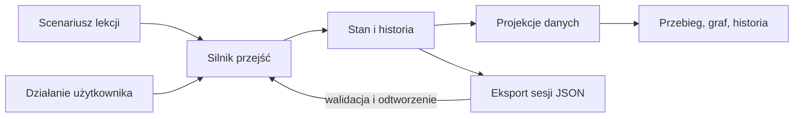

# Wykonanie techniczne symulatora

Data: 2026-10-23. Rewizja: 1. Status: propozycja techniczna do [planu realizacji](plan.md). Wykonanie i dowody: [rejestr](progress.md).

## Architektura pierwszej wersji

Proponuję lokalną aplikację: Python 3.11 lub nowszy, standardowa biblioteka, HTML, CSS, JavaScript i SVG. Jeden proces Pythona udostępni stronę i małe API na adresie loopback. Na start bez bazy danych, frameworka frontendowego, usług zewnętrznych i wywołań LLM. Mały graf lekcji można rozmieścić w stałych kolumnach według typu obiektu; nie potrzebujemy od razu biblioteki automatycznego układania grafów.

Ta konstrukcja ogranicza narzędzia potrzebne do uruchomienia i pozwala testować całą logikę niezależnie od interfejsu. Jeżeli układ SVG przestanie być czytelny dla zaakceptowanych scenariuszy, wtedy ocenimy koszt biblioteki grafowej.



## Model danych

| Obiekt | Najważniejsze informacje |
| --- | --- |
| Lekcja | ID i wersja scenariusza, cel edukacyjny, stan początkowy, dostępne zdarzenia i opisy. |
| Produkt pracy | ID, typ WP, treść lub elementy, rewizja, przykładowa ścieżka zapisu. Typ WP nie jest ID instancji. |
| Element | Stabilne ID, rodzaj, treść, rewizja, produkt zawierający element i powiązania z innymi elementami. |
| Czynność | Wejścia, wykonawca w lekcji, warunki rozpoczęcia, wytwarzane lub zmieniane produkty. |
| Wykonanie sprawdzenia | ID próby, przypadek testowy lub przegląd, wskazane rewizje wejść, wynik i oznaczenie `simulated`. |
| Decyzja w lekcji | Treść, zakres, wskazana wersja i wybrana odpowiedź. Brak działania użytkownika nie tworzy decyzji. |
| Zdarzenie | Numer kroku, typ, dane, aktor w lekcji i opis skutku. Historia zachowuje poprzednie rewizje. |

Oddzielamy gotowość specyfikacji, realizację, wynik sprawdzenia i odbiór. Nie sprowadzamy ich do jednego statusu „done”. Planowana czynność i jej wykonanie to dwa różne fakty. Jedna czynność może zmieniać kilka produktów, a jeden produkt może być rozwijany w kolejnych przyrostach.

Relację zapisujemy raz po stronie obiektu zależnego. Odwrotne powiązania i macierz wyliczamy. Powiązania z rewizją oznaczają konkretną historyczną podstawę, a powiązania tylko z ID wskazują zależność pojęciową; interfejs nie może ich utożsamiać. ID fikcyjnej lekcji są odrębne od ID prac nad symulatorem i rzeczywistego repozytorium.

## Silnik i reguły

Rdzeń: czysta funkcja `transition(state, command)`, zwracająca nowy stan ze zdarzeniem albo odmowę z identyfikatorem reguły i wyjaśnieniem. Bez odczytu Git, sieci, zegara systemowego i plików w logice przejścia. Identyfikatory zdarzeń wynikają z sekwencji, dzięki czemu ten sam początek i te same polecenia dają ten sam wynik.

Warunki przycisków korzystają z tej samej oceny reguł co przejście. API ponownie sprawdza polecenie; samo ukrycie przycisku nie jest kontrolą. Niedozwolone działanie nie może częściowo zmienić stanu. Nieznane ID, brakujące dane i nierozpoznany typ zdarzenia dają czytelną odmowę.

Pierwsze reguły do opisania w S1:

- plan przyrostu istnieje przed symulowaną implementacją; aktualizacja nie przepisuje wcześniejszego planu;
- przypadek testowy bez wykonania nie daje pozytywnego wyniku;
- wynik wskazuje konkretne rewizje; zmiana nie przepisuje historycznego wyniku;
- zmiana zależności wskazuje potrzebę oceny wpływu, a nie automatyczną porażkę wszystkich testów;
- odebranie przyrostu wymaga jawnego działania użytkownika w lekcji;
- błędny test ma ścieżkę poprawki i ponownego sprawdzenia;
- poprawny przebieg może dojść do końca; reguły nie mogą wzajemnie blokować całej lekcji.

Każda reguła ma źródło, uzasadnienie dydaktyczne i skutek: informacja, ostrzeżenie albo blokada. Nie przenosimy automatycznie propozycji symulatora do szablonu. W5 pozostaje ostrzeżeniem w rzeczywistym pakiecie.

## Interfejs i zapis sesji

Przebieg pokazuje tylko istotne teraz czynności. Graf podświetla sąsiadów wybranego elementu, a karta pokazuje jego treść, rewizję, powiązania i źródło reguły. Historia wyjaśnia różnicę między stanem przed i po kroku. Obok koloru zawsze znajduje się tekst, np. „zaplanowano”, „brak wykonania”, „wynik dla poprzedniej wersji”.

Proponowane operacje API: odczyt stanu i projekcji, wykonanie polecenia, eksport oraz import sesji. Backend jest jedynym miejscem oceny reguł; JavaScript renderuje wynik i przekazuje wybór użytkownika.

Cofnięcie ustawia kursor historii i odtwarza stan na wybranym kroku. Nowe działanie z wcześniejszego kroku tworzy oddzielną gałąź ćwiczenia, zachowując poprzednią. Nie będziemy budować ogólnego systemu zdarzeń: wystarczy lista zdarzeń, identyfikator gałęzi i funkcja odtworzenia.

Eksport JSON zawiera wersję formatu, identyfikator i wersję lekcji, zdarzenia oraz pozycję odtwarzania. Użytkownik zapisuje go lokalnie przez przeglądarkę. Import odtwarza historię przez silnik; nie ufa zapisanym pochodnym statusom. Nieobsługiwana wersja lub uszkodzone dane dają błąd bez zastąpienia bieżącej sesji. Restart bez eksportu może utracić ćwiczenie — interfejs ma to jasno komunikować. Automatyczny zapis dodamy tylko wtedy, gdy próba wykaże potrzebę.

Wszystkie wyniki ćwiczenia mają trwałe oznaczenie symulacji, także po eksporcie. W pierwszej wersji nie wykonujemy kodu z importu, nie uruchamiamy poleceń shell i nie zapisujemy stanu fikcyjnej lekcji do dokumentów projektu.

## Proponowany układ przyszłego kodu

Kod powstanie dopiero podczas realizacji; poniższe nazwy są planem, nie istniejącymi plikami.

```text
reference/process-simulator/
  plan.md
  technical-plan.md
  progress.md
  app/
    model.py          # typy i walidacja danych
    engine.py         # przejścia, reguły i odtwarzanie
    projections.py    # dane wspólne dla widoków
    server.py         # lokalne HTTP i adapter JSON
    static/           # HTML, CSS, JavaScript i SVG
  lessons/            # wersjonowane scenariusze i treści produktów
  tests/              # testy silnika, zapisu i API
  evidence/           # rzeczywiste logi testów symulatora
  formal/             # tylko jeżeli uruchomimy S5
```

Testy rdzenia planuję w `unittest`, bez dodatkowej instalacji pakietów. Polecenie startowe i instrukcję zapiszemy po sprawdzeniu działającego uruchomienia; nie przedstawiamy przyszłego polecenia jako obecnie działającego.

## Sprawdzenie implementacji

1. W S1 zapisujemy oczekiwane wyniki kroków niezależnie od kodu silnika.
2. W S2 dla reguły najpierw zapisujemy test i rzeczywisty RED, następnie minimalną implementację i GREEN. Log wskazuje polecenie, środowisko, zakres i ograniczenia sprawdzenia.
3. Sprawdzamy poprawny przebieg, brak planu, test niewykonany, test fail, spóźniony wynik starej rewizji, brak decyzji, zmianę i powrót do pracy.
4. Sprawdzamy deterministyczne odtworzenie, cofnięcie i gałąź, eksport/import, uszkodzony zapis i zgodność wersji lekcji. Odmowa pozostawia stan bez zmian.
5. Usuwamy kontrolnie ochronę przed użyciem starego wyniku; test ma wykryć naruszenie. Przywracamy ochronę. Zapisujemy zakres tej próby, bez deklaracji pokrycia wszystkich błędów.
6. W S3 przechodzimy scenariusz w przeglądarce i porównujemy karty, graf, historię i stan API. Zapisujemy wynik próby i zrzuty pokazujące istotne stany. Rozstrzygamy też, czy graf jest czytelny bez objaśniania przez autora.
7. S4 sprawdza zrozumienie operatora. Zielone testy silnika nie zastępują tej oceny.

## Miejsce metod formalnych

S5 uruchamiamy, jeżeli pojawią się niejasne interakcje reguł lub scenariusze trudne do ręcznego prześledzenia. Wybieramy jedno narzędzie dla konkretnego pytania: Alloy dla relacji i małych przykładów; TLA+/TLC dla kolejności zdarzeń i aktualności wyników. Alloy 6 również potrafi modelować zmiany w czasie; podział jest wyborem roboczym, nie ograniczeniem języka.

Model ma zawierać poprawny przebieg i celowo wadliwy wariant. Raport zapisze własności, założenia, konfigurację, rozmiar modelu, status ukończenia i kontrprzykład. Kontrprzykład zamienimy na test silnika. Nie będziemy utrzymywać dwóch pełnych modeli procesu ani uznawać zgodności modelu i kodu za dowód poprawności potrzeb użytkownika.

Źródła technik: [primer lokalny](../FORMAL-MODELS-REQUIREMENTS-AND-PROCESS.md), [Alloy 6](https://alloytools.org/alloy6.html), [TLC i graf stanów](https://docs.tlapl.us/using%3Agenerating_state_graphs). Są podstawą propozycji, nie wynikiem wykonanego eksperymentu.
