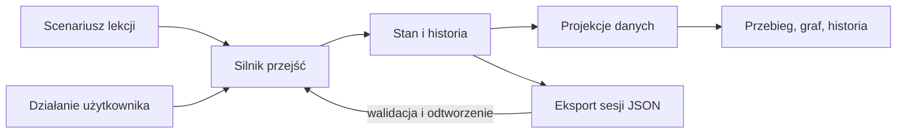

# Wykonanie techniczne symulatora

Utworzono: 2026-10-23. Rewizja: 2, 2026-10-24. Dobór techniczny agenta dla zatwierdzonego [I1](increment-01.md), w ramach [planu realizacji](plan.md). Wykonanie i decyzje agenta: [rejestr](progress.md). Szersze funkcje pierwszej wersji, np. gałęzie historii, pozostają poza I1.

## Wiedza wykorzystana przy projektowaniu

| Obszar wiedzy | Zastosowanie w I1 | Jak sprawdzimy, czy zastosowanie jest poprawne |
| --- | --- | --- |
| Inżynieria wymagań i ISO 29110 | Rozdzielenie czynności, produktów pracy, elementów, ID, rewizji, wykonania i odbioru. Każda reguła lekcji ma źródło lub oznaczenie lokalnej adaptacji. | Przejście przez przykład i kontrprzykład, porównanie treści z lokalną normą i lekcją TextStats. |
| Systemy przejść i symulacja zdarzeń | Zdarzenie zmienia stan, gdy spełnione są warunki; odtwarzanie tej samej sekwencji daje ten sam wynik. Bez sztucznej estymacji czasu pracy. | Ręcznie określony przebieg, odmowy, poprawka po błędzie i test deterministycznego odtworzenia. |
| Modelowanie grafów | Rozdzielenie grafu czynności, grafu produktów i grafu osiągalnych stanów. Widok zależności powstaje z relacji, a nie z kolejności ekranów. | Zgodność identyfikatorów, brak wiszących odwołań, zgodność grafu i kart; nie zakładamy, że każdy graf jest acykliczny, bo proces ma pętle poprawek. |
| Projektowanie modułowe i funkcyjne | Czyste przejścia, jawne dane wejściowe i adaptery HTTP/zapisu; małe rekordy danych zamiast hierarchii klas. | Test silnika bez uruchamiania serwera; brak współdzielonych mutowalnych danych między rewizjami. |
| Projektowanie interakcji i nauczanie przez działanie | Stopniowe odsłanianie grafu, treść produktu po kliknięciu, wyjaśnienie warunku przycisku, tekst obok koloru. | Próba klawiaturą i w przeglądarce oraz obserwacja, czy operator potrafi wyjaśnić skutek kroku bez podpowiedzi. |
| TDD i testowanie stanowe | Sprawdzamy następstwa sekwencji, historię i niezmienniki, a nie tylko pojedyncze funkcje. | RED/GREEN, znane błędne sekwencje, kontrolowana mutacja ochrony, test API i osobna próba edukacyjna. |

Model symulacyjny jest ograniczonym modelem procesu. Testy nie potwierdzą, że wybraliśmy właściwe znaczenie reguł normy ani że wyjaśnienia są zrozumiałe; te dwie kwestie wymagają przeglądu treści i próby operatora.

## Kryteria doboru stosu

Wybieram technologie według pięciu kryteriów: obsługa wymaganych zachowań, koszt uruchomienia na obecnym komputerze, możliwość testowania rdzenia osobno, koszt utrzymania i łatwość wymiany adaptera. Mała liczba zależności jest środkiem ograniczenia obsługi, a nie celem usprawiedliwiającym pisanie własnego frameworka.

Sprawdzono lokalnie: `python3 --version` daje Python 3.14.6, interpreter jest w `/opt/homebrew/bin/python3`. To środowisko pierwszej próby. Kod planujemy w zakresie składni Python 3.11+, ale obsługę innych wersji potwierdzimy dopiero rzeczywistymi przebiegami. Nie instalowano ani nie aktualizowano narzędzi.

| Warstwa | Wybór agenta | Powód i koszt | Kiedy wrócić do wyboru |
| --- | --- | --- | --- |
| Rdzeń symulacji | Python, funkcje, `dataclasses`, `Enum` | Czytelne obiekty domeny i mała liczba jawnych przejść. Koszt: własne reguły dziedziny i ich testy. | Gdy pojawi się rzeczywista potrzeba planowania zdarzeń w czasie i współdzielonych zasobów. |
| Lokalny transport | `http.server.ThreadingHTTPServer` i wąski handler, tylko loopback | Dostępne bez instalacji; niewielka liczba tras. Koszt: jawna walidacja JSON, błędy i testy kontraktu HTTP. | Dostęp zdalny, wielu użytkowników lub rosnąca infrastruktura HTTP uzasadnią framework i osobny zakres wdrożenia. |
| Interfejs | HTML, CSS Grid, moduły JavaScript, Fetch API | Jeden ekran i trzy projekcje; brak kompilacji frontendowej. Koszt: małe funkcje renderujące i obsługa zdarzeń. | Gdy powstanie wiele niezależnych ekranów i powtarzalnych złożonych komponentów. |
| Graf | SVG z deterministycznym rozmieszczeniem według typu obiektu | Mały graf, czytelne etykiety i klikalne elementy; łatwo sprawdzić relacje. Koszt: prosty układ i obsługa klawiatury. | Jeśli zaakceptowane lekcje przestaną być czytelne przy tym układzie, ocenić bibliotekę grafową. |
| Lekcja i zapis | Wersjonowany JSON, standardowy moduł `json`; historia w pamięci, eksport/import | Dane można obejrzeć, odtworzyć i porównać. Koszt: walidacja formatu, referencji i wersji lekcji. | Współdzielenie sesji albo duża trwała historia uzasadnią bazę; potrzeba automatycznego zapisu osobną zmianę zakresu. |
| Testy | `unittest`, lokalne testy HTTP, próba przeglądarkowa | Istniejące narzędzia wystarczą do testów sekwencji i adapterów. Koszt: utrzymywanie przypadków z niezależnym oczekiwaniem. | Generator wielu sekwencji może później uzasadnić Hypothesis; nie jest warunkiem startu. |

`dataclasses` opisują strukturę, ale adnotacje typów nie walidują danych z JSON. Walidacja wejścia pozostaje jawna. `frozen=True` nie zamraża zawartości zagnieżdżonej listy: historyczne rekordy będą używać niemutowalnych kolekcji lub oddzielnych kopii przy przejściu. [Dokumentacja dataclasses](https://docs.python.org/3.14/library/dataclasses.html).

Wybór serwera wątkowego dotyczy obsługi połączeń przeglądarki, nie równoległego wykonywania procesu. Dostęp do bieżącej sesji będzie serializowany w adapterze: odczyt podstawy, sprawdzenie polecenia i podmiana stanu tworzą jedną operację. To chroni przed nakładającymi się żądaniami bez wprowadzania współbieżności do silnika. Dokumentacja opisuje problem wstępnie otwieranych połączeń przeglądarki dla zwykłego HTTPServer; zaznacza też, że moduł nie jest serwerem produkcyjnym. W I1 używamy go wyłącznie lokalnie. [Dokumentacja http.server](https://docs.python.org/3.14/library/http.server.html).

## Narzędzia niewymagane w I1

SimPy wspiera procesy zdarzeniowe i ograniczone współdzielone zasoby. Nasz I1 nie bada kolejek, czasu realizacji ani przepustowości: uczy kolejności i skutków czynności. Dlatego własna mała relacja przejścia jest wystarczająca; nie tworzymy przy tym własnego odpowiednika SimPy. [Dokumentacja SimPy](https://simpy.readthedocs.io/en/latest/).

Alloy/TLC pozostają narzędziami opcjonalnego S5. React, FastAPI i SQLite nie są odrzucone jako złe technologie; obecny rozmiar interfejsu, lokalne uruchomienie i eksport sesji nie uzasadniają jeszcze ich kosztu. Mermaid pozostaje notacją diagramów w dokumentacji, natomiast interaktywny graf aplikacji powstanie w SVG. LLM nie będzie wybierał wyników lekcji w czasie działania: symulator ma być odtwarzalny, a agent pomaga przygotować i sprawdzić jego kod oraz treści.

## Granice odpowiedzialności implementacji

`model` definiuje pojęcia, `engine` przejścia i przyczyny odmów, `projections` wylicza dane widoków, a `server` obsługuje HTTP i dostęp do sesji. Dane lekcji zawierają treść i jawne warianty, nie kod do wykonania. Przeglądarka przechowuje wybór elementu i ustawienia widoku, ale nie drugi model reguł.

Pierwszy test będzie dotyczył zachowania, np. „przypadek testowy istnieje, lecz przed wykonaniem nie ma wyniku”. Potem dojdą próba bez wymaganej podstawy, poprawka, zachowanie historii i brak automatycznego odbioru. Dopiero po RED i minimalnym GREEN połączymy ten przekrój z ekranem. Nie budujemy najpierw kompletnej infrastruktury, aby dopiero na końcu zobaczyć lekcję.

Źródła mechanizmów interfejsu i testów: [SVG](https://developer.mozilla.org/en-US/docs/Web/SVG), [Fetch API](https://developer.mozilla.org/en-US/docs/Web/API/Fetch_API), [unittest](https://docs.python.org/3.14/library/unittest.html). Wybór tych mechanizmów dla I1 jest decyzją projektową agenta, nie zaleceniem normy.

## Architektura pierwszej wersji

Proponuję lokalną aplikację: Python 3.11 lub nowszy, standardowa biblioteka, HTML, CSS, JavaScript i SVG. Jeden proces Pythona udostępni stronę i małe API na adresie loopback. Na start bez bazy danych, frameworka frontendowego, usług zewnętrznych i wywołań LLM. Mały graf lekcji można rozmieścić w stałych kolumnach według typu obiektu; nie potrzebujemy od razu biblioteki automatycznego układania grafów.

Ta konstrukcja ogranicza narzędzia potrzebne do uruchomienia i pozwala testować całą logikę niezależnie od interfejsu. Jeżeli układ SVG przestanie być czytelny dla zaakceptowanych scenariuszy, wtedy ocenimy koszt biblioteki grafowej.



## Model danych

| Obiekt | Najważniejsze informacje |
| --- | --- |
| Lekcja | ID i wersja scenariusza, cel edukacyjny, stan początkowy, dostępne zdarzenia i opisy. |
| Produkt pracy | ID, typ WP, treść lub elementy, rewizja, przykładowa ścieżka zapisu. Typ WP nie jest ID instancji. |
| Element | Stabilne ID, rodzaj, treść, rewizja, produkt zawierający element i powiązania z innymi elementami. |
| Czynność | Wejścia, wykonawca w lekcji, warunki rozpoczęcia, wytwarzane lub zmieniane produkty. |
| Wykonanie sprawdzenia | ID próby, przypadek testowy lub przegląd, wskazane rewizje wejść, wynik i oznaczenie `simulated`. |
| Decyzja w lekcji | Treść, zakres, wskazana wersja i wybrana odpowiedź. Brak działania użytkownika nie tworzy decyzji. |
| Zdarzenie | Numer kroku, typ, dane, aktor w lekcji i opis skutku. Historia zachowuje poprzednie rewizje. |

Oddzielamy gotowość specyfikacji, realizację, wynik sprawdzenia i odbiór. Nie sprowadzamy ich do jednego statusu „done”. Planowana czynność i jej wykonanie to dwa różne fakty. Jedna czynność może zmieniać kilka produktów, a jeden produkt może być rozwijany w kolejnych przyrostach.

Relację zapisujemy raz po stronie obiektu zależnego. Odwrotne powiązania i macierz wyliczamy. Powiązania z rewizją oznaczają konkretną historyczną podstawę, a powiązania tylko z ID wskazują zależność pojęciową; interfejs nie może ich utożsamiać. ID fikcyjnej lekcji są odrębne od ID prac nad symulatorem i rzeczywistego repozytorium.

## Silnik i reguły

Rdzeń: czysta funkcja `transition(state, command)`, zwracająca nowy stan ze zdarzeniem albo odmowę z identyfikatorem reguły i wyjaśnieniem. Bez odczytu Git, sieci, zegara systemowego i plików w logice przejścia. Identyfikatory zdarzeń wynikają z sekwencji, dzięki czemu ten sam początek i te same polecenia dają ten sam wynik.

Warunki przycisków korzystają z tej samej oceny reguł co przejście. API ponownie sprawdza polecenie; samo ukrycie przycisku nie jest kontrolą. Niedozwolone działanie nie może częściowo zmienić stanu. Nieznane ID, brakujące dane i nierozpoznany typ zdarzenia dają czytelną odmowę.

Pierwsze reguły do opisania w S1:

- plan przyrostu istnieje przed symulowaną implementacją; aktualizacja nie przepisuje wcześniejszego planu;
- przypadek testowy bez wykonania nie daje pozytywnego wyniku;
- wynik wskazuje konkretne rewizje; zmiana nie przepisuje historycznego wyniku;
- zmiana zależności wskazuje potrzebę oceny wpływu, a nie automatyczną porażkę wszystkich testów;
- odebranie przyrostu wymaga jawnego działania użytkownika w lekcji;
- błędny test ma ścieżkę poprawki i ponownego sprawdzenia;
- poprawny przebieg może dojść do końca; reguły nie mogą wzajemnie blokować całej lekcji.

Każda reguła ma źródło, uzasadnienie dydaktyczne i skutek: informacja, ostrzeżenie albo blokada. Nie przenosimy automatycznie propozycji symulatora do szablonu. W5 pozostaje ostrzeżeniem w rzeczywistym pakiecie.

## Interfejs i zapis sesji

Przebieg pokazuje tylko istotne teraz czynności. Graf podświetla sąsiadów wybranego elementu, a karta pokazuje jego treść, rewizję, powiązania i źródło reguły. Historia wyjaśnia różnicę między stanem przed i po kroku. Obok koloru zawsze znajduje się tekst, np. „zaplanowano”, „brak wykonania”, „wynik dla poprzedniej wersji”.

Proponowane operacje API: odczyt stanu i projekcji, wykonanie polecenia, eksport oraz import sesji. Backend jest jedynym miejscem oceny reguł; JavaScript renderuje wynik i przekazuje wybór użytkownika.

Cofnięcie ustawia kursor historii i odtwarza stan na wybranym kroku. Nowe działanie z wcześniejszego kroku tworzy oddzielną gałąź ćwiczenia, zachowując poprzednią. Nie będziemy budować ogólnego systemu zdarzeń: wystarczy lista zdarzeń, identyfikator gałęzi i funkcja odtworzenia.

Eksport JSON zawiera wersję formatu, identyfikator i wersję lekcji, zdarzenia oraz pozycję odtwarzania. Użytkownik zapisuje go lokalnie przez przeglądarkę. Import odtwarza historię przez silnik; nie ufa zapisanym pochodnym statusom. Nieobsługiwana wersja lub uszkodzone dane dają błąd bez zastąpienia bieżącej sesji. Restart bez eksportu może utracić ćwiczenie — interfejs ma to jasno komunikować. Automatyczny zapis dodamy tylko wtedy, gdy próba wykaże potrzebę.

Wszystkie wyniki ćwiczenia mają trwałe oznaczenie symulacji, także po eksporcie. W pierwszej wersji nie wykonujemy kodu z importu, nie uruchamiamy poleceń shell i nie zapisujemy stanu fikcyjnej lekcji do dokumentów projektu.

## Proponowany układ przyszłego kodu

Kod powstanie dopiero podczas realizacji; poniższe nazwy są planem, nie istniejącymi plikami.

```text
reference/process-simulator/
  plan.md
  technical-plan.md
  progress.md
  app/
    model.py          # typy i walidacja danych
    engine.py         # przejścia, reguły i odtwarzanie
    projections.py    # dane wspólne dla widoków
    server.py         # lokalne HTTP i adapter JSON
    static/           # HTML, CSS, JavaScript i SVG
  lessons/            # wersjonowane scenariusze i treści produktów
  tests/              # testy silnika, zapisu i API
  evidence/           # rzeczywiste logi testów symulatora
  formal/             # tylko jeżeli uruchomimy S5
```

Testy rdzenia planuję w `unittest`, bez dodatkowej instalacji pakietów. Polecenie startowe i instrukcję zapiszemy po sprawdzeniu działającego uruchomienia; nie przedstawiamy przyszłego polecenia jako obecnie działającego.

## Sprawdzenie implementacji

1. W S1 zapisujemy oczekiwane wyniki kroków niezależnie od kodu silnika.
2. W S2 dla reguły najpierw zapisujemy test i rzeczywisty RED, następnie minimalną implementację i GREEN. Log wskazuje polecenie, środowisko, zakres i ograniczenia sprawdzenia.
3. Sprawdzamy poprawny przebieg, brak planu, test niewykonany, test fail, spóźniony wynik starej rewizji, brak decyzji, zmianę i powrót do pracy.
4. Sprawdzamy deterministyczne odtworzenie, cofnięcie i gałąź, eksport/import, uszkodzony zapis i zgodność wersji lekcji. Odmowa pozostawia stan bez zmian.
5. Usuwamy kontrolnie ochronę przed użyciem starego wyniku; test ma wykryć naruszenie. Przywracamy ochronę. Zapisujemy zakres tej próby, bez deklaracji pokrycia wszystkich błędów.
6. W S3 przechodzimy scenariusz w przeglądarce i porównujemy karty, graf, historię i stan API. Zapisujemy wynik próby i zrzuty pokazujące istotne stany. Rozstrzygamy też, czy graf jest czytelny bez objaśniania przez autora.
7. S4 sprawdza zrozumienie operatora. Zielone testy silnika nie zastępują tej oceny.

## Miejsce metod formalnych

S5 uruchamiamy, jeżeli pojawią się niejasne interakcje reguł lub scenariusze trudne do ręcznego prześledzenia. Wybieramy jedno narzędzie dla konkretnego pytania: Alloy dla relacji i małych przykładów; TLA+/TLC dla kolejności zdarzeń i aktualności wyników. Alloy 6 również potrafi modelować zmiany w czasie; podział jest wyborem roboczym, nie ograniczeniem języka.

Model ma zawierać poprawny przebieg i celowo wadliwy wariant. Raport zapisze własności, założenia, konfigurację, rozmiar modelu, status ukończenia i kontrprzykład. Kontrprzykład zamienimy na test silnika. Nie będziemy utrzymywać dwóch pełnych modeli procesu ani uznawać zgodności modelu i kodu za dowód poprawności potrzeb użytkownika.

Źródła technik: [primer lokalny](../FORMAL-MODELS-REQUIREMENTS-AND-PROCESS.md), [Alloy 6](https://alloytools.org/alloy6.html), [TLC i graf stanów](https://docs.tlapl.us/using%3Agenerating_state_graphs). Są podstawą propozycji, nie wynikiem wykonanego eksperymentu.

## Zrealizowany przekrój I1 — 2026-10-24

Instrukcja i uruchomienie: [README](README.md). Reguły przed implementacją: [scenario.md](scenario.md). Wykonanie i wyniki: [progress.md](progress.md), [evidence/README.md](evidence/README.md).

- `app/model.py`: niemutowalne rekordy; `app/lesson.py`: odczyt danych przy inicjalizacji, poza przejściami; `lessons/textstats-i1.json`: treści lekcji w wersji 1.
- `app/engine.py`: jawne warunki i przejścia; `app/session.py`: replay, wersjonowany eksport oraz walidacja importu; `app/projections.py`: karty, ślad odwrotny, graf grupowany po pliku i historia.
- `app/server.py`: jedna sesja w pamięci, blokada i licznik wersji widoku; lokalny HTTP i stała lista plików statycznych. Ograniczenie Host/Origin jest higieną lokalnego transportu, nie kontrolą tożsamości lub rzeczywistych zgód.
- `app/static/`: HTML, CSS, moduł JS i SVG. Stan domeny pozostaje na serwerze; wybór karty w przeglądarce. Granice: 200 poleceń, 2000 znaków notatki, HTTP do 2 MiB; poprawny eksport z aplikacji mieści się w limicie importu.
- `tests/`: rzeczywiste unittest, w tym loopback HTTP. `tools/reproduce-tdd.py`: pierwszy szkielet RED i kontrolowana mutacja w kopii. `tools/browser-check.mjs`: dodatkowy test Chrome z użyciem Node i jego wbudowanych modułów, bez pakietów; nie jest zależnością runtime.

Odstępstwo od zamierzonego przebiegu S2/S3: po pierwszym GREEN rozszerzono testy i silnik o całą lekcję oraz replay, a dopiero potem połączono ekran. Przyczyna: te same reguły definiują warunki wszystkich trzech widoków; rozszerzenie rdzenia pozostało jednym małym scenariuszem. Zakres I1 ani kolejność celów nie uległy zmianie. Próba użyteczności z człowiekiem pozostaje osobnym S4.
